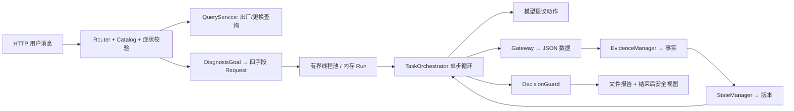

# DeviceTruth V0.2 → V1.0 差距审查

> 2026-11-08｜代码 HEAD：b7befa0｜需求基准：V1.0-Draft.1 PostgreSQL 设计
> 结论基于当前源码与本轮离线测试；历史现状报告不是实现证据替代品。

## 1. 当前真实状态

已有的是**受控、可回归的模拟诊断 Runtime 与 HTTP 演示服务**。模型在一次运行内可以选择工具顺序，程序负责执行、证据重建和结案保护，因此不能说“完全是脚本”；但产品入口、动作协议、结果与终止规则仍绑定固定模拟诊断。没有故障码的充电问题不能按新版故事开展调查，普通手册知识也没有检索通道。

共识别 63 项需求：已实现 4、部分实现 28、未实现 25、与设计冲突 6。条目粒度不同，不能解释成“已完成 6%”或据此估算工期。现有 145 项测试保护旧行为，不代表新版已接近完成。

## 2. 现在怎样运行：以 CAR-B 通信超时为例

1. CLI 的 DeviceTruthApplication.execute 从 scenarios.json 选 B，读取 JSON fixture 和规则，手工装配 Gateway、Reasoner、EvidenceManager、DecisionGuard，再调用 TaskOrchestrator.run。
2. HTTP 的 ConversationController.message 把 content/assetId 交给 ConversationFlowService.handle。默认 offline Router 先认资产、通信超时别名与规则；新模型 Router 即使分类成功也要过相同程序白名单。
3. DiagnosisApplicationService.map 保留原文到 DiagnosisGoal，但 toRequest 转成 assetId/domain/symptomCode/asOf，原始用户问题没有继续传入 Core。
4. DiagnosisRunService.submit 登记内存 RunSnapshot，交有界线程池；POST 返回 202/QUEUED，GET 才读真实执行结果。
5. TaskOrchestrator.run 内新建 StateManager。每轮 Reasoner.propose 提一个动作；CALL_CAPABILITY 经 CapabilityGateway 校验后读 JSON；EvidenceManager 分析来源与时间、重建事实；StateManager 提交版本。
6. ProposeDecision 经过 DecisionGuard 检查规则、引用、当前证据和调查完整性；RequestInformation 则直接结束为 NEED_EVIDENCE，没有等待与继续运行的接口。
7. RunReportWriter 写四份文件；RunEventViews / SafePublicFields 对 HTTP 结果做白名单映射。static/index.html 轮询结果与最终事件，没有 SSE。

新故事“充电中断，没有故障码”会在入口被拦下（RouteValidator 中明确有“充电”拒绝词）；仅换模型供应商不能解除这条限制。即使移除拒绝词，四字段 Request、ID 型工具参数、固定 Guard 与无恢复状态仍不满足产品目标，需贯通改造。

## 3. 证据索引

下表 E 编号供 REQUIREMENTS 引用。每个“已实现”行均有文件/方法依据；“未实现”以依赖清单、全部源码/目录扫描和现存 API 的边界为依据，不从文件名猜能力。

| 编号 | 文件/接口依据 | 直接支持的事实 |
|---|---|---|
| E01 | [pom.xml](../pom.xml)；[AgentScopeStep.java](../src/main/java/io/devicetruth/adapter/AgentScopeStep.java) complete；[application.properties](../src/main/resources/application.properties) | Java21/Boot3.5.16/AgentScope2.0.4；SDK 单步 JSON；有 Web/Actuator，无 DB/解析/向量依赖 |
| E02 | [DeviceTruthApplication.java](../src/main/java/io/devicetruth/app/DeviceTruthApplication.java) execute；[AcceptanceTest.java](../src/test/java/io/devicetruth/core/AcceptanceTest.java) casesABCDProduceEvidenceConstrainedOutcomes / caseEUnknownToolAndForgedEvidenceNeverResolve | CLI A–D 与 E 负例有实现和测试 |
| E03 | [RouteValidator.java](../src/main/java/io/devicetruth/application/RouteValidator.java) resolveAsset / validateSuggestion / UNSUPPORTED_SYMPTOM_WORDS；[DiagnosisApplicationService.java](../src/main/java/io/devicetruth/application/DiagnosisApplicationService.java) map | 资产、症状、规则是诊断准入；“充电”等被拒绝 |
| E04 | [DiagnosisGoal.java](../src/main/java/io/devicetruth/application/DiagnosisGoal.java) toRequest；[Models.java](../src/main/java/io/devicetruth/core/contract/Models.java) DiagnosisRequest | 原始问题留应用层，Core 只有四字段输入 |
| E05 | [ConversationController.java](../src/main/java/io/devicetruth/api/ConversationController.java) 全部 Mapping；[ApiDtos.java](../src/main/java/io/devicetruth/api/ApiDtos.java) MessageRequest / SourceView | 只有 sessions、diagnoses、health；无上传/新资源/SSE，引用无文档定位 |
| E06 | [QueryService.java](../src/main/java/io/devicetruth/application/QueryService.java) query/profile/history；[ConversationFlowService.java](../src/main/java/io/devicetruth/application/ConversationFlowService.java) handle | QUERY 是两类固定只读查询，与 Agent 工具循环分流 |
| E07 | [TaskOrchestrator.java](../src/main/java/io/devicetruth/core/runtime/TaskOrchestrator.java) run，尤其 41/135 行附近 | 单步循环、预算、技术失败、追问即终局 |
| E08 | [ActionProposal.java](../src/main/java/io/devicetruth/core/reasoning/ActionProposal.java) 五个 record；[Reasoner.java](../src/main/java/io/devicetruth/core/reasoning/Reasoner.java) Context | 无通用 ANSWER，CALL 参数是字符串 Map；上下文绑定 DiagnosisState |
| E09 | [ConversationService.java](../src/main/java/io/devicetruth/application/ConversationService.java) sessions；[DiagnosisRunService.java](../src/main/java/io/devicetruth/application/DiagnosisRunService.java) submit/execute/require；[ExecutionStatus.java](../src/main/java/io/devicetruth/application/ExecutionStatus.java) | 内存会话/运行、有界执行；无 WAITING/CANCELLED/重启恢复；session 归属非真实认证 |
| E10 | [DecisionGuard.java](../src/main/java/io/devicetruth/core/decision/DecisionGuard.java) evaluate/investigationNeeds；[Models.java](../src/main/java/io/devicetruth/core/contract/Models.java) Rule/Outcome | 旧规则结案、全资产调查前提、SIMULATION_ONLY |
| E11 | [StateManager.java](../src/main/java/io/devicetruth/core/state/StateManager.java) commit；[DiagnosisState.java](../src/main/java/io/devicetruth/core/state/DiagnosisState.java) | 乐观版本、不可改写旧证据，但不是数据库持久状态 |
| E12 | [SafePublicFields.java](../src/main/java/io/devicetruth/application/SafePublicFields.java)；[RunEventViews.java](../src/main/java/io/devicetruth/application/RunEventViews.java) of/view | 派生字段与最终事件白名单；普通未采纳规则回答/追问内容被隐藏 |
| E13 | [JsonRepositories.java](../src/main/java/io/devicetruth/adapter/JsonRepositories.java) fromClasspath/profile/history；[Repositories.java](../src/main/java/io/devicetruth/core/capability/Repositories.java)；[scenarios.json](../datasets/scenarios.json)；[rules.json](../skills/automotive-demo/rules.json) | 4 资产 JSON、2 规则，非数据库、非 SKILL.md、非文档 RAG |
| E14 | [Models.java](../src/main/java/io/devicetruth/core/contract/Models.java) EvidenceRecord.validAt；[EvidenceManager.java](../src/main/java/io/devicetruth/core/evidence/EvidenceManager.java) analyze/effectiveEnd/invalidateDependencies | 时间/来源/归属/冲突/依赖失效已有，但语义限现有证据 |
| E15 | [ExtensibilityTest.java](../src/test/java/io/devicetruth/core/ExtensibilityTest.java) industrialDomainUsesDifferentSubjectsPredicatesValuesAndSetMembershipWithoutCoreChanges | 假工业域契约测试存在，不等于 SC-0245-B 产品已实现 |
| E16 | [RunReportWriter.java](../src/main/java/io/devicetruth/adapter/RunReportWriter.java) write | 文件结果导出；无知识文件/上传管理 |
| E17 | [CapabilityGateway.java](../src/main/java/io/devicetruth/core/capability/CapabilityGateway.java) execute/descriptor/standard；[CapabilityTypes.java](../src/main/java/io/devicetruth/core/capability/CapabilityTypes.java) | 5 只读工具；所有参数按 ID 校验；未支持中文 query / 嵌套 filters / 新工具 |
| E18 | [StructuredReasoner.java](../src/main/java/io/devicetruth/adapter/StructuredReasoner.java) PROTOCOL/propose；[OpenAiReasoner.java](../src/main/java/io/devicetruth/adapter/OpenAiReasoner.java)；[QwenReasoner.java](../src/main/java/io/devicetruth/adapter/QwenReasoner.java) | 真模型适配、数据不可信提示、严格解析和有限纠正；非 RAG Agent |
| E19 | [ModelConfiguration.java](../src/main/java/io/devicetruth/adapter/ModelConfiguration.java) apply；[.gitignore](../.gitignore) | 私有文件优先/环境补缺是当前行为；未读取私有文件值 |
| E20 | [static/index.html](../src/main/resources/static/index.html) fetch/轮询；[ServerConfiguration.java](../src/main/java/io/devicetruth/server/ServerConfiguration.java) | 原生 JS 页面和手工服务装配，未使用 Vue/TS |
| E21 | [VALIDATION.md](VALIDATION.md)；[baseline.json](evidence/baseline.json)；src/test/java 全部 28 类 | 本轮离线 145/0/0/0；新产品链路未验证 |
| E22 | [V0.1 state.md](../docs/DeviceTruth_Core_V0.1_Spec_Pack/state.md) 2026-11-05 两次真实兼容服务 B 记录；[S1_ACCEPTANCE_REPORT.md](../docs/DeviceTruth_V0.2_S0_S1/S1_ACCEPTANCE_REPORT.md) | 旧在线记录为历史证据，本轮未重跑，不能声称新入口或完整 Router 已通过 |

## 4. 模块怎样复用

| 模块 | 处理 | 需要改变的原因 / 可保留部分 |
|---|---|---|
| DeviceTruthApplication / CLI / JSON fixtures | 保留回归入口 | 旧场景是安全基线；引 DB 不能让 scripted CLI 启动依赖 PG |
| AgentScopeStep / QwenReasoner / OpenAiReasoner | 复用供应商连接和错误处理，重建通用动作上下文适配 | 当前协议没自由问题/ANSWER/RAG，不能把改 Prompt 当全部改造 |
| TaskOrchestrator / Reasoner / ActionProposal | 小范围原型选定后演进 | 状态、工具返回与终止协议需要通用化；不长期维护两套主循环 |
| CapabilityGateway / Descriptor / ToolError | 复用注册/只读/拒绝思想，扩展强类型参数与 ToolContext | ID 正则不能校验自然语言 query；DiagnosisRequest scope 不适用于无资产知识问答 |
| EvidenceManager / DecisionGuard | 复用证据保护，隔离 legacy 规则，新增引用与风险策略 | 知识片段不是资产现场事实；低风险问答不应先读全部维修史 |
| StateManager / DiagnosisState | 复用版本控制与不可变历史约束，新增持久检查点边界 | synchronized 内存版本不是数据库事务；恢复不可依赖局部对象 |
| ConversationService / ConversationSession | 提取持久存储与事务边界，保留成对写入和容量行为 | 用 DB 事务保证消息/任务原子，不把全局锁移植成跨网络调用锁 |
| ConversationFlowService / TaskRouter / RouteValidator / Catalog | 新入口移除固定场景准入；旧路径保留适配 | 可选意图识别不负责限制所有设备问题，避免重复模型分类成本 |
| DiagnosisRunService / ReasonerFactory | 复用有界执行和每任务模型实例；增加持久调度/取消/恢复 | 内存 Map 不能当权威存储，QUEUED 已提交而线程拒绝须可回收 |
| QueryService / Repositories | 复用结构化查询与来源约束，新增 PG 数据访问 | 只查 FACTORY/REPLACEMENT 不等于完整设备身份/配置 API |
| RunReportWriter / RunEventViews / SafePublicFields | 保留文件导出与安全映射策略，新建用户可读通用 DTO | 不能把旧字段全部放开，也不能隐藏所有合法追问/答案 |
| static/index.html | 作为旧演示保留，新增早期 Vue 产品页 | 当前不是 Vue；避免在同页无结构堆成最终工作台 |
| 新增范围 | PG/Flyway、文件/知识导入、embedding/混合检索、Skill 加载、Vue/SSE | 全部是新版真实缺口，沿现有单体分包增加，不拆微服务 |

候选新增包为 adapter/persistence、application/agent、core/agent（最终按 Runtime ADR 收敛）、knowledge、skill；这是文件组织建议，不要求先创建空模块。各 PLAN 列出的新类名均为拟定，不声称现在存在。

## 5. 数据库与迁移影响

| 批次 | 表 / 数据 | 关键约束与影响 |
|---|---|---|
| M0 | conversation、conversation_message、agent_run、agent_run_event | owner/project 服务端上下文、外键、run_id+seq 唯一、消息幂等键、version/状态；提交消息和 QUEUED 同事务，调度在提交后 |
| M1 | uploaded_file、knowledge_document、knowledge_chunk、evidence_reference | 文件 hash 与解析状态；文档版本/定位/embedding profile；引用保留来源与权限；同一 PG 内 pgvector |
| M2 | asset、asset_component、configuration_record、maintenance_record | owner/project、来源、业务有效期、记录时点、核实状态；建立资产/组件/时间索引；用户补充作为声明，非直接核实事实 |
| M3 | asset_observation、skill_installation（按最小需要） | 第二批；模拟观测/领域版本与服务器工具绑定；避免先搭全量 IoT |
| M4 | 仅补性能索引/运维元数据 | 按真实检索实验决定，不无依据提前上 HNSW/额外服务 |

- 当前没有正式数据库，不存在现有 PG 表的就地迁移；首先是**新增存储与应用契约迁移**。JSON fixture 可提供幂等种子导入，保留原始 ID、来源、时间和 SIMULATED。
- 当前内存会话重启已不可恢复；不得承诺把旧会话自动搬入 PG。文件报告也不含新版全部 owner/context，需要显式、安全的导入规则；首版可仅作为历史导出，不自动批量导入。
- 新 PG 仅作为新产品路径的权威数据源；legacy CLI 继续读 fixture。后续是否让 legacy HTTP 也读 PG 由适配与回归结果决定，不为统一表面重写全部旧测试。
- 原始文件不塞进 JSONB，大文件在受控目录；DB 保存路径键、checksum、归属、状态和文档块。删除、版本替换和 embedding 重建应有可审计状态，不能悄悄破坏旧报告引用。
- 数据库及 embedding 精确版本/维度未钉定，M0/M1 前需核对官方资料、Docker 能力和模型配置；本轮不创建库、容器或 migration。

## 6. 新版 E2E 逐项承接

“部分基础”只说明旧机制可用，**下列新版验收本轮均未判 PASS**。

| 用例 | 现状 | 主交付 / 后续总验收 |
|---|---|---|
| E2E-01 无故障码充电异常 | 冲突：入口拒绝充电/缺资产 | 02-02；05-02 |
| E2E-02 专业知识问答 | 未实现 RAG/文档引用 | 02-01/02-03；05-02 |
| E2E-03 身份不明 | 冲突：必须 Catalog 资产 | 02-02；05-02 |
| E2E-04 已知 CAR-B | 部分基础：旧测试通过，新路径未接 | 01-01、03-01、04-02；05-02 |
| E2E-05 工业三源冲突 | 部分基础：有限证据冲突算法，无新场景 | 03-01、04-02；05-02 |
| E2E-06 上传检索引用 | 未实现 | 02-03；05-02 |
| E2E-07 多轮补证 | 冲突：追问即终止 | 02-02/02-03 basic；03-02/03-03 跨重启强化；05-02 完整评测 |
| E2E-08 重启 | 未实现 | 01-02、03-02；05-02 |
| E2E-09 跨会话权限 | 部分基础：run-session 归属，非用户/资产 ACL | 02-01、03-01；05-02 |
| E2E-10 过期错误资料 | 部分基础：旧结构证据时间，无文档版本处理 | 02-03、03-01；05-02 |
| E2E-11 模型/工具故障 | 部分基础：有限重试/错误码，缺持久任务语义 | 03-03；05-02 |
| E2E-12 高风险操作 | 部分基础：旧只读与模拟规则已保护 | 02-02、04-01；05-02 |
| E2E-13 双域 Skill | 未实现标准 Skill，已有假工业域契约测试 | 04-01/04-02；05-02 |
| E2E-14 在线模型 | 仅旧 CAR-B 历史记录；新产品未测 | 02-03 首条 smoke，04-02 双域、05-02 正式验收 |

## 7. 为什么按这个顺序

先明确通用输入、唯一主循环与事务身份边界，能避免 DB 状态和 Router 接口一开始就复制旧限制。随后用最少知识数据做检索和 Vue 问答，尽早观察真实 Agent 是否能调查，而非只做数据库工程。多轮恢复和时序设备事实依赖前面的可引用上下文与 PG 检查点，因此在第三阶段补成完整闭环。第四阶段用真实区分的汽车/工厂数据反证“通用”，防止抽象框架脱离用例。实时流、完整报告、评测/部署在已有正确持久事件之后完善；权限过滤、引用保护与早期 Vue 则不能推迟到最后。

## 8. 本轮边界

仅新增规划与续会话入口。未改业务 Java、测试、前端、pom 或数据；未执行任何 PLAN 中任务、未启动 PG、未调用真实 LLM、未提交 Git commit。详见 VALIDATION 与 STATE。

