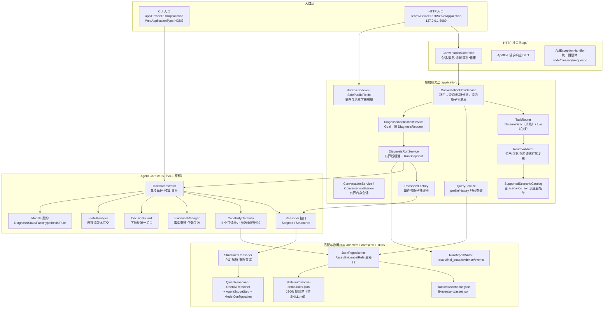
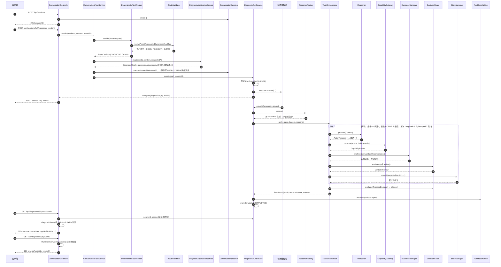

# DeviceTruth 项目现状与进展总结（交接给架构顾问）

> 生成时间：2026-11-08（本地工作树）
> 生成方式：只读分析，未修改业务代码、测试或冻结契约
> 证据范围：`README.md`、`AGENTS.md`、`docs/DeviceTruth_Core_V0.1_Spec_Pack/{spec,task,state}.md`、`docs/DeviceTruth_V0.2_S0_S1/{S0_AUDIT,S1_ACCEPTANCE_REPORT,spec,task,state,改造实施方案_修订版}.md`、`src/main/java` 与 `src/test/java` 全部源码、`target/surefire-reports`、`outputs/runs` 实际报告
> 所有判断标注三种事实级别：**【实现】**=源码存在且链路可达；**【验证】**=有真实命令/测试证据；**【规划】**=仅文档约定、未落地

---

## 0. 一句话结论

DeviceTruth 目前是一个**跑得通、验得过、但智能闭环未完成**的诊断 Agent 内核：V0.1 的受控单 Agent 运行时（`TaskOrchestrator` + 五类动作 + 能力网关 + 证据重建 + 决策守卫）已经稳定，V0.2 的 S0/S1 已把中文 HTTP 入口、受限查询、异步诊断和安全脱敏打通（离线 145 项测试全绿、TC-01~TC-19 实测通过）；但**假设驱动调查闭环（`Hypothesis` → `SUPPORTED`）不存在、多轮补证不存在、标准 Skill 加载器不存在、工厂双域数据不存在**，当前诊断能力本质上是"预定义场景 + 受约束推理"，距离"通用 Agent Core + 标准 Skill + 领域数据底座"的产品目标还有两个阶段的距离（S2/S3）。

---

## 1. 当前整体架构

### 1.1 分层与职责（源码事实）

| 层 | 包/目录 | 职责 | 关键约束 |
|---|---|---|---|
| Agent Core | `core/` | 推理循环、动作契约、能力网关、证据、状态、决策 | **零 Spring 注解**；模型不能写事实/执行工具/下结论 |
| 应用服务层 | `application/` | 会话、路由、查询、诊断编排、事件与字段脱敏 | 只在内存；有界；不伪造 Core 能力 |
| HTTP 接口层 | `api/` | REST 契约、DTO、错误映射 | 唯一对外暴露面；禁止透传报告路径/Prompt |
| 入口层 | `app/`、`server/` | CLI 单次运行 / Web 常驻 | 两个 Main 扫描根互不重叠 |
| 适配层 | `adapter/` | JSON 仓储、报告落盘、模型接入 | 模型只经 `AgentScopeStep` 单步补全 |
| Skill（自称） | `skills/automotive-demo/rules.json` | 两条模拟规则 | **是 JSON 数据包，不是标准 Skill** |
| 数据底座 | `datasets/` | 4 个资产 fixture + 场景定义 | 构造时强制 `SIMULATED` |

### 1.2 架构边界的关键事实

- **Agent Core 不可被模型穿透**：模型的全部入口是 `Reasoner.propose(Context)` 返回一个动作提案；执行权在 `TaskOrchestrator`，数据读取必须过 `CapabilityGateway`，事实由 `EvidenceManager` 重建，结论由 `DecisionGuard` 放行。
- **装配方式分两套**：CLI 在 `DeviceTruthApplication.execute()` 里手工 `new` 全部组件（`DeviceTruthApplication.java:42-52`）；Web 侧集中在 `ServerConfiguration`（`@ComponentScan` 只扫 `io.devicetruth.api`，`ServerConfiguration.java:31-33`）。`core/`、`adapter/`、`app/` 至今没有任何 Spring 组件注解。
- **"Skill"目前只是名字**：`grep -rn "SKILL" src/main/java` 为空，没有加载器、没有目录协议、没有工具绑定；`skills/automotive-demo/rules.json` 只是被 `JsonRepositories` 当普通规则数据读入（`JsonRepositories.java:44-48`）。

---

## 2. 真实运行调用链（以"CAR-B 通信超时，帮我诊断"为例）

### 2.1 HTTP 到诊断结果的完整时序

### 2.2 关键类与方法的实际职责

| 步骤 | 关键位置 | 做什么 |
|---|---|---|
| 建会话 | `ConversationService.create()` | 内存登记 `ConversationSession`（默认上限 100 会话） |
| 收消息 | `ConversationController.message()`（`api/ConversationController.java:67`） | 校验并转交应用层；DIAGNOSE 恒 202 |
| 会话编排 | `ConversationFlowService.handle()`（`application/ConversationFlowService.java:39`） | 路由 → 按 route 分派 → 写消息 |
| 离线路由 | `DeterministicTaskRouter.decide()`（`application/DeterministicTaskRouter.java:14`） | 危险词 → 资产 → 症状 → 查询词表，全部是关键词匹配 |
| 程序复核 | `RouteValidator.resolveAsset()/validateSuggestion()`（`application/RouteValidator.java:54,148`） | 模型建议只是建议；资产必须来自文本/hint/会话上下文 |
| 诊断映射 | `DiagnosisApplicationService.map()`（`application/DiagnosisApplicationService.java:30`） | Catalog 取 domain/symptomCode/固定 asOf；规则存在性校验 |
| 原子写消息 | `ConversationSession.commitPlanned()`（`application/ConversationSession.java:54`） | 容量预检 + 查询/登记 + 两条消息在同一把锁内完成 |
| 异步登记 | `DiagnosisRunService.submit()`（`application/DiagnosisRunService.java:164`） | 生成公开 `diagnosisId`，登记 QUEUED，交线程池；拒绝即移除注册项 |
| 异步执行 | `DiagnosisRunService.execute()`（同上 `:183`） | 建独立 Reasoner → 调 Core → 落盘 → 状态迁移 |
| Core 循环 | `TaskOrchestrator.run()`（`core/runtime/TaskOrchestrator.java:41`） | `while(status==ACTIVE)`，每轮一个动作 |
| 提议动作 | `Reasoner.propose()`（`core/reasoning/Reasoner.java`） | 五类：`CALL_CAPABILITY/PROPOSE_HYPOTHESIS/PROPOSE_DECISION/REQUEST_INFORMATION/ESCALATE` |
| 取数 | `CapabilityGateway.execute()`（`core/capability/CapabilityGateway.java:29`） | 注册/只读/域/参数/跨资产校验；失败包装 `ToolError` 不抛异常 |
| 证据重建 | `EvidenceManager.analyze()/invalidateDependencies()`（`core/evidence/EvidenceManager.java:18,68`） | 每条证据生成事实；同字段组按来源等级竞争；依赖失效 |
| 结案校验 | `DecisionGuard.evaluate()`（`core/decision/DecisionGuard.java:23`） | 13 步链：规则域/建议等级/事实状态/时间窗/证据一致/条件满足/无冲突/必需证据/人工复核 |
| 状态提交 | `StateManager.commit()`（`core/state/StateManager.java:22`） | 乐观锁；证据只增不改；规则/已发现证据增量合并 |
| 报告落盘 | `RunReportWriter.write()`（`adapter/RunReportWriter.java:13`） | `outputs/runs/<独立UUID>/` 四文件（目录 UUID ≠ coreTaskId） |
| 读结果 | `DiagnosisRunService.require()` + `ConversationController.diagnosisView()` | 归属不匹配与不存在同为 404；派生字段过 `SafePublicFields` |
| 读事件 | `RunEventViews.of()`（`application/RunEventViews.java:30`） | 11 类真实事件 → `summary/referenceIds` 白名单；`RunEvent.data` 永不出网 |

### 2.3 内核循环的真实形态（实测轨迹）

同一场景 CAR-B，两种推理器的实际动作序列不同：

| 轮次 | scripted（7 步） | DeepSeek（6 步，本会话实测） |
|---|---|---|
| 1 | `diagnosis.rules.query` | `asset.history.query` |
| 2 | `asset.profile.get` | `evidence.search` |
| 3 | `PROPOSE_HYPOTHESIS` | `evidence.get`（CAR-B-FIELD-1） |
| 4 | `asset.history.query` → 假设 H-1 失效 | `evidence.get`（其余已发现记录） |
| 5 | `evidence.search` | `diagnosis.rules.query` |
| 6 | `evidence.get` | `PROPOSE_DECISION(DEMO-D-120B)` → `RESOLVED` |
| 7 | `PROPOSE_DECISION(DEMO-D-120B)` → `RESOLVED` | — |

结论：**循环框架固定，但"下一步做什么"在在线模式下确实由模型决定**；两种路径都能被 `DecisionGuard` 收束到同一结论，说明守卫与推理器解耦成功。

---

## 3. S0 / S1 实际完成情况（基于源码与测试，不复述报告）

### 3.1 里程碑总览

| 阶段 | 状态 | 证据 |
|---|---|---|
| S0（基线审计 + 契约冻结） | **完成** | `S0_AUDIT.md` 全项实测；`spec.md` 状态 FROZEN（M0 Review #2 PASS） |
| S1 M1（HTTP 接入 + 四类路由） | **完成** | `reviews/M1.md` #3 PASS；109 项测试 |
| S1 M2（受限查询 + 诊断映射） | **完成** | `reviews/M2.md` 首审 PASS；125 项测试 |
| S1 M3（异步诊断 + 最终验收） | **完成** | `reviews/M3.md` 复审 PASS；145 项测试 |

### 3.2 逐项实现程度

| 能力项 | 状态 | 依据 |
|---|---|---|
| 双入口（CLI fat JAR + 独立 Web Main） | **实现+验证** | `pom.xml` 固定 `mainClass` 为 CLI；`Start-Class` 实测正确；Server 用显式 classpath 启动并记录日志（S1 报告 §1） |
| 演示目录 `SupportedScenarioCatalog` | **实现+验证** | 仅从 `scenarios.json` 派生（`SupportedScenarioCatalog.java:34`）；`CAR-ZZ/CAR-B2/CAR-B-UNKNOWN` 不再回落 CAR-B（M1 P1-01 回归） |
| 四类路由 QUERY/DIAGNOSE/CLARIFY/UNSUPPORTED | **实现+验证** | `DeterministicTaskRouter` + `RouteValidator`；TC-07/08/09/10 实测 |
| 受限事实查询（出厂/维修历史） | **实现+验证** | `QueryService` 直连 `AssetRepository`，不经 Gateway、不造 `DiagnosisRequest`（`QueryService.java:18`）；TC-02/03/14/15 |
| 诊断真实进入 Core | **实现+验证** | `DRS.execute → TaskOrchestrator.run`；CAR-B 得 `RESOLVED/DEMO-D-120B`；TC-04 |
| 202 + QUEUED + Location + GET 真状态 | **实现+验证** | `ConversationController.java:72-77`；TC-05 |
| 有界异步执行 + 队列满 429 + 无幽灵任务 | **实现+验证** | `DiagnosisRunService.submit()` 拒绝即移除；TC-17 `statuses=[202,429×5]`、`ghosts=0` |
| 每任务独立 Reasoner | **实现+验证** | `ReasonerFactory` 只存创建方式；`DiagnosisRunServiceTest.eachRunGetsItsOwnReasonerInstance` |
| Core FAILED 不包装成 COMPLETED | **实现+验证** | 读 `report.result().runStatus()`；TC-11 `FAILED/outcome=null/DASHSCOPE_API_KEY_MISSING` |
| §4.8 公开字段安全映射（28 项白名单） | **实现+验证** | `SafePublicFields`；`PROMPT_FRAGMENT` 负例经真实 GET 不回显 |
| 结束后事件白名单视图 | **实现+验证** | `RunEventViews`；34 条/8 类；`REASON_INPUT.data` 永不出网 |
| 双时间（requestedAt / diagnosisAsOf） | **实现+验证** | `DiagnosisGoal` + `DiagnosisRunService.RunSnapshot`；TC-13 |
| 在线 Router（`LlmTaskRouter`） | **实现，仅缺配置路径验证** | 代码完成；仅验证"缺配置→503"，真实模型分类未跑 |
| 在线 Reasoner（qwen/openai） | **实现；S1 验收为 BLOCKED_BY_ENV** | 本会话另行实测 DeepSeek 成功（见 §6.4），但未写入 S1 验收文档 |
| Hypothesis `OPEN→SUPPORTED` 闭环 | **未实现** | 全源码 `HypothesisStatus` 只有 `OPEN`/`INVALIDATED` 赋值点，`SUPPORTED` 无任何写入路径 |
| 多轮补证 / 暂停恢复 | **未实现** | 无运行续跑接口；会话只记住 `currentAssetId` |
| 标准 Skill 加载 | **未实现** | 无 `SKILL.md` 解析器；`rules.json` 是普通数据 |
| 双域（工厂）数据 | **未实现** | `skills/`、`datasets/` 无 `SC-0245` 等工业资产 |
| Vue 工作台 / 实时推流 | **未实现（规划 S4）** | 无 SSE/WebSocket（`grep SseEmitter\|WebSocket` 为空） |
| 前端演示页 | **实现（未提交，超出 S1 范围）** | 本工作树新增 `src/main/resources/static/index.html`，非 S4 的 Vue |

---

## 4. 当前 Agent 智能程度

### 4.1 定位：受控 Agent Runtime + 局部动态调查

| 维度 | 现状 | 结论 |
|---|---|---|
| 循环控制权 | 主机 `TaskOrchestrator` 驱动，模型每轮只能提一个提案 | **是 Agent Runtime，但不是自治 Agent** |
| 工具执行 | 模型只能提议 `CallCapability`，由 `CapabilityGateway` 校验后执行 | 模型无直接工具权限 |
| 事实写入 | 模型输出不能写证据/事实；事实由 `EvidenceManager` 从证据推导 | 事实层不可被模型污染 |
| 结论权 | `ProposeDecision` 必须过 `DecisionGuard` 13 步校验 | 模型只能说"请求结案" |
| 自主性 | 在线模式下模型自主选择查什么、按什么顺序查（实测两种不同路径） | **单次运行内具备动态调查能力** |
| 跨轮记忆 | 每次诊断独立跑；无补证、无续跑 | 无跨轮调查闭环 |
| 假设推理 | `PROPOSE_HYPOTHESIS` 可创建假设，但只用于记账与失效 | **假设不参与驱动调查或结论** |

### 4.2 关键判断：Hypothesis 只是"记账"，不是"推理"

- `TaskOrchestrator` 收到 `ProposeHypothesis` 后只做依赖合法性校验并追加到状态（`TaskOrchestrator.java:109-115`）。
- `DecisionGuard.evaluate()` 只在 `claimedHypothesisIds` 中检查"不得引用 INVALIDATED"（`DecisionGuard.java:33-37`），**从不要求结论必须有假设支撑**；`ScriptedReasoner` 下结论时 `claimedHypothesisIds` 传空列表（`ScriptedReasoner.java:38-39`）。
- `EvidenceManager.invalidateDependencies()` 是唯一的假设状态迁移（→ INVALIDATED），`SUPPORTED` 永远不出现。
- 因此"假设驱动 O-H-E-D 闭环"是**尚未存在的设计目标**，`state.md` §5 与 `spec.md` §9 `[S2]` 均已如实登记。

### 4.3 证据收集的"自主性"其实被守卫约束

`DecisionGuard.investigationNeeds()`（`DecisionGuard.java:85-94`）强制三项完成条件：`asset.history.query`（仅 assetId）、`evidence.search`（仅 assetId）、所有已发现记录都已 `evidence.get` 取回。这保证"不能只看第一条确认就结案"，但也意味着**调查路径的形状是程序规定的**——模型的自由度在"先做哪项、如何组合"这一层，而不是"要不要做完整性检查"这一层。

---

## 5. 实际可用能力与限制

### 5.1 能处理什么（已实测）

| 用户输入类型 | 行为 | 约束来源 |
|---|---|---|
| "查询 CAR-X 的出厂档案/型号" | 200 QUERY，返回 FACTORY 记录 + 真实 `evidenceId/sourceRef` + 语义边界声明 | `QueryService.profile()`；专用词表 `出厂/型号/档案/原厂…` |
| "CAR-X 发生过哪些更换/维修" | 200 QUERY，仅 REPLACEMENT 记录，明示"不等于当前配置" | `QueryService.history()` |
| "CAR-A/B/C/D 通信超时（含 5 个中文/英文别名）" | 202 异步诊断，进真实 Core | `SymptomResolver` 有限别名 |
| "这台设备超时"（无资产） | 200 CLARIFY，请补设备编号 | `RouteValidator` |
| 未登记资产、未覆盖症状、危险操作 | 200 UNSUPPORTED，不编造 | 危险词表与症状黑名单 `RouteValidator.java:24-28` |
| 同会话先说 "CAR-B 出厂型号" 再说 "帮我诊断通信超时" | 复用会话资产，DIAGNOSE | `ConversationSession.currentAssetId` 绑定 |

### 5.2 明确做不到什么

- **资产仅 4 个**（CAR-A~D），全部 `automotive-demo` / `COMM_TIMEOUT` / `asOf=2026-11-03T04:00:00Z`；其他资产一律 UNSUPPORTED。
- **症状仅 COMM_TIMEOUT 一族**；电池/充电/刹车/空调等词直接 UNSUPPORTED（`UNSUPPORTED_SYMPTOM_WORDS`）。
- **规则仅 2 条**（`DEMO-D-120A/B`），都要求 `FIELD_CONFIRMATION`。
- **多轮仅限于"记资产 + 记消息"**：没有"补充证据后续跑"、没有"暂停/恢复"、没有跨诊断上下文；`activeDiagnosisId` 字段有 getter/setter 但**无任何消费方**（S1 遗留 P2）。
- **没有认证/多租户**：`sessionId` 不是凭据，仅 loopback Demo；会话与运行全在内存，重启即丢。
- **没有实时轨迹**：事件只在运行结束后可读；无 SSE/WebSocket。
- **没有真实设备接入**：所有能力只读模拟 JSON；`SIMULATED` 标记贯穿全链路。
- **不是标准 Skill**：没有 Skill 清单、输入输出契约、工具绑定、版本管理。

---

## 6. 测试与验证情况

### 6.1 离线自动化（当前工作树实测）

| 项 | 结果 | 说明 |
|---|---|---|
| `mvn test` | **145 项 / 28 类，0 失败 0 错误 0 跳过，BUILD SUCCESS** | 2026-11-08 本工作树实际执行；均使用 scripted/本机 HTTP 替身，不访问外部模型 |
| 增长轨迹 | 42（V0.1）→ 109（M1）→ 125（M2）→ 145（S1 终态） | 与 `state.md` §4 记录一致 |
| 核心验收 | `AcceptanceTest` A/B/C/D/E 负例 | A/B `RESOLVED`、C `CONFLICT`、D `NEED_EVIDENCE`、E 未知工具/伪造证据不结案 |
| 契约与安全 | `SafePublicFieldsTest`、`DiagnosisSafetyMappingTest`、`RunEventViews` 回归 | `PROMPT_FRAGMENT` 与合成路径不回显 |
| 并发/容量 | `ServerCapacityHttpTest`、`ServerAtomicityHttpTest`、`DiagnosisRunServiceTest` | 429、原子写、无幽灵任务、每任务独立 Reasoner |

### 6.2 CLI 回归（S1 验收实测）

CLI A/B/C/D 退出码 0，`RESOLVED/RESOLVED/CONFLICT/NEED_EVIDENCE`，7/7/7/6 步；`--scenario=E` 退出 2（E 只是测试方法，不是场景）；`python scripts/verify_cli.py` 退出 0（4 项 PASS，含缺 Key 不降级）。

### 6.3 HTTP 端到端（S1 验收实测）

- 主探针 **20/20 PASS**（TC-01~TC-10、TC-13~TC-16、TC-18/19）
- 特殊探针 **7/7 PASS**（TC-11 缺 Key FAILED、TC-16b 失败事件脱敏、TC-17 容量 429 与无幽灵任务）
- TC-20（真实在线 Router + 在线 Reasoner）：**BLOCKED_BY_ENV，未验证，不计通过**

### 6.4 真实外部模型调用（本会话额外实测，不在 S1 验收文档内）

| 项 | 结果 |
|---|---|
| 服务商/模型 | DeepSeek（`OPENAI_BASE_URL=https://api.deepseek.com`，`OPENAI_MODEL=deepseek-flash`）经 `OpenAiReasoner` |
| 运行 1（中文化前） | 18.7s，6 步，`RESOLVED/DEMO-D-120B`，6 次 `MODEL_ATTEMPT` 全 `VALID_PROPOSAL`；报告 `outputs/runs/ccba18c8-…` |
| 运行 2（中文化后） | 16.4s，6 步，同样结论；报告 `outputs/runs/298560d2-…` |
| 已知限制 | 未运行 `scripts/verify_online.py`；未测试失败注入（超时/非法 JSON/额度不足）；该证据未按流程写入 S1 验收报告 |

### 6.5 未验证事项（必须继续标注）

1. 千问 DashScope 真实调用（`--reasoner=qwen`）自 V0.1 起从未真跑（README 已登记为已知残留风险）。
2. 在线 Router（`devicetruth.router.mode=online`）真实分类准确率与失败降级策略。
3. 真实模型下的非法输出重试路径、45 秒超时边界、并发多诊断稳定性。
4. `verify_online.py` 全流程。
5. 前端页面（新增静态页）无自动化测试，仅人工验证。

---

## 7. 与最终产品目标的差距

目标：**通用 Agent Core + 标准 Skill + 领域数据底座 → 工厂设备与汽车双领域专业故障检修。**

| 差距 | 现状 | 缺什么 | 阻塞级别 |
|---|---|---|---|
| **假设驱动调查** | 假设只记 OPEN/INVALIDATED | `SUPPORTED` 赋值路径、支持/反驳证据模型、结论依赖假设、`HypothesisEvaluator` | **P0**，S2 首要 |
| **多轮补证** | 一次诊断自封闭 | 运行可续跑的上下文、needs 驱动追问、增量事件可读、暂停/恢复 | **P0**，依赖假设模型 |
| **标准 Skill** | JSON 规则包 | `SKILL.md` 协议、加载器、领域工具绑定、版本与校验、失败隔离 | **P1**，S3 |
| **双域数据底座** | 4 个汽车 fixture | 工厂 `SC-0245-B` 等资产、跨域 Repository、领域字段映射 | **P1**，S3 |
| **状态持久化** | 全内存 | 运行/会话落库、重启恢复、审计留存 | P2（S2 可先做最小持久化） |
| **在线能力验收** | DeepSeek 实测但未入库 | 正式在线验收、失败注入、Router 在线化 | P1（可与 S2 并行） |
| **可观测与安全** | 白名单脱敏已做 | 鉴权、多用户隔离、速率限制、SSE | P2/P3（S4） |
| **前端** | 单页静态 HTML（未提交） | Vue 工作台、轨迹可视化 | P3（S4） |

---

## 8. 下一阶段建议（按优先级，不含实现）

### 建议 1（最高优先，先行）：清理当前工作树与规范漂移
- 现状：工作树存在未提交改动——中文化（`rules.json`、`StructuredReasoner` 协议、`DecisionGuard` 文案、`SafePublicFields` 固定摘要、前端静态页）、`application.properties` 默认推理器改为 `openai`、`pom.xml` 新增 `spring-boot-starter-actuator`（来源非本次分析）、`.vscode/launch.json`。
- 冲突点：`spec.md` 是 **FROZEN**，其中 §4.8 固定摘要仍是英文 `SIMULATED: no applied rule; …`；§7 明确"不引入 Actuator"；§8 默认 `offline+scripted`。当前实现与文档已不一致。
- 动作：按 `spec.md` §10 变更表逐条登记（或回退），决定默认推理器、决定是否保留 Actuator、把中文化作为一次显式变更记录；然后再进入 S2 编码。
- 依赖：无，**必须先做**，否则 S2 起点不干净。

### 建议 2：S2-1 —— Hypothesis 闭环（技术缺口最硬）
- 目标：至少一个非平凡故障场景完成"建立候选假设 → 查询支持/反驳证据 → `SUPPORTED`/`INVALIDATED` → 结论有证据与假设依赖"。
- 关键改动面：`Models.HypothesisStatus` 赋值路径、`TaskOrchestrator` 假设更新分支、`DecisionGuard` 是否需要"结论必须引用被支持假设"的强约束（**这会触碰冻结的 Guard，必须用户批准**）、新增回归测试。
- 依赖：建议 1 完成；需先做 S2 里程碑拆分与契约评审。

### 建议 3：S2-2 —— 多轮补证与暂停恢复
- 目标：`NEED_EVIDENCE` 后可继续同一任务补充证据并续跑；会话可查询历史运行并继续。
- 关键点：运行上下文脱离 `TaskOrchestrator` 局部变量（当前 `StateManager` 在 `run()` 内创建，`taskId` 外不可知）；事件从"结束后可读"扩展为增量可读（届时才评估 SSE）。
- 依赖：建议 2 的状态模型（假设/缺口可持久）。

### 建议 4：在线链路正式验收（可与 2/3 并行）
- 目标：把已实测的 DeepSeek 调用固化为可重复验收：`verify_online.py --reasoner=openai`、`--reasoner=qwen`，补失败注入（超时、非法 JSON、缺 Key、额度错误），并填写 TC-20。
- 依赖：凭据与额度；无需等 S2 完成，但需按 S1 同等证据标准记录。

### 建议 5：S3 前置设计 —— Skill 协议与双域数据
- 目标：定义 `SKILL.md` 的最小契约（能力清单、输入输出、规则/数据绑定、失败语义），先接一个工厂域最小场景（`SC-0245-B`），验证同一 Runtime 不改 Core 即可切换领域。
- 依赖：建议 2 完成后更有价值（否则双域只是在复刻"固定工作流"）；数据设计与 Repository 扩展需先于编码。

---

## 9. 附：关键文件索引

| 主题 | 位置 |
|---|---|
| HTTP 契约与入口 | `api/ConversationController.java`、`api/ApiDtos.java`、`api/ApiExceptionHandler.java` |
| 会话与路由 | `application/ConversationFlowService.java`、`ConversationSession.java`、`DeterministicTaskRouter.java`、`LlmTaskRouter.java`、`RouteValidator.java`、`SupportedScenarioCatalog.java` |
| 查询与诊断编排 | `application/QueryService.java`、`DiagnosisApplicationService.java`、`DiagnosisRunService.java`、`ReasonerFactory.java` |
| 事件与脱敏 | `application/RunEventViews.java`、`SafePublicFields.java` |
| Agent Core | `core/runtime/TaskOrchestrator.java`、`core/reasoning/{Reasoner,ScriptedReasoner,ActionProposal}.java`、`core/capability/CapabilityGateway.java`、`core/evidence/EvidenceManager.java`、`core/decision/DecisionGuard.java`、`core/state/{StateManager,DiagnosisState}.java`、`core/contract/Models.java` |
| 模型接入 | `adapter/StructuredReasoner.java`、`QwenReasoner.java`、`OpenAiReasoner.java`、`AgentScopeStep.java`、`ModelConfiguration.java` |
| 数据与规则 | `adapter/JsonRepositories.java`、`datasets/scenarios.json`、`datasets/fixtures/`、`skills/automotive-demo/rules.json` |
| 报告 | `adapter/RunReportWriter.java`、`outputs/runs/<runId>/` |
| 冻结契约 | `docs/DeviceTruth_V0.2_S0_S1/spec.md`（FROZEN）、`S0_AUDIT.md`、`S1_ACCEPTANCE_REPORT.md`、`state.md` |
