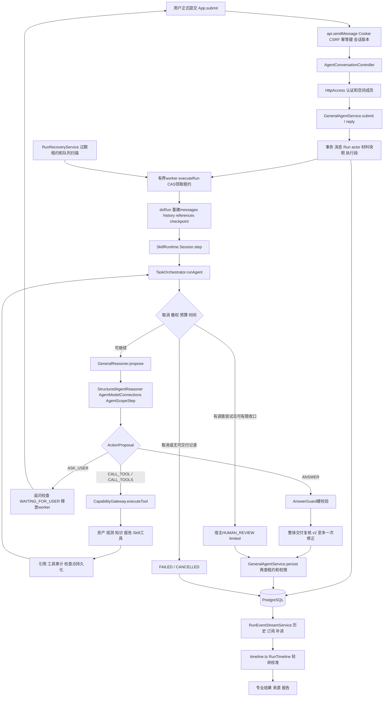
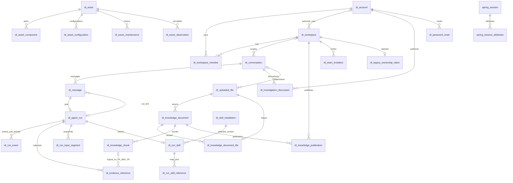
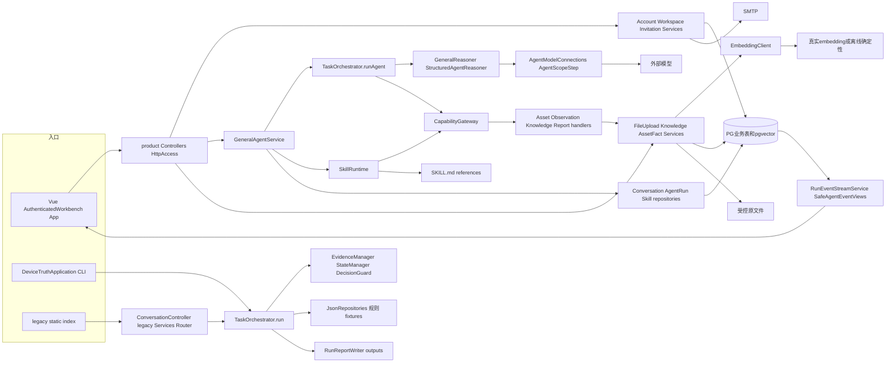
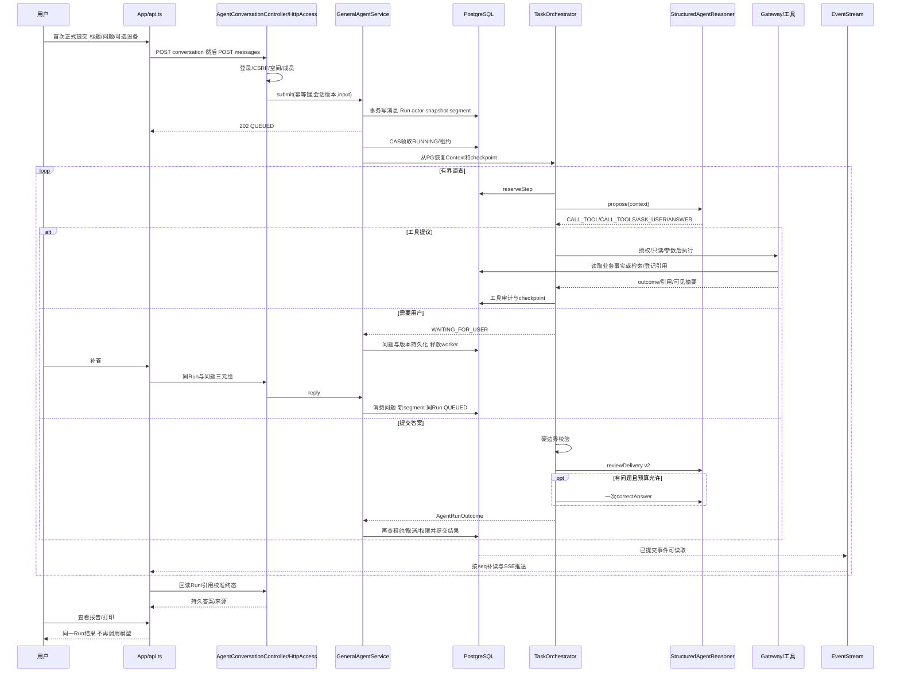
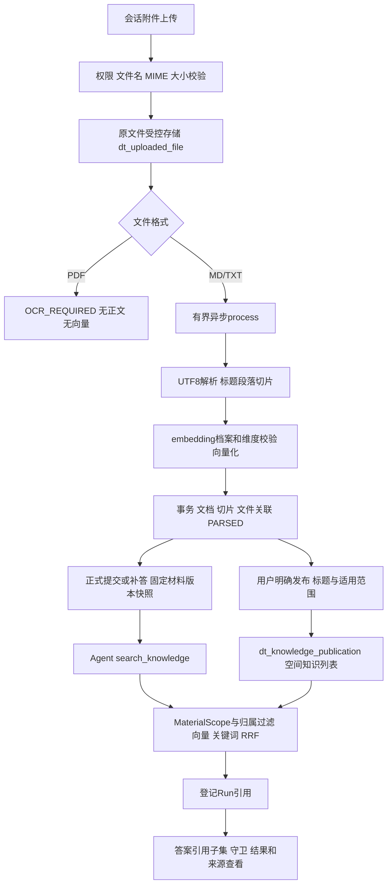

# DeviceTruth 项目全面现状梳理与代码审计

审计日期：2026-11-22（Asia/Shanghai）。对象：本次工作区源码快照。

## 审计口径与结论摘要

本报告回答项目组成、真实实现机制和明确缺口，不制定开发计划。**已完成**表示代码中的核心逻辑与主要调用链可达，不等于本次重新执行了产品验收。页面、HTTP 接口、业务实现、运行验收分别判断；历史验收只作为带日期的辅助证据。

- 初始 `git -c core.fsmonitor=false status --short` 无输出，未发现已有修改。首次普通 `git status --short` 出现 fsmonitor IPC 错误，改为仅对该次命令禁用 fsmonitor，没有修改仓库配置。
- 只新增本报告；没有启动应用、迁移、测试、构建、上传、模型调用或数据库连接。原因是这些路径会创建输出、写会话、自动迁移或建立测试库，不符合本次只读约束。
- 依据为 Java/Vue/TypeScript 源码、24 份 Flyway 迁移、构建/部署配置、测试源码，辅以 README、设计和 OpenSpec 记录。未读取 `.env` 或私有模型配置中的秘密。
- 当前有 **126 个 Java 主源码文件、73 个 Java `*Test.java`、12 个前端 `.test.ts`**。不是早期状态文档所述的 23 个主源码和 12 个测试类。
- 当前产品是**账号与空间隔离下的、PG 持久化的单 Agent 检修调查工作台**；同时保留独立 legacy 诊断和 CLI。不是多 Agent 系统，也不是设备控制平台。
- 真正接入的产品链路包括注册登录、个人/团队空间、讨论与明确引用、调查附件、知识发布、自由目标 Agent、追问补答、取消恢复、来源回溯、SSE、历史调查和打印报告。
- 没有发现当前生产前端的独立“普通模式/专业模式/管理模式”三模式切换；实际为统一专业工作台。没有发现可拖拽节点式动态画布、平台级后台、数据库管理台、在线 Skill 编辑台或模型配置台。
- PDF 可登记上传但不能解析/OCR；观测工具只读取模拟记录；适用规程与人员/现场前提的结构化指导链路仍在独立未完成 change 中。最新 Guard v2 已接主循环，不能用旧验收段落“尚未接入”描述当前源码。
- **真实数据库当前是否已迁移至 V24、当前数据量、当前模型/embedding 可用性、当前部署版本：待确认。** 本报告的表清单是迁移定义，不冒称 live DB 实测清单。

### 证据定位约定

下文 `J/` = `src/main/java/io/devicetruth/`，`F/` = `frontend/src/`，`M/` = `src/main/resources/db/migration/`。这些是阅读缩写；末尾证据索引提供绝对路径和定位行号。表和接口的完整源码位置分别见第9、10节。行号只对应本次快照。

## 1. 项目整体概览

主要源码证据：[GeneralAgentService L417](D:/Java_Project/DeviceTruth/src/main/java/io/devicetruth/application/agent/GeneralAgentService.java#L417)；[AssetTools L168](D:/Java_Project/DeviceTruth/src/main/java/io/devicetruth/application/agent/AssetTools.java#L168)；[KnowledgeSearchService L86](D:/Java_Project/DeviceTruth/src/main/java/io/devicetruth/knowledge/KnowledgeSearchService.java#L86)。

### 1.1 定位、用户与业务问题

输入可以是“充不上电”“PLC 更换后通信异常”“核对设备型号/维修记录”或一般手册问题，不再强制用户提供 legacy 的故障码组合。Agent 调查已登记资产、配置和维修历史，检索可访问的技术资料，追问缺失信息，输出判断、下一步、不确定项、限制和来源。

目标用户在产品设计中为设备使用者、一线维修人员、设备工程师及管理/售后人员；当前源码的主要交互直接服务检修调查人员及协作团队。账号仅区分空间内 ADMIN/COLLABORATOR/VIEWER，不按上述业务职业分权限。没有实际工单派发、远程修复或维修闭环结单系统。

核心价值是把“资料上记载什么”“用户说什么”“现在现场是否已验证”分开。`AssetTools`保留时点与核验状态；`KnowledgeSearchService`登记文档版本、章节和引用；`AnswerGuard`约束引用和确诊边界；模型不能自行写事实或调用设备。

### 1.2 实际支持的场景

| 场景 | 实际入口与实现 | 数据和边界 |
|---|---|---|
| 自由知识问答/可能原因调查 | 工作台提交→`GeneralAgentService.submit`→`runAgent` | 不要求命中预定义场景；答案依赖可用资料及模型 |
| 汽车充电、维护、供电/电池风险 | 8个标准 Skill 中的汽车专项与资产/知识工具 | 只读取证和说明，不等于实车诊断认证 |
| 工业设备停机、PLC/通信、装机配置 | 工厂综合与工业专项 Skill | 具体指令适用范围由文档/Skill说明，不连接PLC |
| Carrier 48TF 屋顶机组初查 | 专项 Skill、型号与历史/资料读取 | 不泛化为任意 HVAC 厂牌能力 |
| 团队调查 | 空间、讨论、引用、执行段作者、附件发布 | 讨论不自动进入模型，正式提交后才产生 Run |
| legacy A–D 等受控回归 | CLI 与 legacy HTTP 路由/场景目录 | JSON 夹具和规则，SIMULATED；不作为 product 准入限制 |

## 2. 技术架构与项目目录

主要源码证据：[DeviceTruthApplication L31](D:/Java_Project/DeviceTruth/src/main/java/io/devicetruth/app/DeviceTruthApplication.java#L31)；[DeviceTruthServerApplication L14](D:/Java_Project/DeviceTruth/src/main/java/io/devicetruth/server/DeviceTruthServerApplication.java#L14)；[ProductConfiguration L48](D:/Java_Project/DeviceTruth/src/main/java/io/devicetruth/server/ProductConfiguration.java#L48)；[LegacyConfiguration L55](D:/Java_Project/DeviceTruth/src/main/java/io/devicetruth/server/LegacyConfiguration.java#L55)；[ServerConfiguration L46](D:/Java_Project/DeviceTruth/src/main/java/io/devicetruth/server/ServerConfiguration.java#L46)。

### 2.1 实际技术栈

| 层 | 当前依赖/机制 | 代码依据 |
|---|---|---|
| Java | Java 21，Maven，Spring Boot 3.5.16 | `pom.xml` |
| 模型 | AgentScope Java 2.0.4 core、DashScope、OpenAI扩展；单步结构化补全 | `AgentScopeStep`、`AgentModelConnections` |
| HTTP/认证 | Spring MVC、Spring Security、Spring Session JDBC、PBKDF2、CSRF | `ProductAuthConfiguration` |
| 数据 | PostgreSQL JDBC、JdbcTemplate、HikariCP、TransactionTemplate、Flyway | 无JPA/MyBatis实体层 |
| 检索 | 同一PG内 pgvector，1024维、cosine、HNSW；关键词+RRF | V2、`KnowledgeSearchService` |
| 前端 | Vue 3.5.45、TS 5.9.3、Vite 8.3.7、vue-tsc 3.3.14、Vitest 5.1.0 | `frontend/package.json`；无Vue Router/Pinia依赖 |
| 运行 | JDK21 JRE镜像、nginx静态资源和代理、Docker Compose | 根/前端Dockerfile、compose、nginx |

### 2.2 目录与协作关系

| 目录/关键入口 | 责任 | 下游/数据 |
|---|---|---|
| `app/DeviceTruthApplication`、`CliOptions` | CLI参数、场景装配、单次执行和报告 | JSON仓储→legacy Core→outputs/runs |
| `server/DeviceTruthServerApplication` | 常驻Web入口，显式排除自动数据源/认证等装配 | server配置、api控制器 |
| `server/ProductConfiguration` | product数据源、迁移、worker、Skill、恢复和资产服务 | PG、Gateway、GeneralReasoner |
| `server/LegacyConfiguration` | legacy场景、Router、内存会话与异步诊断 | 不需PG的旧链路；按profile分开装配 |
| `server/*Account/Workspace/Invitation*` | 账号/会话、密码恢复、空间成员与邀请 | V19–V22表和SMTP |
| `api/` | product会话/Run/资料/资产和legacy会话HTTP合同 | 服务层；不直接让模型执行 |
| `application/agent/` | 产品Run生命周期、作用域、恢复、SSE、资产和报告工具 | 核心循环、persistence、知识和Skill |
| `application/`其余类 | legacy会话、路由、查询和诊断适配 | TaskRouter/RouteValidator/场景目录 |
| `core/reasoning` | 提议单个下一步动作 | 通用和legacy Reasoner接口/脚本替身 |
| `core/runtime` | 唯一受控循环、预算、检查点和答案复核阶段 | Gateway、Guard；产品并不强制跑legacy事实重建 |
| `core/evidence/state/decision` | legacy事实重建/版本提交/规则决策；产品答案硬校验与复核接收 | EvidenceManager/StateManager/DecisionGuard/AnswerGuard |
| `adapter/`、`adapter/persistence/` | 模型传输、JSON协议、PG仓储、CLI报告 | JDBC、外部模型、文件 |
| `knowledge/` | 文件存储、解析切片、向量化、混合召回、引用及材料资格 | PG向量/文档与受控文件目录 |
| `skill/` | 标准Skill发现/解析/按需加载、每Run激活和工具范围 | 文件目录、V14安装/选择表 |
| `frontend/src/` | 认证外壳、统一工作台、独立资料/成员页、结果与事件 | 同源/api、Cookie、SSE和轮询 |
| `datasets/`、`skills/` | 示例/领域快照、检索资料、标准Skill和legacy规则 | 被Maven打包；不表示已全部导入当前PG |
| `scripts/` | CLI、真模、浏览器、部署等验证与数据维护脚本 | 部分会写库/文件，本次未运行 |
| `openspec/`、`docs/` | 当前变更规格、验收与历史/设计 | 不是运行时业务引擎 |

### 2.3 两套运行合同不能混用

`TaskOrchestrator.run`接受`DiagnosisRequest/Budget/Reasoner`，以`DiagnosisState`、证据、规则和legacy决策结束。`runAgent`接受自由目标、消息、引用、工具和`GeneralReasoner`，以`AgentRunOutcome/AgentResult`结束。两者在同一类，但产品不是先通过`TaskRouter`映射故障码再跑legacy。源码中未发现独立`Planner`实现；计划如何推进主要体现在模型每步提议、工具摘要、反馈及宿主预算约束中。

## 3. 产品功能全景

主要源码证据：[App L814](D:/Java_Project/DeviceTruth/frontend/src/App.vue#L814)；[AuthenticatedWorkbench L50](D:/Java_Project/DeviceTruth/frontend/src/AuthenticatedWorkbench.vue#L50)；[GeneralAgentService L417](D:/Java_Project/DeviceTruth/src/main/java/io/devicetruth/application/agent/GeneralAgentService.java#L417)；[ProductAuthConfiguration L90](D:/Java_Project/DeviceTruth/src/main/java/io/devicetruth/server/ProductAuthConfiguration.java#L90)。

状态定义：已完成=主要代码调用链已打通；部分完成=存在明确限制；前后端未打通=两端存在但无完整入口；模拟实现=替身/固定资料；未实际接入=存在代码却未发现入口；待确认=证据不足。未发现实现的规划项在状态旁明确写“未发现实现”，不伪装成已存在半成品。

| 功能 | 页面 | 接口 | 核心逻辑 | 当前结论 |
|---|---|---|---|---|
| 注册/登录/退出/当前账号 | 有 | 有 | PBKDF2+PG会话 | 已完成（代码链路） |
| 找回密码 | 有 | 有 | 一次性摘要Token、SMTP、会话撤销 | 已完成；当前投递/收件待确认 |
| 个人/团队空间与切换 | 有 | 有 | 成员资格映射存储身份 | 已完成 |
| 团队成员/邀请 | 有 | 有 | ADMIN管理、角色和最后管理员限制 | 已完成；不等于平台用户管理 |
| 新调查、继续调查、追问补答 | 有 | 有 | 幂等键、会话版本、同Run补答/新Run续查 | 已完成 |
| 历史搜索、筛选、分页、恢复 | 有 | 有 | PG汇总、游标、持久回读 | 已完成 |
| 判断/来源/对比/报告 | 有 | 有持久Run和引用读取 | 共用ViewModel、打印 | 已完成；实际PDF产物未验证 |
| 团队讨论与引用 | 有 | 有 | 独立讨论表、引用快照后正式提交 | 已完成 |
| MD/TXT附件、原文、重试 | 有 | 有 | 受控文件+异步导入 | 已完成；依赖embedding |
| PDF/OCR | 状态提示 | 上传有 | 保留文件，不产生正文/向量 | 部分完成（解析未实现） |
| 知识复用/发布 | 列表与附件发布 | 有 | 发布记录、适用范围和材料资格 | 部分完成：非完整编辑/删除CRUD |
| 设备档案/配置/历史 | 有 | 只读有 | PG记录和时点重建 | 已完成读取；无设备维护CRUD页 |
| 实时任务过程 | 有时间线 | events/stream有 | 安全事件白名单、续传、轮询 | 已完成；不是节点式画布/逐token输出 |
| 标准Skill | 显示已选版本 | 只读run/skill | 安装+激活+引用+收缩工具域 | 已完成运行接入，无管理控制台 |
| 外部真实模型 | 不暴露凭据 | 间接随Run | OpenAI兼容/Qwen连接 | 已接入；本次在线可用性待确认 |
| 现场观测 | 结果/来源展示 | Agent工具 | 仅导入模拟观测 | 模拟实现 |
| 普通/专业/管理三模式 | 无当前切换 | 无对应模式合同 | 历史原型有示意 | 未实际接入当前三模式产品 |
| 平台后台、DB管理、在线模型/工具配置、日志管理、回归控制台 | 未发现 | 未发现专用API | 配置/脚本/日志不等于后台 | 未发现实现 |

## 4. 用户端功能详细说明

主要源码证据：[App L814](D:/Java_Project/DeviceTruth/frontend/src/App.vue#L814)；[api L270](D:/Java_Project/DeviceTruth/frontend/src/api.ts#L270)；[ConversationRepository L69](D:/Java_Project/DeviceTruth/src/main/java/io/devicetruth/adapter/persistence/ConversationRepository.java#L69)；[AgentRunRepository L89](D:/Java_Project/DeviceTruth/src/main/java/io/devicetruth/adapter/persistence/AgentRunRepository.java#L89)；[InvestigationCollaboration L31](D:/Java_Project/DeviceTruth/frontend/src/components/InvestigationCollaboration.vue#L31)；[diagnosisViewModel L262](D:/Java_Project/DeviceTruth/frontend/src/diagnosisViewModel.ts#L262)。

### 4.1 账号与空间

| 功能与业务目的 | 入口/组件 | API与后端顺序 | 表/状态 |
|---|---|---|---|
| 注册并拥有独立资料域 | `AuthenticatedWorkbench.vue`注册表单 | `/api/auth/register`→`AccountController.register`→`AccountService.register`：邮箱归一化、12–128字符密码、PBKDF2编码；事务创建账号、PERSONAL空间、ADMIN成员；建立会话 | dt_account、dt_workspace、dt_workspace_member、spring_session及attributes；已完成 |
| 登录/退出/刷新身份 | 同组件登录/用户菜单 | `/auth/login`→authenticate→保存SecurityContext；`/auth/me`回读；`/auth/logout`退出 | JDBC会话Cookie DTSESSION，非浏览器JWT；已完成 |
| 找回/重置密码 | recover/reset表单，hash中的reset-token | `/auth/password-reset-requests`、`/password-resets`→`PasswordRecoveryService`→SMTP；校验过期/消费状态、更新密码并撤销会话 | dt_password_reset、account、session；实现，邮件依赖条件见第12节 |
| 空间切换/创建团队 | `WorkspaceShell`、`CreateTeamPage` | `/api/workspaces`→WorkspaceService；切换由前端访问上下文驱动，不把owner/project交给客户端指定 | workspace/member；已完成 |

`AuthenticatedWorkbench`先读取当前账号及空间、成员名称，再挂载`App`。身份/空间改变使旧请求和草稿作用域失效。团队邀请接受入口来自URL邀请信息，调用`/api/invitations/accept`，不是直接输入用户ID任意加成员。

### 4.2 一次调查如何进入系统

`App.vue.submit`在首次提交时才创建会话，标题与正文组成正式消息；`sendMessage`携带`schemaVersion=1`、`Idempotency-Key`、可选设备、附件/引用、会话版本和明确讨论引用。后端拒绝空白、超长、NUL和不兼容版本。`GeneralAgentService.submit`锁会话，检查重复请求和成员写权；团队必须提供匹配的`expectedConversationVersion`，会话已有QUEUED/RUNNING/WAITING任务时拒绝冲突提交。事务写USER消息、Run、作者、材料快照及引用，再提交事务后派给worker。HTTP返回202，不等待模型完成。

- 前端：`App.vue`中的`submit`、`enterNewRun`、`track`；`api.ts.sendMessage`。
- 后端：`AgentConversationController.submit`→`GeneralAgentService.submit`→`ConversationRepository.appendWithReferences`→`AgentRunRepository.enqueue/bindRun/snapshot`。
- 表：dt_conversation、dt_message、dt_agent_run、dt_run_event、dt_run_input_segment，传入已有引用时还涉及dt_evidence_reference。
- 状态：主要调用链已完成；本次没有实际发消息。

### 4.3 补答、继续调查与现场观察不是同一动作

| 操作 | 用户入口 | 真实行为 |
|---|---|---|
| 回答Agent问题 | 待补充信息输入框→`answerQuestion` | 携带runId/pendingQuestionId/questionVersion；后端核对WAITING及三元组、消费问题，同一Run重新QUEUED，新增执行段作者和快照 |
| 针对判断继续调查 | 专业页选择判断→`investigateCurrent` | 选择本轮引用为contextRefs，形成新正式目标/新Run；旧结论不被直接改写 |
| 追加观察 | composeMode=observation | 用户正式文字记录，语义为未核实观察，不是设备遥测采集或独立核验 |
| 团队讨论 | “团队讨论”→InvestigationCollaboration.post | 写独立discussion，不派worker；“引用到调查补充”只选草稿，正式提交后才供模型读取 |
| 上传附件 | 资料抽屉/上传→uploadInvestigationAttachment | 单独上传不启动分析，也不自动发布为空间知识 |

### 4.4 结果、资料、历史和报告

| 功能 | 前端入口与核心组件 | 后端/表 | 实现机制与限制 |
|---|---|---|---|
| 调查概览/候选/下一步 | ProfessionalDiagnosisPage、ClaimList/Detail、diagnosisViewModel | GET run与references；agent_run/event/reference | 区分DIRECT候选、背景观测及历史未知；短结论、优先前三项下一步；不把所有SUPPORTED都当故障原因 |
| 来源与证据对比 | EvidenceDrawer/Modal、EvidenceComparison | `/runs/{id}/references`、`/knowledge/references/{id}?runId=...`及切片接口 | 必须已登记于该Run并满足材料资格；保留版本/章节/摘录；资产来源直接用持久摘录 |
| 设备资料 | DeviceArchivePage、统一资料抽屉 | `/assets`、`/{id}`、`/configuration`、`/maintenance`→AssetFactService→AssetTools/PG仓储 | 读取资产身份、部件、配置和历史，按asOf；没有页面修改设备的链路 |
| 调查附件与原文 | InvestigationCollaboration materials | conversation attachments、file/content/retry；file/document/chunk/link | MD/TXT原文可读；PDF不能读正文 |
| 历史调查 | RecentInvestigations、App.refreshHistory/openConversation | conversations/summaries→ConversationRepository.summaries；detail/messages/runs | 搜索、状态筛选和游标分页；标题来自持久消息/汇总而不是模型自动命名服务 |
| 独立报告/打印 | App.showReport/printReport、DiagnosisReport、reportView | 重用已读Run/引用 | 不重跑模型；浏览器window.print；无独立后端PDF生成服务 |
| 运行过程 | RunTimeline、timeline.ts | events/stream、dt_run_event | 展示安全工具/模型/阶段/恢复/降级事件；不是模型思维链或原Prompt |

## 5. 管理端功能详细说明

主要源码证据：[WorkspaceService L44](D:/Java_Project/DeviceTruth/src/main/java/io/devicetruth/server/WorkspaceService.java#L44)；[TeamInvitationService L31](D:/Java_Project/DeviceTruth/src/main/java/io/devicetruth/server/TeamInvitationService.java#L31)；[KnowledgeLibraryPage L8](D:/Java_Project/DeviceTruth/frontend/src/components/KnowledgeLibraryPage.vue#L8)；[WorkspaceAdministration L1](D:/Java_Project/DeviceTruth/frontend/src/components/WorkspaceAdministration.vue#L1)；[LegacyOwnershipClaimService L42](D:/Java_Project/DeviceTruth/src/main/java/io/devicetruth/application/maintenance/LegacyOwnershipClaimService.java#L42)。

当前“管理员”是**某团队空间管理员**，不是全站管理员。`AccountService`明确不提供平台管理权限；安全链对其余`/api/**`和`/actuator/**`拒绝。不能把历史原型admin画面当现有后台。

| 检查项 | 实际入口/接口/类/表 | 实现与状态 |
|---|---|---|
| 成员管理 | WorkspaceShell→TeamMembersPage；GET/PATCH/DELETE workspaces/{id}/members；WorkspaceService；workspace/member/account | 列表、角色变更、移除、最后ADMIN保护；已完成；不能管理其他空间用户 |
| 团队名与邀请 | TeamMembersPage；PATCH workspace；邀请list/create/resend/revoke、accept；TeamInvitationService；dt_team_invitation | 邮件Token摘要、期限、邮箱匹配、投递状态；已完成，收件情况单独确认 |
| 知识库管理 | KnowledgeLibraryPage只读列表；InvestigationCollaboration附件发布；FileController/FileUploadService.publish/knowledge；dt_knowledge_publication等 | 发布需写权（COLLABORATOR也可），非ADMIN专属；支持标题/适用范围/作者；没有文档改写、删除、撤回和重新索引管理页，部分完成 |
| 资产/数据库管理 | DeviceArchivePage只读；AssetRegistryRepository导入、AssetFixtureSeeder、维护脚本 | 无SQL控制台/备份还原按钮/通用资产写API；运维能力不等于前端管理功能 |
| Skill管理 | 环境配置、SkillInstallationRepository；run/skill只读 | 安装/启停许可持久化和运行核查存在，无HTTP安装/编辑/启停页面；部分完成（运行系统完成、管理UI未发现） |
| 模型配置 | ModelConfiguration、ProductConfiguration.agentReasoners、AgentModelConnections | 环境/本地私有文件，非UI配置；无平台模型切换/Key编辑API |
| 工具配置 | ServerConfiguration.agentCapabilityGateway及Skill许可交集 | 源码注册、服务器配置上限，不是用户任意安装工具 |
| 调用记录 | 调查过程、GET run/tool-events、model-events→AgentRunRepository | 本Run的工具成败/错误码、模型尝试/耗时/Token；没有跨租户调用统计后台或账单系统 |
| 系统日志 | logback控制台、服务catch日志 | 无日志检索页面和日志读取API |
| 测试与回归 | Maven/Vitest、scripts | 工程验证路径，不是在线测试管理端 |
| 旧资料认领 | CLI LegacyOwnershipClaimTool→LegacyOwnershipClaimService；V24审计表 | 默认dryRun、显式execute、单事务绑定专用空间，属于维护命令，不是普通用户按钮；实现但本次未执行 |
| 旧管理组件 | WorkspaceAdministration.vue | 有成员/知识UI和请求实现，当前F/全局检索未发现导入挂载；未实际接入，现入口为独立成员/知识页 |

## 6. Agent 核心架构与运行机制

主要源码证据：[GeneralAgentService L417](D:/Java_Project/DeviceTruth/src/main/java/io/devicetruth/application/agent/GeneralAgentService.java#L417)；[TaskOrchestrator L77](D:/Java_Project/DeviceTruth/src/main/java/io/devicetruth/core/runtime/TaskOrchestrator.java#L77)；[GeneralReasoner L77](D:/Java_Project/DeviceTruth/src/main/java/io/devicetruth/core/reasoning/GeneralReasoner.java#L77)；[StructuredAgentReasoner L47](D:/Java_Project/DeviceTruth/src/main/java/io/devicetruth/adapter/StructuredAgentReasoner.java#L47)；[AnswerGuard L109](D:/Java_Project/DeviceTruth/src/main/java/io/devicetruth/core/decision/AnswerGuard.java#L109)；[RunRecoveryService L51](D:/Java_Project/DeviceTruth/src/main/java/io/devicetruth/application/agent/RunRecoveryService.java#L51)。

### 6.1 各组件真实责任

| 组件 | 负责 | 不负责 |
|---|---|---|
| GeneralAgentService | 接收任务、持久状态机、身份、worker、检查点回调、结果事务 | 不自行推断故障原因 |
| GeneralReasoner/StructuredAgentReasoner | 将当前Context转为单步JSON动作；真实实现还做交付复核/定向修正 | 不持有Gateway执行权、不直接写PG |
| AgentModelConnections/AgentScopeStep | 建供应商连接、非流式补全、超时/usage | 不接管产品主循环；无AgentScope自循环再套一层 |
| TaskOrchestrator.runAgent | 解释动作、预算/取消检查、执行工具、追问/回答、检查点、最终阶段 | 不把模型提议当已执行事实 |
| CapabilityGateway | 工具目录/参数/授权/只读校验、统一ToolOutcome | 不允许模型注册新工具 |
| SkillRuntime | 选择一个已安装版本，加载指引和单篇参考，收缩工具集合 | 不执行Skill里的任意脚本/命令 |
| AnswerGuard | 本Run引用、对象、核验和风险硬边界；接收复核结果 | 不等同外部现场验证系统 |
| EvidenceManager/StateManager/DecisionGuard | legacy证据重建、旧依赖失效、状态版本和规则决策 | 不是每次product普通问答必经的三步流水线 |
| RunRecoveryService/RunEventStreamService | 执行租约恢复/事件传输 | 不负责模型计划 |

### 6.2 上下文如何构建

1. `doRun`从`ConversationRepository.executionMessages`读取当前Run输入快照，缺快照的旧路径回退到目标及该Run挂接消息。包括正式USER目标、追问、补答、附件元数据和用户明确选入的讨论引用。
2. `recentConversationHistory`只取当前目标之前已完成Run的消息，最多12条、合计6000码点；历史附件和引用元数据不自动进入。未完成Run和后到消息不会直接混入当前目标。
3. 读取当前Run已登记references、预算和execution_checkpoint。后者含尝试工具、成功签名、工具可见摘要、反馈、拒绝/无进展计数、finalizing和answerReview阶段。
4. `ToolContext`由服务器填owner/project、conversation/run、selectedAsset、requestedAt/asOf、允许工具以及actor/workspace，客户端/模型不能扩权。
5. `skills.open`恢复已选Skill与最后reference；`session.step`给出目录或activeSkill。Context包含goalText、messages、history、tools、references、toolResults、预算和反馈。`modelView`剔除仅供宿主使用的调用签名。

`AgentRunRepository.snapshot`在提交/补答时固定executionMessages及当前会话PARSED/READY附件的document/version/file列表，并追加`dt_run_input_segment`。正在执行的一段不是不断扫描后来新上传附件；明确补答创建新执行段后才能重新固定材料。空间知识及已发布材料通过MaterialScope另一条资格条件访问。

### 6.3 单步、工具和终止顺序

1. worker读取QUEUED，核对执行人写权和累计时限，用版本CAS领取RUNNING与lease；每lease/3心跳续租。
2. `runAgent`恢复检查点；每步先检查取消、撤权、总时限。连续2轮无进展、剩余步数进入回答预留或剩余时间不足时进入FINALIZING，工具目录清空，只接受ANSWER。
3. 模型调用前`reserveStep`持久计步；真实连接等待上限取固定限制与Run剩余时间较小值。模型返回后再次查中止，不采纳迟到工具/追问/答案。
4. `CALL_TOOL`经Gateway执行；`CALL_TOOLS`合同最多3个独立只读查询，代码对calls使用**顺序for循环执行**，不是并行线程工具执行；Skill激活/参考读取不能批量。独立性除这些硬限制外主要由模型遵守，不存在通用依赖图分析器。
5. 已有相同工具/参数且摘要仍有效的调用可被判为DUPLICATE_CALL；不是永久禁止重取。报告过期、摘要淘汰或补答等条件参与复用判断。
6. 工具返回引用合并，白名单摘要进入下轮；工具动作、审计及检查点通过`persistToolStep`和savepoint协调持久化；失败产生结构化反馈，不编造成功证据。
7. `ASK_USER`经过追问安全检查，生成问题ID；`persist`写助手问题与WAITING_FOR_USER并释放worker。用户等待时间不消耗activeDuration。
8. `ANSWER`进入第6.4节守卫/复核。成功后在结果事务中再次核对租约、取消、写权，写助手消息、最终答案事件和COMPLETED。
9. 没有调查尝试的技术失败保持FAILED。已有**attemptedTools非空**时可由宿主`limitedOutcome`构造无候选断言的HUMAN_REVIEW有限结果，最多带5条已取引用，原错误留在limitations和RUN_DEGRADED；因此COMPLETED不一定表示诊断成功。

默认Run入队预算12步；maxActiveDuration默认120000ms，worker默认并发2、队列10，lease60秒、恢复attempt上限3。这些是配置缺省，不是当前进程实测值。

### 6.4 当前答案复核是v2，旧逐单元合同仍兼容

`StructuredAgentReasoner.supportsAnswerReview=true`且`deliveryReviewVersion=2`。`reviewAgentAnswer`先`AnswerGuard.acceptDelivery`检查可确定边界，再调用`reviewDelivery`做整体交付语义复核；有问题且预算够时最多一次`correctAnswer`定向修正。v2修正后走硬校验采纳，不机械套用旧逐单元二次复核流程。内部/离线Reasoner不声明复核时保留原守卫路径；持久的v1检查点仍有`reviewAnswer/acceptReviewed`兼容。

阶段记录在`AnswerReviewProgress`，有REVIEWING/CORRECTING/REVIEWED/FINISHED，调用前后均查权限/中止。旧v1可按支持单元和依赖闭包保留局部答案；不能据此说当前v2每个新结果都带完整逐句来源单元。v2 `AgentResult.review`可为version2的空units/decisions；前端仍兼容旧逐单元视图。

v2不走旧的操作关键词/确诊措辞整份否决路径；高风险指导是否有规程和必要前提主要交整体语义复核判断，当前没有独立的结构化作业确认gate。硬约束包括：引用必须属于当前Run已取集合；对象必须来自明确选择或成功资产工具，冲突/多对象保守处理；CONFIRMED独立核验不能来自模拟材料；`DIRECT+kind=UNKNOWN`展示相关性降为UNKNOWN，不整份拒绝。`dataNature`取保守规则，引用全部AUTHORIZED才可能标为AUTHORIZED，无引用/混合按SIMULATED。Prompt末尾仍固定写模拟数据限制，见第15节。

### 6.5 恢复、并发与异常

- `recoverAuthenticatedQueued`为product启动钩子；扫描具workspace的身份，重建持久执行actor的scope，不借用某个新请求身份。QUEUED派发；RUNNING只回收租约过期者，WAITING保留；周期补扫遗留队列。
- 乐观版本、租约owner、attempt、会话→Run锁序限制重复提交。结果在RUN_ANSWER事件中保存，读取时由仓储还原，不存在单独dt_agent_result表。
- 队列满明确QUEUE_REJECTED；配置异常MODEL_CONFIGURATION_MISSING；持久异常PERSIST_FAILURE/CHECKPOINT_PERSIST_FAILURE；恢复超限RECOVERY_ATTEMPT_LIMIT；模型错误保留稳定码。
- QUEUED/WAITING取消立即终态；RUNNING协作式取消。仅执行段actor或ADMIN可取消，VIEWER不能补答/取消；迟到响应记RUN_LATE_RESPONSE，不覆盖终态。
- 人工介入是ASK_USER等待、HUMAN_REVIEW答案或建议交专业人员；没有独立人工工单调度引擎。

### 6.6 Agent完整流程图

### 6.7 自主性边界

| 决策 | 主体 |
|---|---|
| 问什么、查哪个已列工具、工具参数、何时提出答案、Skill选择、判断及建议草稿 | 模型；scripted模式由固定策略替代 |
| 用户身份/空间、材料资格、工具注册、参数与只读校验、授权是否仍有效 | 服务器代码与持久权限 |
| 下一步是否执行、最多几步、何时强制回答、超时/取消、迟到结果、恢复次数 | Runtime固定流程 |
| 答案语义复核与一次定向修正 | 真模StructuredReasoner；硬边界仍由代码裁决 |
| 独立现场核验、实体设备操作、安装脚本、任意网络工具、多Agent分工 | 当前产品无此自主执行能力 |

## 7. Skill 与工具系统

主要源码证据：[SkillRegistry L35](D:/Java_Project/DeviceTruth/src/main/java/io/devicetruth/skill/SkillRegistry.java#L35)；[SkillContextLoader L26](D:/Java_Project/DeviceTruth/src/main/java/io/devicetruth/skill/SkillContextLoader.java#L26)；[SkillRuntime L60](D:/Java_Project/DeviceTruth/src/main/java/io/devicetruth/skill/SkillRuntime.java#L60)；[SkillInstallationRepository L25](D:/Java_Project/DeviceTruth/src/main/java/io/devicetruth/adapter/persistence/SkillInstallationRepository.java#L25)；[CapabilityGateway L38](D:/Java_Project/DeviceTruth/src/main/java/io/devicetruth/core/capability/CapabilityGateway.java#L38)。

### 7.1 Skill发现、选择、执行和异常

`SkillRegistry.load(root,limits)`只扫根的一层子目录，有SKILL.md才算标准Skill。frontmatter通过`SkillManifestParser`解析受限YAML子集，要求目录与name一致、版本和元数据合法；登记references清单。`SkillContextLoader`按需读正文和一篇reference，严格检查UTF-8、路径真实归属、大小及变更。元数据包含name、description、version、devices、tasks、tools、evidence、risk、citation。

`ProductConfiguration.productSkillRuntime`读取配置目录（默认skills）及8包安装版本，用`SkillInstallationRepository.installDefault`持久化默认许可，不覆盖已停用/缩权记录。`forIdentity`为各空间建立对应安装域；启动装载的是文件目录，实际enabled还受PG安装记录限制。

模型在availableSkills中识别description/devices/tasks，提出`activate_skill({skillId})`。一个Run只选一个版本；激活记录版本、适用范围、工具交集和正文摘要。随后正文进入activeSkill；`read_skill_reference({name})`读当前包已登记单篇材料，下轮以activeSkill.reference可见。**没有独立Java插件或shell执行器**，Skill的“执行”就是指引模型继续提出普通工具动作。

允许工具=基础已注册工具∩安装许可∩服务器上限∩Skill.tools。Skill不能扩大权限。每步复查安装版本、enabled、工具和内容，变更/撤销返回SKILL_UNAVAILABLE或SkillException稳定码；调用包装为ToolOutcome，致命恢复/内容变化可使Run失败。许可/选择/参考分别落dt_skill_installation、dt_run_skill、dt_run_skill_reference，重启保留；GET run/skill仅公开选中版本和范围，不公开服务器路径/正文。

### 7.2 当前8个标准Skill清单

下列输入均为当前任务、选中设备/asOf、已取引用和工具结果；输出均为指引下的下一步ActionProposal及最终AgentResult，不是各包独立API。每包流程均为：安装可见→模型激活→按需读reference→许可内取证→守卫采纳答案。文件和默认安装版本已接产品主流程；本次未查询各空间实际启用状态。

| Skill/版本 | 用途与专门输入 | 关键取证方向 | 接入状态 |
|---|---|---|---|
| automotive-diagnosis 1.0.1 | 汽车充电/通信交叉线索、故障码 | 资产/历史/观测与知识；专项任务优先专包 | 已接入 |
| factory-equipment 1.0.1 | PLC/变频器/伺服/输送停机与节拍 | 配置与跨部件历史、观测、资料 | 已接入 |
| ev-charging-triage 0.2.4 | 充不上电/中断/红灯/低功率/预约 | 车桩连接、授权和设置证据 | 已接入 |
| ev-maintenance-inspection 0.2.2 | 胎压、轮胎、制动、滤芯、雨刮 | 维护记录和适用文档 | 已接入 |
| ev-powertrain-safety-investigation 0.2.3 | 无法唤醒、低压、ICCU、动力受限、电池温度/召回 | 风险初查与适用性，非高压维修规程 | 已接入 |
| industrial-configuration-investigation 0.2.3 | 装机、固件、技改、更换、采购前核验 | 出厂/工程配置与历史冲突 | 已接入 |
| industrial-controller-fault-triage 0.4.3 | PLC停机、STOP/ERROR、远程I/O、PROFINET | 具体指令仅核对适用S7-1200系列/固件 | 已接入 |
| carrier-rtu-evidence-triage 0.1.2 | Carrier48TF身份、工单、MERV、冷暖异常 | 型号/序列号和文档快照，不泛化其他机组 | 已接入 |

`skills/automotive-demo/rules.json`是legacy规则数据，目录无SKILL.md时不会作为第9个标准Skill发现。Skill reference是领域材料，不自动成为回答referenceId；真实回答引用仍来自受控取证。

### 7.3 普通工具清单及运行关系

| 名称 | 注册类/输入 | 输出/持久关系 |
|---|---|---|
| get_asset | AssetTools，assetId可由context选中设备补足 | 身份、部件、配置状态；资产归属和来源引用 |
| get_configuration | AssetTools，assetId/componentId/attribute/asOf等 | 配置时间线、冲突、核实状态；AssetFactReferenceWriter登记 |
| get_maintenance_history | AssetTools，资产/部件/asOf | 维修前后值、来源和核实状态，非工单写操作 |
| get_observations | ObservationTools，资产/signal/from/asOf/quality | 最多12条已导入SIMULATED观测，NOT_INTEGRATED/NO_MATCHING_DATA/SIMULATED_DATA |
| search_knowledge | KnowledgeTools，query/filters/limit | 混合检索hit、referenceId、文档版本/章节/摘录 |
| get_document_excerpt | KnowledgeTools，documentId/chunkId等合同 | 仅已取得且当前Run可用的资料正文 |
| generate_diagnosis_report | AgentReportTools，当前run由context决定 | 已持久状态、引用/工具/预算/问题/答案摘要；不是现场证据，也不生成PDF |
| activate_skill | SkillRuntime会话网关，skillId | 激活回执，下轮activeSkill正文 |
| read_skill_reference | SkillRuntime，name | 阅读回执，下轮activeSkill.reference；只允许当前包 |

普通工具是Java handler实现的可校验操作；Skill是选择何时使用这些操作的领域指引。所谓只读指**不控制设备、不改资产业务事实**；检索会写引用、Skill会写选择、Runtime会写审计，并非数据库完全无副作用。默认Skill许可6种取证工具，不含generate_diagnosis_report；所以注册了报告工具不表示激活默认包后仍可调用它。

### 7.4 各Skill实际目录与参考材料

- [automotive-diagnosis](D:/Java_Project/DeviceTruth/skills/automotive-diagnosis/SKILL.md)：`charging-troubleshooting.md`、`data-access.md`、`decision-rules.md`、`diagnostic-codes.md`、`domain-knowledge.md`、`evidence-guidance.md`、`evidence-requirements.md`、`investigation-guide.md`、`runtime-contract.md`、`safety-guidelines.md`。
- [carrier-rtu-evidence-triage](D:/Java_Project/DeviceTruth/skills/carrier-rtu-evidence-triage/SKILL.md)：`data-access.md`、`decision-rules.md`、`domain-knowledge.md`、`evidence-guidance.md`、`evidence-requirements.md`、`investigation-guide.md`、`runtime-contract.md`、`safety-guidelines.md`。
- [ev-charging-triage](D:/Java_Project/DeviceTruth/skills/ev-charging-triage/SKILL.md)：`charging-matrix.md`、`data-access.md`、`decision-rules.md`、`domain-knowledge.md`、`evidence-guidance.md`、`evidence-requirements.md`、`investigation-guide.md`、`runtime-contract.md`、`safety-guidelines.md`。
- [ev-maintenance-inspection](D:/Java_Project/DeviceTruth/skills/ev-maintenance-inspection/SKILL.md)：`data-access.md`、`decision-rules.md`、`domain-knowledge.md`、`evidence-guidance.md`、`evidence-requirements.md`、`investigation-guide.md`、`maintenance-matrix.md`、`runtime-contract.md`、`safety-guidelines.md`。
- [ev-powertrain-safety-investigation](D:/Java_Project/DeviceTruth/skills/ev-powertrain-safety-investigation/SKILL.md)：`data-access.md`、`decision-rules.md`、`domain-knowledge.md`、`evidence-guidance.md`、`evidence-requirements.md`、`investigation-guide.md`、`runtime-contract.md`、`safety-guidelines.md`、`supply-recall-matrix.md`。
- [factory-equipment](D:/Java_Project/DeviceTruth/skills/factory-equipment/SKILL.md)：`controller-maintenance.md`、`data-access.md`、`decision-rules.md`、`domain-knowledge.md`、`evidence-guidance.md`、`evidence-requirements.md`、`investigation-guide.md`、`runtime-contract.md`、`safety-guidelines.md`、`safety-notes.md`。
- [industrial-configuration-investigation](D:/Java_Project/DeviceTruth/skills/industrial-configuration-investigation/SKILL.md)：`compatibility-guide.md`、`configuration-investigation.md`、`data-access.md`、`decision-rules.md`、`domain-knowledge.md`、`evidence-guidance.md`、`evidence-requirements.md`、`evidence-semantics.md`、`investigation-guide.md`、`runtime-contract.md`、`safety-guidelines.md`、`source-notes.md`。
- [industrial-controller-fault-triage](D:/Java_Project/DeviceTruth/skills/industrial-controller-fault-triage/SKILL.md)：`community-case-evidence.md`、`data-access.md`、`decision-rules.md`、`diagnostic-data-semantics.md`、`domain-knowledge.md`、`evidence-guidance.md`、`evidence-requirements.md`、`fault-evidence-matrix.md`、`investigation-guide.md`、`profinet-investigation.md`、`replacement-closed-loop.md`、`runtime-contract.md`、`safety-boundaries.md`、`safety-guidelines.md`、`synthetic-dataset-usage.md`。

## 8. RAG 与领域知识库

主要源码证据：[FileUploadService L82](D:/Java_Project/DeviceTruth/src/main/java/io/devicetruth/knowledge/FileUploadService.java#L82)；[KnowledgeImportService L85](D:/Java_Project/DeviceTruth/src/main/java/io/devicetruth/knowledge/KnowledgeImportService.java#L85)；[KnowledgeChunker L23](D:/Java_Project/DeviceTruth/src/main/java/io/devicetruth/knowledge/KnowledgeChunker.java#L23)；[KnowledgeSearchService L86](D:/Java_Project/DeviceTruth/src/main/java/io/devicetruth/knowledge/KnowledgeSearchService.java#L86)；[MaterialScope L6](D:/Java_Project/DeviceTruth/src/main/java/io/devicetruth/knowledge/MaterialScope.java#L6)；[ObservationTools L44](D:/Java_Project/DeviceTruth/src/main/java/io/devicetruth/application/agent/ObservationTools.java#L44)。

### 8.1 来源、上传、切片和向量化

来源分为datasets/knowledge演示手册与领域整理材料、用户MD/TXT附件、显式API导入、已发布可复用资料。**仓库有文档不等于PG已有对应向量**，不在本次推断当前资料库存。

上传顺序：FileController→HttpAccess权限→FileUploadService.upload/ uploadAttachment→校验文件名/MIME/大小→受控路径写原字节及dt_uploaded_file→有界线程池dispatch/process→KnowledgeImportService。业务字节上限1000000，Spring multipart file上限1MB、request2MB。

解析为严格UTF-8；MD保留标题路径，TXT用段序定位；`KnowledgeChunker`按章节/段落装块，超长行按码点拆分，默认480、存储上限4000码点；页码null，不伪造PDF页码。每块调用embedding；验证配置维度与实际索引相符后，在事务里写document、chunk、file-link及PARSED状态。相同内容/版本可复用文档，但每次文件上传保持关联；不同profile不能混查。V4隔离历史未知来源向量为NEEDS_REBUILD，重新导入新版本才建立可信索引。

PDF单独记录OCR_REQUIRED/PDF_NOT_SUPPORTED，不切片、不嵌入；retry不会凭空具备OCR。异步上传是内存线程池，本次未发现类似Agent租约的文件导入启动恢复调度；进程崩溃时UPLOADED/PROCESSING自动续作能力待确认，见第15节。

### 8.2 Embedding与存储

配置默认OpenAI兼容的DashScope text-embedding-v4、1024维、cosine、revision1；`OpenAiCompatibleEmbeddingClient`调用真实服务，`DeterministicEmbeddingClient`只为离线测试。provider/model/dimension/revision共同决定profile，确定性实现强制自己的deterministic-char2名称，不借用真实模型标签。向量在dt_knowledge_chunk.embedding vector(1024)，与业务表同一PG；V2已有HNSW，不存在独立向量数据库服务。

### 8.3 一次检索的真实顺序

1. `KnowledgeTools.search`解析query、filters（domain/deviceModel/documentId）、limit；`KnowledgeSearchService.search`默认HYBRID，query最多2000码点。
2. 校验Run归属、材料资格与embedding维度；查询也先embedding，**KEYWORD评估通道亦不完全脱离embedding依赖**。
3. 向量候选以`1-(embedding <=> query)`达到阈值（默认0.45），按距离排序；关键词候选通过源码分词/标识符、SQL匹配和覆盖度计算，不是独立Elasticsearch或专用重排模型。
4. 授权owner/project、READY、profile及MaterialScope条件在候选SQL中生效；附加型号/领域/文档过滤。
5. 候选上限max(20,最终limit×4)；关键词覆盖最低0.20，低覆盖且低向量相似度者不登记；精确标识符bonus0.05。
6. HYBRID融合=`1/(60+vectorRank)+1/(60+keywordRank)+exactBonus`，缺通道项为0；按融合、相似度、chunkId排序，默认最多5条。
7. 最终hit事务登记dt_evidence_reference；返回referenceId、来源文档/版本、chunk/章节/页码、摘录和dataNature。Runtime下轮Context拿到真实引用，模型只可引用其子集。
8. get_document_excerpt/引用详情再次检查Run已取集合与材料资格。浏览器回溯到同版本章节，不是用任意文档ID越权读全库。

### 8.4 知识CRUD与设备领域数据

| 数据 | 真实存储/关联 | Agent用途与维护机制 |
|---|---|---|
| 原文件 | 受控文件目录；dt_uploaded_file.path_key/checksum/状态/归属/作者/用途 | 原文读取、重试、文档源；不直接把整个上传内容当模型指令 |
| 文档/切片 | dt_knowledge_document、chunk、document_file | 版本化检索与定位；导入新增版本，不是页面原地编辑全文 |
| 空间知识发布 | dt_knowledge_publication→workspace/document/作者 | 调查附件明确发布后跨调查复用；当前列表分页，无删除/撤回/编辑API |
| 资产身份/部件 | dt_asset、dt_asset_component | 提供当前授权对象/逻辑节点，无独立全量“型号主表” |
| 型号/序列号/固件等 | dt_asset_configuration.attribute/value，component_id、source/时间字段 | 时点装机/配置、冲突与核验语义 |
| 维修记录/更换 | dt_asset_maintenance及配置历史；datasets快照与显式导入 | 解释出厂与后续变更，不把旧工单当当前现场 |
| 观测/故障码 | dt_asset_observation或资料正文 | 仅读取模拟信号，不实时采设备 |
| 案例/规程知识 | 文档正文及Skill参考/legacy JSON规则 | 无独立dt_fault_case或dt_procedure业务表；结构化规程确认链路未实现 |

AssetRegistryRepository.importSnapshot/AssetSnapshotImporter与AssetFixtureSeeder可写主数据；seed默认关闭，显式打开才导入模拟夹具。领域数据补充脚本存在，但本次不执行，不沿用README历史166资产等数量作为当前库存。数据性质AUTHORIZED仅表示资料授权/来源性质，不表示已现场核验；DOCUMENTED与FIELD_VERIFIED、valid_from/valid_to、recorded_at/observed_at需分开读。

### 8.5 配置冲突与历史事实的实际判定

证据：[AssetRegistryRepository](D:/Java_Project/DeviceTruth/src/main/java/io/devicetruth/adapter/persistence/AssetRegistryRepository.java)；[AssetTools](D:/Java_Project/DeviceTruth/src/main/java/io/devicetruth/application/agent/AssetTools.java)；[EvidenceManager](D:/Java_Project/DeviceTruth/src/main/java/io/devicetruth/core/evidence/EvidenceManager.java)。

`AssetRegistryRepository.configurations/maintenanceHistory`的SQL以valid_from<=asOf及valid_to为空或>asOf选择有效记录；**未增加recorded_at<=asOf的SQL条件**，所以这里是业务有效时点过滤，不是严格的“截至当时已入库可知”的双时态快照。源码注释提到记录时间，不应据此认为SQL已实现该过滤。

`AssetTools.conflict/installation`按组件+属性分组；存在FIELD_VERIFIED时以核实集合为决定集合，否则看资料集合；最高authority取值出现分叉则冲突。整体FIELD_CONFIRMED要求每个组都有核实且最高权威值唯一，局部确认不扩大到全设备。requiredChecks按未确认组返回补核验要求。维修记录证明发生过更换，不自动证明当前实际装机。

legacy的`EvidenceManager.analyze`则按同subject/predicate归并，校验证据资产、integrity与ID碰撞，按任务时点有效性、来源rank（现场确认>更换>其他）、authority选择SUPPORTED/CONTESTED/SUPERSEDED；更晚更换可缩短旧事实有效期。`invalidateDependencies`将依赖失效事实/证据的假设标INVALIDATED。StateManager.commit检查expectedVersion与ACTIVE，原证据不可删改；DecisionGuard.evaluate核对规则域/症状、advice等级、事实/证据一致性、规则条件、冲突与必需证据。产品资产查询不等于直接复用这一完整legacy状态机。

## 9. 数据库设计与实体关系

主要源码证据：[AgentRunRepository L89](D:/Java_Project/DeviceTruth/src/main/java/io/devicetruth/adapter/persistence/AgentRunRepository.java#L89)；[ConversationRepository L69](D:/Java_Project/DeviceTruth/src/main/java/io/devicetruth/adapter/persistence/ConversationRepository.java#L69)；[SkillInstallationRepository L25](D:/Java_Project/DeviceTruth/src/main/java/io/devicetruth/adapter/persistence/SkillInstallationRepository.java#L25)；[AssetRegistryRepository L119](D:/Java_Project/DeviceTruth/src/main/java/io/devicetruth/adapter/persistence/AssetRegistryRepository.java#L119)。

### 9.1 数据库事实边界

仓库迁移为V1–V24。以下列出所有CREATE TABLE定义并叠加后续ALTER语义，**尚未连接实际数据库核对pg_catalog或flyway_schema_history**，所以部署端存在的额外表/缺失迁移待确认。Flyway自身schema history为基础设施表，不是业务实体。没有通过ORM自动建表；Spring Session表也由Flyway显式创建。

### 9.2 业务用途、关键字段及读写方

| 分类/表 | 业务用途与重要字段 | 读写流程/源码owner |
|---|---|---|
| 核心 dt_conversation | id、owner/project、version、workspace_id、created_by_user_id、时间 | ConversationRepository创建/锁定/列表/汇总；GeneralAgentService绑定空间 |
| 核心 dt_message | id、conversation_id、seq、role/content、request_key、selected_asset_id、as_of、附件/context_refs、run_id、补答三元组、actor、discussion_quotes | submit/reply/appendAssistant、executionMessages/history |
| Agent dt_agent_run | id、goal_message_id、status/version、round_number、pending_question、budget、lease/attempts、active_duration、execution_checkpoint、subject_*、actor/input_snapshot | AgentRunRepository入队/领取/恢复/取消/结束；唯一持久Run状态 |
| Agent dt_run_event | (run_id,seq)、type、safe_payload、attempt、actor、recorded_at | appendEvent、progressWriter、SSE/history；RUN_ANSWER存最终答案payload |
| Agent dt_evidence_reference | id、run/conversation/归属、source_type/id/version、chunk_id、asset_id、as_of、citation_page/section/excerpt、data_nature | 知识search/excerpt、AssetFactReferenceWriter、观测引用及contextRefs导入/回读 |
| Skill dt_skill_installation | (owner,project,skill_id,version)、enabled、allowed_tools | SkillInstallationRepository默认安装/运行许可读取，无管理API |
| Skill dt_run_skill | run_id、skill/version、devices/tasks/tools、document_digest、active_reference_name | 选中/恢复/许可验证；关联安装版本 |
| Skill dt_run_skill_reference | (run_id,name)、content_digest | pinReference/恢复阅读完整性；旧归属清单通过run_skill间接统计 |
| 设备 dt_asset | id、owner/project、created_at | AssetRegistryRepository.asset/list/importSnapshot；id为全局PK，非仅租户内唯一 |
| 设备 dt_asset_component | (asset_id,component_id)、label、归属 | 部件/逻辑节点，导入和资产读取 |
| 设备 dt_asset_configuration | id、component/attribute/value、source/type/ref、nature/verification/authority、valid_from/to、recorded/observed | 配置导入/按时点查询、冲突/装机核实及引用 |
| 设备 dt_asset_maintenance | id、component、operation、before/after、来源/核实/双时点 | 维修导入、历史读取、来源登记 |
| 设备 dt_asset_observation | (asset,owner,project,signal,observed_at,source_id)、value/unit/quality、SIMULATED | 导入脚本/夹具和ObservationTools读取；无现场采集端 |
| 知识 dt_uploaded_file | id、path_key、original_name/mime/checksum/byte_size、parse_status/error、import_*、uploaded_by、conversation_id、usage_scope | FileUploadService保存原文件/排队/状态/retry/content/附件/发布；KnowledgeImportService兼容导入元数据 |
| 知识 dt_knowledge_document | id、title/domain/device_model/doc_version、source_file_id、checksum、ingest_status/profile/model/dimension/chunking/count、nature | 导入/复用/文档元数据、检索过滤 |
| 知识 dt_knowledge_chunk | id、document_id、chunk_no/content/page/section、embedding/profile | 切片落库、HNSW/关键词召回、excerpt |
| 知识 dt_knowledge_document_file | file_id PK、document_id、owner/project | 多个上传文件可复用同一文档；导入事务写关联、材料资格和原文来源 |
| 身份 dt_account | id、email唯一、password_hash、display_name | AccountService、PasswordRecoveryService、成员/作者读取；无平台角色字段 |
| 权限 dt_workspace | id、kind/name、personal_user_id、owner/project唯一 | 注册个人空间、WorkspaceService创建/重命名、维护认领 |
| 权限 dt_workspace_member | (workspace_id,user_id)、role、joined_at | 成员授权/管理、worker撤权复查、SSE会话守卫 |
| 身份 spring_session | primary_id、session_id唯一、principal_name、expiry时间 | Spring Session JDBC；认证持久化、重置密码撤销会话 |
| 身份 spring_session_attributes | (session_primary_id,attribute_name)、attribute_bytes | Spring Session保存安全上下文，父会话删除级联 |
| 协作 dt_investigation_discussion | id、conversation_id、author、version=1、seq/content/created_at | addDiscussion/discussions/resolveQuotes；不自动作为正式模型输入 |
| Agent dt_run_input_segment | (run_id,segment_no)、actor、input_snapshot、归属/时间 | bindRun/bindReply→snapshot，每次执行段追加，恢复/审计依据 |
| 知识 dt_knowledge_publication | id、workspace/document唯一、发布人/原作者、title/applicability/created_at | FileUploadService.publish/knowledge、MaterialScope |
| 身份 dt_password_reset | id、user_id、token_hash唯一、expires/consumed、delivery_status | 请求/发送/消费/撤销，明文Token不落库 |
| 权限 dt_team_invitation | id、workspace、email/role、创建人、token_hash、expires/status/delivery、accepted_by | 邀请创建/重发/撤销/接受与邮件投递 |
| 维护 dt_legacy_ownership_claim | id、workspace及owner/project唯一、claimed_by、table_counts/unknown_authors/active_runs/files | LegacyOwnershipClaimService.claim审计；dryRun不写该表 |

以上28张显式表均发现业务或框架读写用途；**没有证据把某张表判作完全无用**。低频维护表和Spring框架表不能因没有前端按钮认定废弃。dt_agent_run中context_summary/tool_output_refs/result_ref等字段属于协议存储结构；实际最终答案读取以RUN_ANSWER事件为准，不能凭字段名假设另有结果表。

### 9.3 主外键与演进中影响读法的约束

- 核心消息/Run/事件/引用以UUID或(run,seq)为键，并使用含owner/project/conversation的复合FK，避免跨归属串接。request_key在会话内唯一；goal_message_id唯一；V23 round_number在会话内唯一且取消不回收轮号。
- 资产id全局唯一；component以(asset,component)为键。配置事实幂等键经V10/V11细化为(asset,owner,project,source,component,attribute,valid_from)，维修键为相应operation和valid_from。不能把同来源的不同历史事实折叠成一条。
- source_id/asset_id有多态或弱关联含义，并非全部声明FK。**V9已删除evidence_reference.chunk_id→knowledge_chunk复合FK**；知识引用必须有chunk_id的CHECK仍保留，但资产引用可用派生chunk身份，不应在ER图画成所有reference都强制外键到chunk。
- uploaded_file→conversation复合FK，usage_scope为CONVERSATION_ATTACHMENT当且仅当conversation_id非空；SPACE_KNOWLEDGE与附件资格不同。
- workspace使用(id,owner,project)复合唯一键供conversation/publication/claim关联；member/account外键承载成员资格；actor可空以保留历史作者未知。
- agent_run→message目标、message.run_id→run构成可空回指；表创建/迁移顺序不是一次性DDL的排列顺序。
- 并非所有状态都存在独立列：failureCode、answer由事件读取；Token和成本在budget/模型事件JSON中，无专门账单表。

### 9.4 核心实体关系图

实线为迁移声明的外键关系；图中特别注明的引用chunk关系为逻辑关联（V9后无FK）。省略重复归属字段不表示不存在隔离约束。

### 9.5 全部迁移定位与外键声明索引

以下由当前迁移文本抽取，保留声明位置，便于逐表对照；后续ALTER影响见9.3。这里的字段清单为CREATE时字段，新增字段单列在后，不当作live schema导出。

**dt_conversation** — [src/main/resources/db/migration/V1__agent_conversations.sql:3](D:/Java_Project/DeviceTruth/src/main/resources/db/migration/V1__agent_conversations.sql#L3)

建表字段：`id UUID`、`owner_id VARCHAR(128)`、`project_id VARCHAR(128)`、`version BIGINT`、`created_at TIMESTAMPTZ`、`updated_at TIMESTAMPTZ`。

**dt_message** — [src/main/resources/db/migration/V1__agent_conversations.sql:14](D:/Java_Project/DeviceTruth/src/main/resources/db/migration/V1__agent_conversations.sql#L14)

建表字段：`id UUID`、`conversation_id UUID`、`owner_id VARCHAR(128)`、`project_id VARCHAR(128)`、`seq BIGINT`、`role VARCHAR(16)`、`content TEXT`、`request_key UUID`、`selected_asset_id VARCHAR(128)`、`requested_at TIMESTAMPTZ`、`as_of TIMESTAMPTZ`、`schema_version INTEGER`、`attachment_refs JSONB`、`context_refs JSONB`、`reply_to_run_id UUID`、`reply_to_question_id UUID`、`reply_to_question_version INTEGER`。

关联/复合键：`FOREIGN KEY (conversation_id, owner_id, project_id) REFERENCES dt_conversation(id, owner_id, project_id)`。

**dt_agent_run** — [src/main/resources/db/migration/V1__agent_conversations.sql:38](D:/Java_Project/DeviceTruth/src/main/resources/db/migration/V1__agent_conversations.sql#L38)

建表字段：`id UUID`、`conversation_id UUID`、`owner_id VARCHAR(128)`、`project_id VARCHAR(128)`、`goal_message_id UUID`、`status VARCHAR(32)`、`version BIGINT`、`schema_version INTEGER`、`requested_at TIMESTAMPTZ`、`as_of TIMESTAMPTZ`、`pending_question_id UUID`、`question_version INTEGER`、`pending_question JSONB`、`context_summary TEXT`、`tool_output_refs JSONB`、`source_references JSONB`、`budget JSONB`、`result_ref UUID`、`created_at TIMESTAMPTZ`、`updated_at TIMESTAMPTZ`。

关联/复合键：`FOREIGN KEY (goal_message_id, conversation_id, owner_id, project_id) REFERENCES dt_message(id, conversation_id, owner_id, project_id)`。

**dt_run_event** — [src/main/resources/db/migration/V1__agent_conversations.sql:66](D:/Java_Project/DeviceTruth/src/main/resources/db/migration/V1__agent_conversations.sql#L66)

建表字段：`run_id UUID`、`seq BIGINT`、`conversation_id UUID`、`owner_id VARCHAR(128)`、`project_id VARCHAR(128)`、`type VARCHAR(64)`、`recorded_at TIMESTAMPTZ`、`safe_payload JSONB`。

关联/复合键：`PRIMARY KEY (run_id, seq)`；`FOREIGN KEY (run_id, conversation_id, owner_id, project_id) REFERENCES dt_agent_run(id, conversation_id, owner_id, project_id)`。

**dt_uploaded_file** — [src/main/resources/db/migration/V2__knowledge_sources.sql:7](D:/Java_Project/DeviceTruth/src/main/resources/db/migration/V2__knowledge_sources.sql#L7)

建表字段：`id UUID`、`owner_id VARCHAR(128)`、`project_id VARCHAR(128)`、`path_key VARCHAR(256)`、`original_name VARCHAR(256)`、`mime VARCHAR(128)`、`checksum CHAR(64)`、`byte_size INTEGER`、`parse_status VARCHAR(16)`、`created_at TIMESTAMPTZ`。

**dt_knowledge_document** — [src/main/resources/db/migration/V2__knowledge_sources.sql:22](D:/Java_Project/DeviceTruth/src/main/resources/db/migration/V2__knowledge_sources.sql#L22)

建表字段：`id UUID`、`owner_id VARCHAR(128)`、`project_id VARCHAR(128)`、`title TEXT`、`domain VARCHAR(64)`、`device_model VARCHAR(128)`、`doc_version VARCHAR(64)`、`source_file_id UUID`、`checksum CHAR(64)`、`ingest_status VARCHAR(16)`、`embedding_profile VARCHAR(128)`、`embedding_model VARCHAR(128)`、`embedding_dimension INTEGER`、`chunking_profile VARCHAR(64)`、`chunk_count INTEGER`、`data_nature VARCHAR(16)`、`created_at TIMESTAMPTZ`。

关联/复合键：`FOREIGN KEY (source_file_id, owner_id, project_id) REFERENCES dt_uploaded_file(id, owner_id, project_id)`。

**dt_knowledge_chunk** — [src/main/resources/db/migration/V2__knowledge_sources.sql:47](D:/Java_Project/DeviceTruth/src/main/resources/db/migration/V2__knowledge_sources.sql#L47)

建表字段：`id UUID`、`document_id UUID`、`owner_id VARCHAR(128)`、`project_id VARCHAR(128)`、`chunk_no INTEGER`、`content TEXT`、`page_no INTEGER`、`section TEXT`、`embedding vector(1024)`、`embedding_profile VARCHAR(128)`。

关联/复合键：`FOREIGN KEY (document_id, owner_id, project_id) REFERENCES dt_knowledge_document(id, owner_id, project_id)`。

**dt_evidence_reference** — [src/main/resources/db/migration/V2__knowledge_sources.sql:66](D:/Java_Project/DeviceTruth/src/main/resources/db/migration/V2__knowledge_sources.sql#L66)

建表字段：`id UUID`、`run_id UUID`、`conversation_id UUID`、`owner_id VARCHAR(128)`、`project_id VARCHAR(128)`、`source_type VARCHAR(32)`、`source_id VARCHAR(128)`、`source_version VARCHAR(64)`、`chunk_id UUID`、`asset_id VARCHAR(128)`、`as_of TIMESTAMPTZ`、`citation_page INTEGER`、`citation_section TEXT`、`retrieved_at TIMESTAMPTZ`、`data_nature VARCHAR(16)`、`schema_version INTEGER`。

关联/复合键：`FOREIGN KEY (run_id, conversation_id, owner_id, project_id) REFERENCES dt_agent_run(id, conversation_id, owner_id, project_id)`；`FOREIGN KEY (chunk_id, owner_id, project_id) REFERENCES dt_knowledge_chunk(id, owner_id, project_id)`。

**dt_knowledge_document_file** — [src/main/resources/db/migration/V7__file_document_versions.sql:33](D:/Java_Project/DeviceTruth/src/main/resources/db/migration/V7__file_document_versions.sql#L33)

建表字段：`file_id UUID`、`document_id UUID`、`owner_id VARCHAR(128)`、`project_id VARCHAR(128)`。

关联/复合键：`PRIMARY KEY (file_id)`；`FOREIGN KEY (file_id, owner_id, project_id) REFERENCES dt_uploaded_file(id, owner_id, project_id)`；`FOREIGN KEY (document_id, owner_id, project_id) REFERENCES dt_knowledge_document(id, owner_id, project_id)`。

**dt_asset** — [src/main/resources/db/migration/V8__asset_registry_history.sql:10](D:/Java_Project/DeviceTruth/src/main/resources/db/migration/V8__asset_registry_history.sql#L10)

建表字段：`id VARCHAR(128)`、`owner_id VARCHAR(128)`、`project_id VARCHAR(128)`、`created_at TIMESTAMPTZ`。

**dt_asset_component** — [src/main/resources/db/migration/V8__asset_registry_history.sql:18](D:/Java_Project/DeviceTruth/src/main/resources/db/migration/V8__asset_registry_history.sql#L18)

建表字段：`asset_id VARCHAR(128)`、`component_id VARCHAR(128)`、`owner_id VARCHAR(128)`、`project_id VARCHAR(128)`、`label VARCHAR(256)`、`created_at TIMESTAMPTZ`。

关联/复合键：`PRIMARY KEY (asset_id, component_id)`；`FOREIGN KEY (asset_id, owner_id, project_id) REFERENCES dt_asset(id, owner_id, project_id)`。

**dt_asset_configuration** — [src/main/resources/db/migration/V8__asset_registry_history.sql:31](D:/Java_Project/DeviceTruth/src/main/resources/db/migration/V8__asset_registry_history.sql#L31)

建表字段：`id UUID`、`asset_id VARCHAR(128)`、`owner_id VARCHAR(128)`、`project_id VARCHAR(128)`、`component_id VARCHAR(128)`、`attribute VARCHAR(128)`、`value VARCHAR(512)`、`source_type VARCHAR(32)`、`source_id VARCHAR(128)`、`source_ref TEXT`、`data_nature VARCHAR(16)`、`verification_status VARCHAR(16)`、`authority INTEGER`、`valid_from TIMESTAMPTZ`、`valid_to TIMESTAMPTZ`、`recorded_at TIMESTAMPTZ`、`observed_at TIMESTAMPTZ`。

关联/复合键：`FOREIGN KEY (asset_id, owner_id, project_id) REFERENCES dt_asset(id, owner_id, project_id)`；`FOREIGN KEY (asset_id, component_id, owner_id, project_id) REFERENCES dt_asset_component(asset_id, component_id, owner_id, project_id)`。

**dt_asset_maintenance** — [src/main/resources/db/migration/V8__asset_registry_history.sql:61](D:/Java_Project/DeviceTruth/src/main/resources/db/migration/V8__asset_registry_history.sql#L61)

建表字段：`id UUID`、`asset_id VARCHAR(128)`、`owner_id VARCHAR(128)`、`project_id VARCHAR(128)`、`component_id VARCHAR(128)`、`operation VARCHAR(64)`、`before_value VARCHAR(128)`、`after_value VARCHAR(128)`、`source_type VARCHAR(32)`、`source_id VARCHAR(128)`、`source_ref TEXT`、`data_nature VARCHAR(16)`、`verification_status VARCHAR(16)`、`authority INTEGER`、`valid_from TIMESTAMPTZ`、`valid_to TIMESTAMPTZ`、`recorded_at TIMESTAMPTZ`、`observed_at TIMESTAMPTZ`。

关联/复合键：`FOREIGN KEY (asset_id, owner_id, project_id) REFERENCES dt_asset(id, owner_id, project_id)`；`FOREIGN KEY (asset_id, component_id, owner_id, project_id) REFERENCES dt_asset_component(asset_id, component_id, owner_id, project_id)`。

**dt_skill_installation** — [src/main/resources/db/migration/V14__skill_installation.sql:1](D:/Java_Project/DeviceTruth/src/main/resources/db/migration/V14__skill_installation.sql#L1)

建表字段：`owner_id VARCHAR(128)`、`project_id VARCHAR(128)`、`skill_id VARCHAR(64)`、`version TEXT`、`enabled BOOLEAN`、`allowed_tools TEXT[]`。

关联/复合键：`PRIMARY KEY (owner_id, project_id, skill_id, version)`。

**dt_run_skill** — [src/main/resources/db/migration/V14__skill_installation.sql:11](D:/Java_Project/DeviceTruth/src/main/resources/db/migration/V14__skill_installation.sql#L11)

建表字段：`run_id UUID`、`conversation_id UUID`、`owner_id VARCHAR(128)`、`project_id VARCHAR(128)`、`skill_id VARCHAR(64)`、`version TEXT`、`devices TEXT[]`、`tasks TEXT[]`、`allowed_tools TEXT[]`、`document_digest CHAR(64)`。

关联/复合键：`FOREIGN KEY (run_id, conversation_id, owner_id, project_id) REFERENCES dt_agent_run(id, conversation_id, owner_id, project_id)`；`FOREIGN KEY (owner_id, project_id, skill_id, version) REFERENCES dt_skill_installation(owner_id, project_id, skill_id, version)`。

**dt_run_skill_reference** — [src/main/resources/db/migration/V14__skill_installation.sql:28](D:/Java_Project/DeviceTruth/src/main/resources/db/migration/V14__skill_installation.sql#L28)

建表字段：`run_id UUID`、`name VARCHAR(128)`、`content_digest CHAR(64)`。

关联/复合键：`run_id UUID NOT NULL REFERENCES dt_run_skill(run_id)`；`PRIMARY KEY (run_id, name)`。

**dt_asset_observation** — [src/main/resources/db/migration/V15__asset_observation.sql:2](D:/Java_Project/DeviceTruth/src/main/resources/db/migration/V15__asset_observation.sql#L2)

建表字段：`asset_id VARCHAR(128)`、`owner_id VARCHAR(128)`、`project_id VARCHAR(128)`、`observed_at TIMESTAMPTZ`、`signal VARCHAR(128)`、`value VARCHAR(256)`、`unit VARCHAR(32)`、`source_id VARCHAR(128)`、`quality VARCHAR(16)`、`data_nature VARCHAR(16)`。

关联/复合键：`PRIMARY KEY (asset_id, owner_id, project_id, signal, observed_at, source_id)`；`FOREIGN KEY (asset_id, owner_id, project_id) REFERENCES dt_asset(id, owner_id, project_id)`。

**dt_account** — [src/main/resources/db/migration/V19__account_workspace_session.sql:2](D:/Java_Project/DeviceTruth/src/main/resources/db/migration/V19__account_workspace_session.sql#L2)

建表字段：`id UUID`、`email VARCHAR(254)`、`password_hash VARCHAR(512)`、`display_name VARCHAR(100)`、`created_at TIMESTAMPTZ`。

**dt_workspace** — [src/main/resources/db/migration/V19__account_workspace_session.sql:11](D:/Java_Project/DeviceTruth/src/main/resources/db/migration/V19__account_workspace_session.sql#L11)

建表字段：`id UUID`、`kind VARCHAR(16)`、`name VARCHAR(100)`、`personal_user_id UUID`、`owner_id VARCHAR(128)`、`project_id VARCHAR(128)`、`created_at TIMESTAMPTZ`。

关联/复合键：`personal_user_id UUID UNIQUE REFERENCES dt_account(id)`。

**dt_workspace_member** — [src/main/resources/db/migration/V19__account_workspace_session.sql:23](D:/Java_Project/DeviceTruth/src/main/resources/db/migration/V19__account_workspace_session.sql#L23)

建表字段：`workspace_id UUID`、`user_id UUID`、`role VARCHAR(16)`、`joined_at TIMESTAMPTZ`。

关联/复合键：`workspace_id UUID NOT NULL REFERENCES dt_workspace(id)`；`user_id UUID NOT NULL REFERENCES dt_account(id)`；`PRIMARY KEY (workspace_id, user_id)`。

**SPRING_SESSION** — [src/main/resources/db/migration/V19__account_workspace_session.sql:33](D:/Java_Project/DeviceTruth/src/main/resources/db/migration/V19__account_workspace_session.sql#L33)

建表字段：`PRIMARY_ID CHAR(36)`、`SESSION_ID CHAR(36)`、`CREATION_TIME BIGINT`、`LAST_ACCESS_TIME BIGINT`、`MAX_INACTIVE_INTERVAL INT`、`EXPIRY_TIME BIGINT`、`PRINCIPAL_NAME VARCHAR(100)`。

**SPRING_SESSION_ATTRIBUTES** — [src/main/resources/db/migration/V19__account_workspace_session.sql:45](D:/Java_Project/DeviceTruth/src/main/resources/db/migration/V19__account_workspace_session.sql#L45)

建表字段：`SESSION_PRIMARY_ID CHAR(36)`、`ATTRIBUTE_NAME VARCHAR(200)`、`ATTRIBUTE_BYTES BYTEA`。

关联/复合键：`PRIMARY KEY (SESSION_PRIMARY_ID, ATTRIBUTE_NAME)`。

**dt_investigation_discussion** — [src/main/resources/db/migration/V20__collaboration_provenance.sql:25](D:/Java_Project/DeviceTruth/src/main/resources/db/migration/V20__collaboration_provenance.sql#L25)

建表字段：`id UUID`、`conversation_id UUID`、`owner_id VARCHAR(128)`、`project_id VARCHAR(128)`、`author_user_id UUID`、`version INTEGER`、`seq BIGINT`、`content TEXT`、`created_at TIMESTAMPTZ`。

关联/复合键：`author_user_id UUID NOT NULL REFERENCES dt_account(id)`；`FOREIGN KEY (conversation_id, owner_id, project_id) REFERENCES dt_conversation(id, owner_id, project_id)`。

**dt_run_input_segment** — [src/main/resources/db/migration/V20__collaboration_provenance.sql:39](D:/Java_Project/DeviceTruth/src/main/resources/db/migration/V20__collaboration_provenance.sql#L39)

建表字段：`run_id UUID`、`segment_no INTEGER`、`conversation_id UUID`、`owner_id VARCHAR(128)`、`project_id VARCHAR(128)`、`actor_user_id UUID`、`input_snapshot JSONB`、`created_at TIMESTAMPTZ`。

关联/复合键：`actor_user_id UUID REFERENCES dt_account(id)`；`PRIMARY KEY (run_id, segment_no)`；`FOREIGN KEY (run_id, conversation_id, owner_id, project_id) REFERENCES dt_agent_run(id, conversation_id, owner_id, project_id)`。

**dt_knowledge_publication** — [src/main/resources/db/migration/V20__collaboration_provenance.sql:53](D:/Java_Project/DeviceTruth/src/main/resources/db/migration/V20__collaboration_provenance.sql#L53)

建表字段：`id UUID`、`workspace_id UUID`、`owner_id VARCHAR(128)`、`project_id VARCHAR(128)`、`document_id UUID`、`published_by_user_id UUID`、`original_author_user_id UUID`、`title VARCHAR(500)`、`applicability VARCHAR(2000)`、`created_at TIMESTAMPTZ`。

关联/复合键：`published_by_user_id UUID NOT NULL REFERENCES dt_account(id)`；`original_author_user_id UUID REFERENCES dt_account(id)`；`FOREIGN KEY (workspace_id, owner_id, project_id) REFERENCES dt_workspace(id, owner_id, project_id)`；`FOREIGN KEY (document_id, owner_id, project_id) REFERENCES dt_knowledge_document(id, owner_id, project_id)`。

**dt_password_reset** — [src/main/resources/db/migration/V21__password_recovery.sql:1](D:/Java_Project/DeviceTruth/src/main/resources/db/migration/V21__password_recovery.sql#L1)

建表字段：`id UUID`、`user_id UUID`、`token_hash CHAR(64)`、`expires_at TIMESTAMPTZ`、`consumed_at TIMESTAMPTZ`、`delivery_status VARCHAR(32)`、`created_at TIMESTAMPTZ`。

关联/复合键：`user_id UUID NOT NULL REFERENCES dt_account(id)`。

**dt_team_invitation** — [src/main/resources/db/migration/V22__team_invitation.sql:1](D:/Java_Project/DeviceTruth/src/main/resources/db/migration/V22__team_invitation.sql#L1)

建表字段：`id UUID`、`workspace_id UUID`、`email VARCHAR(254)`、`role VARCHAR(16)`、`created_by_user_id UUID`、`token_hash CHAR(64)`、`expires_at TIMESTAMPTZ`、`status VARCHAR(16)`、`delivery_status VARCHAR(32)`、`accepted_by_user_id UUID`、`created_at TIMESTAMPTZ`。

关联/复合键：`workspace_id UUID NOT NULL REFERENCES dt_workspace(id)`；`created_by_user_id UUID NOT NULL REFERENCES dt_account(id)`；`accepted_by_user_id UUID REFERENCES dt_account(id)`。

**dt_legacy_ownership_claim** — [src/main/resources/db/migration/V24__legacy_ownership_claim.sql:1](D:/Java_Project/DeviceTruth/src/main/resources/db/migration/V24__legacy_ownership_claim.sql#L1)

建表字段：`id UUID`、`workspace_id UUID`、`owner_id VARCHAR(128)`、`project_id VARCHAR(128)`、`claimed_by_user_id UUID`、`table_counts JSONB`、`unknown_author_counts JSONB`、`active_runs JSONB`、`files JSONB`、`claimed_at TIMESTAMPTZ`。

关联/复合键：`claimed_by_user_id UUID NOT NULL REFERENCES dt_account(id)`；`FOREIGN KEY (workspace_id, owner_id, project_id) REFERENCES dt_workspace(id, owner_id, project_id)`。

后续字段/约束演进位置：

- dt_message新增：`run_id`。[src/main/resources/db/migration/V5__agent_run_message_link.sql:5](D:/Java_Project/DeviceTruth/src/main/resources/db/migration/V5__agent_run_message_link.sql#L5)
- dt_uploaded_file新增：`parse_error`。[src/main/resources/db/migration/V6__controlled_file_import.sql:4](D:/Java_Project/DeviceTruth/src/main/resources/db/migration/V6__controlled_file_import.sql#L4)
- dt_uploaded_file新增：`import_title`。[src/main/resources/db/migration/V6__controlled_file_import.sql:5](D:/Java_Project/DeviceTruth/src/main/resources/db/migration/V6__controlled_file_import.sql#L5)
- dt_uploaded_file新增：`import_domain`。[src/main/resources/db/migration/V6__controlled_file_import.sql:6](D:/Java_Project/DeviceTruth/src/main/resources/db/migration/V6__controlled_file_import.sql#L6)
- dt_uploaded_file新增：`import_device_model`。[src/main/resources/db/migration/V6__controlled_file_import.sql:7](D:/Java_Project/DeviceTruth/src/main/resources/db/migration/V6__controlled_file_import.sql#L7)
- dt_uploaded_file新增：`import_version`。[src/main/resources/db/migration/V6__controlled_file_import.sql:8](D:/Java_Project/DeviceTruth/src/main/resources/db/migration/V6__controlled_file_import.sql#L8)
- dt_uploaded_file新增：`import_data_nature`。[src/main/resources/db/migration/V6__controlled_file_import.sql:9](D:/Java_Project/DeviceTruth/src/main/resources/db/migration/V6__controlled_file_import.sql#L9)
- dt_evidence_reference新增：`citation_excerpt`。[src/main/resources/db/migration/V10__asset_fact_record_identity.sql:3](D:/Java_Project/DeviceTruth/src/main/resources/db/migration/V10__asset_fact_record_identity.sql#L3)
- dt_agent_run新增：`lease_owner`、`lease_expires_at`、`lease_heartbeat_at`、`attempts`。[src/main/resources/db/migration/V12__run_checkpoints.sql:6](D:/Java_Project/DeviceTruth/src/main/resources/db/migration/V12__run_checkpoints.sql#L6)
- dt_agent_run新增：`cancel_requested_at`、`started_at`、`finished_at`、`active_duration_ms`。[src/main/resources/db/migration/V13__run_lifecycle.sql:7](D:/Java_Project/DeviceTruth/src/main/resources/db/migration/V13__run_lifecycle.sql#L7)
- dt_run_event新增：`attempt`。[src/main/resources/db/migration/V16__run_event_attempt.sql:5](D:/Java_Project/DeviceTruth/src/main/resources/db/migration/V16__run_event_attempt.sql#L5)
- dt_agent_run新增：`execution_checkpoint`、`active_accounted_at`。[src/main/resources/db/migration/V17__agent_execution_checkpoint.sql:2](D:/Java_Project/DeviceTruth/src/main/resources/db/migration/V17__agent_execution_checkpoint.sql#L2)
- dt_run_skill新增：`active_reference_name`。[src/main/resources/db/migration/V17__agent_execution_checkpoint.sql:6](D:/Java_Project/DeviceTruth/src/main/resources/db/migration/V17__agent_execution_checkpoint.sql#L6)
- dt_agent_run新增：`subject_asset_id`、`subject_status`、`subject_changed_from`。[src/main/resources/db/migration/V18__run_investigation_subject.sql:1](D:/Java_Project/DeviceTruth/src/main/resources/db/migration/V18__run_investigation_subject.sql#L1)
- dt_conversation新增：`workspace_id`、`created_by_user_id`。[src/main/resources/db/migration/V20__collaboration_provenance.sql:3](D:/Java_Project/DeviceTruth/src/main/resources/db/migration/V20__collaboration_provenance.sql#L3)
- dt_message新增：`actor_user_id`、`discussion_quotes`。[src/main/resources/db/migration/V20__collaboration_provenance.sql:8](D:/Java_Project/DeviceTruth/src/main/resources/db/migration/V20__collaboration_provenance.sql#L8)
- dt_agent_run新增：`initiated_by_user_id`、`execution_actor_user_id`、`input_snapshot`。[src/main/resources/db/migration/V20__collaboration_provenance.sql:10](D:/Java_Project/DeviceTruth/src/main/resources/db/migration/V20__collaboration_provenance.sql#L10)
- dt_run_event新增：`actor_user_id`。[src/main/resources/db/migration/V20__collaboration_provenance.sql:14](D:/Java_Project/DeviceTruth/src/main/resources/db/migration/V20__collaboration_provenance.sql#L14)
- dt_uploaded_file新增：`uploaded_by_user_id`、`conversation_id`、`usage_scope`。[src/main/resources/db/migration/V20__collaboration_provenance.sql:15](D:/Java_Project/DeviceTruth/src/main/resources/db/migration/V20__collaboration_provenance.sql#L15)
- dt_agent_run新增：`round_number`。[src/main/resources/db/migration/V23__collaboration_round_number.sql:2](D:/Java_Project/DeviceTruth/src/main/resources/db/migration/V23__collaboration_round_number.sql#L2)

## 10. 前后端交互机制

主要源码证据：[App L814](D:/Java_Project/DeviceTruth/frontend/src/App.vue#L814)；[api L270](D:/Java_Project/DeviceTruth/frontend/src/api.ts#L270)；[timeline L48](D:/Java_Project/DeviceTruth/frontend/src/timeline.ts#L48)；[RunEventStreamService L106](D:/Java_Project/DeviceTruth/src/main/java/io/devicetruth/application/agent/RunEventStreamService.java#L106)；[SafeAgentEventViews L22](D:/Java_Project/DeviceTruth/src/main/java/io/devicetruth/application/agent/SafeAgentEventViews.java#L22)。

### 10.1 页面组织和状态管理

`main.ts`挂载AuthenticatedWorkbench；认证成功后挂App。没有路由库，`App.currentPage`在investigation/devices/knowledge/members/create-team间切换；调查内activeTab为overview/discussion/records/process。刷新恢复依据当前账号/空间作用域的conversation-id和服务端回读，而非每页面独立URL资源路由。

App仍是唯一调查/Run控制器；ref/computed管理messages/runs、选中查看Run、实际活动Run、待答Run、资料抽屉和打印状态。`runTargets.ts`避免“正在看历史Run”时误取消/补答另一个Run；scope/scheduler以generation、AbortController和作用域键阻止切换会话/空间后的迟到请求覆盖新页面。`privateDrafts.ts`按账号+空间+调查/问题版本保存私有草稿；这些浏览器草稿不是团队共享持久事实。

核心组件的责任分离：WorkspaceShell导航身份；ProfessionalDiagnosisPage展示统一ViewModel；RecentInvestigations历史；RunTimeline事件；DiagnosisReport报告；InvestigationCollaboration讨论/附件；DeviceArchivePage、KnowledgeLibraryPage、TeamMembersPage、CreateTeamPage独立业务页。没有发现Canvas/WebGL/节点引擎、可编辑拓扑或可拖拽计划图。所谓动态展示是响应式结果、状态、时间线和抽屉，不是规划图自动布局。

### 10.2 API与错误

api.ts统一fetch，credentials=same-origin；写请求先取CSRF，带服务端给出的headerName/token；普通资源请求携X-Workspace-ID，登录接口不携空间。请求不提交owner/project或权限。幂等键是会话内去重，重复键返回409，不是重发时自动返回原结果的缓存合同。

页面轮询`waitForRun`及App.track与SSE并行承担终态校准；网络错误与403会使相应认证/CSRF状态失效，不静默把别的空间状态当成功。后端Controller检查DTO/HTTP格式，Service控制事务和授权，Repository绑定参数SQL；模型输出和API对象通过严格Json边界校验；用户原文/资料作为数据传入，不能因其文字内容获得系统权限。product普通错误常见code/message/retryable/traceId；File/Knowledge及legacy有code/message/requestId，Security入口仅code，SSE错误也有特例。不能声称所有接口错误体完全一致。

### 10.3 SSE真实时序

前端timeline.follow先读取历史、记录maxSeq，再openRunEventStream；首次EventSource URL不携游标，服务端从0补发，timeline用已读maxSeq去重；同一原生EventSource断线重连才自动携Last-Event-ID。关闭再新建流则重新历史对齐并去重。切换目标关闭旧流并增加generation，旧事件不会进入当前展示。

后端RunEventStreamService.open在提交响应前校验身份/Run/游标及容量；读取历史后登记订阅，再补读交界窗口；数据库事件提交后publish仅唤醒，实际事件仍由PG补读。relay专用有界池，不让worker等浏览器。默认每Run16订阅、总64、TTL60分钟、心跳15秒；单Run满409/全局满503。每批/每条发送和心跳复查会话与成员资格。WAITING/完成/失败/取消发送无id的RUN_TERMINAL后释放流；补答后重新订阅。

事件是进度通知，不是逐token文本流，更不是可展示的模型隐含推理过程。RUN_TOOL目前公开工具名/成败/引用数/耗时等，不带任意原始工具输出；SafeAgentEventViews对嵌套答案/引用和字段白名单过滤。用户看到的最终内容来自持久Run再次读取，不单靠事件累积拼接。

### 10.4 实际Controller接口清单

表中列出当前源码声明的全部HTTP方法，包含legacy与product；“存在接口”不单独证明当前部署启用或前端消费。用户/管理功能的调用方与使用状态见第4、5节。Health无条件；legacy会话仅legacy；其余资源与认证/空间为product。行号链接对应方法注解。

| 方法 | 路径 | 声明位置 |
|---|---|---|
| POST | `/api/conversations` | [AgentConversationController:31](D:/Java_Project/DeviceTruth/src/main/java/io/devicetruth/api/AgentConversationController.java#L31) |
| GET | `/api/conversations` | [AgentConversationController:38](D:/Java_Project/DeviceTruth/src/main/java/io/devicetruth/api/AgentConversationController.java#L38) |
| GET | `/api/conversations/summaries` | [AgentConversationController:41](D:/Java_Project/DeviceTruth/src/main/java/io/devicetruth/api/AgentConversationController.java#L41) |
| GET | `/api/conversations/{id}` | [AgentConversationController:49](D:/Java_Project/DeviceTruth/src/main/java/io/devicetruth/api/AgentConversationController.java#L49) |
| GET | `/api/conversations/{id}/messages` | [AgentConversationController:52](D:/Java_Project/DeviceTruth/src/main/java/io/devicetruth/api/AgentConversationController.java#L52) |
| POST | `/api/conversations/{id}/messages` | [AgentConversationController:55](D:/Java_Project/DeviceTruth/src/main/java/io/devicetruth/api/AgentConversationController.java#L55) |
| POST | `/api/conversations/{id}/discussions` | [AgentConversationController:63](D:/Java_Project/DeviceTruth/src/main/java/io/devicetruth/api/AgentConversationController.java#L63) |
| GET | `/api/conversations/{id}/discussions` | [AgentConversationController:68](D:/Java_Project/DeviceTruth/src/main/java/io/devicetruth/api/AgentConversationController.java#L68) |
| GET | `/api/runs/{id}` | [AgentConversationController:75](D:/Java_Project/DeviceTruth/src/main/java/io/devicetruth/api/AgentConversationController.java#L75) |
| GET | `/api/runs/{id}/skill` | [AgentConversationController:79](D:/Java_Project/DeviceTruth/src/main/java/io/devicetruth/api/AgentConversationController.java#L79) |
| GET | `/api/runs/{id}/references` | [AgentConversationController:85](D:/Java_Project/DeviceTruth/src/main/java/io/devicetruth/api/AgentConversationController.java#L85) |
| GET | `/api/runs/{id}/tool-events` | [AgentConversationController:90](D:/Java_Project/DeviceTruth/src/main/java/io/devicetruth/api/AgentConversationController.java#L90) |
| GET | `/api/runs/{id}/model-events` | [AgentConversationController:96](D:/Java_Project/DeviceTruth/src/main/java/io/devicetruth/api/AgentConversationController.java#L96) |
| GET | `/api/runs/{id}/events` | [AgentConversationController:102](D:/Java_Project/DeviceTruth/src/main/java/io/devicetruth/api/AgentConversationController.java#L102) |
| GET | `/api/runs/{id}/stream` | [AgentConversationController:111](D:/Java_Project/DeviceTruth/src/main/java/io/devicetruth/api/AgentConversationController.java#L111) |
| POST | `/api/runs/{id}/cancel` | [AgentConversationController:144](D:/Java_Project/DeviceTruth/src/main/java/io/devicetruth/api/AgentConversationController.java#L144) |
| GET | `/api/assets` | [AssetController:37](D:/Java_Project/DeviceTruth/src/main/java/io/devicetruth/api/AssetController.java#L37) |
| GET | `/api/assets/{assetId}` | [AssetController:44](D:/Java_Project/DeviceTruth/src/main/java/io/devicetruth/api/AssetController.java#L44) |
| GET | `/api/assets/{assetId}/configuration` | [AssetController:51](D:/Java_Project/DeviceTruth/src/main/java/io/devicetruth/api/AssetController.java#L51) |
| GET | `/api/assets/{assetId}/maintenance` | [AssetController:61](D:/Java_Project/DeviceTruth/src/main/java/io/devicetruth/api/AssetController.java#L61) |
| POST | `/api/sessions` | [ConversationController:53](D:/Java_Project/DeviceTruth/src/main/java/io/devicetruth/api/ConversationController.java#L53) |
| GET | `/api/sessions/{sessionId}/messages` | [ConversationController:60](D:/Java_Project/DeviceTruth/src/main/java/io/devicetruth/api/ConversationController.java#L60) |
| POST | `/api/sessions/{sessionId}/messages` | [ConversationController:67](D:/Java_Project/DeviceTruth/src/main/java/io/devicetruth/api/ConversationController.java#L67) |
| GET | `/api/diagnoses/{diagnosisId}` | [ConversationController:81](D:/Java_Project/DeviceTruth/src/main/java/io/devicetruth/api/ConversationController.java#L81) |
| GET | `/api/diagnoses/{diagnosisId}/events` | [ConversationController:87](D:/Java_Project/DeviceTruth/src/main/java/io/devicetruth/api/ConversationController.java#L87) |
| POST | `/api/files` | [FileController:40](D:/Java_Project/DeviceTruth/src/main/java/io/devicetruth/api/FileController.java#L40) |
| GET | `/api/files/{fileId}` | [FileController:49](D:/Java_Project/DeviceTruth/src/main/java/io/devicetruth/api/FileController.java#L49) |
| POST | `/api/files/{fileId}/retry` | [FileController:54](D:/Java_Project/DeviceTruth/src/main/java/io/devicetruth/api/FileController.java#L54) |
| POST | `/api/conversations/{id}/attachments` | [FileController:59](D:/Java_Project/DeviceTruth/src/main/java/io/devicetruth/api/FileController.java#L59) |
| GET | `/api/conversations/{id}/attachments` | [FileController:67](D:/Java_Project/DeviceTruth/src/main/java/io/devicetruth/api/FileController.java#L67) |
| GET | `/api/files/{fileId}/content` | [FileController:71](D:/Java_Project/DeviceTruth/src/main/java/io/devicetruth/api/FileController.java#L71) |
| POST | `/api/files/{fileId}/publications` | [FileController:74](D:/Java_Project/DeviceTruth/src/main/java/io/devicetruth/api/FileController.java#L74) |
| GET | `/api/knowledge/documents` | [FileController:78](D:/Java_Project/DeviceTruth/src/main/java/io/devicetruth/api/FileController.java#L78) |
| GET | `/api/health` | [HealthController:12](D:/Java_Project/DeviceTruth/src/main/java/io/devicetruth/api/HealthController.java#L12) |
| POST | `/api/knowledge/documents` | [KnowledgeController:61](D:/Java_Project/DeviceTruth/src/main/java/io/devicetruth/api/KnowledgeController.java#L61) |
| GET | `/api/knowledge/documents/{documentId}` | [KnowledgeController:69](D:/Java_Project/DeviceTruth/src/main/java/io/devicetruth/api/KnowledgeController.java#L69) |
| GET | `/api/knowledge/tools` | [KnowledgeController:75](D:/Java_Project/DeviceTruth/src/main/java/io/devicetruth/api/KnowledgeController.java#L75) |
| POST | `/api/knowledge/search` | [KnowledgeController:78](D:/Java_Project/DeviceTruth/src/main/java/io/devicetruth/api/KnowledgeController.java#L78) |
| GET | `/api/knowledge/references/{referenceId}` | [KnowledgeController:93](D:/Java_Project/DeviceTruth/src/main/java/io/devicetruth/api/KnowledgeController.java#L93) |
| GET | `/api/knowledge/documents/{documentId}/chunks/{chunkId}` | [KnowledgeController:98](D:/Java_Project/DeviceTruth/src/main/java/io/devicetruth/api/KnowledgeController.java#L98) |
| GET | `/api/auth/csrf` | [AccountController:37](D:/Java_Project/DeviceTruth/src/main/java/io/devicetruth/server/AccountController.java#L37) |
| POST | `/api/auth/register` | [AccountController:40](D:/Java_Project/DeviceTruth/src/main/java/io/devicetruth/server/AccountController.java#L40) |
| POST | `/api/auth/login` | [AccountController:46](D:/Java_Project/DeviceTruth/src/main/java/io/devicetruth/server/AccountController.java#L46) |
| GET | `/api/auth/me` | [AccountController:52](D:/Java_Project/DeviceTruth/src/main/java/io/devicetruth/server/AccountController.java#L52) |
| POST | `/api/auth/password-reset-requests` | [AccountController:55](D:/Java_Project/DeviceTruth/src/main/java/io/devicetruth/server/AccountController.java#L55) |
| POST | `/api/auth/password-resets` | [AccountController:60](D:/Java_Project/DeviceTruth/src/main/java/io/devicetruth/server/AccountController.java#L60) |
| POST | `/api/auth/logout` | [AccountController:65](D:/Java_Project/DeviceTruth/src/main/java/io/devicetruth/server/AccountController.java#L65) |
| GET | `/api/workspaces/{id}/invitations` | [TeamInvitationController:22](D:/Java_Project/DeviceTruth/src/main/java/io/devicetruth/server/TeamInvitationController.java#L22) |
| POST | `/api/workspaces/{id}/invitations` | [TeamInvitationController:23](D:/Java_Project/DeviceTruth/src/main/java/io/devicetruth/server/TeamInvitationController.java#L23) |
| POST | `/api/workspaces/{id}/invitations/{invitationId}/resend` | [TeamInvitationController:26](D:/Java_Project/DeviceTruth/src/main/java/io/devicetruth/server/TeamInvitationController.java#L26) |
| POST | `/api/workspaces/{id}/invitations/{invitationId}/revoke` | [TeamInvitationController:29](D:/Java_Project/DeviceTruth/src/main/java/io/devicetruth/server/TeamInvitationController.java#L29) |
| POST | `/api/invitations/accept` | [TeamInvitationController:30](D:/Java_Project/DeviceTruth/src/main/java/io/devicetruth/server/TeamInvitationController.java#L30) |
| GET | `/api/workspaces` | [WorkspaceController:26](D:/Java_Project/DeviceTruth/src/main/java/io/devicetruth/server/WorkspaceController.java#L26) |
| POST | `/api/workspaces` | [WorkspaceController:27](D:/Java_Project/DeviceTruth/src/main/java/io/devicetruth/server/WorkspaceController.java#L27) |
| PATCH | `/api/workspaces/{id}` | [WorkspaceController:30](D:/Java_Project/DeviceTruth/src/main/java/io/devicetruth/server/WorkspaceController.java#L30) |
| GET | `/api/workspaces/{id}/members` | [WorkspaceController:33](D:/Java_Project/DeviceTruth/src/main/java/io/devicetruth/server/WorkspaceController.java#L33) |
| PATCH | `/api/workspaces/{id}/members/{userId}` | [WorkspaceController:36](D:/Java_Project/DeviceTruth/src/main/java/io/devicetruth/server/WorkspaceController.java#L36) |
| DELETE | `/api/workspaces/{id}/members/{userId}` | [WorkspaceController:39](D:/Java_Project/DeviceTruth/src/main/java/io/devicetruth/server/WorkspaceController.java#L39) |

### 10.5 哪些接口没有专用前端消费

`KnowledgeController`的POST documents、POST search、GET tools是直接导入/检索/合同接口，主要由工具/脚本/测试使用；当前KnowledgeLibraryPage只GET列表，不能据此认定整套API都是知识库管理按钮。run/tool-events、model-events可直接查明细，当前RunTimeline主要消费统一events/stream；接口存在不等于有专门“调用记录后台”。`AssetController`configuration/maintenance同时有独立只读端点，前端readAsset主要使用组合详情。旧WorkspaceAdministration无挂载；legacy static/index.html消费旧sessions/diagnoses，不是当前认证工作台的普通模式。

## 11. 用户、权限与多租户机制

主要源码证据：[ProductAuthConfiguration L90](D:/Java_Project/DeviceTruth/src/main/java/io/devicetruth/server/ProductAuthConfiguration.java#L90)；[HttpAccess L27](D:/Java_Project/DeviceTruth/src/main/java/io/devicetruth/server/HttpAccess.java#L27)；[WorkspaceScopeResolver L31](D:/Java_Project/DeviceTruth/src/main/java/io/devicetruth/application/agent/WorkspaceScopeResolver.java#L31)；[AgentRunRepository L89](D:/Java_Project/DeviceTruth/src/main/java/io/devicetruth/adapter/persistence/AgentRunRepository.java#L89)；[MaterialScope L6](D:/Java_Project/DeviceTruth/src/main/java/io/devicetruth/knowledge/MaterialScope.java#L6)。

### 11.1 身份如何变成数据归属

登录Principal是账号UUID。HttpAccess.current根据资源定位其workspace，校验X-Workspace-ID是否匹配，再由WorkspaceScopeResolver查询真实成员记录，得到actor/workspace/role/storageIdentity；无显式空间时按个人空间合同解析。资源请求不能借header切换到与资源不符的另一个空间，历史未绑定workspace的资源不会自动送给新注册用户。

每空间对应唯一owner/project（新空间通常owner为workspace-UUID、project为default）；Repository在资产、会话、Run、文档、文件和引用查询中携带该归属。材料还经MaterialScope额外限制：SPACE_KNOWLEDGE、已发布知识或当前执行段材料快照才有调查使用资格。**空间成员可查看资料，不代表某个旧执行段可自动把该资料作为模型证据。**

### 11.2 实际权限矩阵

| 行为 | ADMIN | COLLABORATOR | VIEWER |
|---|---|---|---|
| 当前空间调查/资料/设备/成员读取 | 是 | 是 | 是 |
| 新建调查、发正式消息、补答、讨论、上传、发布知识 | 是 | 是 | 否 |
| 取消运行 | 是 | 仅当前执行段actor | 否 |
| 角色变更/移除/团队改名/邀请管理 | 是（保留最后ADMIN） | 否 | 否 |
| 查看/更改其他空间资源 | 必须另具该空间成员资格 | 同左 | 同左 |
| 平台账号列表/封禁、全库SQL、模型Key、任意工具注册 | 无该平台权限接口 | 无 | 无 |

HttpAccess对非GET/HEAD/OPTIONS统一要求当前写权，故POST search也不是VIEWER可直接提交的普通读取端点。worker从持久actor恢复scope，领取/动作和落库阶段再核查写权；撤权产生AUTHORIZATION_REVOKED。SSE由streamGuard检查PG会话存在和成员资格，连接期间撤销也会生效，而非只在打开时查一次。

### 11.3 已贯穿范围和未核实边界

代码已贯穿HTTP→Service→Repository→ToolContext→知识材料→worker恢复→SSE；不仅前端隐藏按钮。复合FK进一步防止串接。没有审计证据表明已做数据库RLS、数据库按租户分库或平台超级管理员体系；当前是应用层作用域隔离。部署实例是否最新、旧资料是否已显式认领、多节点/长时间运行行为未在本次实测。legacy和CLI不使用product账号体系，不能把它们作为已认证多租户入口。

## 12. 部署与运行环境

主要源码证据：[ProductConfiguration L48](D:/Java_Project/DeviceTruth/src/main/java/io/devicetruth/server/ProductConfiguration.java#L48)；[ServerConfiguration L46](D:/Java_Project/DeviceTruth/src/main/java/io/devicetruth/server/ServerConfiguration.java#L46)；[ProductAuthConfiguration L90](D:/Java_Project/DeviceTruth/src/main/java/io/devicetruth/server/ProductAuthConfiguration.java#L90)；[AgentModelConnections L19](D:/Java_Project/DeviceTruth/src/main/java/io/devicetruth/adapter/AgentModelConnections.java#L19)。

### 12.1 入口及外部依赖

| 场景 | 仓库实际机制 | 审计状态 |
|---|---|---|
| CLI | fat JAR默认main是DeviceTruthApplication，WebApplicationType.NONE；--scenario/--reasoner，报告落outputs/runs | 实现；本次未执行以免生成报告 |
| legacy HTTP | 独立DeviceTruthServerApplication + legacy；JSON夹具/内存会话 | 不需要product PG；不是Vue认证工作台的默认后端 |
| product HTTP | 同Web main + product，ProductConfiguration显式数据源和Flyway.migrate | 启动会写schema/安装许可/恢复状态，本次不启动 |
| 本地Vue | npm run dev，5173代理/api→127.0.0.1:8080 | 配置存在；未核验当前运行进程 |
| 构建 | mvn package；frontend build=vue-tsc+vite到dist | 不在本次执行；不新增缓存/覆盖dist |
| Compose | PG16+pgvector、backend8080、nginx frontend8081，外部端口回环 | 缺省推理scripted/embedding deterministic；不是自动真模联调 |
| PG | Hikari pool4、5秒连接等待；迁移V1–V24含vector扩展 | 版本与可用性待确认；compose镜像配置不是当前live证据 |
| 外部LLM | Qwen/DashScope或OpenAI兼容（可指DeepSeek），非流式结构化JSON | 实际调用/模型名待确认，不输出私有配置值 |
| embedding | OpenAI兼容真实服务或deterministic离线 | 配置代码默认与compose默认不同，实际provider待确认 |
| 文件/邮件 | 本地受控目录或/data文件卷，SMTP STARTTLS | 文件持久、邮件投递是额外依赖；无S3/Redis/Kafka要求 |

HTTP缺省server.address=127.0.0.1；容器显式0.0.0.0供代理。Backend Dockerfile复制宿主已打包JAR与skills/datasets，不在镜像构建下载依赖；通过PropertiesLauncher指定Web main。前端Dockerfile托管已构建dist。nginx对/api关闭缓存/缓冲和gzip、超时1h支持SSE；无内置TLS server块。

profile是分开装配使用的入口约定，当前代码未发现强制拒绝同时启用product+legacy的显式防线；本次未尝试双profile，不能以“绝对互斥”替代实际部署参数核验。

### 12.2 配置项（仅名称/用途，不含实际敏感值）

| 配置族 | 用途 |
|---|---|
| SPRING_DATASOURCE_URL/USERNAME/PASSWORD | PG连接；Spring环境读取，不把密码交模型 |
| DEVICETRUTH_DB_PASSWORD/DB_PORT、BACKEND_PORT、FRONTEND_PORT | Compose凭据与端口映射 |
| OPENAI_API_KEY/BASE_URL/MODEL、DASHSCOPE_API_KEY | 推理供应商；ModelConfiguration读批准的本地私有文件与环境 |
| DEVICETRUTH_AGENT_REASONER/WORKER_ENABLED/MAX_CONCURRENT_RUNS/MAX_QUEUE | 选择推理与worker容量；application-product中reasoner可为空，必须按实际解析结果判断配置是否完整 |
| DEVICETRUTH_AGENT_LEASE_SECONDS/MAX_RECOVERY_ATTEMPTS/MAX_ACTIVE_DURATION_MS | 执行租约、恢复上限及累计时限 |
| DEVICETRUTH_EMBEDDING_PROVIDER/BASE_URL/API_KEY/MODEL/DIMENSION/PROFILE_REVISION/TIMEOUT_MS/SEND_DIMENSIONS | embedding档案、连接与超时；专用Key空时可复用DashScope |
| DEVICETRUTH_KNOWLEDGE_MAX_CHUNKS/MIN_SIMILARITY/MAX_CHUNK_CHARS | 检索与切片边界 |
| DEVICETRUTH_FILES_ROOT/MAX_CONCURRENT_IMPORTS/MAX_QUEUE | 受控目录与导入容量 |
| DEVICETRUTH_SKILLS_ROOT/SKILLS_INSTALLATIONS/SKILLS_ALLOWED_TOOLS | 发现目录、默认版本和服务器工具上限 |
| DEVICETRUTH_OWNER_ID/PROJECT_ID、ASSETS_SEED_FIXTURES/ASSETS_FIXTURES | legacy存储身份/显式夹具导入，不替代登录空间身份 |
| DEVICETRUTH_SMTP_HOST/PORT/USERNAME/PASSWORD/FROM、PUBLIC_URL、SMTP_*TIMEOUT_MS | 密码恢复与邀请邮件，SMTP强制STARTTLS和有限等待 |
| devicetruth.auth.cookie-secure、devicetruth.auth.rate-* | Secure Cookie默认true、认证限流；普通HTTP端口映射不自动满足浏览器Secure Cookie条件 |
| devicetruth.stream.max-*、ttl-minutes | SSE容量与连接时限 |

推理配置保留ModelConfiguration“私有文件非空优先、环境补缺”；reasoner选择则显式Spring/环境优先再私有文件；embeddingSetting也有自己优先级，不能套一个全局优先级描述全部配置。Compose仅显式透传其environment列出的变量，不因宿主有任意变量就自动进容器。

### 12.3 开发/生产与日志监控边界

开发有Vite代理、回环HTTP、离线脚本和可选夹具导入；compose文档自称本地演示，默认离线推理/embedding。认证代码默认Secure/HttpOnly/Lax Cookie、8小时最大不活动会话；真实HTTPS/可信证书/代理和SMTP public-url需要部署环境成立。历史协作验收有自签HTTPS记录，不构成当前生产受信任证书证据。

logback配置控制台INFO、AgentScope WARN；服务多处只记异常类型和Run ID。pom有Actuator依赖，但product security显式deny actuator路径，不能由依赖推断已开放指标后台。/api/health仅静态UP/dataNature，不探测模型、embedding、数据库业务链路。没有发现Prometheus/Grafana、平台日志查询或分布式追踪配置。备份/恢复脚本及运维文档存在，但本次不执行；数据库与原文件必须分别理解其持久载体。

## 13. 测试体系与验证情况

主要源码证据：[RunRecoveryService L51](D:/Java_Project/DeviceTruth/src/main/java/io/devicetruth/application/agent/RunRecoveryService.java#L51)；[AnswerGuard L109](D:/Java_Project/DeviceTruth/src/main/java/io/devicetruth/core/decision/AnswerGuard.java#L109)。

### 13.1 本次执行情况

| 检查 | 实际执行 | 结果 |
|---|---|---|
| Git工作区 | git status（fsmonitor报错）；git -c core.fsmonitor=false status --short | 后者初始无改动；最终核对见报告末尾 |
| 文件/符号/调用点 | Get-Content、Get-ChildItem、rg、Python只读解析 | 已完成本报告所列入口、核心调用链、迁移与接口检查 |
| 测试源码及既有XML | 只读取，不运行 | 73个Java测试类、12个前端测试文件；XML统计见下 |
| 本次业务测试 | 未执行 | 总数0、通过0、失败0、错误0、跳过0（未运行不是通过） |
| 模型/embedding/PG/浏览器/CLI/部署 | 未调用、不连接、不启动 | 当前运行有效性待确认 |

不运行测试有具体依据：KnowledgeImportTest/KnowledgeSearchTest、GeneralAgentFlowTest、RunRecoveryTest、AgentStreamTest、ResourceAuthorizationTest等会CREATE/DROP DATABASE，KnowledgeUpgradeMigrationTest会DROP SCHEMA（在测试库），Maven/Vite会写target/dist；不符合此次状态不变约束。没有把这些写操作称只读检查。

### 13.2 现有测试覆盖的合同

| 层/测试类 | 实际关注范围 |
|---|---|
| AcceptanceTest、EvidenceManagerTest、DecisionGuardTest、RuntimeTest、GatewayTest、ExtensibilityTest | legacy A–D/负例、来源与时间、旧依赖、预算、越权和可替换数据 |
| ProtocolTest、OpenAiReasonerTest、QwenReasonerTest、AgentScopeStepTest | JSON动作、模型配置、传输/超时/失败合同，多数可用替身，不等于外部供应商可用 |
| AnswerGuardTest、AnswerEvidenceResolverTest、AnswerReviewContractTest、DeliveryReviewTest、AnswerReviewLifecycleTest | 引用/对象/风险/复核v1-v2、局部结果、修正和恢复 |
| GeneralAgentFlowTest、AgentLifecycleTest、RunRecoveryTest、AgentToolFeedbackTest | 持久任务、补答、幂等、取消/超时、租约恢复、摘要复用、预算和迟到响应 |
| AssetToolTest、DualDomainAgentTest、AgentReportToolTest | 资产、跨域、模拟观测和报告工具 |
| KnowledgeImport/Search/UpgradeMigrationTest、EmbeddingClient/IntegrationTest | 切片/事务/复用/profile/向量和关键词/权限引用，升级隔离 |
| SkillRegistry/ContextLoader/RuntimeIntegrationTest | frontmatter、路径/编码/限制、激活和许可/版本持久化 |
| AccountAuthentication/WorkspaceMembership/PasswordRecovery/TeamInvitation/AuthMailTest | 登录/CSRF/会话、成员/邀请、邮件及重置Token |
| AuthenticatedResource/ScopedAgentRuntime/InvestigationDiscussion/InvestigationMaterial/LegacyOwnershipClaimTest | 身份全链、撤权、讨论引用、材料快照、发布、旧资料认领及回滚 |
| AgentStreamTest、ServerAtomicity/CapacityHttpTest、ResourceAuthorizationTest | 事件顺序/容量/断线、事务一致性、HTTP授权负例 |
| AuthenticatedRealModel/RealSmtpAcceptance/WorkbenchBrowserAcceptance/FinalCollaborationBrowserHost/SecureDeploymentRecoveryTest | 显式开关真实模型、邮件、浏览器与恢复；环境相关，不自动等于常规单测全执行 |
| 前端api/authentication/scope/runTargets/history/draftSubmission/privateDrafts/claimSelection/reportView/diagnosisViewModel/answerReviewView/pageScenarios | 协议、身份和迟到状态、调查目标、草稿/报告/来源分组及部分SSR组件；Vitest environment=node，不是全套真实浏览器点击 |

### 13.3 既有结果不能冒充本次全量通过

本次读到target/surefire-reports下73个TEST XML，合计**515项：501通过、0失败、0错误、14跳过**（通过按总数减失败/错误/跳过计算）。文件修改时间范围为2026-11-22 00:45:17至11:02:26；不同套件可来自不同定向运行。这个目录会被后续专项覆盖，**不是一次同候选全量运行的独立证明**，也不把跳过算通过。

历史验收记录中：add-authenticated-team-workbench记录真实PG协作/浏览器、外部模型和SMTP供应商接受；第六组后来的记录可覆盖先前Guard“前端未接线”的阶段事实。improve-evidence-aware-answer-guard收尾记录138项（133通过/0失败/0错误/5跳过），并保留真实模型超时/无有效回答的旧失败，不能只摘取成功条目。前端106项等为历史记录，本次没有重跑。

当前尚未取得：真实embedding检索质量、当前部署的正式登录→提交→复核→报告全链实测、本次打印PDF文件、现场设备数据/操作和生产恢复证据。未发现覆盖率插件或数值门槛，也没有可由源码静态判断的行覆盖率；不能据测试类存在判某功能已被充分测过。

## 14. 当前功能实现状态清单

主要源码证据：[GeneralAgentService L417](D:/Java_Project/DeviceTruth/src/main/java/io/devicetruth/application/agent/GeneralAgentService.java#L417)；[StructuredAgentReasoner L47](D:/Java_Project/DeviceTruth/src/main/java/io/devicetruth/adapter/StructuredAgentReasoner.java#L47)；[FileUploadService L82](D:/Java_Project/DeviceTruth/src/main/java/io/devicetruth/knowledge/FileUploadService.java#L82)；[App L814](D:/Java_Project/DeviceTruth/frontend/src/App.vue#L814)。

| 编号 | 功能 | 判定 | 具体证据/限制 |
|---|---|---|---|
| S01 | 自由目标product Agent循环 | 已完成 | GeneralAgentService.doRun→TaskOrchestrator.runAgent→StructuredAgentReasoner |
| S02 | 工具批量提议 | 已完成 | ActionProposal.CallTools限制1–3；Runtime顺序执行，非并行工具池 |
| S03 | 账号认证与个人空间 | 已完成 | AccountController/Service、ProductAuthConfiguration、V19 |
| S04 | 团队成员/邀请 | 已完成 | WorkspaceService/TeamInvitationService、TeamMembersPage、V22 |
| S05 | 讨论与明确引用 | 已完成 | addDiscussion、resolveQuotes/saveQuotes、snapshot；V20 |
| S06 | 补答/恢复/取消/撤权 | 已完成 | reply/executeRun/persist、RunRecoveryService、persistedScope/CAS |
| S07 | 真实模型连接 | 已完成接入；可用性待确认 | AgentModelConnections/AgentScopeStep，未调用本次供应商 |
| S08 | RAG混合检索/追溯 | 已完成代码链路；在线质量待确认 | KnowledgeSearchService、MaterialScope、KnowledgeTools |
| S09 | MD/TXT导入与原文 | 已完成 | FileUploadService.process、KnowledgeImportService |
| S10 | PDF | 部分完成 | 上传登记已实现，OCR_REQUIRED；无解析/OCR |
| S11 | 知识管理 | 部分完成 | 导入/列表/发布/版本可用，无完整编辑/删除/撤回UI/API |
| S12 | 资产档案/配置/维修 | 已完成只读链路 | AssetFactService/AssetTools/Registry；维护写入为导入/脚本 |
| S13 | 遥测/观测 | 模拟实现 | ObservationTools固定SIMULATED，V15 CHECK只允许模拟 |
| S14 | Skill8包 | 已完成运行接入 | 默认配置+Registry+Runtime+V14；实际空间启停待确认 |
| S15 | 专业结果与报告 | 已完成 | App→diagnosisViewModel→ProfessionalDiagnosisPage/DiagnosisReport |
| S16 | 节点式动态画布/三模式 | 未实际接入 | 生产main/App无模式/画布引擎，历史原型不作实现 |
| S17 | WorkspaceAdministration | 未实际接入 | 文件有实现，当前无import/挂载；成员/知识独立页已接 |
| S18 | 平台用户/数据库/模型/日志/测试管理台 | 未发现实现 | 无对应Controller或生产路由；只有空间管理与工程工具 |
| S19 | Guard整体交付复核v2 | 已完成主循环接入；最终跨change验收口径待确认 | supportsAnswerReview/version2、reviewDelivery、correctAnswer、acceptDelivery；相关change自身3.1未勾 |
| S20 | 结构化规程及执行前提确认 | 部分完成（规划/接口术语有，完整链未实现） | add-procedure-grounded-guidance全未勾；无人员/作业前提确认输入、独立表和完整组件 |
| S21 | 旧资料显式认领 | 已完成维护代码 | LegacyOwnershipClaimTool默认dryRun，claim写V24；本次不认领 |
| S22 | 本次数据库/模型/现场/部署状态 | 待确认 | 未连接/执行，不复用历史库存作当前事实 |
| S23 | generate_diagnosis_report | 已注册，但条件可达 | 未激活默认Skill时可见；默认Skill工具交集不含该工具，非所有Run必调用 |
| S24 | 文件导入崩溃恢复 | 待确认/未发现自动续作入口 | 内存executor，retry仅FAILED/OCR_REQUIRED；与Agent租约恢复不同 |

## 15. 已发现的遗留事项与待确认问题

主要源码证据：[FileUploadService L82](D:/Java_Project/DeviceTruth/src/main/java/io/devicetruth/knowledge/FileUploadService.java#L82)；[ObservationTools L44](D:/Java_Project/DeviceTruth/src/main/java/io/devicetruth/application/agent/ObservationTools.java#L44)；[StructuredAgentReasoner L47](D:/Java_Project/DeviceTruth/src/main/java/io/devicetruth/adapter/StructuredAgentReasoner.java#L47)；[SkillRuntime L60](D:/Java_Project/DeviceTruth/src/main/java/io/devicetruth/skill/SkillRuntime.java#L60)；[LegacyOwnershipClaimService L42](D:/Java_Project/DeviceTruth/src/main/java/io/devicetruth/application/maintenance/LegacyOwnershipClaimService.java#L42)。

本节只记录缺口及其影响，不给改造方案。对没有运行反例的问题保留代码观察级别，不作故障已复现结论。

| 编号/性质 | 事实、影响 | 代码/文档证据 |
|---|---|---|
| L01 明确未实现 | PDF可上传但不能解析/检索正文，重试不实现OCR | FileUploadService.upload/process/fail/content；PDF_NOT_SUPPORTED、OCR_REQUIRED |
| L02 模拟边界 | 观测始终为导入模拟数据，不能用来声称实时设备核验 | ObservationTools常量/查询；V15 data_nature CHECK |
| L03 功能边界 | 知识库无全文修改、删除、撤回发布API/页面；设备主数据无用户端CRUD；不等于已有读取逻辑缺陷 | 全Controller清单、KnowledgeLibraryPage、DeviceArchivePage |
| L04 尚未完成规划 | 人员/现场前提与规程适用性结构化链路未完成 | add-procedure-grounded-guidance/tasks的6项未勾；当前AgentTaskInput/AgentResult无完整对应合同 |
| L05 跨记录状态 | Guard change 3.1仍未勾，但后续workbench acceptance记录已接认证客户端和联合浏览器。不能只按前者判当前前后端不通，也不能替它宣称独立验收已关闭 | 两个change tasks/acceptance及当前App/api源码 |
| L06 可选任务未完成 | pro-workbench-mvp的RUN_TOOL安全摘要、知识登记事务失败专项仍未勾；当前事件确无通用工具结果关键词摘要 | tasks8.1/8.2、SafeAgentEventViews.RUN_TOOL、persistToolStep的savepoint；后者不能仅凭未勾证明现故障 |
| L07 崩溃路径待确认 | 上传worker为进程内队列，未发现启动扫描/租约恢复；retry只允许FAILED/OCR_REQUIRED，崩溃遗留UPLOADED/PROCESSING能否自动恢复待确认 | FileUploadService构造、dispatch/process/retry，ServerConfiguration仅构造服务 |
| L08 文案/数据性质观察 | StructuredAgentReasoner.PROTOCOL末尾固定“本次运行使用SIMULATED”，而知识/资产可存AUTHORIZED；不同来源性质的Prompt表述可能不完全一致，实际答案仍由Guard保守计算 | StructuredAgentReasoner.PROTOCOL、AnswerGuard、KnowledgeImportService.ImportRequest |
| L15 风险校验边界 | v2绕过旧关键词裁决，高风险规程/前提主要由整体模型复核判断；结构化规程和用户确认链未实现，不能将其写成程序逐项证明“可执行” | AnswerGuard.acceptDelivery/reviewInternal的delivery分支、StructuredAgentReasoner.reviewDelivery、独立procedure change |
| L09 已注册不等于可调用 | 默认Skill激活后allowed-tools无报告工具，所以generate_diagnosis_report不是所有Run可用的最终必经环节 | application-product.skills.allowed-tools、SkillRuntime.activate/step |
| L10 维护历史 | SMTP示例配置曾暴露真实凭据的历史记录仍在；当前示例整改与读取来源修复已记验收，旧凭据是否在供应商侧轮换待用户/外部确认 | add-authenticated-team-workbench acceptance 2026-11-22；本次不读取/显示旧值，不判“已轮换” |
| L11 输出验收 | 原生打印入口实现且有历史点击验收，但实际生成PDF文件的排版/可用性未确认 | App.printReport、DiagnosisReport及workbench acceptance明确未实际产出PDF |
| L12 运行状态 | 当前PG迁移、真实库存、当前Key额度、真实embedding及生产证书/恢复状态均无本次证据 | 未连接运行环境；配置/历史数量不替代查询 |
| L13 双profile | product与legacy按profile隔离，但未发现启动期强制互斥检查，双启行为未验证 | ProductConfiguration/LegacyConfiguration各自@Profile；不是业务缺陷已复现 |
| L14 覆盖证据不足 | 尚无可证明当前生产同候选、真实embedding+真实模型+浏览器+实际PDF的统一验收；代码测试类覆盖范围见13.2，不表示全链每组合均有断言 | opt-in测试、历史验收性质区分 |

生产Java和前端源码定向检索TODO/FIXME未发现明确标记；检索出的placeholder多为HTML输入提示，不是空handler。没有把它们列作缺陷。当前可见关键按钮（提交/补答/取消/继续调查/讨论/引用/上传/原文/重试/发布/成员管理/邀请/打印）均找到事件处理和API或浏览器行为；没有在这些入口发现仅画按钮而无handler的证据。此为静态调用检查，未逐个点击验收。

已修复而不重复列为当前缺陷：旧归属dryRun漏计dt_run_skill_reference，当前tableCounts已有run_skill联接统计，LegacyOwnershipClaimTest已有对应断言；历史问题和修复均保留在原acceptance中。

## 16. 文档与实际代码差异

主要源码证据：[ProductAuthConfiguration L90](D:/Java_Project/DeviceTruth/src/main/java/io/devicetruth/server/ProductAuthConfiguration.java#L90)；[StructuredAgentReasoner L47](D:/Java_Project/DeviceTruth/src/main/java/io/devicetruth/adapter/StructuredAgentReasoner.java#L47)；[App L814](D:/Java_Project/DeviceTruth/frontend/src/App.vue#L814)。

| 文档/描述 | 当前源码事实 | 判断 |
|---|---|---|
| README：Java21/SpringBoot/AgentScope单Agent，模型提议/网关执行 | pom、Reasoner/Gateway/Runtime吻合 | 一致 |
| V1产品设计：同一PG业务表+pgvector，不引入独立向量库 | V1/V2及JDBC/compose吻合 | 一致；逻辑表名草案不是最终DDL |
| README：产品只有CALL_TOOL/ASK_USER/ANSWER，开头“每步至多一次能力” | 追加CALL_TOOLS，1–3个独立查询、顺序执行 | 不完整/过时的产品描述；legacy单动作仍成立 |
| README：知识库尚未建设、缺embedding密钥不可检索 | 导入/混合检索/引用代码已实现；当前是否已建库和缺Key未经本次读取 | 前半应区分能力与库存，后半运行状态待确认，不能直接断为假 |
| README/operations：没有真实认证、固定本地身份、后续做认证 | 当前Spring Security/JDBC Session、账号、空间/成员、HttpAccess及worker scope已接入 | 明确过时；固定身份仍供legacy/旧数据/默认安装用途 |
| README/operations：Flyway V1–V16 | 当前到V24 | 明确过时；实际部署版本仍待确认 |
| README：接口错误统一code/message/requestId | product多为traceId/retryable，security/SSE及文件路径有特例 | 不一致 |
| CURRENT_PROJECT_STATUS早期正文：无标准Skill、多轮、工厂域、只内存 | 当前Registry/SkillRuntime/PG、多轮/恢复和工厂Skill齐备 | 历史快照不能作当前结论；该文件开头虽追加修复仍保留旧正文 |
| V0.1 spec/task/state：唯一基线、23主源码/12测试、42项 | 是legacy当时状态，当前126/73和product/OpenSpec | 历史语境有效，不能覆盖当前基准 |
| V1设计：Testcontainers或独立库、规程/通用工具建议 | pom无Testcontainers；测试实际建独立随机PG库；部分规程能力尚未实现 | 设计不是依赖/完成证据 |
| V0.3原型与早期普通/专业/管理界面 | 生产main挂认证统一工作台；无三模式开关 | 原型展示未完整成为生产功能 |
| OpenSpec早期Guard段落“适配器尚未接主循环” | TaskOrchestrator.reviewAgentAnswer真实调用，StructuredReasoner现在version2 | 被后续实现覆盖的阶段记录，不可单句引用 |
| Guard acceptance“前端提交未通过/等工作台第6组” | 最新App/api已有CSRF、expectedConversationVersion、正式认证/空间；workbench后续记录联合验收 | 代码已接线，跨change独立勾选仍不一致/待确认 |
| add-procedure-grounded-guidance proposal/design | 无完整输入/持久化/执行前提UI，tasks全未勾 | 规划尚未实现，不作为现有高风险指导能力 |
| 数据字典/接口历史审计 | 当前增加V19–V24、auth/workspace/discussion/material等；本报告9/10节以迁移/Controller复核 | 旧审计只在对应日期范围有效 |
| 运维文档镜像“不含数据”式概括 | Dockerfile显式COPY skills和datasets，前端静态/后端JAR分镜像 | 应区分夹具/领域资料与运行数据库/秘密；代码确含打包夹具 |

本次没有改写上述文档。文档一致性判断只针对所列具体陈述，不把整份历史设计判作错误；原始失败、人工确认、技术修复的时间顺序均保留。

## 17. 项目核心模块关系图

主要源码证据：[ServerConfiguration L46](D:/Java_Project/DeviceTruth/src/main/java/io/devicetruth/server/ServerConfiguration.java#L46)；[ProductConfiguration L48](D:/Java_Project/DeviceTruth/src/main/java/io/devicetruth/server/ProductConfiguration.java#L48)；[GeneralAgentService L417](D:/Java_Project/DeviceTruth/src/main/java/io/devicetruth/application/agent/GeneralAgentService.java#L417)；[TaskOrchestrator L77](D:/Java_Project/DeviceTruth/src/main/java/io/devicetruth/core/runtime/TaskOrchestrator.java#L77)。

## 18. 核心业务运行流程图

主要源码证据：[App L814](D:/Java_Project/DeviceTruth/frontend/src/App.vue#L814)；[GeneralAgentService L417](D:/Java_Project/DeviceTruth/src/main/java/io/devicetruth/application/agent/GeneralAgentService.java#L417)；[TaskOrchestrator L77](D:/Java_Project/DeviceTruth/src/main/java/io/devicetruth/core/runtime/TaskOrchestrator.java#L77)；[FileUploadService L82](D:/Java_Project/DeviceTruth/src/main/java/io/devicetruth/knowledge/FileUploadService.java#L82)。

### 18.1 正式调查、追问与最终结果时序

### 18.2 附件成为可引用知识的路径

### 18.3 legacy业务链与产品链的不同

例如CLI场景B：CliOptions→读取datasets/scenarios与asset JSON/规则→手工装配Gateway/Reasoner→TaskOrchestrator.run→模型或脚本提出legacy动作→Gateway读取来源→EvidenceManager重建配置事实并失效旧依赖→StateManager提交版本→DecisionGuard确认规则条件→RunReportWriter输出result/final_state/evidence/events。HTTP legacy额外经过ConversationFlowService、Router、RouteValidator、DiagnosisRunService。它们不经过product账号/知识材料/PG Run状态机。

例如团队PLC调查：先登录选择团队→上传TXT并等解析→写讨论（此时不调用模型）→引用讨论并正式提交→固定actor/材料快照→模型选工业Skill并查配置/历史/知识→缺对象则同Run追问→成员补答形成新执行段→整体复核后存PG→其他成员通过SSE/回读看到同一结果。模拟观测仍是模拟，报告不会把用户讨论转换成现场核验。

## 19. 项目关键术语与组件说明

主要源码证据：[GeneralReasoner L77](D:/Java_Project/DeviceTruth/src/main/java/io/devicetruth/core/reasoning/GeneralReasoner.java#L77)；[AgentRunRepository L89](D:/Java_Project/DeviceTruth/src/main/java/io/devicetruth/adapter/persistence/AgentRunRepository.java#L89)；[SkillRuntime L60](D:/Java_Project/DeviceTruth/src/main/java/io/devicetruth/skill/SkillRuntime.java#L60)；[AnswerGuard L109](D:/Java_Project/DeviceTruth/src/main/java/io/devicetruth/core/decision/AnswerGuard.java#L109)。

| 术语 | 本项目中的准确含义 |
|---|---|
| Conversation / 调查 | 连续调查容器，包含正式消息、多个Run、独立讨论和附件 |
| Run / 轮次 | 一次正式目标执行；ASK_USER补答恢复同Run；继续新目标产生新Run；round_number不因取消回收 |
| 执行段 | 初次提交或补答时固定的actor、消息和材料snapshot；不是每次模型HTTP请求 |
| Reasoner | 提议下一步的接口；真实模型与scripted为不同实现 |
| Planner | 未发现独立同名编排器；不要根据通用Agent架构图凭空补组件 |
| ActionProposal | 模型请求宿主做的动作，不等于已执行结果 |
| CALL_TOOLS | 最多3个独立只读查询的一次提议，当前顺序执行 |
| Gateway | 已注册/授权/只读/参数校验的执行关口 |
| ToolContext | 服务器提供的身份、Run、时点和权限，非模型可写配置 |
| Skill | 标准SKILL.md领域指引和references，不是任意代码插件或第二个Agent |
| Reference | 当前Run成功取得且可定位的资料来源，不等于Skill内部参考文件名 |
| RAG | 受材料资格限制的检索→引用→上下文→答案，不是自动把全库塞Prompt |
| asOf / requestedAt | 业务查询时点 / 用户请求记录时刻；不同于资料recordedAt与现场observedAt |
| DOCUMENTED / FIELD_VERIFIED | 文档记载 / 现场核实，不能仅以记录更新较新升级核实状态 |
| AUTHORIZED / SIMULATED | 数据性质，非账号角色、非现场真实性自动证明 |
| DIRECT / CONTEXT | 当前目标直接相关 / 背景，和CAUSE/OBSERVATION类别分开 |
| Guard v2 | 整体交付语义复核+硬边界、最多一次定向修正；不是所有答案都有逐句复核单元 |
| HUMAN_REVIEW / limited | 人工进一步核验的有限交付；可能status仍COMPLETED，但不是故障已解决 |
| Lease + CAS | 存活worker续租，过期才恢复，用版本条件防止重复提交 |
| SSE | 持久运行事件增量通知，seq续传；不表示模型token流 |
| ADMIN | 某空间的成员管理角色，不是全平台超级用户 |
| 已完成 / 已验收 | 本报告前者按代码链路，后者必须说明哪次实际执行、何种环境和结果 |

### 19.1 核心源码证据索引

以下给出绝对路径、类/方法和本次快照行号；与上文同名组件、功能表和流程相互对应。接口和迁移位置已在第9/10节逐项标注。

| 源码 | 类/方法或关键符号与行号 |
|---|---|
| [src/main/java/io/devicetruth/app/DeviceTruthApplication.java](D:/Java_Project/DeviceTruth/src/main/java/io/devicetruth/app/DeviceTruthApplication.java) | [`execute(` L36](D:/Java_Project/DeviceTruth/src/main/java/io/devicetruth/app/DeviceTruthApplication.java#L36) |
| [src/main/java/io/devicetruth/server/DeviceTruthServerApplication.java](D:/Java_Project/DeviceTruth/src/main/java/io/devicetruth/server/DeviceTruthServerApplication.java) | [`main(` L14](D:/Java_Project/DeviceTruth/src/main/java/io/devicetruth/server/DeviceTruthServerApplication.java#L14) |
| [src/main/java/io/devicetruth/server/ProductConfiguration.java](D:/Java_Project/DeviceTruth/src/main/java/io/devicetruth/server/ProductConfiguration.java) | [`productFlyway(` L48](D:/Java_Project/DeviceTruth/src/main/java/io/devicetruth/server/ProductConfiguration.java#L48)、[`generalAgentService(` L81](D:/Java_Project/DeviceTruth/src/main/java/io/devicetruth/server/ProductConfiguration.java#L81)、[`productSkillRuntime(` L65](D:/Java_Project/DeviceTruth/src/main/java/io/devicetruth/server/ProductConfiguration.java#L65)、[`agentReasonerName(` L198](D:/Java_Project/DeviceTruth/src/main/java/io/devicetruth/server/ProductConfiguration.java#L198) |
| [src/main/java/io/devicetruth/server/ServerConfiguration.java](D:/Java_Project/DeviceTruth/src/main/java/io/devicetruth/server/ServerConfiguration.java) | [`agentCapabilityGateway(` L46](D:/Java_Project/DeviceTruth/src/main/java/io/devicetruth/server/ServerConfiguration.java#L46)、[`productEmbeddingProfile(` L79](D:/Java_Project/DeviceTruth/src/main/java/io/devicetruth/server/ServerConfiguration.java#L79)、[`fileUploadService(` L140](D:/Java_Project/DeviceTruth/src/main/java/io/devicetruth/server/ServerConfiguration.java#L140) |
| [src/main/java/io/devicetruth/server/LegacyConfiguration.java](D:/Java_Project/DeviceTruth/src/main/java/io/devicetruth/server/LegacyConfiguration.java) | [`taskRouter(` L55](D:/Java_Project/DeviceTruth/src/main/java/io/devicetruth/server/LegacyConfiguration.java#L55) |
| [src/main/java/io/devicetruth/server/AccountService.java](D:/Java_Project/DeviceTruth/src/main/java/io/devicetruth/server/AccountService.java) | [`register(` L27](D:/Java_Project/DeviceTruth/src/main/java/io/devicetruth/server/AccountService.java#L27)、[`authenticate(` L49](D:/Java_Project/DeviceTruth/src/main/java/io/devicetruth/server/AccountService.java#L49) |
| [src/main/java/io/devicetruth/server/AccountController.java](D:/Java_Project/DeviceTruth/src/main/java/io/devicetruth/server/AccountController.java) | [`signIn(` L70](D:/Java_Project/DeviceTruth/src/main/java/io/devicetruth/server/AccountController.java#L70) |
| [src/main/java/io/devicetruth/server/ProductAuthConfiguration.java](D:/Java_Project/DeviceTruth/src/main/java/io/devicetruth/server/ProductAuthConfiguration.java) | [`productSecurity(` L90](D:/Java_Project/DeviceTruth/src/main/java/io/devicetruth/server/ProductAuthConfiguration.java#L90)、[`cookieSerializer(` L81](D:/Java_Project/DeviceTruth/src/main/java/io/devicetruth/server/ProductAuthConfiguration.java#L81)、[`accountPasswordEncoder(` L59](D:/Java_Project/DeviceTruth/src/main/java/io/devicetruth/server/ProductAuthConfiguration.java#L59) |
| [src/main/java/io/devicetruth/server/PasswordRecoveryService.java](D:/Java_Project/DeviceTruth/src/main/java/io/devicetruth/server/PasswordRecoveryService.java) | [`request(` L37](D:/Java_Project/DeviceTruth/src/main/java/io/devicetruth/server/PasswordRecoveryService.java#L37)、[`reset(` L66](D:/Java_Project/DeviceTruth/src/main/java/io/devicetruth/server/PasswordRecoveryService.java#L66) |
| [src/main/java/io/devicetruth/server/TeamInvitationService.java](D:/Java_Project/DeviceTruth/src/main/java/io/devicetruth/server/TeamInvitationService.java) | [`create(` L31](D:/Java_Project/DeviceTruth/src/main/java/io/devicetruth/server/TeamInvitationService.java#L31)、[`accept(` L62](D:/Java_Project/DeviceTruth/src/main/java/io/devicetruth/server/TeamInvitationService.java#L62) |
| [src/main/java/io/devicetruth/server/WorkspaceService.java](D:/Java_Project/DeviceTruth/src/main/java/io/devicetruth/server/WorkspaceService.java) | [`members(` L44](D:/Java_Project/DeviceTruth/src/main/java/io/devicetruth/server/WorkspaceService.java#L44)、[`changeRole(` L49](D:/Java_Project/DeviceTruth/src/main/java/io/devicetruth/server/WorkspaceService.java#L49) |
| [src/main/java/io/devicetruth/server/HttpAccess.java](D:/Java_Project/DeviceTruth/src/main/java/io/devicetruth/server/HttpAccess.java) | [`current(` L27](D:/Java_Project/DeviceTruth/src/main/java/io/devicetruth/server/HttpAccess.java#L27)、[`streamGuard(` L21](D:/Java_Project/DeviceTruth/src/main/java/io/devicetruth/server/HttpAccess.java#L21) |
| [src/main/java/io/devicetruth/application/agent/WorkspaceScopeResolver.java](D:/Java_Project/DeviceTruth/src/main/java/io/devicetruth/application/agent/WorkspaceScopeResolver.java) | [`resolveResource(` L31](D:/Java_Project/DeviceTruth/src/main/java/io/devicetruth/application/agent/WorkspaceScopeResolver.java#L31)、[`requireWrite(` L38](D:/Java_Project/DeviceTruth/src/main/java/io/devicetruth/application/agent/WorkspaceScopeResolver.java#L38) |
| [src/main/java/io/devicetruth/application/agent/AccessScope.java](D:/Java_Project/DeviceTruth/src/main/java/io/devicetruth/application/agent/AccessScope.java) | [`canWrite(` L16](D:/Java_Project/DeviceTruth/src/main/java/io/devicetruth/application/agent/AccessScope.java#L16)、[`canManage(` L17](D:/Java_Project/DeviceTruth/src/main/java/io/devicetruth/application/agent/AccessScope.java#L17) |
| [src/main/java/io/devicetruth/application/agent/GeneralAgentService.java](D:/Java_Project/DeviceTruth/src/main/java/io/devicetruth/application/agent/GeneralAgentService.java) | [`submit(` L417](D:/Java_Project/DeviceTruth/src/main/java/io/devicetruth/application/agent/GeneralAgentService.java#L417)、[`reply(` L453](D:/Java_Project/DeviceTruth/src/main/java/io/devicetruth/application/agent/GeneralAgentService.java#L453)、[`executeRun(` L561](D:/Java_Project/DeviceTruth/src/main/java/io/devicetruth/application/agent/GeneralAgentService.java#L561)、[`doRun(` L619](D:/Java_Project/DeviceTruth/src/main/java/io/devicetruth/application/agent/GeneralAgentService.java#L619)、[`persist(` L680](D:/Java_Project/DeviceTruth/src/main/java/io/devicetruth/application/agent/GeneralAgentService.java#L680)、[`persistToolStep(` L753](D:/Java_Project/DeviceTruth/src/main/java/io/devicetruth/application/agent/GeneralAgentService.java#L753)、[`recoverAuthenticatedQueued(` L363](D:/Java_Project/DeviceTruth/src/main/java/io/devicetruth/application/agent/GeneralAgentService.java#L363)、[`cancel(` L343](D:/Java_Project/DeviceTruth/src/main/java/io/devicetruth/application/agent/GeneralAgentService.java#L343) |
| [src/main/java/io/devicetruth/adapter/persistence/ConversationRepository.java](D:/Java_Project/DeviceTruth/src/main/java/io/devicetruth/adapter/persistence/ConversationRepository.java) | [`checkSubmission(` L69](D:/Java_Project/DeviceTruth/src/main/java/io/devicetruth/adapter/persistence/ConversationRepository.java#L69)、[`resolveQuotes(` L77](D:/Java_Project/DeviceTruth/src/main/java/io/devicetruth/adapter/persistence/ConversationRepository.java#L77)、[`executionMessages(` L98](D:/Java_Project/DeviceTruth/src/main/java/io/devicetruth/adapter/persistence/ConversationRepository.java#L98)、[`recentConversationHistory(` L295](D:/Java_Project/DeviceTruth/src/main/java/io/devicetruth/adapter/persistence/ConversationRepository.java#L295)、[`summaries(` L116](D:/Java_Project/DeviceTruth/src/main/java/io/devicetruth/adapter/persistence/ConversationRepository.java#L116) |
| [src/main/java/io/devicetruth/adapter/persistence/AgentRunRepository.java](D:/Java_Project/DeviceTruth/src/main/java/io/devicetruth/adapter/persistence/AgentRunRepository.java) | [`persistedScope(` L89](D:/Java_Project/DeviceTruth/src/main/java/io/devicetruth/adapter/persistence/AgentRunRepository.java#L89)、[`snapshot(` L118](D:/Java_Project/DeviceTruth/src/main/java/io/devicetruth/adapter/persistence/AgentRunRepository.java#L118)、[`requireCancelActor(` L139](D:/Java_Project/DeviceTruth/src/main/java/io/devicetruth/adapter/persistence/AgentRunRepository.java#L139)、[`enqueue(` L167](D:/Java_Project/DeviceTruth/src/main/java/io/devicetruth/adapter/persistence/AgentRunRepository.java#L167)、[`updateModelUsage(` L342](D:/Java_Project/DeviceTruth/src/main/java/io/devicetruth/adapter/persistence/AgentRunRepository.java#L342)、[`complete(` L394](D:/Java_Project/DeviceTruth/src/main/java/io/devicetruth/adapter/persistence/AgentRunRepository.java#L394) |
| [src/main/java/io/devicetruth/core/runtime/TaskOrchestrator.java](D:/Java_Project/DeviceTruth/src/main/java/io/devicetruth/core/runtime/TaskOrchestrator.java) | [`run(` L77](D:/Java_Project/DeviceTruth/src/main/java/io/devicetruth/core/runtime/TaskOrchestrator.java#L77)、[`runAgent(` L221](D:/Java_Project/DeviceTruth/src/main/java/io/devicetruth/core/runtime/TaskOrchestrator.java#L221)、[`reviewAgentAnswer(` L584](D:/Java_Project/DeviceTruth/src/main/java/io/devicetruth/core/runtime/TaskOrchestrator.java#L584)、[`limitedOutcome(` L865](D:/Java_Project/DeviceTruth/src/main/java/io/devicetruth/core/runtime/TaskOrchestrator.java#L865)、[`canReuse(` L838](D:/Java_Project/DeviceTruth/src/main/java/io/devicetruth/core/runtime/TaskOrchestrator.java#L838) |
| [src/main/java/io/devicetruth/core/reasoning/GeneralReasoner.java](D:/Java_Project/DeviceTruth/src/main/java/io/devicetruth/core/reasoning/GeneralReasoner.java) | [`record Context(` L77](D:/Java_Project/DeviceTruth/src/main/java/io/devicetruth/core/reasoning/GeneralReasoner.java#L77)、[`modelView(` L110](D:/Java_Project/DeviceTruth/src/main/java/io/devicetruth/core/reasoning/GeneralReasoner.java#L110) |
| [src/main/java/io/devicetruth/adapter/StructuredAgentReasoner.java](D:/Java_Project/DeviceTruth/src/main/java/io/devicetruth/adapter/StructuredAgentReasoner.java) | [`PROTOCOL =` L47](D:/Java_Project/DeviceTruth/src/main/java/io/devicetruth/adapter/StructuredAgentReasoner.java#L47)、[`deliveryReviewVersion(` L128](D:/Java_Project/DeviceTruth/src/main/java/io/devicetruth/adapter/StructuredAgentReasoner.java#L128)、[`reviewDelivery(` L130](D:/Java_Project/DeviceTruth/src/main/java/io/devicetruth/adapter/StructuredAgentReasoner.java#L130)、[`correctAnswer(` L185](D:/Java_Project/DeviceTruth/src/main/java/io/devicetruth/adapter/StructuredAgentReasoner.java#L185)、[`reviewAnswer(` L220](D:/Java_Project/DeviceTruth/src/main/java/io/devicetruth/adapter/StructuredAgentReasoner.java#L220) |
| [src/main/java/io/devicetruth/adapter/AgentModelConnections.java](D:/Java_Project/DeviceTruth/src/main/java/io/devicetruth/adapter/AgentModelConnections.java) | [`openai(` L19](D:/Java_Project/DeviceTruth/src/main/java/io/devicetruth/adapter/AgentModelConnections.java#L19)、[`qwen(` L15](D:/Java_Project/DeviceTruth/src/main/java/io/devicetruth/adapter/AgentModelConnections.java#L15) |
| [src/main/java/io/devicetruth/adapter/AgentScopeStep.java](D:/Java_Project/DeviceTruth/src/main/java/io/devicetruth/adapter/AgentScopeStep.java) | [`completeWithUsage(` L74](D:/Java_Project/DeviceTruth/src/main/java/io/devicetruth/adapter/AgentScopeStep.java#L74) |
| [src/main/java/io/devicetruth/core/capability/CapabilityGateway.java](D:/Java_Project/DeviceTruth/src/main/java/io/devicetruth/core/capability/CapabilityGateway.java) | [`registerTool(` L38](D:/Java_Project/DeviceTruth/src/main/java/io/devicetruth/core/capability/CapabilityGateway.java#L38)、[`toolCatalog(` L52](D:/Java_Project/DeviceTruth/src/main/java/io/devicetruth/core/capability/CapabilityGateway.java#L52)、[`executeTool(` L64](D:/Java_Project/DeviceTruth/src/main/java/io/devicetruth/core/capability/CapabilityGateway.java#L64)、[`standard(` L138](D:/Java_Project/DeviceTruth/src/main/java/io/devicetruth/core/capability/CapabilityGateway.java#L138) |
| [src/main/java/io/devicetruth/core/reasoning/ActionProposal.java](D:/Java_Project/DeviceTruth/src/main/java/io/devicetruth/core/reasoning/ActionProposal.java) | [`record CallTools(` L101](D:/Java_Project/DeviceTruth/src/main/java/io/devicetruth/core/reasoning/ActionProposal.java#L101)、[`record Answer(` L117](D:/Java_Project/DeviceTruth/src/main/java/io/devicetruth/core/reasoning/ActionProposal.java#L117) |
| [src/main/java/io/devicetruth/core/decision/AnswerGuard.java](D:/Java_Project/DeviceTruth/src/main/java/io/devicetruth/core/decision/AnswerGuard.java) | [`acceptDelivery(` L109](D:/Java_Project/DeviceTruth/src/main/java/io/devicetruth/core/decision/AnswerGuard.java#L109)、[`reviewInternal(` L103](D:/Java_Project/DeviceTruth/src/main/java/io/devicetruth/core/decision/AnswerGuard.java#L103) |
| [src/main/java/io/devicetruth/core/decision/AnswerEvidenceResolver.java](D:/Java_Project/DeviceTruth/src/main/java/io/devicetruth/core/decision/AnswerEvidenceResolver.java) | [`closeDependencies(` L156](D:/Java_Project/DeviceTruth/src/main/java/io/devicetruth/core/decision/AnswerEvidenceResolver.java#L156) |
| [src/main/java/io/devicetruth/core/evidence/EvidenceManager.java](D:/Java_Project/DeviceTruth/src/main/java/io/devicetruth/core/evidence/EvidenceManager.java) | 类/组件整体实现 |
| [src/main/java/io/devicetruth/core/state/StateManager.java](D:/Java_Project/DeviceTruth/src/main/java/io/devicetruth/core/state/StateManager.java) | 类/组件整体实现 |
| [src/main/java/io/devicetruth/core/decision/DecisionGuard.java](D:/Java_Project/DeviceTruth/src/main/java/io/devicetruth/core/decision/DecisionGuard.java) | 类/组件整体实现 |
| [src/main/java/io/devicetruth/application/agent/RunRecoveryService.java](D:/Java_Project/DeviceTruth/src/main/java/io/devicetruth/application/agent/RunRecoveryService.java) | [`reconcileQueued(` L51](D:/Java_Project/DeviceTruth/src/main/java/io/devicetruth/application/agent/RunRecoveryService.java#L51)、[`reconcileExpired(` L108](D:/Java_Project/DeviceTruth/src/main/java/io/devicetruth/application/agent/RunRecoveryService.java#L108) |
| [src/main/java/io/devicetruth/application/agent/RunEventStreamService.java](D:/Java_Project/DeviceTruth/src/main/java/io/devicetruth/application/agent/RunEventStreamService.java) | [`open(` L106](D:/Java_Project/DeviceTruth/src/main/java/io/devicetruth/application/agent/RunEventStreamService.java#L106)、[`sendNewEvents(` L183](D:/Java_Project/DeviceTruth/src/main/java/io/devicetruth/application/agent/RunEventStreamService.java#L183)、[`subscribe(` L226](D:/Java_Project/DeviceTruth/src/main/java/io/devicetruth/application/agent/RunEventStreamService.java#L226) |
| [src/main/java/io/devicetruth/application/agent/SafeAgentEventViews.java](D:/Java_Project/DeviceTruth/src/main/java/io/devicetruth/application/agent/SafeAgentEventViews.java) | [`ALLOWED_FIELDS` L22](D:/Java_Project/DeviceTruth/src/main/java/io/devicetruth/application/agent/SafeAgentEventViews.java#L22) |
| [src/main/java/io/devicetruth/skill/SkillRegistry.java](D:/Java_Project/DeviceTruth/src/main/java/io/devicetruth/skill/SkillRegistry.java) | [`load(` L35](D:/Java_Project/DeviceTruth/src/main/java/io/devicetruth/skill/SkillRegistry.java#L35) |
| [src/main/java/io/devicetruth/skill/SkillManifestParser.java](D:/Java_Project/DeviceTruth/src/main/java/io/devicetruth/skill/SkillManifestParser.java) | 类/组件整体实现 |
| [src/main/java/io/devicetruth/skill/SkillContextLoader.java](D:/Java_Project/DeviceTruth/src/main/java/io/devicetruth/skill/SkillContextLoader.java) | [`instructions(` L26](D:/Java_Project/DeviceTruth/src/main/java/io/devicetruth/skill/SkillContextLoader.java#L26)、[`readReference(` L38](D:/Java_Project/DeviceTruth/src/main/java/io/devicetruth/skill/SkillContextLoader.java#L38) |
| [src/main/java/io/devicetruth/skill/SkillRuntime.java](D:/Java_Project/DeviceTruth/src/main/java/io/devicetruth/skill/SkillRuntime.java) | [`forIdentity(` L60](D:/Java_Project/DeviceTruth/src/main/java/io/devicetruth/skill/SkillRuntime.java#L60)、[`step(` L102](D:/Java_Project/DeviceTruth/src/main/java/io/devicetruth/skill/SkillRuntime.java#L102)、[`activate(` L124](D:/Java_Project/DeviceTruth/src/main/java/io/devicetruth/skill/SkillRuntime.java#L124)、[`readReference(` L144](D:/Java_Project/DeviceTruth/src/main/java/io/devicetruth/skill/SkillRuntime.java#L144)、[`verifyActiveGrant(` L70](D:/Java_Project/DeviceTruth/src/main/java/io/devicetruth/skill/SkillRuntime.java#L70) |
| [src/main/java/io/devicetruth/adapter/persistence/SkillInstallationRepository.java](D:/Java_Project/DeviceTruth/src/main/java/io/devicetruth/adapter/persistence/SkillInstallationRepository.java) | [`installDefault(` L25](D:/Java_Project/DeviceTruth/src/main/java/io/devicetruth/adapter/persistence/SkillInstallationRepository.java#L25)、[`select(` L51](D:/Java_Project/DeviceTruth/src/main/java/io/devicetruth/adapter/persistence/SkillInstallationRepository.java#L51)、[`pinReference(` L98](D:/Java_Project/DeviceTruth/src/main/java/io/devicetruth/adapter/persistence/SkillInstallationRepository.java#L98) |
| [src/main/java/io/devicetruth/application/agent/AssetTools.java](D:/Java_Project/DeviceTruth/src/main/java/io/devicetruth/application/agent/AssetTools.java) | [`registerInto(` L168](D:/Java_Project/DeviceTruth/src/main/java/io/devicetruth/application/agent/AssetTools.java#L168)、[`configuration(` L112](D:/Java_Project/DeviceTruth/src/main/java/io/devicetruth/application/agent/AssetTools.java#L112)、[`maintenance(` L142](D:/Java_Project/DeviceTruth/src/main/java/io/devicetruth/application/agent/AssetTools.java#L142) |
| [src/main/java/io/devicetruth/application/agent/AssetFactService.java](D:/Java_Project/DeviceTruth/src/main/java/io/devicetruth/application/agent/AssetFactService.java) | [`composite(` L60](D:/Java_Project/DeviceTruth/src/main/java/io/devicetruth/application/agent/AssetFactService.java#L60) |
| [src/main/java/io/devicetruth/adapter/persistence/AssetRegistryRepository.java](D:/Java_Project/DeviceTruth/src/main/java/io/devicetruth/adapter/persistence/AssetRegistryRepository.java) | [`importSnapshot(` L119](D:/Java_Project/DeviceTruth/src/main/java/io/devicetruth/adapter/persistence/AssetRegistryRepository.java#L119) |
| [src/main/java/io/devicetruth/adapter/persistence/AssetFactReferenceWriter.java](D:/Java_Project/DeviceTruth/src/main/java/io/devicetruth/adapter/persistence/AssetFactReferenceWriter.java) | 类/组件整体实现 |
| [src/main/java/io/devicetruth/application/agent/ObservationTools.java](D:/Java_Project/DeviceTruth/src/main/java/io/devicetruth/application/agent/ObservationTools.java) | [`registerInto(` L44](D:/Java_Project/DeviceTruth/src/main/java/io/devicetruth/application/agent/ObservationTools.java#L44)、[`query(` L56](D:/Java_Project/DeviceTruth/src/main/java/io/devicetruth/application/agent/ObservationTools.java#L56) |
| [src/main/java/io/devicetruth/application/agent/AgentReportTools.java](D:/Java_Project/DeviceTruth/src/main/java/io/devicetruth/application/agent/AgentReportTools.java) | [`registerInto(` L39](D:/Java_Project/DeviceTruth/src/main/java/io/devicetruth/application/agent/AgentReportTools.java#L39)、[`reportOutcome(` L46](D:/Java_Project/DeviceTruth/src/main/java/io/devicetruth/application/agent/AgentReportTools.java#L46) |
| [src/main/java/io/devicetruth/application/agent/AssetFixtureSeeder.java](D:/Java_Project/DeviceTruth/src/main/java/io/devicetruth/application/agent/AssetFixtureSeeder.java) | [`seed(` L35](D:/Java_Project/DeviceTruth/src/main/java/io/devicetruth/application/agent/AssetFixtureSeeder.java#L35) |
| [src/main/java/io/devicetruth/application/agent/AssetSnapshotImporter.java](D:/Java_Project/DeviceTruth/src/main/java/io/devicetruth/application/agent/AssetSnapshotImporter.java) | [`fromEvidence(` L46](D:/Java_Project/DeviceTruth/src/main/java/io/devicetruth/application/agent/AssetSnapshotImporter.java#L46) |
| [src/main/java/io/devicetruth/knowledge/FileUploadService.java](D:/Java_Project/DeviceTruth/src/main/java/io/devicetruth/knowledge/FileUploadService.java) | [`uploadAttachment(` L82](D:/Java_Project/DeviceTruth/src/main/java/io/devicetruth/knowledge/FileUploadService.java#L82)、[`retry(` L158](D:/Java_Project/DeviceTruth/src/main/java/io/devicetruth/knowledge/FileUploadService.java#L158)、[`content(` L196](D:/Java_Project/DeviceTruth/src/main/java/io/devicetruth/knowledge/FileUploadService.java#L196)、[`publish(` L218](D:/Java_Project/DeviceTruth/src/main/java/io/devicetruth/knowledge/FileUploadService.java#L218)、[`knowledge(` L242](D:/Java_Project/DeviceTruth/src/main/java/io/devicetruth/knowledge/FileUploadService.java#L242)、[`dispatch(` L145](D:/Java_Project/DeviceTruth/src/main/java/io/devicetruth/knowledge/FileUploadService.java#L145)、[`process(` L263](D:/Java_Project/DeviceTruth/src/main/java/io/devicetruth/knowledge/FileUploadService.java#L263) |
| [src/main/java/io/devicetruth/knowledge/KnowledgeImportService.java](D:/Java_Project/DeviceTruth/src/main/java/io/devicetruth/knowledge/KnowledgeImportService.java) | [`importBytes(` L108](D:/Java_Project/DeviceTruth/src/main/java/io/devicetruth/knowledge/KnowledgeImportService.java#L108)、[`write(` L147](D:/Java_Project/DeviceTruth/src/main/java/io/devicetruth/knowledge/KnowledgeImportService.java#L147)、[`reuseForFile(` L184](D:/Java_Project/DeviceTruth/src/main/java/io/devicetruth/knowledge/KnowledgeImportService.java#L184) |
| [src/main/java/io/devicetruth/knowledge/DocumentParser.java](D:/Java_Project/DeviceTruth/src/main/java/io/devicetruth/knowledge/DocumentParser.java) | [`parseMarkdown(` L10](D:/Java_Project/DeviceTruth/src/main/java/io/devicetruth/knowledge/DocumentParser.java#L10) |
| [src/main/java/io/devicetruth/knowledge/KnowledgeChunker.java](D:/Java_Project/DeviceTruth/src/main/java/io/devicetruth/knowledge/KnowledgeChunker.java) | [`of(` L23](D:/Java_Project/DeviceTruth/src/main/java/io/devicetruth/knowledge/KnowledgeChunker.java#L23) |
| [src/main/java/io/devicetruth/knowledge/KnowledgeSearchService.java](D:/Java_Project/DeviceTruth/src/main/java/io/devicetruth/knowledge/KnowledgeSearchService.java) | [`searchChannel(` L90](D:/Java_Project/DeviceTruth/src/main/java/io/devicetruth/knowledge/KnowledgeSearchService.java#L90)、[`scopeSql(` L194](D:/Java_Project/DeviceTruth/src/main/java/io/devicetruth/knowledge/KnowledgeSearchService.java#L194)、[`excerpt(` L253](D:/Java_Project/DeviceTruth/src/main/java/io/devicetruth/knowledge/KnowledgeSearchService.java#L253)、[`register(` L306](D:/Java_Project/DeviceTruth/src/main/java/io/devicetruth/knowledge/KnowledgeSearchService.java#L306) |
| [src/main/java/io/devicetruth/knowledge/KnowledgeTools.java](D:/Java_Project/DeviceTruth/src/main/java/io/devicetruth/knowledge/KnowledgeTools.java) | [`registerInto(` L116](D:/Java_Project/DeviceTruth/src/main/java/io/devicetruth/knowledge/KnowledgeTools.java#L116)、[`parseSearch(` L184](D:/Java_Project/DeviceTruth/src/main/java/io/devicetruth/knowledge/KnowledgeTools.java#L184) |
| [src/main/java/io/devicetruth/knowledge/MaterialScope.java](D:/Java_Project/DeviceTruth/src/main/java/io/devicetruth/knowledge/MaterialScope.java) | [`allowed(` L6](D:/Java_Project/DeviceTruth/src/main/java/io/devicetruth/knowledge/MaterialScope.java#L6) |
| [src/main/java/io/devicetruth/knowledge/EmbeddingProfile.java](D:/Java_Project/DeviceTruth/src/main/java/io/devicetruth/knowledge/EmbeddingProfile.java) | 类/组件整体实现 |
| [src/main/java/io/devicetruth/knowledge/OpenAiCompatibleEmbeddingClient.java](D:/Java_Project/DeviceTruth/src/main/java/io/devicetruth/knowledge/OpenAiCompatibleEmbeddingClient.java) | 类/组件整体实现 |
| [src/main/java/io/devicetruth/knowledge/DeterministicEmbeddingClient.java](D:/Java_Project/DeviceTruth/src/main/java/io/devicetruth/knowledge/DeterministicEmbeddingClient.java) | 类/组件整体实现 |
| [src/main/java/io/devicetruth/app/LegacyOwnershipClaimTool.java](D:/Java_Project/DeviceTruth/src/main/java/io/devicetruth/app/LegacyOwnershipClaimTool.java) | 类/组件整体实现 |
| [src/main/java/io/devicetruth/application/maintenance/LegacyOwnershipClaimService.java](D:/Java_Project/DeviceTruth/src/main/java/io/devicetruth/application/maintenance/LegacyOwnershipClaimService.java) | [`dryRun(` L42](D:/Java_Project/DeviceTruth/src/main/java/io/devicetruth/application/maintenance/LegacyOwnershipClaimService.java#L42)、[`claim(` L50](D:/Java_Project/DeviceTruth/src/main/java/io/devicetruth/application/maintenance/LegacyOwnershipClaimService.java#L50)、[`tableCounts(` L105](D:/Java_Project/DeviceTruth/src/main/java/io/devicetruth/application/maintenance/LegacyOwnershipClaimService.java#L105) |
| [frontend/src/AuthenticatedWorkbench.vue](D:/Java_Project/DeviceTruth/frontend/src/AuthenticatedWorkbench.vue) | [`submit(` L50](D:/Java_Project/DeviceTruth/frontend/src/AuthenticatedWorkbench.vue#L50)、[`selectSpace(` L43](D:/Java_Project/DeviceTruth/frontend/src/AuthenticatedWorkbench.vue#L43) |
| [frontend/src/App.vue](D:/Java_Project/DeviceTruth/frontend/src/App.vue) | [`submit(` L814](D:/Java_Project/DeviceTruth/frontend/src/App.vue#L814)、[`investigateCurrent(` L869](D:/Java_Project/DeviceTruth/frontend/src/App.vue#L869)、[`answerQuestion(` L904](D:/Java_Project/DeviceTruth/frontend/src/App.vue#L904)、[`cancelActive(` L939](D:/Java_Project/DeviceTruth/frontend/src/App.vue#L939)、[`printReport(` L1060](D:/Java_Project/DeviceTruth/frontend/src/App.vue#L1060)、[`track(` L533](D:/Java_Project/DeviceTruth/frontend/src/App.vue#L533) |
| [frontend/src/api.ts](D:/Java_Project/DeviceTruth/frontend/src/api.ts) | [`loadCsrf(` L270](D:/Java_Project/DeviceTruth/frontend/src/api.ts#L270)、[`sendMessage(` L605](D:/Java_Project/DeviceTruth/frontend/src/api.ts#L605)、[`replyToQuestion(` L634](D:/Java_Project/DeviceTruth/frontend/src/api.ts#L634)、[`openRunEventStream(` L471](D:/Java_Project/DeviceTruth/frontend/src/api.ts#L471) |
| [frontend/src/components/ProfessionalDiagnosisPage.vue](D:/Java_Project/DeviceTruth/frontend/src/components/ProfessionalDiagnosisPage.vue) | 类/组件整体实现 |
| [frontend/src/components/DiagnosisReport.vue](D:/Java_Project/DeviceTruth/frontend/src/components/DiagnosisReport.vue) | 类/组件整体实现 |
| [frontend/src/diagnosisViewModel.ts](D:/Java_Project/DeviceTruth/frontend/src/diagnosisViewModel.ts) | [`buildDiagnosisViewModel(` L262](D:/Java_Project/DeviceTruth/frontend/src/diagnosisViewModel.ts#L262) |
| [frontend/src/answerReviewView.ts](D:/Java_Project/DeviceTruth/frontend/src/answerReviewView.ts) | [`answerReviewView(` L22](D:/Java_Project/DeviceTruth/frontend/src/answerReviewView.ts#L22) |
| [frontend/src/timeline.ts](D:/Java_Project/DeviceTruth/frontend/src/timeline.ts) | [`createRunTimelineController(` L48](D:/Java_Project/DeviceTruth/frontend/src/timeline.ts#L48) |
| [frontend/src/runTargets.ts](D:/Java_Project/DeviceTruth/frontend/src/runTargets.ts) | 类/组件整体实现 |
| [frontend/src/privateDrafts.ts](D:/Java_Project/DeviceTruth/frontend/src/privateDrafts.ts) | 类/组件整体实现 |
| [frontend/src/scope.ts](D:/Java_Project/DeviceTruth/frontend/src/scope.ts) | 类/组件整体实现 |
| [frontend/src/scheduler.ts](D:/Java_Project/DeviceTruth/frontend/src/scheduler.ts) | 类/组件整体实现 |
| [frontend/src/components/InvestigationCollaboration.vue](D:/Java_Project/DeviceTruth/frontend/src/components/InvestigationCollaboration.vue) | [`post(` L31](D:/Java_Project/DeviceTruth/frontend/src/components/InvestigationCollaboration.vue#L31)、[`publish(` L63](D:/Java_Project/DeviceTruth/frontend/src/components/InvestigationCollaboration.vue#L63) |
| [frontend/src/components/KnowledgeLibraryPage.vue](D:/Java_Project/DeviceTruth/frontend/src/components/KnowledgeLibraryPage.vue) | [`load(` L8](D:/Java_Project/DeviceTruth/frontend/src/components/KnowledgeLibraryPage.vue#L8) |
| [frontend/src/components/TeamMembersPage.vue](D:/Java_Project/DeviceTruth/frontend/src/components/TeamMembersPage.vue) | 类/组件整体实现 |
| [frontend/src/components/WorkspaceAdministration.vue](D:/Java_Project/DeviceTruth/frontend/src/components/WorkspaceAdministration.vue) | 类/组件整体实现 |
| [frontend/src/components/RecentInvestigations.vue](D:/Java_Project/DeviceTruth/frontend/src/components/RecentInvestigations.vue) | 类/组件整体实现 |
| [frontend/src/components/DeviceArchivePage.vue](D:/Java_Project/DeviceTruth/frontend/src/components/DeviceArchivePage.vue) | 类/组件整体实现 |

### 19.2 证据范围和交付检查记录

- 当前迁移V1–V24共24份，显式建表28张；Controller声明HTTP方法共58个，完整清单见第10节。
- 报告按要求保留19个主章节、功能表、数据库实体关系图、Agent流程图、模块关系图、业务时序与RAG流程图，共5张Mermaid图；本次只检查Markdown围栏/图源码结构，未启动额外渲染环境验证Mermaid视觉效果。
- 静态检查报告中的绝对路径链接均指向现存文件，行号未超出当前文件；本文未包含密码、Token、授权码、私有配置内容。
- 最终Git状态仅新增`docs/DEVICETRUTH_CURRENT_STATE_AUDIT.md`；未修改业务源码、配置、数据库、页面或既有文档，无reset/checkout/clean/stash/格式化操作。
- 本次运行验证为0；现有XML、历史真模/真实PG/浏览器/SMTP记录均已区分，不据它们宣称当前部署、真实embedding或现场作业已通过。
