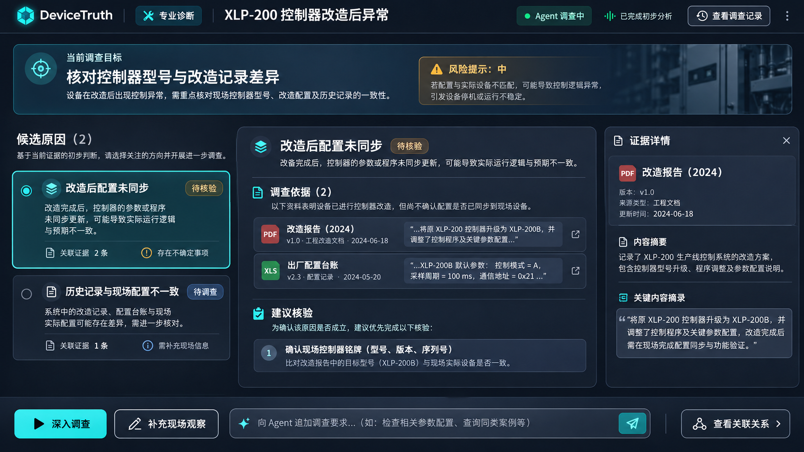

# DeviceTruth 专业模式 MVP 开发计划 V0.2

> 日期：2026-11-17；依据：`DEVICETRUTH_BACKEND_MVP_READINESS_REVIEW.md`；目标：比赛提交前一周内跑通专业模式核心闭环。
>
> 本文是开发计划初稿，不是当前已实现功能清单。页面原型为说明交互用的示意图，不代表系统已生成这些具体诊断结论或引用。

## 1. 目标与边界

**只开发专业模式主页面**，不同时建设个人模式、登录、管理后台、团队协作、图形编辑器。项目定位仍然是通用设备检修 Agent，兼容工业设备与汽车资料，但不为两域开发不同界面。

唯一重点闭环：**提问 → Agent 自主调用工具/Skill/RAG → 展示判断和证据 → 点击某一判断要求深入调查 → 创建下一 Run → 展示新结果 → 允许用户补充信息或回复 ASK_USER → 给出诊断结论**。

保留现有 `TaskOrchestrator`、`GeneralReasoner`、`GeneralAgentService` 和持久化结构；MVP **不新增**独立 CanvasComposer、DiagnosisCase/Canvas 表或新 Agent 状态机。以 `Conversation` 表示一次持续调查，以多个 `Run` 表示调查轮次，前端将结构化结果投影成工作台。

## 2. 专业模式页面原型与交互

**只做一张专业诊断工作台**，不额外设计“聚焦/关系”两套工作流程。

- **顶部任务区**：当前故障问题、关联设备、Run 状态、风险与模拟数据提示。
- **左侧候选判断区**：仅当 `AgentResult.category=POSSIBLE_CAUSES` 时，才将相应 `claims` 作为候选原因；其他 category 显示为结论/事实卡。用户点击卡片仅切换查看焦点，不自动请求模型。
- **中央调查详情区**：选中判断的说明、关联引用、待核验建议，以及“深入调查”“补充现场信息”两个主要操作。`suggestions` 是建议，不自动认定为已执行检查。
- **右侧证据抽屉**：点证据打开详细来源、摘录、版本、数据性质；可收起，非永久第三栏。实际数据若为 Markdown、导入快照或模拟观察，要按真实来源标注，不能让示意图中的 PDF/XLS 图标误导为已实现 PDF 导入。
- **底部协作输入**：保留自然语言调查补充入口；执行中显示进度、取消以及等待补答状态。关系图按钮先保留入口或隐藏，不作为首周验收范围。

**交互规则**：
1. 初次提交：创建/复用 Conversation，提交消息并获得 Run；订阅 SSE 展示状态。
2. 查看候选原因：选择 `claim`，从 `referenceIds` 找到实际 `references`；无引用时标注“当前无已关联引用”。
3. 深入调查：以选中 claim 的原文构造用户可见的明确请求，提交新消息（新 Run），相关引用通过 `contextRefs` 传入，沿用会话历史。
4. 补充信息：普通补充在 Run 结束后提交新消息；Agent 已发 ASK_USER 时，使用 `replyToQuestion` 恢复原 Run，不应另建新 Run。
5. 刷新恢复：重新获取 Conversation 的全部 Run 和最后结果；不依赖前端内存充当权威数据源。

## 3. 后端补全（严格最小）

### 3.1 可直接复用

- `POST /api/conversations` 与 `POST /api/conversations/{id}/messages`：初次提问、后续调查，遵守 `Idempotency-Key`。
- `GET /api/conversations/{id}`：获取消息和关联 Runs。
- `GET /api/runs/{id}`、`/references`、`/events`、`/stream`：结果、证据、执行进度、失败状态。
- `replyToQuestion`：ASK_USER 补答与续接；`contextRefs`：显式继承实际授权引用。

### 3.2 需要补全/核验

| 项目 | 优先级 | 最小工作 | 验收 |
|---|---|---|---|
| RUN_TOOL 安全摘要 | P1 | `TaskOrchestrator.runAgent` 的事件审计仅保存允许展示的 1-2 个参数；`SafeAgentEventViews` 白名单放行。`purpose` 若源数据存在可保存，不能凭空生成 | 事件接口能查看安全检索关键词/目标；长文本、敏感参数不泄漏 |
| QUEUED 滞留恢复（P1-04） | P0 稳定性 | 检查 `GeneralAgentService.recoverQueued` 的周期补派逻辑；以最小修改保证滞留 QUEUED 可重新调度，防重复抢占 | 模拟短暂调度失败后 Run 自动恢复，不需重启 |
| RAG 事务异常（P1-03） | P1 稳定性 | 在真实检索错误分支做针对性回归，评估并最小修复事务传播/登记错误 | RAG 登记失败不能破坏整个 Run 的检查点提交 |
| 最终回答崩溃窗口（P1-05） | 记录风险 | 首周不做复杂 WAL/事件存储重构；完成正常与恢复路径冒烟，保留已知限制 | 演示说明准确，后续补齐 |
| 真实模型与资料 | P0 | 选用真实模型配置；加载工业和汽车的有效数据；明确 `SIMULATED` 与真实资料边界 | 至少各完成一次真实模型诊断；不声称接入真机 |

**此阶段不新增 API、画布数据库、完整身份体系。** 如前端开发时发现现有 API 无法支撑基础闭环，优先做局部 DTO/接口适配，禁止扩建第二套 Agent Runtime。

## 4. 前端开发思路

采用 **Vue 3 + 当前样式体系**，第一版以“结构化卡片驱动的工作台”为主，不必先用 Vue Flow。参考已有 `RunTimeline.vue`、`DiagnosisReport.vue`、`EvidenceComparison.vue`，尽量复用。

最少组件：
- `ProfessionalDiagnosisPage.vue`：聚合 Conversation、Run、SSE 和当前选中 claim。
- `DiagnosisHeader.vue`：任务/设备/风险与运行状态。
- `ClaimList.vue`：候选判断列表（语义分类，不能强制所有 claims 都是故障原因）。
- `ClaimDetail.vue`：选中判断的摘要、关联引用、建议操作。
- `EvidenceDrawer.vue`：引用来源、版本、摘录、`dataNature`。
- `AgentActionBar.vue`：输入、深入调查、补答、取消与反馈。
- `canvasAdapter.ts`（可选命名为 `diagnosisViewModel.ts`）：**纯前端确定性映射**，将 `RunView.result`、`references`、`events` 组织成 UI ViewModel，不再调用 LLM。

状态策略：
- 以现有后端 Run/Conversation API 为权威数据；SSE 用于增量通知，完成后可主动同步最终结果。
- 当前选中的 claim 是局部 UI 状态，用户切换不会发送模型请求。
- 新一轮调查完成后展示最新版结果，并保留查看上一轮 Run 的入口；不编造跨 Run 的完整语义级图谱合并。
- 提交按钮防重复；失败时显示错误状态及重试，原引用与已完成历史仍可访问。

## 5. 一周执行计划（目标节点，不保证耗时）

| 时间 | 重点 | 当日验收 |
|---|---|---|
| D1 | 以原型冻结专业模式布局与字段映射，配置真实模型和测试数据 | 能读取一条真实 Run 的 `AgentResult`/引用；原型认可 |
| D2 | 前端页面骨架、ViewModel、真实数据卡片；后端并行修安全审计字段 | 真实 Run 可以渲染候选判断与证据，不用 mock |
| D3 | 节点点击、证据抽屉、SSE 运行反馈；后端并行补 QUEUED 恢复 | 能查看证据和工具过程，Run 异常不永久卡死 |
| D4 | 深入调查 → 新 Run → 新结果；补充信息/ASK_USER 补答 | 至少一次真实双向协作往返成功 |
| D5 | 打磨交互与边界、真实数据接入；必要时修 RAG 错误路径 | 工业主案例可连贯演示，能清楚说明证据和不确定性 |
| D6 | 汽车域回归、刷新恢复、失败兜底 | 两个领域使用同一套页面；可刷新恢复 |
| D7 | 冻结新增功能、全流程彩排、准备提交材料 | 稳定完整演示；已知风险明确 |

**范围停止规则**：若 D4 还没实现“选中原因 → 继续调查 → 结果更新”，立即暂停视觉细节、关系图、登录和其他扩展，集中修核心链路。

## 6. MVP 最低验收

1. 工业/汽车至少各有一个真实模型执行成功的调查样本，所展示的具体资料真实来自已授权的导入来源；模拟资产数据准确标示。
2. 能从 RunView 的 claims/references 建立真实引用关联；不存在伪造引用或将 `POSSIBLE` 自动升级为现场确认。
3. 点击一个候选原因仅切换 UI；点击“深入调查”才真正创建下一 Run，并可以继承合法 `contextRefs`。
4. 发生 ASK_USER 时，可正确提交回答并恢复同一 Run。
5. 工具执行状态、失败原因、完成结果通过现有 API/SSE 显示；刷新页面可以重新获取调查历史。
6. 后端全量回归或针对性回归通过，并对三项遗留可靠性缺陷进行真实、准确的状态说明。

---

**最终开发原则：先让已有 Agent Core 的结构化结果真正驱动专业工作台，再逐步完善。**
