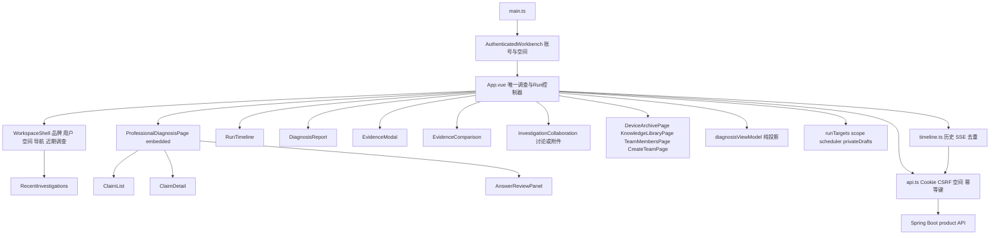

# DeviceTruth 专业检修工作台 UI 重设计：前后端能力契约审计

审计日期：2026-11-22。阶段：只读产品设计审计；本报告中的方案、任务和验收标准均未实施。

## 审计结论

**推荐保留现有认证外壳、App.vue 调查/Run控制器及全部API合同，把界面重排为“调查上下文—当前状态/结果—证据—明确下一次提交”的专业工作区。** 最大收益来自压缩重复说明、前置真实过程与判断导航、区分查看轮和活动轮、让结果与证据就近阅读，而不是新增业务功能或另造Agent画布。

本轮默认只处理A类已打通能力；B类仅列候选，不在本报告交付后自动接入。普通用户端、平台后台和后端改造均不在方案范围。

### 材料、证据和只读边界

- 初始Git状态仅有上一轮新增且未跟踪的`docs/DEVICETRUTH_CURRENT_STATE_AUDIT.md`，本轮保留不动；不修改其他源码/配置/文档，不执行测试、构建、迁移、API写请求或模型调用。
- 已阅读上述现状报告作为架构背景，结论重新核对当前Vue、TypeScript、CSS、Controller、record DTO、Service、Repository与公开事件白名单；不是从旧报告复制能力判断。
- 用户提供压缩包：`D:/Java_Project/DeviceTruth/outputs/devicetruth-ui-screenshots.zip`。直接内存解码并查看三张PNG，未解压落地：S1=`1-初始工作台.png`（1280×720）；S2=`2-Agent执行中.png`（941×893）；S3=`3-调查完成结果.png`（941×893）。S2/S3顶部已裁切或处于滚动位置，不能据此断言页顶按钮不存在。
- 截图证明画面呈现，不证明其部署构建与当前源码完全相同，也不证明截图中的诊断内容正确。本报告将截图观察、代码事实与拟议设计分开。
- 下文F=frontend/src；J=src/main/java/io/devicetruth。附录提供绝对路径与行号，表内方法、DTO名称可据索引定位。

### 能力分类

| 类别 | 定义 | 本轮处置 |
|---|---|---|
| A | 当前生产组件→前端调用→后端业务已形成链路 | 直接优化展示和现有交互反馈，不改请求/响应含义 |
| B | 后端已有能力/返回字段，但当前前端未消费或未完整呈现 | 标明具体字段与接入成本，仅作为可选候选，不自动接入 |
| C | 前端局部呈现/入口存在，但缺完整支持或语义不完整 | 如实保留限制，不能包装成完整功能 |
| D | 当前前后端均无该业务能力 | 从本轮设计排除，不建议为设计效果开发 |

“纯展示计算”不等于Mock：对真实字段分组、计数、格式化合法；补造进度、证据、置信度、执行步骤不合法。分类按具体交互颗粒度，不因整个接口属于A就把所有返回字段都当已被UI使用。

## 1. 当前前端架构

主要源码证据：[main.ts:1](D:/Java_Project/DeviceTruth/frontend/src/main.ts#L1)；[App.vue:100](D:/Java_Project/DeviceTruth/frontend/src/App.vue#L100)；[timeline.ts:48](D:/Java_Project/DeviceTruth/frontend/src/timeline.ts#L48)；[WorkspaceShell.vue:1](D:/Java_Project/DeviceTruth/frontend/src/components/WorkspaceShell.vue#L1)；[runTargets.ts:1](D:/Java_Project/DeviceTruth/frontend/src/runTargets.ts#L1)。

### 1.1 入口与组件关系



当前没有frontend/src/views目录，也没有Vue Router/Pinia依赖；页面由App.currentPage切换：investigation/devices/knowledge/members/create-team。调查内activeTab=overview/discussion/records/process，个人空间不显示团队讨论页签。URL hash只用于接收密码重置/邀请Token等现有入口，不是可任意设计的调查深链接路由。

| 对象 | 当前责任与取数方式 | 重设计必须保留 |
|---|---|---|
| AuthenticatedWorkbench | currentAccount、CSRF、空间列表、成员名映射；登录/退出/接受邀请；10秒成员资格复查 | setAccessContext、账号失效事件、空间切换重挂载、角色更新 |
| App.vue | conversation/messages/runs；run/activeRun/waitingRun；草稿、上传、引用、页签、报告、取消目标；统筹API | 不拆/不重建核心状态机；所有提交/补答/取消继续由现有handler拥有 |
| WorkspaceShell | props渲染空间/用户/导航/近期调查；emit交给App | 不自行创建会话或持有第二份Run列表 |
| ProfessionalDiagnosisPage | props中的Run/VM/引用；选中判断emit、展开完整结果为局部状态 | 不fetch、不再次生成答案；当前embedded模式隐藏自带任务头/右来源栏 |
| RunTimeline | props中的events/live/status/duration，按type/data格式化 | 只读事件、保留失败/未知码，不自己发起工具/模型 |
| DiagnosisReport | 同一Run/VM/引用，emit print/close/openReference | 不生成新Run、不调用模型或PDF后台 |
| EvidenceModal | 已登记ReferenceView、原生dialog、焦点与Esc | 当前打开来源不请求全文；不能改成任意URL或伪造页码 |
| EvidenceComparison | watch assetId/asOf→readAsset组合详情；局部分组表 | 保留数据性质和verificationStatus，不能把来源名当核验状态 |
| InvestigationCollaboration | discussion/materials两模式，自取讨论/附件/原文/发布 | 讨论、上传、引用草稿、正式提交、发布五个动作不能合并 |
| 独立资料/成员页 | 设备列表来自App；知识、成员页自行读取已授权接口 | 不扩展为平台级管理 |
| EvidenceDrawer / WorkspaceAdministration | 文件存在，当前生产App未导入挂载 | 不因名字像新方案就默认接回；现用EvidenceModal与独立页 |

### 1.2 当前事件和持久状态如何协作

1. 初次有效提交才ensureConversation，标题经initialMessage拼入userMessage；上传待发送文件、等待PARSED，再sendMessage；接受202后enterNewRun。
2. App.resolveRunTargets将**查看轮run**、**活动轮activeRun**、**待答轮waitingRun**分开；pinnedRunId只影响查看，不改变取消/补答目标。runPermissions同时控制按钮、键盘和handler。
3. ensureTracking对QUEUED/RUNNING建立有界waitForRun轮询；默认间隔1秒、单次等待60秒，超时是客户端等待失败，不表示后端已失败；WAITING/COMPLETED/FAILED/CANCELLED停止该轮询段。
4. timeline.follow先readRunEvents再开EventSource；只追加seq>maxSeq。首次stream URL未发送lastSeq，服务器可能从0补发，前端按seq去重；同一原生EventSource断线重连才自动带Last-Event-ID。
5. App只订阅活动轮；看历史时单独readRunEvents，不把活动流冒充历史过程。RUN_WAITING或RUN_TERMINAL触发readRun/会话详情回读，服务端持久版本才决定页面状态。
6. sceneGeneration、scoped loader、AbortController、mergeRunView和scheduler拦截旧空间/会话/旧版本响应；不得为排版绕开这些机制。
7. refreshHistory读取summaries，历史点击openConversation→detail→applyDetail恢复消息、Run、未决跟踪；localStorage保存的conversation-id以账号/空间作用域区分，不是唯一历史来源。
8. answerQuestion携待答轮自己的runId/questionId/questionVersion，409保留草稿并回读，不自动当新消息提交。cancelActive需确认目标仍为当前活动轮；RUNNING取消是协作式，不得按钮点击就显示已取消。

**当前来源加载时机特别重要：** App的引用watch只在TERMINAL_EVENT_STATUSES（仅COMPLETED/FAILED/CANCELLED，不含WAITING_FOR_USER）阶段调用loadRegisteredReferences；运行中及待答态抽屉计数可能为0/idle，不足以证明后端尚未取到来源。改变运行中加载节奏属于B类现有接口候选，不是本次默认A类视觉调整。

### 1.3 当前样式和Token范围

| 文件/位置 | 是否实际进入当前页面 | 现有规则与冲突面 |
|---|---|---|
| F/main.ts→design.css | 是，全局 | :root紫色系primary/accent、14px基础字、focus-visible、通用hint/error |
| F/main.ts→workspace.css | 是，全局 | .team-app蓝色语义Token、dt布局/表单/页签/抽屉/打印；1000px抽屉堆叠、600px窄屏 |
| F/App.vue style src=pro.css | 是，非scoped | .pro-light紫蓝Token、旧专业壳、pro-card和多组通用样式；与team-app同节点变量存在覆盖竞争 |
| 各组件style scoped | 是，按组件 | WorkspaceShell含固定蓝按钮、204px侧栏、64px顶栏、12/11px标签；Professional含embedded布局；Timeline固定淡紫背景等 |
| F/workbench.css | 当前main/App未发现导入 | 旧三栏.workbench样式，不作为当前布局依据，不为此次优化顺手删除 |
| F/AuthenticatedWorkbench scoped | 是 | 认证布局与表单，不是新的普通用户端 |

当前混用--ink/--muted/--surface与--text/--text-2/--panel，--warning/--success与--warn/--ok，也有直接色值和5/6/9/12/14/16px圆角。截图中壳层以蓝色为主；未运行getComputedStyle，不给出所有运行时变量最终覆盖值。重设计以统一专业蓝灰语义Token为方向，不通过重写构建顺序或删除历史CSS来实施架构清理。

## 2. 前后端API契约映射

主要源码证据：[api.ts:605](D:/Java_Project/DeviceTruth/frontend/src/api.ts#L605)；[GeneralAgentService.java:48](D:/Java_Project/DeviceTruth/src/main/java/io/devicetruth/application/agent/GeneralAgentService.java#L48)；[AgentConversationController.java:31](D:/Java_Project/DeviceTruth/src/main/java/io/devicetruth/api/AgentConversationController.java#L31)；[AgentResult.java:11](D:/Java_Project/DeviceTruth/src/main/java/io/devicetruth/core/contract/AgentResult.java#L11)；[FileController.java:40](D:/Java_Project/DeviceTruth/src/main/java/io/devicetruth/api/FileController.java#L40)。

### 2.1 真实DTO字段字典（供下表引用）

DTO定位：[GeneralAgentService.java:48](D:/Java_Project/DeviceTruth/src/main/java/io/devicetruth/application/agent/GeneralAgentService.java#L48)；[GeneralAgentService.java:69](D:/Java_Project/DeviceTruth/src/main/java/io/devicetruth/application/agent/GeneralAgentService.java#L69)；[AgentResult.java:11](D:/Java_Project/DeviceTruth/src/main/java/io/devicetruth/core/contract/AgentResult.java#L11)；[FileUploadService.java:51](D:/Java_Project/DeviceTruth/src/main/java/io/devicetruth/knowledge/FileUploadService.java#L51)；[ConversationRepository.java:32](D:/Java_Project/DeviceTruth/src/main/java/io/devicetruth/adapter/persistence/ConversationRepository.java#L32)；[WorkspaceService.java:15](D:/Java_Project/DeviceTruth/src/main/java/io/devicetruth/server/WorkspaceService.java#L15)。

字段以当前Java record与TS interface为依据；`?`表示可空/可选。未列出的业务字段不能因UI需要自行加进请求。DTO的辅助重载构造不是新HTTP版本。

| 代号 | Java定义 / 前端类型 | 精确字段 |
|---|---|---|
| D1 | GeneralAgentService.AgentTaskInput / sendMessage正文 | schemaVersion、userMessage、selectedAssetId?、attachments?、contextRefs?、asOf?、replyTo?、discussionQuotes?、expectedConversationVersion? |
| D1a | 内嵌受限map，由Service校验 | attachments=[{fileId}]；contextRefs=[{referenceId}]（最多10）；replyTo={runId,pendingQuestionId,questionVersion}；discussionQuotes=[{discussionId,version}]（最多10）；不接受owner/project/permissions |
| D2 | ConversationView | conversationId、version、createdAt、updatedAt |
| D3 | ConversationSummary/Page | item: conversationId、title、investigatedAssetId、latestRunStatus、activeRunCount、waitingRunCount、runCount、updatedAt；page: items、nextCursor |
| D4 | ConversationDetail / MessageView | detail={conversation:D2,messages:D4m[],runs:D5[]}；message={messageId,seq,role,content,selectedAssetId,requestedAt,asOf,actorUserId,discussionQuotes}；讨论引用快照含discussionId/version/authorUserId/authorName/createdAt/content/dataNature |
| D5 | GeneralAgentService.RunView | runId、conversationId、goalMessageId、status、version、requestedAt、asOf、investigatedAssetId、assetResolution、changedFromAssetId、dataNature、pendingQuestion、result、failureCode、activeDurationMs、usageStatus、inputTokens、outputTokens、cost、roundNumber、initiatedByUserId、executionActorUserId |
| D5差异 | F/api.ts RunView | 尚未声明后端已有roundNumber、initiatedByUserId；其余部分字段TS可选；当前轮号用runs数组下标+1，发起人用executionActorUserId，不能混同原发起人 |
| D6 | core AgentTaskInput.PendingQuestion / F PendingQuestion | pendingQuestionId、questionVersion、question、requestedFields、askedAt |
| D7 | core AgentResult / F AgentResult | summary、category、claims、suggestions、uncertainties、limitations、references、riskLevel、safetyDisposition、dataNature、subjectAssetId?、assetResolution?、review? |
| D7c | AgentResult.Claim | text、referenceIds、certainty、kind、relevance；certainty=POSSIBLE/SUPPORTED/CONFIRMED；kind=CAUSE/OBSERVATION/CONCLUSION/OTHER/UNKNOWN；relevance=DIRECT/CONTEXT/UNRELATED/UNKNOWN |
| D8 | AgentResult.Reference / F Reference | referenceId、sourceType、sourceId、sourceVersion、chunkId、title、page?、section?、excerpt、dataNature |
| D9 | SafeAgentEventViews.PublicEvent / F RunEvent | seq、type、recordedAt、data、actorUserId?；当前TS RunEvent未声明actorUserId。type对应data见2.5 |
| D10 | SkillRuntime.SelectionView | skillId、version、devices[]、tasks[]；不返回正文、文件路径或安装编辑能力 |
| D11 | FileUploadService.FileView | fileId、originalName、mime、checksum、byteSize、parseStatus、failureCode、documentId、title、documentVersion、domain、createdAt、uploadedByUserId、conversationId、usageScope、dataNature |
| D12 | FileContent | fileId、uploadedByUserId、conversationId、usageScope、dataNature、content；组件当前只取content |
| D13 | ConversationRepository.Discussion/Page | item={discussionId,version,seq,authorUserId,authorName,content,createdAt}；page={items,nextCursor}；前端局部接口省略seq/authorUserId但后台已返回 |
| D14 | FileUploadService.Publication | publicationId、documentId、title、applicability、publishedByUserId、originalAuthorUserId、documentVersion、dataNature、createdAt |
| D15 | FileUploadService.KnowledgeDocument | documentId、title、documentVersion、dataNature、ingestStatus、applicability、publishedByUserId、originalAuthorUserId、publishedAt |
| D16 | AssetFactService.Composite / F AssetComposite | assetId、ownerId、projectId、asOf、configurations[]、maintenance[]、installationStatus、conflict、requiredChecks[]、limitations[]、dataNature |
| D16c | core AssetFacts.ConfigurationEntry | recordId、componentId、attribute、value、sourceType、sourceId、sourceRef、dataNature、verificationStatus、authority、validFrom、validTo、recordedAt、observedAt |
| D16m | core AssetFacts.MaintenanceEntry | recordId、componentId、operation、beforeValue、afterValue、sourceType、sourceId、sourceRef、dataNature、verificationStatus、authority、validFrom、validTo、recordedAt、observedAt |
| D17 | AccountService.AccountView / WorkspaceService.WorkspaceView / MemberView | account={userId,email,displayName}；workspace={workspaceId,kind,name,role}；member={userId,displayName,email,role} |
| D18 | TeamInvitationService.InvitationView | invitationId、workspaceId、email、role、status、deliveryStatus、expiresAt；当前成员组件局部类型省略workspaceId/expiresAt |

HTTP输入schemaVersion=1不表示每个响应里都有schemaVersion字段。asOf在后端输入DTO存在，但当前sendMessage/replyToQuestion没有暴露该参数，不能设计为已支持的可选日期表单。标题无独立持久DTO字段：initialMessage(title,message)=trim(title)+换行+message，currentTitle取首条USER消息第一行；不存在重命名调查API。

### 2.2 A类：调查与结果真实已接通

统一前提：同源Cookie；api.call自动CSRF与X-Workspace-ID（认证路径除外）；正式消息有Idempotency-Key。这里“前端API方法”包括组件使用的通用productRequest，不能只检查命名导出函数。

| UI功能/类 | 前端组件 | 前端API方法 | 后端接口 | 请求字段 | 返回字段 | 当前支持的交互/服务与持久逻辑 |
|---|---|---|---|---|---|---|
| 首次正式创建 A | App.submit | ensureConversation→createConversation | POST /api/conversations | 空对象{}，不能传title | D2，201 | GeneralAgentService.create→ConversationRepository+空间作者绑定；仅有效提交创建，不是点“新建”就写库 |
| 提交目标 A | App.submit | sendMessage | POST /api/conversations/{id}/messages | D1：schemaVersion=1,userMessage；可选设备/附件/引文；expectedConversationVersion；幂等header | D5，202 | submit锁会话/去重/写权/版本/未决Run；append消息→enqueue→bindRun/snapshot/segment→worker |
| 现场观察 A | App composeMode=observation | sendMessage | 同上 | userMessage前缀“现场观察（用户报告，未经核实）”+正文；其余同上 | D5 | 文本用户报告，不是专门遥测表写接口、不自动核验 |
| 针对判断继续调查 A | Professional→App.investigateCurrent | sendMessage | 同上 | 当前判断生成的可编辑正文、plan.selectedAssetId、contextRefs、expectedConversationVersion、discussionQuotes；附件数组为空 | D5，新runId | 从当前完成判断形成新目标；最多继承10个引用；不继续原Run、不随附输入区文件 |
| 回答追问 A | App.answerQuestion | replyToQuestion | 同上 | schemaVersion,userMessage,replyTo三元组，discussionQuotes?；当前包装不传设备/附件/asOf/会话版本 | D5，同runId | Service.reply核对WAITING、问题ID/版本与会话；消费问题、新执行段、同Run排队；过期409保留草稿 |
| 回读/恢复调查 A | App.openConversation/refresh | readConversation | GET /api/conversations/{id} | path id | D4 | 同归属messages+runs完整回读；applyDetail合并版本、恢复未决跟踪 |
| 近期搜索/筛选/翻页 A | RecentInvestigations→App | listConversationSummaries | GET /api/conversations/summaries | q?,assetId?,status?,cursor?,limit?；当前UI主要q/status/cursor | D3 | ConversationRepository.summaries按归属汇总；nextCursor非总条数；“已加载数量”不能称全库总数 |
| 当前轮与活动轮同步 A | App.track/resyncRun | waitForRun→readRun | GET /api/runs/{id} | runId | D5 | 仓储持久状态/结果；version合并，不用动画决定完成 |
| 查看过程 A | App/RunTimeline | readRunEvents | GET /api/runs/{id}/events | after?，非负seq | D9[] | events按序、白名单；历史查看不新建Run |
| 实时通知 A | timeline.ts→App | openRunEventStream | GET /api/runs/{id}/stream | path id；重连Last-Event-ID | D9事件帧；RUN_TERMINAL={status}无id | RunEventStreamService先历史/订阅/补读，结束后回读D5 |
| 取消活动轮 A | App.requestCancellation/cancelActive | cancelRun | POST /api/runs/{id}/cancel | 无业务body | D5 | QUEUED/WAITING可直接取消，RUNNING先标记等待收口；执行actor/ADMIN可取消，终态竞争409 |
| 本轮登记来源 A | App.loadRegisteredReferences | readReferences | GET /api/runs/{id}/references | runId | D8[] | AgentRunRepository按Run/owner/project读取；目前主要完成/失败/取消后自动加载，待答态不自动加载 |
| 引用详情 A | ClaimDetail→App→EvidenceModal | 无新API；复用readReferences结果 | 无额外请求 | referenceId本地选择 | 已加载D8→ReferenceView | openReference必须在registeredReferences中；不是后台get_document_excerpt调用 |
| 已选Skill A（取数） | App watch→selectedSkill | readRunSkill | GET /api/runs/{id}/skill | runId | D10；未选择404 SKILL_NOT_SELECTED→null | 只读；embedded主体未显示自带task-meta，不能说已在当前头部完整呈现范围 |
| 设备下拉/档案 A | App、DeviceArchivePage | listAssets | GET /api/assets | 无 | string[] | AssetFactService.assets按归属；只有ID，不能补造型号/品牌/位置 |
| 设备事实对照 A | 抽屉EvidenceComparison | readAsset | GET /api/assets/{assetId} | asOf?，ISO时间；当前传查看轮时点 | D16/D16c/D16m | composite聚合配置/维修及装机/冲突/requiredChecks；只读，不提交现场确认 |
| 报告查看与打印 A | App/DiagnosisReport | 无新API；showReport加载已有来源、printReport→window.print | 复用Run/引用读取，无PDF生成端点 | 当前查看Run | D5/D7/D8及VM | 打印同一持久结果，不重新调用模型；浏览器另存PDF不是后台文件下载 |

### 2.3 A类：附件、知识与团队协作

| UI功能/类 | 前端组件 | 前端API方法 | 后端接口 | 请求字段 | 返回字段 | 当前支持的交互/业务限制 |
|---|---|---|---|---|---|---|
| 调查附件上传 A | App.upload/submit、InvestigationCollaboration.upload | uploadInvestigationAttachment | POST /api/conversations/{id}/attachments | multipart file；后端还支持title/domain/deviceModel/version/dataNature，当前包装只传file | D11，202 | FileUploadService上传受控文件/异步导入；App首次待发送可先本地stagedFile再正式提交时上传 |
| 附件处理等待 A | App.importAttachment | waitForFile→readFile | GET /api/files/{fileId} | fileId | D11 | 每500ms回读至PARSED/FAILED/OCR_REQUIRED，60秒客户端超时；不显示百分比 |
| 附件重试 A | App.retryAttachment；资料抽屉 | retryFile或productRequest | POST /api/files/{fileId}/retry | fileId | D11，202 | 服务只允许FAILED/OCR_REQUIRED；当前UI只对FAILED展示重试，不承诺OCR可恢复 |
| 附件列表 A | InvestigationCollaboration materials | productRequest | GET /api/conversations/{id}/attachments | offset/limit，组件每页20 | D11[]，无total | 只读当前调查文件；与发送时attachments引用清单含义不同 |
| MD/TXT原文 A | 同上content | productRequest | GET /api/files/{fileId}/content | fileId | D12；组件取content | 不执行Markdown脚本；PDF返回PDF_NOT_SUPPORTED，原文缺失保留错误 |
| 发布知识 A | 同上beginPublish/publish | productRequest | POST /api/files/{fileId}/publications | PublicationInput={title,applicability} | D14 | 写权、CONVERSATION_ATTACHMENT、PARSED且READY；发布到当前空间，可跨调查检索，非直接确认现场事实 |
| 知识库列表 A | KnowledgeLibraryPage | productRequest | GET /api/knowledge/documents | limit/offset，每页20 | D15[]，无total | 显示版本/性质/作者/适用范围；没有全文编辑/删除/撤回操作 |
| 讨论列表 A | InvestigationCollaboration discussion | productRequest | GET /api/conversations/{id}/discussions | after/limit，当前limit100 | D13 Page | 独立讨论seq分页；不自动生成分析或SSE同步所有草稿 |
| 发表讨论 A | 同上post | productRequest | POST /api/conversations/{id}/discussions | DiscussionInput={content} | D13 item，201 | addDiscussion写讨论表，8k长度校验，不派worker |
| 引用讨论 A | 同上emit quote→App.quoteForAnalysis | 本地选草稿，正式提交经sendMessage/replyToQuestion | messages接口 | 仅discussionId/version，原文由服务resolveQuotes固定 | D4/D5 | 前端显示原文和作者，服务器不信任客户端重写讨论原文；非知识引用ID |
| 成员列表 A | AuthenticatedWorkbench、TeamMembersPage | workspaceRequest | GET /api/workspaces/{id}/members | 空 | D17 member[] | 成员名映射与角色；不是全站账号列表 |
| 修改团队名 A | TeamMembersPage.change | workspaceRequest | PATCH /api/workspaces/{id} | NameInput={name} | D17 workspace | ADMIN限定、团队名称≤100；不用于调查标题改名 |
| 改角色/移除 A | 同上 | workspaceRequest | PATCH /{id}/members/{userId}；DELETE同路径 | PATCH RoleInput={role}；DELETE无body | {updated:true}/{removed:true} | ADMIN、最后管理员保护；保存后重新读取，非先假定成功 |
| 邀请列表/创建 A | TeamMembersPage | workspaceRequest | GET/POST /api/workspaces/{id}/invitations | POST Create={email,role} | D18[]/D18 | ADMIN限定；投递状态独立于加入状态 |
| 邀请重发/撤销 A | 同上change | workspaceRequest | POST /{id}/invitations/{invitationId}/resend或/revoke | 无业务body | D18或{revoked:true} | 不把邮件供应商接受标成收件人收到 |
| 接受邀请 A | AuthenticatedWorkbench→App确认横幅 | productRequest | POST /api/invitations/accept | Accept={token}，来自现有URL hash | {workspaceId} | 登录邮箱匹配，重载空间列表；不是任意加成员 |
| 创建团队 A | CreateTeamPage→外层 | workspaceRequest | POST /api/workspaces | NameInput={name} | D17 workspace | 独立空空间，个人调查/资料不自动迁入 |

### 2.4 身份与安全合同（必须保留，不作为新普通用户端开发）

| UI/API | 请求DTO | 响应与当前消费 |
|---|---|---|
| loadCsrf GET /api/auth/csrf | 无 | {headerName,token}存内存；写请求自动携带，不进入界面/报告 |
| authenticate register POST /api/auth/register | Registration={email,password,displayName} | D17 account；注册创建个人空间/ADMIN并登录 |
| authenticate login POST /api/auth/login | Login={email,password} | D17 account；刷新CSRF状态；Cookie Session而非UI保管JWT |
| currentAccount GET /api/auth/me | 无 | D17 account；恢复登录 |
| logout POST /api/auth/logout | 无 | {loggedOut:true}，清身份/空间及账号草稿 |
| authAction POST /api/auth/password-reset-requests | ResetRequest={email} | {status,message}，不泄漏邮箱是否存在 |
| authAction POST /api/auth/password-resets | PasswordReset={token,password,confirmPassword} | {passwordReset:true}；返回登录，不把Token展示 |
| listWorkspaces GET /api/workspaces | 无 | D17 workspace[]，真实成员资格；setAccessContext改变作用域 |

api.call为所有当前包装器提供同源credentials、CSRF、空间header和contextGeneration。401（非登录/注册）清认证并通知外层；403清CSRF，下次重取；切空间拒绝旧响应；错误ApiError保留code/status/retryable/traceId，兼容后端只有code的安全错误。后端部分文件/知识路径仍是requestId，不能在UI虚构每次都有traceId。重设计不得把凭据、数据库归属或权限字段做成可编辑设置。

### 2.5 SSE事件与展示能力

状态集合需分别理解：api.waitForRun的TERMINAL包含WAITING_FOR_USER（停止一段轮询），runTargets.ACTIVE_STATUSES也包含它（仍是未决任务）；scheduler.TERMINAL_EVENT_STATUSES只有COMPLETED/FAILED/CANCELLED。不得因为前者叫TERMINAL，就认为待答已经完成或当前自动加载来源。

D9外壳seq/type/recordedAt/data，actorUserId由后端可返回但当前TS未消费；事件白名单与api STREAM_EVENT_TYPES不是同一清单，必须逐项核对。

| 事件 | 真实data字段 | 当前前端消费 | 可表达/不能表达 |
|---|---|---|---|
| RUN_QUEUED | status | 具名监听+Timeline | 已入队；无队列排名/预计等待 |
| RUN_RECOVERED | attempts | 监听+显示“第N次恢复” | attempts是领取尝试计数，不能直接等同恢复次数；宜称“已恢复，执行尝试N” |
| RUN_WAITING | questionVersion | 监听→回读Run；Timeline | 待补充通知；问题正文/字段必须读D6，不由事件编造 |
| RUN_TOOL | toolName,success,errorCode,references,durationMs,retryable | 监听+Timeline逐行 | 记录一次工具处理结果，无启动事件、参数/purpose/原始输出；success=true且references=0不能说找到证据 |
| RUN_MODEL | model,attempt,outcome,durationMs,retryable,inputTokens,outputTokens,cost | 监听；Timeline显示部分 | 调用尝试完成记录，不是token实时进度或内部思考；attempt不等于调查步骤 |
| RUN_PHASE | phase,reason | 监听，但Timeline只看NO_PROGRESS/否则预算 | 可出现FINALIZING、REVIEWING、CORRECTING；应按真实phase翻译，不能宣称已通过 |
| RUN_ANSWER_REVIEW | code,unitIds,rules,reviews,corrections | **未在STREAM_EVENT_TYPES注册**；历史REST可能取回，Timeline无专用映射 | 后端支持，前端局部未接全；B类事件呈现候选，不能设计为当前稳定实时可见 |
| RUN_DEGRADED | code,references | 监听+有限结果文字 | 保留原原因码；来源数不等于候选原因数 |
| RUN_ANSWER | summary,category,claims,suggestions,uncertainties,limitations,references,riskLevel,safetyDisposition,dataNature | 监听，Timeline摘要；完整结果回读D5 | claims/references是数组，不能将其当number直接读取；无review/subject等完整Run字段 |
| RUN_FAILED | code | 监听+失败 | 明确失败；不能自动当新任务重发 |
| RUN_CANCELLED | phase | 监听+取消 | 持久取消；与用户点击请求取消分开 |
| RUN_LATE_RESPONSE | status,code | 监听+迟到响应 | 记录被丢弃/收口，不代表新答案采纳 |
| RUN_TERMINAL | {status}，无seq/id | onTerminal，不追加普通events列表 | 连接本执行段结束，WAITING也会结束流，不等于任务COMPLETED |

未知type显示“其他运行事件/原type”，未知phase保留原码，不统一当“预算耗尽”。未知success保留未知，不涂绿。可依据持久事件计算已记录工具次数/成功失败次数/最后事件时间，须标明“本轮已记录”，不能把工具references求和作为去重后的来源总数。

### 2.6 B类及未消费包装器：不是现有UI功能

| 能力 | 后端/真实字段 | 当前前端证据 | 是否列入重设计候选 |
|---|---|---|---|
| 运行用量 | D5 activeDurationMs/usageStatus/inputTokens/outputTokens/cost | activeDuration已在过程展示；Token/cost未形成当前面板 | 仅技术详情可选，缺值显示“未报告”；成本无明确币种字段，不设计货币账单 |
| 服务端轮号/原发起人 | D5 roundNumber/initiatedByUserId | F RunView未声明，UI用数组下标/执行actor | 可选严格对齐已有响应字段；默认方案仍可用原列表定位，不能混作者 |
| 事件执行人 | D9 actorUserId | F RunEvent未声明 | 可选，不借此显示在线协作者/正在输入 |
| Skill元数据展开 | GET run/skill D10 | 已取数，embedded模式下隐藏自带meta，范围devices/tasks未完整展示 | 可直接利用已有数据展示“已选领域包/范围”，不是手动切换Skill |
| 运行中来源回读 | GET run/references D8[] | 包装已用，但App只在完成/失败/取消阶段自动取 | B：可候选按现有事件/手动刷新取本轮来源，不能增加第二轮询状态机 |
| 工具明细 | GET run/tool-events；ToolEvent={sequence,toolName,success,errorCode,referenceCount,durationMs,retryable} | 无专用wrapper/生产调用，events已部分覆盖 | 默认不新增面板/请求；技术详情确需时再审，不自动接入 |
| 模型明细 | GET run/model-events；ModelEvent={sequence,model,attempt,outcome,durationMs,retryable,inputTokens,outputTokens,cost} | 无专用调用，events已部分覆盖 | 同上，不作为后台统计功能 |
| 原会话列表/仅消息列表 | listConversations GET conversations；GET conversations/{id}/messages | 前者有wrapper无生产调用；后者无专用wrapper，App用detail | 不替换已用summary/detail，不新增重复请求 |
| 独立配置/维修过滤 | GET assets/{id}/configuration或maintenance | 无当前调用，EvidenceComparison用组合readAsset | 不为此次视觉调整重写取数；可用已读组合数据做本地展示 |
| 文档元数据/片段/引用原文 | GET knowledge/documents/{id}、/{id}/chunks/{chunkId}?runId、references/{id}?runId | 当前EvidenceModal不调用；使用D8摘录 | B，只能在授权材料和实际ID充分时考虑“读取完整片段”；绝不把当前摘录伪称全文 |
| 知识搜索/导入/工具目录 | POST knowledge/search、documents；GET knowledge/tools | 无当前生产页面调用，主要Agent/工程链 | 非本轮默认候选；search有Run/材料资格及写权要求，不设计全库任意搜索台 |
| 普通文件上传uploadMarkdown | F已有wrapper→POST /api/files | 生产App未调用，当前用会话附件上传 | 保持当前隔离语义，不用它替代调查附件，不自动上传为空间知识 |
| summaries扩展筛选 | assetId、status=CANCELLED等已支持 | wrapper可传，当前控件没有全部选项 | B候选，优先只补真实“已取消”筛选；无优先级/负责人/日期查询字段 |

### 2.7 C/D类交互边界

| 能力 | 类别与理由 | 界面处理 |
|---|---|---|
| PDF上传并展示状态 | C：后端留文件、OCR_REQUIRED，解析链不完整 | 若保留上传，明确不可检索/不可预览，不提供“解析完成”假态；主composer仍只MD/TXT |
| 附件“移除” | C（若理解成删除）：App仅清staged/uploaded本地选择，后端无DELETE | 名称应明确“取消本次附带/移除待发送”，不能显示“已删除文件” |
| 独立调查标题/目标持久编辑 | C：标题仅拼正文，没有独立update接口 | 初次标题可保留；不增加重命名/保存独立目标操作 |
| 执行百分比、剩余时间、预定步骤完成率 | D：无计划总量/进度/ETA字段 | 用真实状态和已发生事件，禁用伪进度条 |
| 暂停/恢复、任意重试某工具、停止后回滚 | D：只有取消和等待补答/恢复机制 | 不画暂停/重试工具/撤销执行按钮 |
| 判断级行动闭环/完成勾选/消除故障 | D：suggestions为本轮string[]，无action实体或写回API | 展示建议列表，不能提供“已执行/已验证”持久勾选 |
| 置信度百分比/故障概率/风险分数 | D：只有certainty与risk枚举 | 文字标签，不换算数值 |
| 现场确认、资质确认、远程控制/派工 | D：当前无完整相关作业合同 | 不新增确认开关或控制按钮 |
| 多人在线/正在输入、共享草稿实时协作 | D：成员列表和讨论分页不等于presence | 仅显示空间成员数/已记录作者，不标在线状态 |
| PDF后台下载、签章、正式报告审批 | D：当前window.print，无文档生成/签署API | 保留“打印/另存为PDF”，不冒称已生成可下载文件 |

## 3. 三个关键界面的现有功能与数据映射

主要源码证据：[App.vue:1193](D:/Java_Project/DeviceTruth/frontend/src/App.vue#L1193)；[draftSubmission.ts:3](D:/Java_Project/DeviceTruth/frontend/src/draftSubmission.ts#L3)；[ProfessionalDiagnosisPage.vue:17](D:/Java_Project/DeviceTruth/frontend/src/components/ProfessionalDiagnosisPage.vue#L17)；[diagnosisViewModel.ts:262](D:/Java_Project/DeviceTruth/frontend/src/diagnosisViewModel.ts#L262)。

### 3.1 初始调查：保留真实字段，合并视觉层级

S1可见：64px品牌栏、204px侧栏；主区任务标题后出现一张约126px高的“从设备现象开始”卡片，再隔大段留白进入“补充调查信息”。在1280×720截图里创建按钮接近底边，设备选择与附件链接挤在同一行。这里的像素为截图观察，不作为浏览器精确盒模型测量。

| 当前UI元素 | 实际业务字段 | 接口支持 | 建议保留 | UI调整方向/约束 |
|---|---|---|---|---|
| 工作空间 | X-Workspace-ID→服务器解析真实成员/owner/project | A | 必须 | 在任务头明确当前空间与可见范围，不另加可编辑租户字段 |
| 设备选择 | selectedAssetId?；值来自GET assets string[] | A | 是、仍可空 | 提到创建卡顶部“排查设备（可选）”；不假造设备名称/位置/型号，不要求必须选设备 |
| 调查标题 | newTitle本地；initialMessage第一行拼userMessage | A（首次文本） | 是、仅初次 | 紧凑单行；保留200字符前端限制，并提示标题与正文拼接后须符合后端8000码点总限，不增加title请求键；无后续改名按钮 |
| 故障现象描述 | draft/composerText→userMessage | A | 必须 | 主要文本区，适当增高，提示写现象、发生条件和已有检查；保持一个提交正文 |
| 调查目标 | 无单独goal/objective字段；语义包含userMessage | 非独立字段 | 不新增独立输入 | 将希望调查的问题写入同一正文；可改标签为“现象、已有检查与调查要求”，不另造目的DTO |
| 添加附件 | stagedFile（首次本地）→conversation attachments上传；D11→attachments[{fileId}] | A | 是 | 形成紧凑文件行，显示待发送/处理中/成功/失败，不把上传等同已经关联到Run |
| 附件关联 | message attachment refs＋执行段材料快照 | A | 是、明确区别 | 初次上传后PARSED才正式提交；资料抽屉里已上传附件不表示自动发布知识；不做虚构多选管理器 |
| 移除附件 | stagedFile=null或uploadedFile=null | 仅本地选择 | 是但改准确文案 | “取消本次附带”，不是数据库删除 |
| 提交任务 | createConversation→sendMessage，expectedConversationVersion/幂等键 | A | 唯一主操作 | “创建并开始调查”；上传/发送期间禁用，错误保留草稿，不自动重发 |
| 归属/资料警示长说明 | 当前空间/数据性质与用户报告边界 | 前端说明 | 精简但保留含义 | 一处说明“仅自己/团队可见”；首次未有Run不显示虚假的实际数据性质或来源计数 |

**推荐布局：**取消单独大空状态卡，让“新建检修调查”标题、空间说明和同一张创建卡连起来。卡内顶部设备选择，下一行标题，主要正文，文件行与底部右对齐主按钮。正文宽度控制到约760–880px；右侧空白可用于原有支持格式/隐私短说明，不新增场景模板、推荐故障或示例数据。1280×720常规字体缩放下设备、标题、正文和主按钮应在首屏可达，不靠压缩正文到11px实现。

### 3.2 执行中：真实过程代替重复占位

S2同时有头部活动状态、蓝色活动横幅、白色“执行中”卡片和下方“正在恢复调查”提示。主要过程需点击“调查过程”页签；较大的输入区及空“调查方向”占据下方。截图中没有展开过程，因此不能推断没有工具事件。

| 内容 | 数据来源 | 当前支持/语义 | 新设计呈现 |
|---|---|---|---|
| 排队/运行/等待/终态 | D5.status | 真实持久状态 | 主状态条只出现一处，执行状态与结果类别分开 |
| 活动轮作者与轮次 | activeRun.executionActorUserId + runs定位；后端roundNumber另有 | 真实字段+前端计算 | 标注“正在执行的轮次”；历史查看页另标“当前查看第N轮” |
| 调查阶段 | RUN_PHASE.phase/reason | 真实事件，无全流程百分比 | “准备最终答复/复核答复/修正答复”；未知回退“处理中（原phase）” |
| 工具调用 | RUN_TOOL实际完成事件 | 无“当前正在执行某工具”起始时刻 | 事件行显示动作名、完成/失败/无来源、耗时、来源数，未发生不预画完成勾 |
| 模型调用 | RUN_MODEL | 尝试记录，不是内心思考 | 默认紧凑，技术细节折叠，失败/超时不隐藏 |
| 真实时间线 | 当前查看轮的timelineEvents | 事件顺序/seq | overview执行态加入同一RunTimeline的紧凑最近事件窗口；完整列表仍在过程页，复用同一数据，不重开流 |
| 等待补答 | D6 | 同Run问题与版本 | 提升为唯一主任务卡，问题、requestedFields、输入、补答按钮同组；其他新目标提交继续阻断 |
| 已记录来源数量 | readReferences D8[]，目前运行期可能未读 | “0”可能只是未读取 | 未加载显示“运行中尚未读取来源清单”，不写“没有证据”；终态empty才说本轮无来源 |
| 取消 | canCancel+确认dialog+POST cancel | 请求和持久取消有时间差 | 次级危险操作“取消本轮”；请求中显示“正在请求取消”，以回读状态收口 |
| 草稿 | privateDrafts、composeMode | 私有、不进入正在运行Run、不会自动排队 | 执行期间收敛为“准备下一轮补充”可展开；保留草稿且明显不能提交，不冻结资料/讨论 |
| 历史查看 | run vs activeRun | 两套目标 | 历史结果顶部显示“查看历史；第M轮仍在运行”，回活动轮按钮；取消/补答显式属于活动轮 |
| 耗时 | D5.activeDurationMs | 累计执行段，不含等待用户，非剩余时间 | “累计执行用时”；没有新值可保持最近读值，不伪装毫秒实时计时 |

**禁止时间线内容：**假定“分析故障→查手册→验证原因→修复成功”四步；“已完成72%”；预计3分钟；思考中输出自造解释；把success=false涂绿或因可重试就提供实际重试工具按钮。最新已发生的成功事件不代表当前模型正在做同一件事。

### 3.3 调查完成：组织为可核对的专业结果

S3可见：“当前结论”首先是确定性模板“本次形成1项…”，然后蓝底下一步建议，当前焦点01/03、判断原文、无已关联引用、复核说明、不确定点/限制和展开完整结果。候选导航在当前embedded布局中位于pro-center（含composer）之后，截图未显示；不是当前焦点只有一个判断。

| 结果字段 | 后端真实来源 | 当前展示位置 | 可以如何优化/缺省 |
|---|---|---|---|
| status | D5，AgentRunRepository持久状态 | 页头/状态卡/报告 | “执行结束”独立于“故障是否查清”；COMPLETED不自动绿勾“修复成功” |
| category | D7，由模型草稿经Guard采纳 | VM类别与完整结果/报告 | 顶部显式“资料答复/候选原因/需人工复核/服务端核验结论”，不与status混同 |
| summary | D7.summary，RUN_ANSWER payload持久读取 | VM.summary；当前主要完整结果/无焦点分支，报告有原文 | 前置实际摘要，保留原文；现有shortConclusion做辅助性质说明，不用前端重新总结诊断 |
| shortConclusion | VM按category+directCauses.length计算，不是模型原文 | “当前结论”大字 | 改为小型结果性质提示，不能让计数模板替代业务摘要 |
| claims | D7c | ClaimList/Detail及完整结果、报告 | 左/上方紧凑可选判断列表，右/下方同一判断详情；保持原顺序和索引选择 |
| 候选原因 | kind=CAUSE且relevance=DIRECT的确定性投影 | directCauses组 | 只有这组叫直接候选；其他SUPPORTED不自动升级故障原因 |
| 背景/历史未知 | OBSERVATION或CONTEXT/UNRELATED及其余 | contextClaims/otherClaims | 分组明确，历史缺kind/relevance回UNKNOWN，不能为了填列表归入候选 |
| certainty | POSSIBLE/SUPPORTED/CONFIRMED | 文字chip | “可能/资料支持/服务端已核验”，无百分比和排序概率 |
| claim.referenceIds | D7c，Guard限制为本Run子集 | 判断卡的引用按钮 | 就近显示可点击来源；无引用“未关联工具来源”，不生成占位文献 |
| references | D8[]来自result所用引用或Run登记引用；当前App实际用后者独立加载 | 抽屉/ClaimDetail/EvidenceModal/报告 | 分清“本判断引用”“本轮其他已登记来源”，不得称全部都支持当前判断 |
| title/version/page/section/excerpt | D8；版本/章节/摘录由知识或资产引用登记 | modal与来源卡 | 正文摘录在先，文档标题版本定位次之，技术ID折叠；无页码用实际section，无二者则明确未提供 |
| suggestions | D7.string[] | nextActions取前3、完整结果和报告全量 | “本轮建议”编号列表，保留其余可展开；不是已执行检查，不创建完成复选框 |
| uncertainties | D7.string[] | 当前结果下部与报告 | 单列“仍需确认”，与建议相邻；空数组“未列出”，不称没有任何不确定性 |
| limitations | D7.string[]+Guard追加受控说明 | 当前下部/完整结果/报告 | “适用边界与数据限制”精简视觉但原文完整可读；不能删除否定或风险句 |
| riskLevel | D7枚举LOW/MEDIUM/HIGH/PROHIBITED | 完整结果/报告；embedded自带头隐藏风险chip | 将已有枚举提到摘要旁文字标签，缺值“未返回”；不换算风险分数 |
| safetyDisposition | D7受控处置 | VM安全提示及完整结果 | 高风险提示就近可见；不能把“需专业人员”改为用户已具备资质 |
| dataNature | D5/D7及每D8独立性质 | 页头、说明、引用/报告 | 每来源保持自身标记，AUTHORIZED不等于现场核验；混合不强行全盘授权 |
| investigatedAssetId/assetResolution/changedFrom | D5持久对象，VM处理回退 | 页头/报告/设备抽屉 | 选择/确认/歧义/未确认分开；不得等同FIELD_CONFIRMED装机状态 |
| review | D7 review，v1逐项或v2整体 | AnswerReviewPanel | v2仅审核状态（units为空正常），无逐项条目不要做空可展开列表；旧无review如实说明 |
| HUMAN_REVIEW/有限交付 | category、review.limited、RUN_DEGRADED及正文限制 | VM人工复核说明/事件 | 没有统一顶层limited布尔值；三种信号分别展示，事件未读不能靠无claims推断全部失败 |
| failureCode/已取资料 | D5+Run references | FAILED/CANCELLED面板/报告 | 无答案也保留来源、事件、历史；不拿上一轮结果填空 |
| 打印 | 同D5/D7/D8、DiagnosisReport | reportOpen+window.print | 正式版面展示元信息、摘要、判断/引用、建议、边界和来源；无后台PDF保存按钮 |

建议、不确定点、限制是**本轮数组**，没有claimId/actionId关联。重设计不得把本轮建议直接挂到选中候选下称“此原因的专属维修步骤”。本轮报告标题也不能变成“已完成维修报告”或“已确诊故障单”。

## 4. UI设计能力边界：三张清单

主要源码证据：[api.ts:419](D:/Java_Project/DeviceTruth/frontend/src/api.ts#L419)；[SafeAgentEventViews.java:22](D:/Java_Project/DeviceTruth/src/main/java/io/devicetruth/application/agent/SafeAgentEventViews.java#L22)；[AgentRunRepository.java:561](D:/Java_Project/DeviceTruth/src/main/java/io/devicetruth/adapter/persistence/AgentRunRepository.java#L561)；[FileUploadService.java:51](D:/Java_Project/DeviceTruth/src/main/java/io/devicetruth/knowledge/FileUploadService.java#L51)。

### 4.A 可以直接优化（A类，不新增业务请求）

| 设计内容 | 既有输入/组件 | 可改内容 | 不可改变 |
|---|---|---|---|
| 整体壳层/空间导航 | WorkspaceShell/account/space/historyItems | 字体、间距、侧栏宽度、状态密度、长标题完整阅读 | 当前身份/空间切换/只读和退出语义 |
| 初始表单 | App现有slot和handler | 合并空态、重排设备/标题/正文/文件/提交 | 单userMessage合同和首次提交才创建会话 |
| 活动状态 | run/activeRun/waitingRun/permissions | 紧凑状态条、明确活动目标、补答提示和取消请求反馈 | 不建立第二Run状态来源，不自动排队草稿 |
| 执行过程 | timelineEvents/RunTimeline | 真实phase翻译、最近事件窗口、失败和技术详情层级 | seq去重、订阅归属、实际结果/未知码 |
| 结果与导航 | DiagnosisViewModel/ClaimList/Detail | 摘要前置、导航前置、本轮建议分区、证据就近 | 判断类别/原文/引用关系/安全限定不重写 |
| 资料抽屉/证据详情 | registeredReferences/EvidenceModal | 文档标题/定位/摘录优先，IDs折叠，焦点/键盘完善 | 不能用任意文档填缺失来源，打开不新建Run |
| 历史 | summaries/RecentInvestigations | 列表密度、状态标签、标题悬停/聚焦全文、分页反馈 | 当前筛选/游标语义，不假设total |
| 团队讨论/资料/成员 | 既有collaboration与独立页 | 明确正式提交边界、作者/时间排版、表单对齐 | 上传≠提交≠发布；成员数≠在线数；ADMIN≠平台管理 |
| 报告 | DiagnosisReport/reportView | 阅读版式、打印分页、元信息与引用编号 | 不二次模型、不后台生成文件、不删原文风险条件 |
| 加载/空态/错误 | 现有loading/status/error、API码 | 区分未读取/读取中/空/失败/无权；草稿保留提示 | 不把空来源等同无依据，也不把错误显示成完成 |

### 4.B 可利用现有API/已有响应进一步呈现（B类候选，均需人工选入）

首选是**已经取得但未明显呈现的数据**：Skill范围、riskLevel、业务时点、来源版本、真实phase，无需扩大请求面。若新增读取，仅使用既有api.call/productRequest的安全路径。

| 候选 | 接口/字段 | 拟消费组件 | 接入限制 |
|---|---|---|---|
| 运行中来源“读取/刷新” | run/references→D8[] | App现有loader→资料抽屉 | 保留同Run scope及去重；不建立额外持续轮询；不将来源数与所有工具返回数等同 |
| 稳定服务端轮号 | detail/run→D5.roundNumber | App展示投影/轮次选择器 | 只扩前端响应类型/显示绑定，不改后端DTO和runTargets核心逻辑；旧null保守回退 |
| 原发起人与执行人分列 | D5.initiatedByUserId/executionActorUserId | 历史轮/技术详情 | 按真实memberNames解析，无姓名则“未知/ID”，不把执行人改成创建人 |
| 复核事件专门呈现 | events/stream→RUN_ANSWER_REVIEW data | api具名事件注册、RunTimeline格式化 | 前端局部接线候选，保持同一timeline控制器；不暴露草稿原文 |
| 已取消/设备筛选 | summaries.status=CANCELLED、assetId | RecentInvestigations | 保留server分页/查询；没有日期/负责人/优先级查询字段 |
| Token/耗时技术摘要 | D5及RUN_MODEL | 过程的可折叠技术区 | usageStatus UNKNOWN/PARTIAL明确；null不是0；不推断费用币种/账单 |
| 邀请到期时间 | D18.expiresAt | TeamMembersPage | 当前后端已有字段；不把前端倒计时当接受结果 |
| 读取已授权完整片段 | knowledge excerpt接口，runId/documentId/chunkId | 来源详情（仅确有完整ID时） | 默认仍用当前摘录；B候选不自动接入，不提供全库预览 |

### 4.C 当前不能实现或不能承诺的设计

- 百分比进度、ETA、队列排名、预定调查步骤与完成率：无对应数据。
- “正在调用get_xxx”的实时工具状态：当前RUN_TOOL只有结果事件；可说“最近完成的取证”，不能补造开始/结束区间。
- 自动维修方案执行/现场确认按钮、判断级待办勾选、故障关闭、派工：无写业务合同。
- “重试此工具”“暂停Agent”“回退到第N步”“并行创建子Agent”：无相应API；cancel不等于pause。
- 数字置信度/风险分数/证据可信度百分比：certainty/risk枚举和检索similarity都不能转换为这些含义。
- 任意附件删除/调查删除/标题重命名/归档收藏/导出后台PDF：未发现当前业务接口；不设计为可用按钮。
- PDF/OCR完成、扫描件预览定位、图片读数：当前解析链不支持。
- 成员在线、输入状态、共享草稿、讨论自动入模：无presence或共享编辑合同，且后者违反现有明确提交边界。
- 逐条建议都绑定候选原因/证据、规程每步前提已满足：现有D7建议是本轮string[]，不能做这种关联。
- 故障概率趋势、设备健康分、全队绩效/诊断命中率、平台用户/模型后台：无数据/业务，不纳入最终提交UI。

## 5. 当前UI具体问题：截图与代码分别取证

主要源码证据：[RunTimeline.vue:119](D:/Java_Project/DeviceTruth/frontend/src/components/RunTimeline.vue#L119)；[App.vue:1183](D:/Java_Project/DeviceTruth/frontend/src/App.vue#L1183)；[EvidenceComparison.vue:19](D:/Java_Project/DeviceTruth/frontend/src/components/EvidenceComparison.vue#L19)；[answerReviewView.ts:23](D:/Java_Project/DeviceTruth/frontend/src/answerReviewView.ts#L23)。

严重度表示对本次使用和事实表达的影响，不是架构优劣评判。源码可确定的语义问题不需要因截图没展开而忽略；未实际点击的交互不写“已复现”。

| 编号 | 证据/现象 | 对用户的影响 | 本轮设计处理（报告方案，未实施） |
|---|---|---|---|
| U01 空态和表单分离 | S1：大空态卡+间距+“补充调查信息”；App #empty/#composer | 新建任务像空页面下挂CRUD，主操作首屏压底 | 合并为单一创建工作卡；新建时标题用“创建检修调查”，不叫补充 [App.vue:1193](D:/Java_Project/DeviceTruth/frontend/src/App.vue#L1193) |
| U02 设备控件处于弱层级 | S1设备下拉原生小尺寸，挤在附件footer；App.dt-input-footer | 专业对象选择难扫读，且易误认必填/仅附件选项 | 提前到表单上下文行，仍标可选；统一控件尺寸 [App.vue:1219](D:/Java_Project/DeviceTruth/frontend/src/App.vue#L1219) |
| U03 运行占位重复 | S2活动横幅+执行中卡+运行提示；App与Professional active分支 | 占空间却不增加真实信息 | 一条持久状态＋最近真实事件；保留取消和草稿边界 [ProfessionalDiagnosisPage.vue:137](D:/Java_Project/DeviceTruth/frontend/src/components/ProfessionalDiagnosisPage.vue#L137) |
| U04 过程缺首屏辨识 | S2概览无真实事件；App仅process页挂RunTimeline | 用户只知道“检索中”，看不到已发生工作与失败 | overview执行态紧凑复用已有事件，完整过程不重复开连接 [App.vue:1254](D:/Java_Project/DeviceTruth/frontend/src/App.vue#L1254) |
| U05 空判断导航占位 | S2显示“0项/暂无结构化判断”；Professional v-if=run | 运行中无判断时展示空列表，干扰草稿/过程 | 运行中折叠空导航；完成且无判断时给正确空态 [ProfessionalDiagnosisPage.vue:115](D:/Java_Project/DeviceTruth/frontend/src/components/ProfessionalDiagnosisPage.vue#L115) |
| U06 关键判断导航被压后 | Professional embedded强制pro-center第一行、pro-nav第二行；composer位于center内 | 多候选需滚过长正文和输入区再切换；S3显示01/03却看不到同屏列表 | 桌面导航与正文并排，窄屏导航置于正文前的紧凑列表，保留索引 [ProfessionalDiagnosisPage.vue:291](D:/Java_Project/DeviceTruth/frontend/src/components/ProfessionalDiagnosisPage.vue#L291) |
| U07 模板结论盖过摘要 | S3大字先是数量模板；shortConclusionOf；summary主要完整结果 | 用户先读到“有几项”而非这次实际说什么 | 实际summary前置，性质模板降为说明；不前端生成新摘要 [diagnosisViewModel.ts:245](D:/Java_Project/DeviceTruth/frontend/src/diagnosisViewModel.ts#L245) |
| U08 建议视觉权重偏高 | S3蓝色大块建议在当前判断之前，多重英文eyebrow | 阅读主线从结论跳动作，支持关系不清 | 摘要→判断/引用→本轮建议，英文eyebrow删除或弱化，不删建议原文 [ProfessionalDiagnosisPage.vue:146](D:/Java_Project/DeviceTruth/frontend/src/components/ProfessionalDiagnosisPage.vue#L146) |
| U09 提示字偏密偏小 | S1/S2多组12px说明、侧栏11px标签、长说明蓝灰混用 | 首屏信息看似多，关键操作与必要条件不突出 | 正文14–15px，必要提示13px；合并重复说明但保留不同风险/归属意义 [workspace.css:36](D:/Java_Project/DeviceTruth/frontend/src/workspace.css#L36) |
| U10 事件阶段误译 | RunTimeline.RUN_PHASE只区分NO_PROGRESS/否则预算；后端发REVIEWING/CORRECTING | 复核/修正可被显示为预算不足，事实语义错误 | 只改事件展示映射，以phase为主、reason为辅，未知保留码 [RunTimeline.vue:119](D:/Java_Project/DeviceTruth/frontend/src/components/RunTimeline.vue#L119) |
| U11 复核事件未实时全接 | SafeAgentEventViews有RUN_ANSWER_REVIEW，api具名清单没有，Timeline无专用case | 历史/实时可见性不同，不能设计成稳定实时审核明细 | B类显式候选；即使不选入，也只承诺Run结果review与已有phase [api.ts:419](D:/Java_Project/DeviceTruth/frontend/src/api.ts#L419) |
| U12 活动轮号与查看轮混用 | App活动横幅文字用viewedIndex+1，但作者来自activeRun | 查看第1轮且第3轮运行时可能显示活动第1轮 | 绑定活动轮自己的真实列表位置或已选B字段；不改runTargets [App.vue:1183](D:/Java_Project/DeviceTruth/frontend/src/App.vue#L1183) |
| U13 “恢复”提示不对应真实恢复 | App.track一开始就设resumingRunId，sendHint显示“正在恢复调查”；RUN_RECOVERED attempts也被称恢复次数 | 正常跟踪被误认故障恢复；次数含义偏移 | 前者改“正在同步本轮状态”；只有真实恢复事件写“中断后恢复” [App.vue:540](D:/Java_Project/DeviceTruth/frontend/src/App.vue#L540) |
| U14 来源0的含义过强 | App运行中不主动读引用，composer用length=0写“尚未取得工具来源” | 用户可能把未加载误认Agent未取证 | 未加载与已读空分开；B运行中来源刷新另选，不必改后端 [App.vue:306](D:/Java_Project/DeviceTruth/frontend/src/App.vue#L306) |
| U15 复核面板空展开 | answerReviewView version2返回available=true,units=[]；AnswerReviewPanel仍details+ul | S3审核文字看似还能看逐条证据，展开可能空 | v2显示状态说明而非空明细；v1有真实单元才显示明细；不伪造每句审核 [answerReviewView.ts:23](D:/Java_Project/DeviceTruth/frontend/src/answerReviewView.ts#L23) |
| U16 事实对照来源误导 | EvidenceComparison.SOURCE_LABELS把FIELD_OBSERVATION称“现场核验”，但核实状态另有verificationStatus | 模拟观测可能被来源名称误读为已核验 | 来源类型标签用“观测记录”，核验只能依据verificationStatus和dataNature；不改业务判断 [EvidenceComparison.vue:19](D:/Java_Project/DeviceTruth/frontend/src/components/EvidenceComparison.vue#L19) |
| U17 局部分组颜色与服务器冲突不一致 | EvidenceComparison.groups用所有value差异标conflicting；后端AssetTools以核实/authority决定conflict | 可能同时“整体无冲突”而行涂冲突色 | 前端值差异明确叫“不同记录取值”，服务器conflict单独显示，不能用红色宣判业务冲突 [EvidenceComparison.vue:43](D:/Java_Project/DeviceTruth/frontend/src/components/EvidenceComparison.vue#L43) |
| U18 列表勾号语义 | S3当前历史项有绿色勾；RecentInvestigations是“当前选中”才画check，非后端确诊 | 容易联想到故障已解决 | 选中态用细指示线/背景与“当前”，终态用明确文字 [RecentInvestigations.vue:72](D:/Java_Project/DeviceTruth/frontend/src/components/RecentInvestigations.vue#L72) |
| U19 资料两层入口缺分工 | App materialDrawer与EvidenceModal并存；drawer宽310，<=1000置顶 | 用户在来源列表、附件和引用详情之间易丢上下文 | 列表/附件/设备为侧资料区，单条证据仍原生modal；各自标题与返回焦点明确 [workspace.css:88](D:/Java_Project/DeviceTruth/frontend/src/workspace.css#L88) |
| U20 样式语义不一致 | design/workspace/pro与scoped固定色/圆角；Timeline淡紫、外壳蓝 | 同一产品像多阶段界面拼接 | 统一语义Token和组件变体，保留当前文件组织，不做无关CSS清理 [pro.css:5](D:/Java_Project/DeviceTruth/frontend/src/pro.css#L5) |
| U21 组合正文长度未提示 | App标题maxlength200、正文maxlength7980，initialMessage拼接换行；后端userMessage上限8000码点，canSend未检查组合长度 | 两框各自合法的长输入组合仍可能被服务器拒绝，用户不易理解 | 可用真实组合正文长度作本地提示，不新增字段、不放宽后端限制，错误仍保留草稿  [App.vue:575](D:/Java_Project/DeviceTruth/frontend/src/App.vue#L575)；[draftSubmission.ts:3](D:/Java_Project/DeviceTruth/frontend/src/draftSubmission.ts#L3)；[GeneralAgentService.java:420](D:/Java_Project/DeviceTruth/src/main/java/io/devicetruth/application/agent/GeneralAgentService.java#L420) |

U12/U13/U16/U17是源码条件下可确定的展示风险，本次未构造新Mock或运行浏览器复现；报告不以偏好将服务器设计认定缺陷。S2/S3截图宽941但页面已滚动，三图不能替代完整响应式矩阵。

## 6. 最终UI设计方案

主要源码证据：[WorkspaceShell.vue:52](D:/Java_Project/DeviceTruth/frontend/src/components/WorkspaceShell.vue#L52)；[ProfessionalDiagnosisPage.vue:290](D:/Java_Project/DeviceTruth/frontend/src/components/ProfessionalDiagnosisPage.vue#L290)；[DiagnosisReport.vue:44](D:/Java_Project/DeviceTruth/frontend/src/components/DiagnosisReport.vue#L44)；[EvidenceModal.vue:93](D:/Java_Project/DeviceTruth/frontend/src/components/EvidenceModal.vue#L93)。

### 6.1 统一方向与视觉层级

采用**克制的蓝灰专业界面**：借鉴Linear的信息密度与层级，不复刻品牌皮肤；现代Agent体验来自真实异步状态、可追溯事件、明确提交与证据上下文；工业感来自设备/时点/来源/限制的准确表达，不添加仪表盘和装饰拓扑。

层级顺序固定：①当前调查与查看轮；②活动状态或结果性质；③实际过程/摘要与判断；④就近证据与本轮建议；⑤下一次明确提交；⑥原始码和技术细节。每一层回答不同问题，避免每块都加卡片、图标和主色标题。

```text
品牌与用户（紧凑顶栏，不放模型配置）
┌空间 / 导航 / 近期调查┬ 调查标题 · 设备/对象状态 · 查看轮 · 活动状态 · 报告 ┐
│                    │ 概览 | 团队讨论（团队） | 分析记录 | 调查过程       │
│                    ├─────────────────────────────────────────────────┤
│                    │ 新建：唯一创建卡                                  │
│                    │ 执行：状态条 + 真实最近事件 + 私有下一轮草稿        │
│                    │ 待答：问题卡 + 补答，继续同Run                     │
│                    │ 完成：结果摘要 + 判断导航/正文 + 本轮建议          │
│                    │              + 明确下一次提交                     │
│                    │                                     按需资料抽屉 │
└────────────────────┴─────────────────────────────────────────────────┘
```

不另加“对话首页”“普通用户模式”“超级管理台”。个人空间仍保留专业工作流，这是权限范围，不是普通用户端产品。

### 6.2 布局与响应式

| 屏幕/条件 | 建议排版 | 理由与边界 |
|---|---|---|
| ≥1440px | 全局侧栏约216–224px；工作区24px内边距；完成态判断导航约192–216px＋弹性正文 | 多候选可同屏切换；正文仍有约600px级阅读空间，不永久再开第三栏 |
| 1100–1439px | 侧栏200–216px；结果导航可紧凑并排或上置；资料按需打开 | 优先确保正文不被侧栏+判断栏+资料栏挤成窄列 |
| 768–1099px（含941截图） | 紧凑侧栏或现有导航；判断导航上置，资料作为覆盖层/原有堆叠但保持位置反馈 | 运行/完成主信息首屏可见，打开资料不隐藏关键状态 |
| <768px | 单列内容，导航折叠，资料modal全屏或近全屏；主按钮不遮textarea/错误 | 键盘/触屏可用；不取消可访问的历史/资料入口 |
| 超宽且用户打开资料 | 仅在可保留正文最小约520px时显示320–360px侧资料栏，否则模态覆盖 | 不强制四栏并存；沿用materialDrawer状态，不另建路由 |

主区采用正常页面滚动；只对很长的历史列表、事件列表和资料内容设有界滚动。页签/状态条可sticky，但合计高度保持紧凑且不盖住焦点；不把整个页面改成多重固定高度嵌套滚动。表格只有数据表自身横向滚动，不让整个应用横向溢出。

### 6.3 建议统一Token（方案值，非已修改配置）

| 语义 | 建议值 | 使用 |
|---|---|---|
| bg / panel / panel-2 | #F5F6F8 / #FFFFFF / #F9FAFB | 页面/真实分组/次级区 |
| text / text-2 / text-3 | #17212F / #465467 / #667085 | 正文、次级信息、元数据；后续实际计算对比度后定稿 |
| line / line-soft | #DDE3EA / #E9EDF2 | 分区/列表，非每一行包卡片 |
| accent / primary / primary-deep | #245CC5 / #245CC5 / #194EAE | 当前导航、链接、唯一主提交 |
| soft | #EDF3FD | 选中态，不能等同成功 |
| ok / warn / danger | #23704A / #8A570A / #B42318 | 完成记录/待核验/失败；均配文字 |
| warn-bg / danger-bg | #FFF6E7 / #FEF3F2 | 有意义的风险/失败，不用于普通说明 |
| radius | 6px控件、8px主卡、10–12px模态 | 与工业工具的克制感一致，避免同页5–20px随机圆角 |
| shadow | 常规卡无或极轻；overlay仅1级阴影 | 用空间和边框分组，减少漂浮面板堆叠 |
| spacing | 4/8/12/16/24/32px | 行内、列表、分组、页面的固定节奏 |
| 字体 | 现有系统字体栈；正文14–15px/1.6，label13px，元信息12–13px；标题24/18/15px | 不引入字体依赖；技术ID等宽但可断行 |
| 交互尺寸 | input/button约36–40px；窄屏关键触控目标≥44px | 不靠缩小字体/点击区塞内容 |
| motion | 120–180ms局部展开；持续等待不用假线性进度；遵守reduced-motion | 动效仅表达界面变化，不模拟Agent步骤 |

优先让workspace语义与专业组件使用相同变量，shell/Timeline不各自硬编码主题色。保留认证页可用样式，不将本次整理扩成全仓CSS删除或框架替换；workbench.css未加载不需要清理才能交付。

### 6.4 初始界面

- 标题“新建检修调查”，次行只保留空间/可见范围；未创建不显示“第一轮已开始”或虚假来源0。
- 主创建卡上部设备选择（可选），其后调查标题、主要正文。提示“说明现象、发生条件、已有检查，以及希望继续核对的问题”，不新增四个DTO输入。
- 文件行放在正文下：待发送名称、解析状态/失败码、准确的取消附带动作；不放空证据表。
- 卡底只突出“创建并开始调查”，左侧短提示“正式提交后才开始分析”；首次创建和上传中仍沿原busy/uploading禁用，失败保留草稿。
- 不增加AI自动补全、任务模板推荐、紧急程度、负责人、预计完成时间等当前无合同字段。

### 6.5 执行界面

- 顶部单一状态条：活动轮身份/轮次、持久status、最近一次明确phase；取消为次级文字按钮，保留确认dialog与目标核查。
- 概览执行主体用同一RunTimeline展示最近真实事件（可有界滚动/本地“展开全部过程”），没有事件时显示“等待运行事件；状态仍以服务器回读为准”。不预放四步调查计划。
- 工具行中文动作名＋成功/失败/未报告状态＋耗时/来源数；错误码可展开，失败不能被紧凑模式省略。成功但0来源写“调用完成，未登记新来源”，不写“已找到证据”。
- 模型事件默认折叠技术信息但保留错误/超时；phase按真实FINALIZING/REVIEWING/CORRECTING显示。没有工具启动事件时仅显示“最近完成的操作”，不冒充当前执行。
- 草稿区标题“准备下一轮补充（仅自己可见）”，默认紧凑可展开，实际Run未结束前不能提交；不会自动排队。工作区仍可进入讨论/资料。
- WAITING时主区改为待答卡：真实问题、所需字段、待答轮标识、补答输入和主操作“提交补答并继续本轮”。暂不设计补答附件/设备确认选择，因为当前wrapper不发送这些字段。
- 查看历史时明确双上下文：“当前查看第N轮”＋“活动第M轮”；相关取消/补答按钮必须写所属轮，不能沿用viewedIndex。

### 6.6 完成结果与有限结果

1. 结果头：类别、风险枚举、数据性质、实际对象与查询时点；执行结束是一项元信息，不是业务成功判词。
2. 实际summary作为主摘要；现有shortConclusion性质说明降一级。若category=HUMAN_REVIEW或真实review.limited/RUN_DEGRADED存在，醒目显示“需人工复核/有限交付”及已有原因，不用通用成功绿块。
3. 判断导航就近：直接候选/背景观测/其他未知分组；选择保持claim.index与runId作用域；默认焦点继续沿用VM，不给缺分类老结果补候选。
4. 正文：判断原文、certainty文字、关联引用；来源标题版本定位与摘录紧邻。当前判断无引用时“未关联工具来源”，不是“证据充分”或自动借其他来源。
5. 本轮建议／仍需确认／适用边界分组，明确不是当前判断专属；前三项优先，其余可展开且报告全量。安全限制持续可见，不折叠到无法发现的位置。
6. 后续输入收在结果之后的明确区域，不挤进候选导航之前。普通提问/深入调查/观察继续复用composeMode和现有handler。深入调查只针对已选判断，在有活动轮/无判断时沿permissions禁用。
7. 完整结果保留原文与历史兼容；v2复核仅显示审核状态，v1真实单元才展开，未知版本/缺失不能显示“全部通过”。

### 6.7 证据、历史与协作

**证据区：**维持sources/attachments/asset三种materialDrawer上下文，不新增业务数据。来源列表先分“当前判断引用”与“本轮其他来源”，随后显示标题、版本、真实定位、dataNature。EvidenceModal先读摘录，技术ID置后折叠；缺摘录、无定位、无权、读取失败、未加载各有独立状态。保持原生dialog焦点锁、Esc、关闭后原触发位置。附件原文与知识引用摘录是不同材料类型；不把它们统一叫完整手册。

**设备对照：**复用组合数据；配置/维修按组件属性分组，verificationStatus与dataNature并列。sourceType标签不直接用“现场核验”；资料值不同只作差异提示，服务器conflict另行显示。没有证据时不加确认装机按钮。

**历史列表：**侧栏宽度给标题完整阅读机会，单行/两行截断并提供悬停和键盘可达完整标题；显示真实状态文字、设备ID、更新时间和轮数。选中样式不再用业务成功勾。搜索仍提交q、服务端分页；显示“已加载N条”，无total不标“共N条”；没有匹配和无历史是两个空态。

**团队协作：**保留团队讨论独立页签，不做一直占屏的伪实时聊天栏。讨论→引用草稿→明确提交的三级反馈可见，草稿标私有；原作者与正式提交者分别显示。附件发布卡保留标题/适用范围及确认后空间复用说明；“查看原文/发布/重试”的权限和状态沿原条件。成员页继续空间管理，投递接受/邀请加入分别显示，不做平台账号管理。

### 6.8 报告与打印

复用DiagnosisReport：报告身份（设备/对象状态、目标原文、Run/时间、类别、风险/性质）→实际摘要→判断及引文编号→本轮建议与人工项→完整来源及版本/定位/摘录。屏幕顶部操作只有返回和打印；打印隐藏shell/草稿/按钮，保留所有必要条件、失败/取消/待答状态以及数据性质。

打印CSS按自然页流，避免长段被固定高度裁切；短来源块/标题尽量不孤立跨页，过长原文允许自然跨页，不强行整块避免分页而产生空白页。浏览器“另存为PDF”以真实打印窗口为准，不显示后台文件已生成。当前未实际产生新PDF，不把方案当验收通过。

## 7. 组件复用与变更边界

主要源码证据：[App.vue:564](D:/Java_Project/DeviceTruth/frontend/src/App.vue#L564)；[scope.ts:1](D:/Java_Project/DeviceTruth/frontend/src/scope.ts#L1)；[scheduler.ts:1](D:/Java_Project/DeviceTruth/frontend/src/scheduler.ts#L1)；[privateDrafts.ts:1](D:/Java_Project/DeviceTruth/frontend/src/privateDrafts.ts#L1)。

**默认不要求新增任何业务组件。** 先在现有组件模板与样式范围完成重排；如展示重复确实出现，可在审核后新增纯props/emit小组件，但不把App状态和请求迁出。

| 当前组件/文件 | 复用方式 | 允许调整 | 明确不做 |
|---|---|---|---|
| AuthenticatedWorkbench | 完整保留认证/空间入口 | 轻量视觉一致性、错误排版 | 不更改登录/CSRF/成员复查流程 |
| WorkspaceShell/RecentInvestigations | 原导航、历史组件 | 紧凑壳层、列表/选中/空态样式 | 不新增路由管理器、不改服务器查询语义 |
| App.vue | 保持所有状态、watch、handlers和目标关系 | 模板slot布局、文案、必要显示投影；不移动请求/状态所有权 | 不另写Run store、不改merge/dispatch/取消补答控制 |
| ProfessionalDiagnosisPage | 当前embedded专业主体 | summary层级、判断导航位置、空态、草稿slot位置 | 不直接fetch、不新建诊断数据 |
| ClaimList/ClaimDetail | 原索引/选择/引用emit | 密度、完整阅读、证据邻接 | 不改certainty/候选分类、自动打分 |
| RunTimeline | 同一events和live输入 | phase/type映射、未知状态、紧凑显示变体 | 不重开EventSource、不增加模型调用 |
| DiagnosisReport/reportView | 同一Run/VM | 阅读/打印版式与空态 | 不重新生成、不另存后端报告 |
| EvidenceModal | 原dialog与焦点逻辑 | 内容顺序、宽度、元信息折叠 | 不用常驻div替换原生模态而丢焦点约束 |
| EvidenceComparison | 原readAsset | 来源命名/差异与冲突分离、表格阅读 | 不更改AssetTools/Repository判定 |
| InvestigationCollaboration | 原两个模式 | 讨论/附件/发布层次和反馈 | 不合并上传与正式提交、不自动发布 |
| KnowledgeLibrary/TeamMembers/CreateTeam/DeviceArchive | 原页面与API | Token/标题/表格一致性 | 不补编辑删除或平台管理 |
| diagnosisViewModel/claimSelection | 保留纯投影/选中合同 | 展示字段使用与文字格式化；不得重定义业务 | 不推断建议关联、置信度、现场状态 |
| timeline/scope/scheduler/runTargets/privateDrafts/api.call | 逻辑原样复用 | 默认无改动；B事件监听/响应类型另选后局部调整 | 不“顺手”重构异步状态或认证 |
| 可选纯展示RunStatusSummary | 仅复用多个状态区域确有必要时 | props run/active/phase，emit已有动作 | 不持有持久状态/网络、非默认必需 |
| 可选证据列表外观小组件 | 若sources列表重复 | props ReferenceView[]、emit open | 不是新的资料仓库或检索服务 |

## 8. 改造任务拆分（待审核，不执行）

主要源码证据：[App.vue:814](D:/Java_Project/DeviceTruth/frontend/src/App.vue#L814)；[api.ts:298](D:/Java_Project/DeviceTruth/frontend/src/api.ts#L298)；[timeline.ts:80](D:/Java_Project/DeviceTruth/frontend/src/timeline.ts#L80)。

依赖顺序按真实风险安排；无需OpenSpec Change、后端任务或安装依赖。每项只在人工批准UI实施后开展。

| 任务 | 交付内容 | 主要范围 | 能力类 | 依赖/完成条件 |
|---|---|---|---|---|
| T1 样式基线 | 蓝灰Token、字体/间距/按钮/焦点/状态色统一 | design/workspace/pro及当前组件样式 | A | 保留所有原状态；认证和资料页不回退 |
| T2 统一专业框架 | 紧凑页头、导航/近期列表、查看轮与活动轮双上下文 | WorkspaceShell、RecentInvestigations、App模板 | A | 不改App state/watch；U12/U18显示语义消除 |
| T3 初始任务卡 | 合并空态与现有表单、设备前置、文件行和主提交 | App #empty/#composer模板、布局样式 | A | 请求字段与initialMessage相同，首提交/失败草稿不变 |
| T4 真实执行态 | 单状态条＋紧凑已有时间线；阶段与恢复文案准确 | RunTimeline、Professional/App模板 | A | 不增加第二SSE；U10/U13/U14有正确缺省；无百分比 |
| T5 结果重排 | 实际摘要前置、判断列表就近、建议/边界分区、v1/v2复核差异 | Professional/ClaimList/Detail/AnswerReviewPanel | A | 不改变VM业务分类、判断原文和引用集合 |
| T6 资料与协作 | 来源/附件/设备上下文、来源名与冲突差异修正、讨论引用/发布反馈 | EvidenceModal/Comparison、InvestigationCollaboration、独立页 | A | 不添CRUD；焦点/权限/作者/材料范围保留 |
| T7 报告与窄屏 | 打印、长文本、缩放/键盘、各状态完整布局 | DiagnosisReport、shell/组件媒体样式 | A | 真打印/另存PDF与全部状态验收，不仅构建通过 |
| O1 B候选选择 | 运行中来源、复核事件、轮号/actor、取消筛选、用量等 | 第4.B明确组件/API | B，非默认 | 逐项人工选入；不为T1–T7前置；不自动消费全部B能力 |
| T8 端到端回归 | 同一产品实际接口和权限下核对现有路径与视觉 | 现有测试/真实product运行证据 | 验证 | 不新增Mock资料冒充真模；失败与未跑项明确记录 |

## 9. 风险与影响范围

主要源码证据：[runTargets.ts:59](D:/Java_Project/DeviceTruth/frontend/src/runTargets.ts#L59)；[HttpAccess.java:27](D:/Java_Project/DeviceTruth/src/main/java/io/devicetruth/server/HttpAccess.java#L27)；[WorkspaceScopeResolver.java:31](D:/Java_Project/DeviceTruth/src/main/java/io/devicetruth/application/agent/WorkspaceScopeResolver.java#L31)。

| 风险 | 触发调整 | 影响范围 | 验收关注 |
|---|---|---|---|
| 样式覆盖扩大 | 修改全局Token/pro.css/通用button等 | 认证、独立页、打印、对话框 | 容器限定、实际computed style与全部入口视觉，不靠删除旧CSS解决 |
| 查看轮/活动轮串位 | 移动状态条/动作/轮次选择器 | 错补答/错取消/报告错轮 | runId明确，按钮与handler共用permissions，历史流不冒充活动流 |
| 首次表单语义漂移 | 标题/描述/设备/附件重排 | 服务收不到旧正文、重复创建、标题丢失 | 对照实际请求；保持initialMessage/ensureConversation，失败草稿不清 |
| 流重复/乱序 | 概览新增过程展示 | 双连接/重复事件/旧会话污染 | 复用同timelineState/seq，不让新组件开流；关闭/切换/重连测试 |
| 对失败过度美化 | 紧凑事件/状态映射 | 工具失败/降级被隐藏 | false/unknown/0来源/缺字段分别显示，原错误码可查 |
| 空态事实误读 | 来源未加载/引用失败/未知分类 | 虚构证据或错误“无证据”结论 | idle/loading/empty/error/denied/notFound区分；不借用旧轮来源 |
| 摘要/建议被改写 | 结果层级优化/截断 | 否定/风险条件丢失、用户误执行 | 截断仅导航短预览；正文和报告完整；不做前端AI二次概括 |
| 组件被重挂载丢草稿 | 调整slot/v-if/key | 私有草稿、旧追问、上传阶段 | App及privateDrafts所有权不变；不同问题/空间分键不变 |
| 来源/核验混同 | 对照表标签/颜色 | 模拟或资料被当现场确认 | dataNature、verificationStatus、服务器conflict分别展示 |
| 抽屉/模态可访问性 | 侧栏/移动端改布局 | 焦点丢失、键盘被遮挡 | dialog、Esc、Tab循环、关闭恢复与不存在触发项回退 |
| B类取数扩展 | 运行中references或新增明细 | 请求数量、授权/材料资格、前后状态不一致 | 先获选入，不改api.call；401/403/404与作用域失效保留 |
| 打印信息丢失 | print CSS、折叠布局 | 限制/来源被裁、长表溢出 | 实际PDF页检查，引用编号和风险/数据性质仍在 |

所有T项的Java/DTO/数据库/Agent Core变更范围为零。若发现只有改后端才能完成某设计，则该设计返回第4.C排除，而不是把后端工作隐藏在UI任务中。

## 10. 验收标准

主要源码证据：[package.json:1](D:/Java_Project/DeviceTruth/frontend/package.json#L1)；[api.test.ts:1](D:/Java_Project/DeviceTruth/frontend/src/api.test.ts#L1)；[pageScenarios.test.ts:1](D:/Java_Project/DeviceTruth/frontend/src/pageScenarios.test.ts#L1)；[runTargets.test.ts:1](D:/Java_Project/DeviceTruth/frontend/src/runTargets.test.ts#L1)。

以下是**未来实施的验收条件，不是本次已通过结果**。本轮只完成报告、源码追踪和截图阅读，没有跑构建、单测、真实模型、浏览器点击或PDF生成。

### 10.1 契约与业务行为

| 编号 | 条件 | 判定证据 |
|---|---|---|
| AC01 | Java、Controller/DTO/Service/Repository、迁移、后端配置不因UI改造变化 | 受影响diff；前后端请求字段对照 |
| AC02 | 新建按钮只清本地新调查状态，首次有效提交才POST conversation；标题第一行/正文/设备/附件保持同义 | 浏览器网络与PG/Run回读；无重复Run |
| AC03 | 用户未选设备仍可提交；无设备资料不显示伪型号/已确认装机 | 实际空设备路径 |
| AC04 | QUEUED/RUNNING只可准备私人草稿；不自动提交或自动排队；WAITING只对正确问题补答 | 正式请求与同Run ID、三元组、草稿保留 |
| AC05 | 查看历史时，活动状态/取消/补答/来源/报告各自指向正确Run | 历史轮与活动轮并存操作和请求核对；不能只截单一完成页 |
| AC06 | 取消前有确认，RUNNING点击后不提前宣告CANCELLED；终态竞争409回读且不重发目标 | 当前取消API与持久状态 |
| AC07 | SSE只有一个活动主订阅；历史/重连seq去重；旧空间/旧会话响应不覆盖新页 | EventSource/网络、现有scope/timeline测试及实际断网恢复 |
| AC08 | 401/403/404、会话版本冲突、追问过期、队列/模型/上传失败保留原安全路径和原因 | 已有负例断言、浏览器错误反馈和实际响应 |
| AC09 | VIEWER不出现可执行提交/上传/发布/补答/取消；COLLABORATOR与ADMIN取消/管理边界不扩大 | 三角色真实账号的服务器拒绝与UI双核对 |
| AC10 | 上传、等待解析、正式附带、引用讨论、发布知识相互独立；PDF不会被标可检索；取消附带不是删除 | 真实文件状态与请求，不用Mock数据替代 |
| AC11 | 结果summary/claims/引用/建议/边界与同Run后端逐字段一致；HUMAN_REVIEW不冒称确诊；无数字置信度 | 持久Run JSON对照及实际结果页 |
| AC12 | 所有A项显示保持相同业务含义；B项仅限明确批准列表；没有新增无合同按钮 | 报告能力表逐项对照与网络检查 |

### 10.2 视觉、内容与可访问性

- 重查S1/S2/S3对应状态：初始没有大空态挤走主操作；执行态不用重复卡片堆叠；结果有可读业务摘要和可达候选导航。以实际截图对比，不只评CSS。
- 至少核对1440×900、1280×720、941×893、768px及390px窄屏与200%缩放；无整页横向溢出、按钮被悬浮层遮挡、抽屉把正文挤成不可读窄列。三张原图不是全部视口通过证据。
- 正文/关键限定14–15px级可读，必要辅助不低于13px目标；技术元数据可12px。实际测普通文字对比度至少4.5:1，大字及控件/焦点按相应可访问性标准核对；Token建议值不是已测结论。
- 颜色不能独立表达运行状态、风险、选中/成功/失败；当前选中历史项不再仅用成功勾。未知字段显示未知，绝不默认绿色。
- RUN_PHASE每种实际值有准确文案；RUN_RECOVERED attempts不叫恢复次数；success=false和没有success都不会显示成功；模型outcome原码可查。
- 来源有loading/未读取/empty/error/denied/notFound明确状态；无引用的判断不虚构证据，来源版本/真实定位保留。
- 键盘能进入所有按钮/页签/判断/来源；Tab和Shift+Tab在原生证据dialog正确循环，Esc关闭后回触发项；缺触发项回标题；焦点不被sticky栏遮挡。页签role/aria-current/aria-expanded与显示一致。
- 高风险提示、SIMULATED/AUTHORIZED性质、用户报告/现场核验区别在结果、证据、报告中持续明确，不能为“更简洁”删除必要限定。
- 长标题/长原文/多来源/多候选/无结果/失败/取消/待答/v1/v2/历史缺分类均可读，保留全文入口；避免以新增虚构业务资料填满空态。
- 实际打印/另存PDF检查至少正常完成、HUMAN_REVIEW、长来源三种真实结果：无切断必要条件、缺引用编号、空白整页或按钮混入。后端不重复模型调用。

### 10.3 工程与运行证据

实施后复用现有`npm run test -- --run`与`npm run build`验证合同/类型/构建，再用已配置真实模型的product后端验证主要用户路径；不把scripted或静态样例称真模体验。对纯前端改动不要求无关后端全套重跑；取决于影响面的现有api/diagnosisViewModel/runTargets/scope/draftSubmission/reportView/answerReviewView/pageScenarios测试及实际浏览器行为需保留。

验收记录分开写：前端测试、构建、真实PG、真实模型名称、embedding性质、资料性质、浏览器行为、实际PDF；缺外部环境或调用失败记录为未通过/待确认，不要求用户“确认通过”技术失败。

## 11. 四个最终问题的明确答案

主要源码证据：[api.ts:1](D:/Java_Project/DeviceTruth/frontend/src/api.ts#L1)；[AgentConversationController.java:1](D:/Java_Project/DeviceTruth/src/main/java/io/devicetruth/api/AgentConversationController.java#L1)；[AssetController.java:1](D:/Java_Project/DeviceTruth/src/main/java/io/devicetruth/api/AssetController.java#L1)；[FileController.java:1](D:/Java_Project/DeviceTruth/src/main/java/io/devicetruth/api/FileController.java#L1)。

### 哪些UI优化完全不需要修改后端？

**本报告默认T1–T7全部不需要。** 布局、导航/判断层级、字体/间距/Token、当前已加载过程的格式化、摘要与本轮建议分组、来源抽屉/模态、历史列表、团队讨论/附件反馈、报告与打印都能复用现有数据和组件。活动轮文案绑定、phase翻译、恢复提示、来源未加载提示和v2空审核详情也属于前端显示语义，不需要重构Run状态机。

### 哪些优化可以通过现有API完成？

运行中读取本轮登记来源、显示服务端轮号/原发起人、复核事件具名呈现、补已取消筛选、邀请到期时间及用量技术信息，都有现成接口/字段。它们列为B候选，需要明确选入；当前报告不自动接入。多数当前视觉问题连这些新读取都不需要。

### 哪些理想中的设计无法通过当前后端实现？

百分比进度/ETA/预定步骤、内部思维链、暂停和任意工具重试、故障概率/风险分数、建议执行闭环、现场核验确认、远程控制派工、实时多人presence/共享草稿、PDF/OCR解析、后台报告生成/签署及调查删除改名等，均不能按完整可用功能设计。本轮排除，不将它们转成后端开发建议。

### 如何不修改后端而提升成熟度？

**先解决信息顺序和事实表达，再统一视觉。** 初始页只有一个清晰任务卡；执行页用一处真实状态和已发生事件；完成页以实际摘要、可切换判断与就近引用构成阅读主线，本轮建议/不确定性/限制随后；下一次提交、团队讨论和知识发布始终有明确边界。复用现有App与组件即可让同一套能力更易理解和使用，不需要另造产品功能。

## 12. 审计记录与源码证据索引

本轮仅新增本报告，上一轮现状报告和其他工作区内容保持原状；没有解压截图文件、创建原型/Mock、修改业务源码、创建OpenSpec或开始实施。截图与源码均已检查，动态浏览器交互、运行时样式覆盖、测试/构建、真实模型/embedding和PDF产物本次未执行，未来按第10节取证。

以下源文件链接及定位行号对应本次快照；表中record字段与方法是前文契约判断的检索入口。前端样式最终computed值仍以未来实际渲染为准。


### 12.1 api.ts导出函数与当前生产调用点清单

此表由当前源码检索得到；命中为符号引用而非运行时调用次数，测试文件不计入生产消费。api.ts内部helper调用另列，不能将“外部未引用”误判成函数完全无效。

| 导出函数 | 生产文件引用 | 判断 |
|---|---|---|
| [api.ts:235](D:/Java_Project/DeviceTruth/frontend/src/api.ts#L235) `describeFailure` | App.vue | 已有生产引用（具体API交互见第2节） |
| [api.ts:240](D:/Java_Project/DeviceTruth/frontend/src/api.ts#L240) `newRequestKey` | 无外部生产引用 | api内部使用 |
| [api.ts:257](D:/Java_Project/DeviceTruth/frontend/src/api.ts#L257) `setAccessContext` | AuthenticatedWorkbench.vue | 已有生产引用（具体API交互见第2节） |
| [api.ts:264](D:/Java_Project/DeviceTruth/frontend/src/api.ts#L264) `accessContextKey` | App.vue、InvestigationCollaboration.vue | 已有生产引用（具体API交互见第2节） |
| [api.ts:265](D:/Java_Project/DeviceTruth/frontend/src/api.ts#L265) `clearAuthentication` | AuthenticatedWorkbench.vue | 已有生产引用（具体API交互见第2节） |
| [api.ts:270](D:/Java_Project/DeviceTruth/frontend/src/api.ts#L270) `loadCsrf` | AuthenticatedWorkbench.vue | 已有生产引用（具体API交互见第2节） |
| [api.ts:278](D:/Java_Project/DeviceTruth/frontend/src/api.ts#L278) `currentAccount` | AuthenticatedWorkbench.vue | 已有生产引用（具体API交互见第2节） |
| [api.ts:279](D:/Java_Project/DeviceTruth/frontend/src/api.ts#L279) `authenticate` | AuthenticatedWorkbench.vue | 已有生产引用（具体API交互见第2节） |
| [api.ts:286](D:/Java_Project/DeviceTruth/frontend/src/api.ts#L286) `logout` | App.vue、AuthenticatedWorkbench.vue、WorkspaceShell.vue | 已有生产引用（具体API交互见第2节） |
| [api.ts:290](D:/Java_Project/DeviceTruth/frontend/src/api.ts#L290) `authAction` | AuthenticatedWorkbench.vue | 已有生产引用（具体API交互见第2节） |
| [api.ts:293](D:/Java_Project/DeviceTruth/frontend/src/api.ts#L293) `listWorkspaces` | AuthenticatedWorkbench.vue | 已有生产引用（具体API交互见第2节） |
| [api.ts:294](D:/Java_Project/DeviceTruth/frontend/src/api.ts#L294) `workspaceRequest` | AuthenticatedWorkbench.vue、CreateTeamPage.vue、TeamMembersPage.vue、WorkspaceAdministration.vue | 已有生产引用（具体API交互见第2节） |
| [api.ts:339](D:/Java_Project/DeviceTruth/frontend/src/api.ts#L339) `createConversation` | App.vue | 已有生产引用（具体API交互见第2节） |
| [api.ts:344](D:/Java_Project/DeviceTruth/frontend/src/api.ts#L344) `listConversations` | 无外部生产引用 | 未发现生产调用；不是既有UI入口 |
| [api.ts:348](D:/Java_Project/DeviceTruth/frontend/src/api.ts#L348) `listConversationSummaries` | App.vue | 已有生产引用（具体API交互见第2节） |
| [api.ts:360](D:/Java_Project/DeviceTruth/frontend/src/api.ts#L360) `listAssets` | App.vue | 已有生产引用（具体API交互见第2节） |
| [api.ts:364](D:/Java_Project/DeviceTruth/frontend/src/api.ts#L364) `readConversation` | App.vue | 已有生产引用（具体API交互见第2节） |
| [api.ts:368](D:/Java_Project/DeviceTruth/frontend/src/api.ts#L368) `readRun` | App.vue | 已有生产引用（具体API交互见第2节） |
| [api.ts:372](D:/Java_Project/DeviceTruth/frontend/src/api.ts#L372) `readReferences` | App.vue | 已有生产引用（具体API交互见第2节） |
| [api.ts:385](D:/Java_Project/DeviceTruth/frontend/src/api.ts#L385) `readRunEvents` | App.vue、timeline.ts | 已有生产引用（具体API交互见第2节） |
| [api.ts:471](D:/Java_Project/DeviceTruth/frontend/src/api.ts#L471) `openRunEventStream` | timeline.ts | 已有生产引用（具体API交互见第2节） |
| [api.ts:548](D:/Java_Project/DeviceTruth/frontend/src/api.ts#L548) `uploadMarkdown` | 无外部生产引用 | 未发现生产调用；不是既有UI入口 |
| [api.ts:557](D:/Java_Project/DeviceTruth/frontend/src/api.ts#L557) `readFile` | 无外部生产引用 | api内部使用 |
| [api.ts:561](D:/Java_Project/DeviceTruth/frontend/src/api.ts#L561) `retryFile` | App.vue | 已有生产引用（具体API交互见第2节） |
| [api.ts:565](D:/Java_Project/DeviceTruth/frontend/src/api.ts#L565) `waitForFile` | App.vue | 已有生产引用（具体API交互见第2节） |
| [api.ts:588](D:/Java_Project/DeviceTruth/frontend/src/api.ts#L588) `selectContextRefs` | 无外部生产引用 | 未发现生产调用；不是既有UI入口 |
| [api.ts:605](D:/Java_Project/DeviceTruth/frontend/src/api.ts#L605) `sendMessage` | App.vue | 已有生产引用（具体API交互见第2节） |
| [api.ts:634](D:/Java_Project/DeviceTruth/frontend/src/api.ts#L634) `replyToQuestion` | App.vue | 已有生产引用（具体API交互见第2节） |
| [api.ts:673](D:/Java_Project/DeviceTruth/frontend/src/api.ts#L673) `waitForRun` | App.vue | 已有生产引用（具体API交互见第2节） |
| [api.ts:693](D:/Java_Project/DeviceTruth/frontend/src/api.ts#L693) `cancelRun` | App.vue | 已有生产引用（具体API交互见第2节） |
| [api.ts:706](D:/Java_Project/DeviceTruth/frontend/src/api.ts#L706) `readRunSkill` | App.vue | 已有生产引用（具体API交互见第2节） |
| [api.ts:766](D:/Java_Project/DeviceTruth/frontend/src/api.ts#L766) `readAsset` | EvidenceComparison.vue | 已有生产引用（具体API交互见第2节） |
| [api.ts:771](D:/Java_Project/DeviceTruth/frontend/src/api.ts#L771) `productRequest` | AuthenticatedWorkbench.vue、InvestigationCollaboration.vue、KnowledgeLibraryPage.vue、WorkspaceAdministration.vue | 已有生产引用（具体API交互见第2节） |
| [api.ts:774](D:/Java_Project/DeviceTruth/frontend/src/api.ts#L774) `uploadInvestigationAttachment` | App.vue、InvestigationCollaboration.vue | 已有生产引用（具体API交互见第2节） |

### 12.2 关键DTO、状态与处理方法定位

| 源码 | 字段/方法位置 |
|---|---|
| [frontend/src/App.vue](D:/Java_Project/DeviceTruth/frontend/src/App.vue) | [App.vue:100](D:/Java_Project/DeviceTruth/frontend/src/App.vue#L100)；[App.vue:564](D:/Java_Project/DeviceTruth/frontend/src/App.vue#L564)；[App.vue:814](D:/Java_Project/DeviceTruth/frontend/src/App.vue#L814)；[App.vue:869](D:/Java_Project/DeviceTruth/frontend/src/App.vue#L869)；[App.vue:904](D:/Java_Project/DeviceTruth/frontend/src/App.vue#L904)；[App.vue:939](D:/Java_Project/DeviceTruth/frontend/src/App.vue#L939)；[App.vue:248](D:/Java_Project/DeviceTruth/frontend/src/App.vue#L248)；[App.vue:735](D:/Java_Project/DeviceTruth/frontend/src/App.vue#L735)；[App.vue:1194](D:/Java_Project/DeviceTruth/frontend/src/App.vue#L1194) |
| [frontend/src/api.ts](D:/Java_Project/DeviceTruth/frontend/src/api.ts) | [api.ts:145](D:/Java_Project/DeviceTruth/frontend/src/api.ts#L145)；[api.ts:47](D:/Java_Project/DeviceTruth/frontend/src/api.ts#L47)；[api.ts:605](D:/Java_Project/DeviceTruth/frontend/src/api.ts#L605)；[api.ts:634](D:/Java_Project/DeviceTruth/frontend/src/api.ts#L634)；[api.ts:298](D:/Java_Project/DeviceTruth/frontend/src/api.ts#L298)；[api.ts:419](D:/Java_Project/DeviceTruth/frontend/src/api.ts#L419) |
| [frontend/src/main.ts](D:/Java_Project/DeviceTruth/frontend/src/main.ts) | 组件/类/样式整体实现 |
| [frontend/src/timeline.ts](D:/Java_Project/DeviceTruth/frontend/src/timeline.ts) | [timeline.ts:80](D:/Java_Project/DeviceTruth/frontend/src/timeline.ts#L80)；[timeline.ts:73](D:/Java_Project/DeviceTruth/frontend/src/timeline.ts#L73) |
| [frontend/src/runTargets.ts](D:/Java_Project/DeviceTruth/frontend/src/runTargets.ts) | [runTargets.ts:32](D:/Java_Project/DeviceTruth/frontend/src/runTargets.ts#L32)；[runTargets.ts:59](D:/Java_Project/DeviceTruth/frontend/src/runTargets.ts#L59) |
| [frontend/src/diagnosisViewModel.ts](D:/Java_Project/DeviceTruth/frontend/src/diagnosisViewModel.ts) | [diagnosisViewModel.ts:245](D:/Java_Project/DeviceTruth/frontend/src/diagnosisViewModel.ts#L245)；[diagnosisViewModel.ts:262](D:/Java_Project/DeviceTruth/frontend/src/diagnosisViewModel.ts#L262) |
| [frontend/src/draftSubmission.ts](D:/Java_Project/DeviceTruth/frontend/src/draftSubmission.ts) | [draftSubmission.ts:3](D:/Java_Project/DeviceTruth/frontend/src/draftSubmission.ts#L3) |
| [frontend/src/components/ProfessionalDiagnosisPage.vue](D:/Java_Project/DeviceTruth/frontend/src/components/ProfessionalDiagnosisPage.vue) | [ProfessionalDiagnosisPage.vue:17](D:/Java_Project/DeviceTruth/frontend/src/components/ProfessionalDiagnosisPage.vue#L17)；[ProfessionalDiagnosisPage.vue:290](D:/Java_Project/DeviceTruth/frontend/src/components/ProfessionalDiagnosisPage.vue#L290) |
| [frontend/src/components/RunTimeline.vue](D:/Java_Project/DeviceTruth/frontend/src/components/RunTimeline.vue) | [RunTimeline.vue:70](D:/Java_Project/DeviceTruth/frontend/src/components/RunTimeline.vue#L70) |
| [frontend/src/components/ClaimDetail.vue](D:/Java_Project/DeviceTruth/frontend/src/components/ClaimDetail.vue) | 组件/类/样式整体实现 |
| [frontend/src/components/ClaimList.vue](D:/Java_Project/DeviceTruth/frontend/src/components/ClaimList.vue) | 组件/类/样式整体实现 |
| [frontend/src/components/EvidenceModal.vue](D:/Java_Project/DeviceTruth/frontend/src/components/EvidenceModal.vue) | [EvidenceModal.vue:74](D:/Java_Project/DeviceTruth/frontend/src/components/EvidenceModal.vue#L74)；[EvidenceModal.vue:93](D:/Java_Project/DeviceTruth/frontend/src/components/EvidenceModal.vue#L93) |
| [frontend/src/components/EvidenceComparison.vue](D:/Java_Project/DeviceTruth/frontend/src/components/EvidenceComparison.vue) | [EvidenceComparison.vue:32](D:/Java_Project/DeviceTruth/frontend/src/components/EvidenceComparison.vue#L32)；[EvidenceComparison.vue:62](D:/Java_Project/DeviceTruth/frontend/src/components/EvidenceComparison.vue#L62) |
| [frontend/src/components/AnswerReviewPanel.vue](D:/Java_Project/DeviceTruth/frontend/src/components/AnswerReviewPanel.vue) | 组件/类/样式整体实现 |
| [frontend/src/answerReviewView.ts](D:/Java_Project/DeviceTruth/frontend/src/answerReviewView.ts) | [answerReviewView.ts:22](D:/Java_Project/DeviceTruth/frontend/src/answerReviewView.ts#L22) |
| [frontend/src/components/DiagnosisReport.vue](D:/Java_Project/DeviceTruth/frontend/src/components/DiagnosisReport.vue) | 组件/类/样式整体实现 |
| [frontend/src/reportView.ts](D:/Java_Project/DeviceTruth/frontend/src/reportView.ts) | 组件/类/样式整体实现 |
| [frontend/src/AuthenticatedWorkbench.vue](D:/Java_Project/DeviceTruth/frontend/src/AuthenticatedWorkbench.vue) | [AuthenticatedWorkbench.vue:43](D:/Java_Project/DeviceTruth/frontend/src/AuthenticatedWorkbench.vue#L43)；[AuthenticatedWorkbench.vue:76](D:/Java_Project/DeviceTruth/frontend/src/AuthenticatedWorkbench.vue#L76) |
| [frontend/src/components/WorkspaceShell.vue](D:/Java_Project/DeviceTruth/frontend/src/components/WorkspaceShell.vue) | 组件/类/样式整体实现 |
| [frontend/src/components/RecentInvestigations.vue](D:/Java_Project/DeviceTruth/frontend/src/components/RecentInvestigations.vue) | 组件/类/样式整体实现 |
| [frontend/src/components/InvestigationCollaboration.vue](D:/Java_Project/DeviceTruth/frontend/src/components/InvestigationCollaboration.vue) | [InvestigationCollaboration.vue:31](D:/Java_Project/DeviceTruth/frontend/src/components/InvestigationCollaboration.vue#L31)；[InvestigationCollaboration.vue:38](D:/Java_Project/DeviceTruth/frontend/src/components/InvestigationCollaboration.vue#L38)；[InvestigationCollaboration.vue:63](D:/Java_Project/DeviceTruth/frontend/src/components/InvestigationCollaboration.vue#L63) |
| [frontend/src/components/TeamMembersPage.vue](D:/Java_Project/DeviceTruth/frontend/src/components/TeamMembersPage.vue) | 组件/类/样式整体实现 |
| [frontend/src/components/KnowledgeLibraryPage.vue](D:/Java_Project/DeviceTruth/frontend/src/components/KnowledgeLibraryPage.vue) | 组件/类/样式整体实现 |
| [frontend/src/components/CreateTeamPage.vue](D:/Java_Project/DeviceTruth/frontend/src/components/CreateTeamPage.vue) | 组件/类/样式整体实现 |
| [frontend/src/components/DeviceArchivePage.vue](D:/Java_Project/DeviceTruth/frontend/src/components/DeviceArchivePage.vue) | 组件/类/样式整体实现 |
| [frontend/src/components/WorkspaceAdministration.vue](D:/Java_Project/DeviceTruth/frontend/src/components/WorkspaceAdministration.vue) | 组件/类/样式整体实现 |
| [frontend/src/components/EvidenceDrawer.vue](D:/Java_Project/DeviceTruth/frontend/src/components/EvidenceDrawer.vue) | 组件/类/样式整体实现 |
| [frontend/src/design.css](D:/Java_Project/DeviceTruth/frontend/src/design.css) | 组件/类/样式整体实现 |
| [frontend/src/workspace.css](D:/Java_Project/DeviceTruth/frontend/src/workspace.css) | 组件/类/样式整体实现 |
| [frontend/src/pro.css](D:/Java_Project/DeviceTruth/frontend/src/pro.css) | 组件/类/样式整体实现 |
| [frontend/src/workbench.css](D:/Java_Project/DeviceTruth/frontend/src/workbench.css) | 组件/类/样式整体实现 |
| [src/main/java/io/devicetruth/api/AgentConversationController.java](D:/Java_Project/DeviceTruth/src/main/java/io/devicetruth/api/AgentConversationController.java) | [AgentConversationController.java:55](D:/Java_Project/DeviceTruth/src/main/java/io/devicetruth/api/AgentConversationController.java#L55)；[AgentConversationController.java:111](D:/Java_Project/DeviceTruth/src/main/java/io/devicetruth/api/AgentConversationController.java#L111) |
| [src/main/java/io/devicetruth/application/agent/GeneralAgentService.java](D:/Java_Project/DeviceTruth/src/main/java/io/devicetruth/application/agent/GeneralAgentService.java) | [GeneralAgentService.java:48](D:/Java_Project/DeviceTruth/src/main/java/io/devicetruth/application/agent/GeneralAgentService.java#L48)；[GeneralAgentService.java:69](D:/Java_Project/DeviceTruth/src/main/java/io/devicetruth/application/agent/GeneralAgentService.java#L69)；[GeneralAgentService.java:417](D:/Java_Project/DeviceTruth/src/main/java/io/devicetruth/application/agent/GeneralAgentService.java#L417)；[GeneralAgentService.java:453](D:/Java_Project/DeviceTruth/src/main/java/io/devicetruth/application/agent/GeneralAgentService.java#L453)；[GeneralAgentService.java:619](D:/Java_Project/DeviceTruth/src/main/java/io/devicetruth/application/agent/GeneralAgentService.java#L619) |
| [src/main/java/io/devicetruth/core/contract/AgentResult.java](D:/Java_Project/DeviceTruth/src/main/java/io/devicetruth/core/contract/AgentResult.java) | [AgentResult.java:11](D:/Java_Project/DeviceTruth/src/main/java/io/devicetruth/core/contract/AgentResult.java#L11)；[AgentResult.java:39](D:/Java_Project/DeviceTruth/src/main/java/io/devicetruth/core/contract/AgentResult.java#L39)；[AgentResult.java:56](D:/Java_Project/DeviceTruth/src/main/java/io/devicetruth/core/contract/AgentResult.java#L56) |
| [src/main/java/io/devicetruth/core/contract/AgentTaskInput.java](D:/Java_Project/DeviceTruth/src/main/java/io/devicetruth/core/contract/AgentTaskInput.java) | [AgentTaskInput.java:67](D:/Java_Project/DeviceTruth/src/main/java/io/devicetruth/core/contract/AgentTaskInput.java#L67)；[AgentTaskInput.java:57](D:/Java_Project/DeviceTruth/src/main/java/io/devicetruth/core/contract/AgentTaskInput.java#L57) |
| [src/main/java/io/devicetruth/adapter/persistence/ConversationRepository.java](D:/Java_Project/DeviceTruth/src/main/java/io/devicetruth/adapter/persistence/ConversationRepository.java) | [ConversationRepository.java:32](D:/Java_Project/DeviceTruth/src/main/java/io/devicetruth/adapter/persistence/ConversationRepository.java#L32)；[ConversationRepository.java:69](D:/Java_Project/DeviceTruth/src/main/java/io/devicetruth/adapter/persistence/ConversationRepository.java#L69)；[ConversationRepository.java:77](D:/Java_Project/DeviceTruth/src/main/java/io/devicetruth/adapter/persistence/ConversationRepository.java#L77) |
| [src/main/java/io/devicetruth/adapter/persistence/AgentRunRepository.java](D:/Java_Project/DeviceTruth/src/main/java/io/devicetruth/adapter/persistence/AgentRunRepository.java) | [AgentRunRepository.java:561](D:/Java_Project/DeviceTruth/src/main/java/io/devicetruth/adapter/persistence/AgentRunRepository.java#L561)；[AgentRunRepository.java:32](D:/Java_Project/DeviceTruth/src/main/java/io/devicetruth/adapter/persistence/AgentRunRepository.java#L32)；[AgentRunRepository.java:118](D:/Java_Project/DeviceTruth/src/main/java/io/devicetruth/adapter/persistence/AgentRunRepository.java#L118) |
| [src/main/java/io/devicetruth/application/agent/SafeAgentEventViews.java](D:/Java_Project/DeviceTruth/src/main/java/io/devicetruth/application/agent/SafeAgentEventViews.java) | [SafeAgentEventViews.java:16](D:/Java_Project/DeviceTruth/src/main/java/io/devicetruth/application/agent/SafeAgentEventViews.java#L16)；[SafeAgentEventViews.java:22](D:/Java_Project/DeviceTruth/src/main/java/io/devicetruth/application/agent/SafeAgentEventViews.java#L22) |
| [src/main/java/io/devicetruth/application/agent/RunEventStreamService.java](D:/Java_Project/DeviceTruth/src/main/java/io/devicetruth/application/agent/RunEventStreamService.java) | [RunEventStreamService.java:106](D:/Java_Project/DeviceTruth/src/main/java/io/devicetruth/application/agent/RunEventStreamService.java#L106)；[RunEventStreamService.java:205](D:/Java_Project/DeviceTruth/src/main/java/io/devicetruth/application/agent/RunEventStreamService.java#L205) |
| [src/main/java/io/devicetruth/core/runtime/TaskOrchestrator.java](D:/Java_Project/DeviceTruth/src/main/java/io/devicetruth/core/runtime/TaskOrchestrator.java) | [TaskOrchestrator.java:334](D:/Java_Project/DeviceTruth/src/main/java/io/devicetruth/core/runtime/TaskOrchestrator.java#L334)；[TaskOrchestrator.java:612](D:/Java_Project/DeviceTruth/src/main/java/io/devicetruth/core/runtime/TaskOrchestrator.java#L612)；[TaskOrchestrator.java:642](D:/Java_Project/DeviceTruth/src/main/java/io/devicetruth/core/runtime/TaskOrchestrator.java#L642)；[TaskOrchestrator.java:865](D:/Java_Project/DeviceTruth/src/main/java/io/devicetruth/core/runtime/TaskOrchestrator.java#L865) |
| [src/main/java/io/devicetruth/api/FileController.java](D:/Java_Project/DeviceTruth/src/main/java/io/devicetruth/api/FileController.java) | [FileController.java:40](D:/Java_Project/DeviceTruth/src/main/java/io/devicetruth/api/FileController.java#L40)；[FileController.java:73](D:/Java_Project/DeviceTruth/src/main/java/io/devicetruth/api/FileController.java#L73) |
| [src/main/java/io/devicetruth/knowledge/FileUploadService.java](D:/Java_Project/DeviceTruth/src/main/java/io/devicetruth/knowledge/FileUploadService.java) | [FileUploadService.java:51](D:/Java_Project/DeviceTruth/src/main/java/io/devicetruth/knowledge/FileUploadService.java#L51)；[FileUploadService.java:195](D:/Java_Project/DeviceTruth/src/main/java/io/devicetruth/knowledge/FileUploadService.java#L195)；[FileUploadService.java:213](D:/Java_Project/DeviceTruth/src/main/java/io/devicetruth/knowledge/FileUploadService.java#L213)；[FileUploadService.java:240](D:/Java_Project/DeviceTruth/src/main/java/io/devicetruth/knowledge/FileUploadService.java#L240)；[FileUploadService.java:158](D:/Java_Project/DeviceTruth/src/main/java/io/devicetruth/knowledge/FileUploadService.java#L158) |
| [src/main/java/io/devicetruth/api/AssetController.java](D:/Java_Project/DeviceTruth/src/main/java/io/devicetruth/api/AssetController.java) | [AssetController.java:44](D:/Java_Project/DeviceTruth/src/main/java/io/devicetruth/api/AssetController.java#L44) |
| [src/main/java/io/devicetruth/application/agent/AssetFactService.java](D:/Java_Project/DeviceTruth/src/main/java/io/devicetruth/application/agent/AssetFactService.java) | [AssetFactService.java:82](D:/Java_Project/DeviceTruth/src/main/java/io/devicetruth/application/agent/AssetFactService.java#L82) |
| [src/main/java/io/devicetruth/core/contract/AssetFacts.java](D:/Java_Project/DeviceTruth/src/main/java/io/devicetruth/core/contract/AssetFacts.java) | [AssetFacts.java:45](D:/Java_Project/DeviceTruth/src/main/java/io/devicetruth/core/contract/AssetFacts.java#L45)；[AssetFacts.java:67](D:/Java_Project/DeviceTruth/src/main/java/io/devicetruth/core/contract/AssetFacts.java#L67) |
| [src/main/java/io/devicetruth/application/agent/AssetTools.java](D:/Java_Project/DeviceTruth/src/main/java/io/devicetruth/application/agent/AssetTools.java) | [AssetTools.java:317](D:/Java_Project/DeviceTruth/src/main/java/io/devicetruth/application/agent/AssetTools.java#L317)；[AssetTools.java:327](D:/Java_Project/DeviceTruth/src/main/java/io/devicetruth/application/agent/AssetTools.java#L327) |
| [src/main/java/io/devicetruth/api/KnowledgeController.java](D:/Java_Project/DeviceTruth/src/main/java/io/devicetruth/api/KnowledgeController.java) | [KnowledgeController.java:41](D:/Java_Project/DeviceTruth/src/main/java/io/devicetruth/api/KnowledgeController.java#L41)；[KnowledgeController.java:93](D:/Java_Project/DeviceTruth/src/main/java/io/devicetruth/api/KnowledgeController.java#L93) |
| [src/main/java/io/devicetruth/knowledge/KnowledgeImportService.java](D:/Java_Project/DeviceTruth/src/main/java/io/devicetruth/knowledge/KnowledgeImportService.java) | [KnowledgeImportService.java:35](D:/Java_Project/DeviceTruth/src/main/java/io/devicetruth/knowledge/KnowledgeImportService.java#L35)；[KnowledgeImportService.java:61](D:/Java_Project/DeviceTruth/src/main/java/io/devicetruth/knowledge/KnowledgeImportService.java#L61) |
| [src/main/java/io/devicetruth/knowledge/KnowledgeSearchService.java](D:/Java_Project/DeviceTruth/src/main/java/io/devicetruth/knowledge/KnowledgeSearchService.java) | [KnowledgeSearchService.java:33](D:/Java_Project/DeviceTruth/src/main/java/io/devicetruth/knowledge/KnowledgeSearchService.java#L33)；[KnowledgeSearchService.java:38](D:/Java_Project/DeviceTruth/src/main/java/io/devicetruth/knowledge/KnowledgeSearchService.java#L38) |
| [src/main/java/io/devicetruth/server/AccountController.java](D:/Java_Project/DeviceTruth/src/main/java/io/devicetruth/server/AccountController.java) | [AccountController.java:23](D:/Java_Project/DeviceTruth/src/main/java/io/devicetruth/server/AccountController.java#L23)；[AccountController.java:26](D:/Java_Project/DeviceTruth/src/main/java/io/devicetruth/server/AccountController.java#L26) |
| [src/main/java/io/devicetruth/server/AccountService.java](D:/Java_Project/DeviceTruth/src/main/java/io/devicetruth/server/AccountService.java) | [AccountService.java:14](D:/Java_Project/DeviceTruth/src/main/java/io/devicetruth/server/AccountService.java#L14) |
| [src/main/java/io/devicetruth/server/WorkspaceController.java](D:/Java_Project/DeviceTruth/src/main/java/io/devicetruth/server/WorkspaceController.java) | [WorkspaceController.java:17](D:/Java_Project/DeviceTruth/src/main/java/io/devicetruth/server/WorkspaceController.java#L17)；[WorkspaceController.java:18](D:/Java_Project/DeviceTruth/src/main/java/io/devicetruth/server/WorkspaceController.java#L18) |
| [src/main/java/io/devicetruth/server/WorkspaceService.java](D:/Java_Project/DeviceTruth/src/main/java/io/devicetruth/server/WorkspaceService.java) | [WorkspaceService.java:14](D:/Java_Project/DeviceTruth/src/main/java/io/devicetruth/server/WorkspaceService.java#L14)；[WorkspaceService.java:15](D:/Java_Project/DeviceTruth/src/main/java/io/devicetruth/server/WorkspaceService.java#L15) |
| [src/main/java/io/devicetruth/server/TeamInvitationController.java](D:/Java_Project/DeviceTruth/src/main/java/io/devicetruth/server/TeamInvitationController.java) | [TeamInvitationController.java:14](D:/Java_Project/DeviceTruth/src/main/java/io/devicetruth/server/TeamInvitationController.java#L14)；[TeamInvitationController.java:15](D:/Java_Project/DeviceTruth/src/main/java/io/devicetruth/server/TeamInvitationController.java#L15) |
| [src/main/java/io/devicetruth/server/TeamInvitationService.java](D:/Java_Project/DeviceTruth/src/main/java/io/devicetruth/server/TeamInvitationService.java) | [TeamInvitationService.java:14](D:/Java_Project/DeviceTruth/src/main/java/io/devicetruth/server/TeamInvitationService.java#L14) |
| [src/main/java/io/devicetruth/skill/SkillRuntime.java](D:/Java_Project/DeviceTruth/src/main/java/io/devicetruth/skill/SkillRuntime.java) | [SkillRuntime.java:34](D:/Java_Project/DeviceTruth/src/main/java/io/devicetruth/skill/SkillRuntime.java#L34) |
| [src/main/java/io/devicetruth/server/ProductAuthConfiguration.java](D:/Java_Project/DeviceTruth/src/main/java/io/devicetruth/server/ProductAuthConfiguration.java) | [ProductAuthConfiguration.java:90](D:/Java_Project/DeviceTruth/src/main/java/io/devicetruth/server/ProductAuthConfiguration.java#L90) |
| [src/main/java/io/devicetruth/server/HttpAccess.java](D:/Java_Project/DeviceTruth/src/main/java/io/devicetruth/server/HttpAccess.java) | [HttpAccess.java:27](D:/Java_Project/DeviceTruth/src/main/java/io/devicetruth/server/HttpAccess.java#L27)；[HttpAccess.java:21](D:/Java_Project/DeviceTruth/src/main/java/io/devicetruth/server/HttpAccess.java#L21) |
| [src/main/java/io/devicetruth/application/agent/WorkspaceScopeResolver.java](D:/Java_Project/DeviceTruth/src/main/java/io/devicetruth/application/agent/WorkspaceScopeResolver.java) | [WorkspaceScopeResolver.java:31](D:/Java_Project/DeviceTruth/src/main/java/io/devicetruth/application/agent/WorkspaceScopeResolver.java#L31) |

### 12.3 本轮交付检查

- 本报告12个编号主章节覆盖所需架构、契约、三态映射、边界、问题、方案、复用、任务、风险、验收及四问结论。
- 直接阅读压缩包内三张用户截图，未解压新增文件；源码链接路径存在、行号在当前文件范围内。Mermaid仅做源码结构检查，未另建渲染文件。
- 最终工作区仍仅有上一轮现状报告和本轮UI报告两项未跟踪文件，无业务/配置/既有文档改动。
- 本轮业务测试、构建、真实接口/模型调用、浏览器点击、PDF输出均未执行；没有将截图阅读或链接检查计作这些验收通过。
