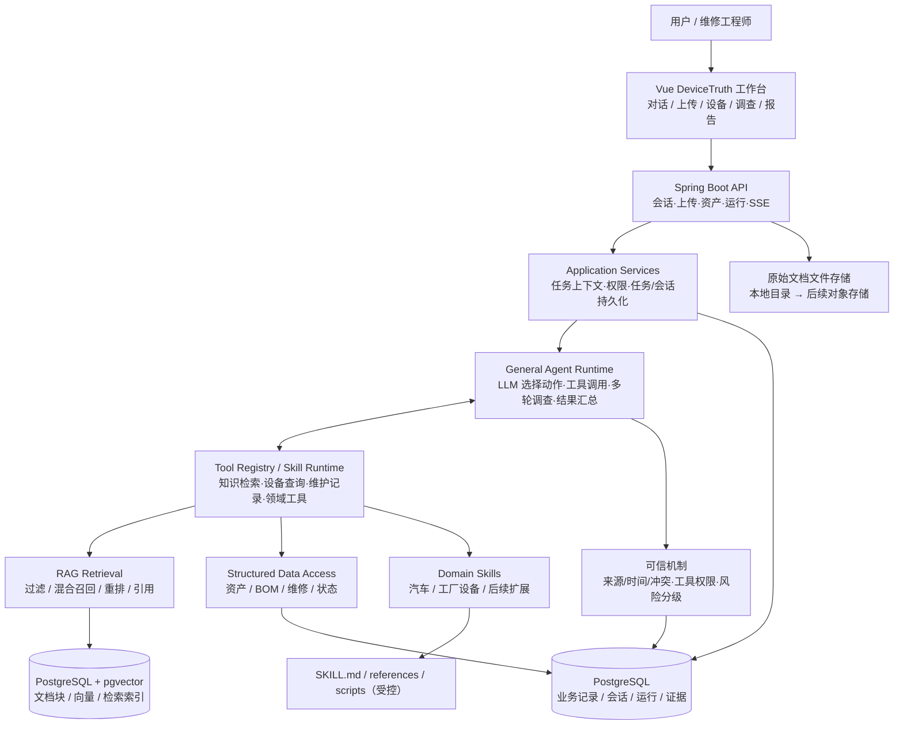
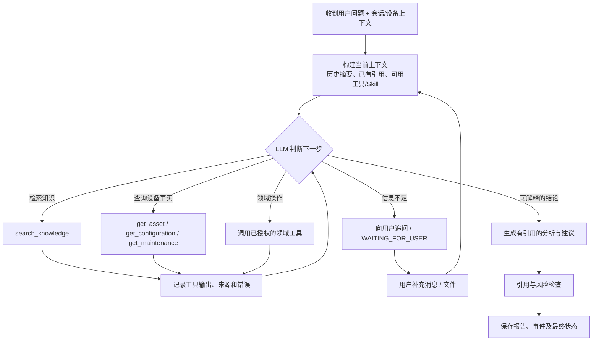

# DeviceTruth V1.0 — 通用设备检修 Agent 完整产品设计方案

> **文档类型**：产品与系统架构设计（团队讨论版，不是逐文件编码任务书）  
> **版本**：V1.0-Draft.1  
> **日期**：2026-11-08  
> **目标**：从 V0.2 的受限演示诊断，演进为面向多设备领域、可自然语言交互、主动检索和调查、可持久化运行的完整产品。  
> **技术主线**：Java 21 + Spring Boot + 单 Agent Runtime + 标准 Skill + PostgreSQL / pgvector + RAG + Vue。  
> **定位说明**：本设计依据 V0.2 `CURRENT_PROJECT_STATUS.md` 和既有 S0/S1 改造方案形成。新架构部分是**设计决策与建议**，不代表已由现有源码实现。

---

## 0. 执行摘要：这次为什么要重新设计

V0.2 已完成可复现的单 Agent 受控运行时，以及 CLI / HTTP 双入口、会话、路由、受限查询、异步诊断、结果和事件读取。项目状态报告记录 **145 项离线自动化测试通过**，另有 **两次真实 DeepSeek Reasoner 的 CAR-B 诊断成功记录**；但在线 Router → Reasoner 完整链路尚未正式验收。

其局限并不在于没有动作循环，而在于产品入口被原测试场景的 `assetId + domain + symptomCode + asOf` 契约绑定：必须命中已登记场景与故障码才能诊断；知识来源主要是 JSON fixture；会话无法跨轮补证；没有标准 Skill、RAG 或持久化业务数据。

**本次方向调整**：

1. **用户可以自由提出与设备相关的问题**。自然语言目标直接进入 Agent；故障码、场景 ID 只是可选线索，不再是诊断准入条件。
2. **模型主导调查策略**。Agent 可以检索知识、查结构化设备数据、调用领域工具、提出需要补充的信息，循环分析直至给出有依据的结果或说明不足。
3. **知识和设备事实分流**。文档类专业知识采用 RAG；BOM、配置历史、维修工单、设备实时状态采用结构化查询，并保留身份、版本、来源与业务时间。
4. **PostgreSQL 正式接入**。作为业务与执行状态的权威存储；以 `pgvector` 承接知识向量索引，初期不另建 Milvus/Elasticsearch 集群。
5. **把旧 Core 变成可复用能力，而非产品边界**。保留工具权限、安全约束、事实来源、运行轨迹等有效设计；可以重新设计不适合开放式交互的 Request、Router 和 Guard 契约。
6. **尽早形成完整纵向体验**。Web 对话、上传材料、知识检索、设备记录、连续调查、引用证据、持久化历史，尽量在一条真实链路里先跑通，再逐步扩充双域。

### 0.1 一句话产品定位

**DeviceTruth 是面向工厂设备、汽车等不同设备领域的通用 AI 检修智能体：理解用户描述，自主利用 Skill、专业知识与设备数据开展调查，并输出证据可追溯、风险边界清晰的排查与维修建议。**

“通用”是跨设备领域复用调查与交互能力，不等于不受约束的通用聊天或自动控制真实设备。

### 0.2 明确不再继承的旧假设

- 不要求每条诊断请求事先拥有 `symptomCode`、匹配固定场景或已有规则。
- 不要求每次诊断都按“先查询完整维修历史→全量发现→读取全部证据→结案”执行。
- 不要求所有事实查询和故障解释都创建 Hypothesis 并完成强制状态转换。
- 不将 `skills/automotive-demo/rules.json` 视为已具备标准 Skill 的事实。
- 不为了保持 V0.1 的 API 形状而拒绝改造必要的产品入口。

---

## 1. 产品用户、任务与能力边界

### 1.1 主要用户

| 用户 | 典型问题 | 期待结果 |
|---|---|---|
| 设备使用者 / 车主 | “充电经常中断，可能怎么排查？” | 易理解的解释、安全的自查步骤、必要的补充问题 |
| 一线维修人员 | “这台控制器通信超时，历史上改过什么？” | 设备记录、候选原因、检查顺序、证据与风险提示 |
| 工厂设备工程师 | “最新更换件与原始 BOM 不一致，按哪个版本判断？” | 出厂、改造、维修、现场证据的时间与来源对照 |
| 管理/售后人员 | “这次诊断为什么建议派工？” | 可追溯的调查记录、维修建议、升级/派工依据 |

### 1.2 五类可进入 Agent 的用户目标

| 目标类型 | 示例 | 处理方式 |
|---|---|---|
| 专业问答 | “这类驱动器报警代表什么？” | 检索手册与知识、引用依据，必要时追问型号 |
| 故障调查 | “偶发通信超时，最近更频繁了” | 开放式调查，跨多轮使用知识与工具，形成候选原因 |
| 设备事实查询 | “当前装的控制器是什么？” | 优先查询设备身份、配置记录、现场确认，不用手册替代现状 |
| 记录一致性核验 | “BOM 和改造记录冲突怎么办？” | 结构化记录与来源/时间对照，给出不确定边界 |
| 处置决策支持 | “能远程解决还是需要派人来？” | 给出低风险建议、必要条件、何时升级/派工 |

**入口策略**：只要问题属于设备知识、运行、诊断、检修或维护范畴，即可进入 Agent。未知资产时允许先进行通用调查或向用户澄清；不能因没有预定义故障码直接拒绝。对无法接入的实时信息必须声明“尚未读取到现场数据”。

### 1.3 重点演示的两条产品故事

**A. 汽车场景：未知故障自然语言接入**

> 用户：“我的新能源汽车最近充电经常中断，但没有故障码。”  
> Agent：“我可以先结合车型和充电条件排查。请问是直流快充还是交流慢充？是否只在特定充电桩出现？”  
> 用户补充信息后，Agent 检索车辆使用手册、相关案例，必要时查询已接入的日志/车辆记录，给出区分不同原因的排查步骤和需要线下检查的条件。

验收重点不是必须得到唯一故障原因，而是**没有预定义故障码也能开始调查、合理追问、检索可信资料、区分可能性和确定性**。

**B. 工业场景：SC-0245-B 配置冲突**

> 工厂设备 XLP-200，历史记录涉及 `CTRL-01` 出厂 D-120A、后续改造 D-120B、旧模板仍为 D-120A。用户问：“现场这台设备应该采用哪份配置？需要维修吗？”

Agent 应查询同一资产的出厂 BOM、改造记录、维修记录和现场确认，结合业务时点判断冲突。**“记录有改造”不能直接等于“当前现场已核实安装”**；若现场确认缺失，需要明确请求补证或建议现场核验。

> 以上两个案例是计划中的验收场景；工业场景不与现有 `CAR-B` 模拟数据混用。

---

## 2. 产品能力蓝图

| 能力层 | V1.0 应具备 | 首版完成边界 |
|---|---|---|
| 对话 | 自然语言输入、连续追问、历史会话、任务关联 | 先支持文本和上传文档；语音/图像理解可后置 |
| Agent | 自主选择知识检索与工具、动态调查、多轮补证、任务总结 | 先坚持单 Agent，不引入多 Agent 编排 |
| 知识 | 上传、解析、切分、向量化、混合检索、引用原文 | 支持 PDF/MD/TXT，DOCX 后续扩展；复杂扫描件单独处理 |
| 设备 | 资产信息、组件/配置历史、维修记录、现场证据 | 以汽车和工厂两个模拟/可授权数据包验证 |
| Skill | 发现、选择、读取 `SKILL.md`、加载领域指引、调用注册工具 | 先实现必要的标准 Skill 规范与工具绑定，不做任意代码执行 |
| 结果 | 调查摘要、证据引用、不确定性、排查/维修建议 | 区分“知识建议、可能原因、确认结论、人工处理” |
| 可观测 | 工具轨迹、引用来源、任务进度、模型错误 | Web 可展示任务事件；用户默认看安全摘要 |
| 存储 | 用户会话、Agent 运行、业务数据、知识索引持久化 | PostgreSQL + pgvector；原始文件可先本地对象目录 |

---

## 3. 总体逻辑架构



**原则**：上图 `PostgreSQL` 和 `PostgreSQL + pgvector` 在第一版是**同一个 PostgreSQL 实例中的不同表/索引**，并非两套数据库。业务表与向量表可分别使用 schema 组织。

### 3.1 模块边界

| 模块 | 负责 | 不负责 |
|---|---|---|
| Web/API | 用户交互、请求校验、流式展示、鉴权入口 | 决定故障原因 |
| Application | 会话与运行生命周期、持久化、工具权限上下文 | 替模型编排固定诊断步骤 |
| Agent Runtime | 理解目标、组织上下文、选择下一动作、判断是否继续 | 自行绕过工具权限、修改权威设备事实 |
| Skill Runtime | 领域指引选择、工具注册发现、版本与适用范围 | 把任意 `SKILL.md` 内容当作系统级指令 |
| RAG | 文档召回、重排、可追溯引用、检索质量 | 认定设备当前真实配置 |
| Structured Data | 资产身份、历史配置、维修事件、时点查询 | 用文本相似度代替结构化事实查询 |
| Trust & Safety | 来源校验、冲突提示、风险动作授权、操作审计 | 强制所有低风险问答走固定诊断规则 |

---

## 4. 通用 Agent 的运行机制

### 4.1 新的入口：自由目标，而非故障码映射

建议将对外输入抽象为：

```text
AgentTaskInput {
  conversationId
  userMessage              // 原始自然语言，必填
  selectedAssetId?         // 用户选定的设备，可为空
  attachments?             // 用户上传材料引用
  contextRefs?             // 已有任务/报告/证据引用
  userPermissions          // 后端认证上下文，不由模型生成
}
```

系统可在内部识别意图、车型、报警码或部件，但这些只是**检索线索**：`symptomCode?`、`faultCode?`、`modelName?` 等均为可选，不得成为 Agent 启动条件。

原 `DiagnosisRequest(assetId, domain, symptomCode, asOf)` 可以继续作为 **legacy structured diagnosis** 适配器，供旧 CLI 回归和严格场景检查使用，不能继续作为全部诊断任务的唯一入口。

### 4.2 单 Agent 动态执行循环



循环遵循 `观察 → 决定下一步 → 调工具 / 提问 / 作答`，可自行决定取证顺序，**不预写通用诊断剧本**。即使模型选择结束，系统仍会进行权限、来源和风险级别相关的基础校验。

### 4.3 调查状态：存“任务进展”，不强制“假设状态机”

通用状态最小包括：

- 用户目标与当前设备上下文；
- 当前调查摘要（已有事实、仍有疑问、已调用工具）；
- 可引用的来源和证据；
- 待回答的问题 / 等待的材料；
- 任务及工具执行事件；
- 预算与错误信息。

`Hypothesis` 可作为**可选的结构化调查笔记**（原因候选、支持/反驳证据、置信边界）。第一版不要求所有请求都经过 `OPEN → SUPPORTED → INVALIDATED`，也不让模型靠一句话直接修改权威事实。

### 4.4 多轮与恢复

建议区分：

- `conversation`：长期交互容器，含多个消息、多个 Agent 任务。
- `agent_run`：一次可暂停、恢复的调查执行。
- `run_event`：一次模型/工具动作或状态变化（面向审计）。

执行状态建议：`QUEUED → RUNNING → WAITING_FOR_USER → RUNNING → COMPLETED`；另有 `FAILED / CANCELLED`。模型提出 `ask_user` 时保存会话摘要、待补问题、已获得资料引用及工具结果，用户回复后创建新执行轮次，**不必依赖原线程存活**。恢复时重新构建 Context，检查原证据是否已失效。

### 4.5 “何时结束”的新策略

- **低风险问答**：模型基于检索结果给出有引用的解释；资料不足时可以明确表示不知道。
- **一般诊断建议**：允许输出可能原因和建议排查步骤，不强制唯一确诊；必须区分证据与推测。
- **关键配置判定 / 派工决策**：核验设备身份、来源、时间及冲突；关键证据缺失时不能宣称已确认。
- **危险或外部执行操作**：执行前需要独立工具权限校验、必要的用户/人员确认；第一版默认**只读**，不远程操作设备。

`DecisionGuard` 将从“所有场景统一的 13 步结案流程”演进为**按任务和风险级别使用的策略集合**。已有固定场景的强约束作为一种可选策略保留，并继续用于历史回归。

---

## 5. PostgreSQL 数据底座设计

### 5.1 为什么正式采用 PostgreSQL

PostgreSQL 同时承担三类工作：

1. **业务权威数据**：设备、组件、配置历史、维修记录、现场确认等有关系、版本和时间语义的数据。
2. **Agent 运行数据**：会话、消息、工具调用、任务进度、调查事件、报告元数据；解决 V0.2 重启丢失与无法续跑问题。
3. **知识检索索引**：配合 `pgvector` 保存文档块 embedding，联接文档来源、设备型号和访问权限；适合当前团队规模和双域 MVP。

PostgreSQL 官方提供全文检索和 GIN 等索引机制；pgvector 支持向量相似检索及 HNSW/IVFFlat，Spring AI 也有 PgVectorStore 适配能力。此处选择是**降低系统数量的工程决策**，不是断言 PostgreSQL 在所有规模下都比专用向量库更强。

### 5.2 推荐数据域与核心表（逻辑设计，非最终 DDL）

| 数据域 | 建议表 | 主要字段/用途 | 阶段 |
|---|---|---|---|
| 设备主数据 | `asset` | id、domain、manufacturer、model、serial_no、status | 首版 |
| 设备组件 | `asset_component` | id、asset_id、component_code、component_model、安装位置 | 首版 |
| 配置与版本历史 | `configuration_record` | asset_id、component_id、model/value、valid_from/to、recorded_at、source_id、status | 首版 |
| 维修历史 | `maintenance_record` | asset_id、performed_at、operation、component_id、before/after、source_id | 首版 |
| 外部观测 | `asset_observation` | asset_id、observed_at、signal、value、unit、source_id、quality | 第二批 |
| 知识文档 | `knowledge_document` | id、title、domain、device_model、version、file_ref、ingest_status、owner_scope | 首版 |
| 文档切片 | `knowledge_chunk` | document_id、chunk_no、content、page/section、embedding、metadata | 首版 |
| 对话 | `conversation` | id、owner_id、current_asset_id、title、created_at、updated_at | 首版 |
| 对话消息 | `conversation_message` | id、conversation_id、role、content、attachment_refs、created_at | 首版 |
| Agent 任务 | `agent_run` | id、conversation_id、goal、status、context_summary、pending_question、result_ref、timestamps | 首版 |
| 运行事件 | `agent_run_event` | id、run_id、seq、event_type、tool_name、safe_payload、created_at | 首版 |
| 证据/引用 | `evidence_reference` | id、run_id、source_type、source_id、chunk_id?、asset_id?、as_of?、citation_locator | 首版 |
| 上传文件 | `uploaded_file` | id、owner_id、path_key、mime、checksum、parse_status | 首版 |
| Skill 元数据 | `skill_installation` | skill_id、version、domain、enabled、directory、tool_whitelist | 第二批 |

**最小可交付子集**：先建会话、消息、Agent 任务/事件、资产、维修/配置记录、知识文档/切片、证据引用和文件元数据。避免一上来覆盖工单、库存、IoT 全量业务系统。

### 5.3 结构化数据和 RAG 必须分清

| 用户问题 | 首选数据通道 | 为什么 |
|---|---|---|
| “如何排查 X 型号通信故障？” | RAG（手册 / 案例 / SOP） | 查询专业知识和通用流程 |
| “我的设备现在装了哪个控制器？” | PostgreSQL 配置/现场记录 | 必须匹配具体设备和时点 |
| “改造前后有什么变化？” | PostgreSQL 配置与维修历史 | 时间序列和事件关联更可靠 |
| “故障码的含义是什么？” | RAG + 结构化代码表（如有） | 文字解释与精确码值互补 |
| “为什么这次建议派工？” | 运行轨迹 + 来源引用 + 专业知识 | 需要重建 Agent 决策依据 |

**禁止**将 embedding 相似度当作设备当前配置的证据。工具应返回 `assetId、sourceId、observedAt/effectiveAt、recordedAt、verificationStatus` 等元数据，供模型分析与应用层校验。

### 5.4 配置记录的时间语义

至少区分：

- `valid_from / valid_to`：记录声称某配置在现实业务中生效的区间；
- `recorded_at`：系统何时收到/记录这一说法；
- `observed_at`：现场证据实际观测时间（适用于观测记录）；
- `source_type / source_id`：来自出厂 BOM、改造报告、维修工单还是现场确认；
- `verification_status`：已现场核实、文档记载、待确认等。

**示例：** D-120A 的出厂记录和 D-120B 的改造记录可以同时存在；查询“截至某日的当前型号”应综合有效期与来源。若证据不足，返回“最新文档记录为 D-120B，但缺少当前现场核验”，而不是虚构确定性。

### 5.5 pgvector 检索设计

建议第一版采用：

```text
上传/导入 PDF、MD、TXT
    ↓
抽取正文 + 页码/章节/文档版本 + 设备元数据
    ↓
清洗与分块（保留标题、表格上下文与引用定位）
    ↓
Embedding（记录模型名称、维度和索引版本）
    ↓
PostgreSQL knowledge_document / knowledge_chunk
    ↓
查询时：领域/设备型号/权限过滤
    ↓
向量召回 + 关键词/精确匹配（混合检索）
    ↓
结果合并 / 重排 / 去重
    ↓
将证据片段及引用位置交给 LLM
```

- **向量检索**：pgvector 的 cosine 距离或其他经测试选定的距离，数据量增大后再评估 HNSW 索引。
- **关键词检索**：设备编号、部件号、故障码优先精确或模糊匹配；PostgreSQL 内建全文检索对中文分词支持有限，中文文档建议评估应用层分词/关键词字段或 `pg_trgm` 方案，不应假设英文 tokenizer 适用于中文。
- **混合排序**：第一版可从简单加权/RRF 开始；重排器作为可插拔组件，不强行提前部署复杂服务。
- **权限过滤**：先按用户/项目/领域/资产过滤允许的文档，再检索；不能把检索到的私有文档交给无权限会话。
- **引用链**：回答标注 `documentId + version + page/section + chunkId`；使用工厂数据时还应记录对应 `assetId`。
- **模型升级**：Embedding 维度和模型版本必须记录；换模型需要重建对应索引，不能混用不兼容向量。

#### 原始文件如何保存

PostgreSQL 保存文件元数据、路径标识、hash、解析状态及文档片段。第一版原始 PDF/DOCX 等保存在受控本地文件目录；后续按部署需求迁移到 MinIO/对象存储。**不要把大体积原始文件全部当成 JSONB 或向量字段存进主业务表。**

### 5.6 数据库迁移与开发配置

- 使用 Flyway 维护可重放的 schema migration；模型不要随意在启动时重建业务表。
- 本地 Docker Compose 启动 PostgreSQL + pgvector，测试使用 Testcontainers 或独立测试库；数据库与 LLM API Key 均由环境配置注入。
- `schema` 可按 `business` / `agent` / `knowledge` 做逻辑隔离；团队规模较小时一个 schema 加清晰表名前缀也可，避免形式主义。
- 关键索引：`asset(serial_no)`、`maintenance_record(asset_id,performed_at)`、`configuration_record(asset_id, component_id,valid_from)`、`conversation_message(conversation_id,created_at)`、`agent_run_event(run_id,seq)`，以及向量/检索索引。
- 使用参数化 SQL、应用层资产权限校验、连接池；不允许 LLM 生成 SQL 直接不受控执行。
- 需要备份/恢复与迁移回滚演练；MVP 可以单实例，不急着上 Redis、MQ 或读写分离。

---

## 6. RAG、专业工具与标准 Skill 如何协作

### 6.1 Agent 可调用的基础工具（建议）

| 工具名称（示意） | 返回内容 | 数据源 |
|---|---|---|
| `search_knowledge(query, filters)` | 相关手册/案例片段 + 引用 | pgvector + 关键词索引 |
| `get_asset(assetId)` | 设备身份、型号、域 | PostgreSQL |
| `get_configuration(assetId, asOf?)` | 配置记录、来源、时间、冲突 | PostgreSQL |
| `get_maintenance_history(assetId, filters?)` | 维修事件、零件更换 | PostgreSQL |
| `get_observations(assetId, range?)` | 日志、传感器/故障码（已接入时） | PostgreSQL / 后续 IoT 适配 |
| `get_document_excerpt(documentId, locator)` | 被引用的原始段落与页面 | 文件与文档存储 |
| `request_user_information(question)` | 保存待补问题、暂停任务 | Agent Runtime |
| `generate_diagnosis_report(runId)` | 调查摘要、来源、风险与建议 | Agent 运行记录 |

工具参数必须通过 Java DTO/Schema 校验，访问受权限和资产作用域约束；工具可以返回 `NOT_FOUND / DATA_STALE / PERMISSION_DENIED / AMBIGUOUS` 等明确状态，而非把全部失败都吞成“无证据”。

### 6.2 标准 Skill 的定位

采用通用的 `SKILL.md` 组织领域知识与使用指引，Skill 不是一套独立 Agent，也不是数据库替身。建议目录：

```text
skills/
  automotive-diagnosis/
    SKILL.md
    references/charging-troubleshooting.md
    references/diagnostic-codes.md
  factory-equipment/
    SKILL.md
    references/controller-maintenance.md
    references/safety-notes.md
```

每个 Skill 至少描述：`name`、`description`、适用设备/任务、工作指引、可调用的已注册工具、所需证据、风险提示、引用规范。领域 Skill 可以提供检索提示与分析思路，**不得自行升级工具权限或要求忽略系统边界**。

### 6.3 Skill 与 RAG 的区别

- **Skill**：告诉 Agent “处理该类问题有哪些专业步骤、优先考虑哪些证据、可以用什么工具”。
- **RAG 知识库**：给 Agent 可检索的具体手册、术语解释、案例和规范内容。
- **结构化数据库**：告诉 Agent “某一台具体设备的已记录配置、维修、状态和时间”。

三者相互补充。一个新的设备领域应尽量通过 **领域 Skill + 知识数据 + 数据访问适配**扩展，而不是修改 Agent Runtime 的核心循环。

### 6.4 工具与知识的信任边界

- 检索文本、上传附件和第三方 Skill 内容都是**不可信输入**，不能将其中的“忽略规则”“执行命令”等文字当作开发/系统指令。
- Skill 中的脚本如需执行，应单独审批白名单、文件/网络/进程权限；首版以只读工具和指引型 Skill 为主。
- RAG 引用必须在工具返回结果中可定位，禁止模型编造页码、引用 ID 或记录时间。
- 用户权限先由服务端确定；模型无权改变访问范围。

---

## 7. 面向完整产品的 Web 交互

### 7.1 主页面：对话式检修工作台

建议最小布局：

- **左侧**：历史会话、设备切换、领域/知识包状态；
- **中部**：自然语言对话、文件上传、Agent 追问、诊断结论；
- **右侧或可折叠抽屉**：当前调查轨迹、使用过的工具、引用资料、设备事实及证据冲突；
- **报告页**：问题概述、已知事实、可能原因、建议行动、需人工确认事项、可追溯引用。

用户无需手动选择 `COMM_TIMEOUT` 或其它故障码才能发送消息。选设备只是帮助缩小调查范围；没有设备 ID 时，仍应允许通用问答或请求补充信息。

### 7.2 实时进度与持久化

- 后端可使用 SSE 推送**白名单的任务事件**（如正在检索手册、正在查询维修记录、等待补充信息），不直接推送内部 Prompt、密钥和原始工具异常堆栈。
- 页面刷新后，从 PostgreSQL 恢复历史消息、任务状态和引用；SSE 仅用于当前体验，不承担历史记录存储。
- 异步任务应支持取消、超时、队列容量限制和请求幂等标识。

### 7.3 API 边界（建议，非冻结）

| API | 目的 |
|---|---|
| `POST /api/conversations` | 创建会话 |
| `GET /api/conversations/{id}` | 恢复会话及运行摘要 |
| `POST /api/conversations/{id}/messages` | 自然语言提问、补证、文件引用 |
| `GET /api/runs/{id}` | 查询执行进度与最终结果 |
| `GET /api/runs/{id}/events` | 查询历史事件 |
| `GET /api/runs/{id}/stream` | SSE 实时安全事件 |
| `POST /api/files` | 上传资料并返回文件引用 |
| `POST /api/knowledge/import` | 发起知识文档入库 |
| `GET /api/assets/{id}` | 设备主数据与摘要 |

已有 V0.2 `/api/sessions`、`/api/diagnoses` 可在迁移期保留兼容适配，避免旧 CLI/HTTP 回归全部失效。

---

## 8. 技术栈与工程取舍

| 层 | 推荐选择 | 说明 |
|---|---|---|
| 后端 | Java 21 + 现有 Spring Boot 3.5.x 基线 | 延续已有服务、测试、依赖；升级另行评估 |
| Agent | **单 Agent**，先评估演进现有 Runtime | 保留模型调用与工具能力，解除旧症状码约束；不并行开发两套循环 |
| 模型接口 | 现有 AgentScope Model API / OpenAI-compatible | 真正的模型供应商由配置切换；Router 可合并，避免重复 LLM 分类 |
| 业务数据库 | PostgreSQL | 设备、维修、会话、运行与证据的权威数据源 |
| 向量检索 | PostgreSQL + pgvector | MVP 首选，避免无必要增加 Milvus 服务 |
| 迁移 | Flyway | 数据库表结构可追踪 |
| DB 访问 | Spring JDBC / JdbcTemplate（或统一选择一种类型安全方案） | 不混搭多套 ORM；精确 SQL 和时序查询更可控 |
| 文档处理 | 后台导入任务 + PDF/Office 解析适配 | 保留原文引用和文档版本；扫描件按需支持 OCR |
| 前端 | Vue 3 + TypeScript | 会话、资产、运行轨迹、报告、上传 |
| 实时交互 | SSE | 文本生成/运行进度；历史持久化在 PG |
| 部署 | Docker Compose 起步 | Postgres/pgvector + 后端 + 前端；对象存储按需加入 |
| 测试 | JUnit + Testcontainers + 真实模型小样本 E2E | 既验证确定性契约，也验证开放式调查质量 |

**关于 AgentScope Java / Spring AI Alibaba**：不应仅为了引入新框架而重写全部 Runtime。应做一次小范围对比：能否减少单步工具调用、记忆和流式事件的自研成本，是否破坏现有证据/安全组件的复用。若采用框架，应明确**只有一套 Agent 决策循环**，避免“框架 ReAct + 自研 TaskOrchestrator”嵌套编排。

---

## 9. V0.2 代码如何迁移

| V0.2 模块 | V1.0 决策 | 注意事项 |
|---|---|---|
| `ConversationController/Service` | 扩展 + PG 持久化 | 兼容旧 API；保留会话/任务隔离 |
| `ConversationFlowService` | 重构路由与 Agent 入口 | 从 QUERY/DIAGNOSE 硬分流转为 Agent 可自主调用查询工具 |
| `TaskRouter/RouteValidator` | 只保留必要的请求/权限验证；意图识别按需使用 | 不再以 Catalog/故障码阻挡通用问题 |
| `DiagnosisApplicationService` | 新增自由目标适配；旧结构请求保留为 legacy | 不把用户原始语句丢在应用层 |
| `SupportedScenarioCatalog` | 降级为测试 fixture / 示例数据索引 | 不作为产品准入白名单 |
| `TaskOrchestrator` | 评估演进为通用运行循环 | 支持新工具、动态上下文、暂停/恢复、答案生成 |
| `Reasoner/StructuredReasoner` | 保留能用的模型连接和动作解析 | 调整提案协议，避免固定五动作阻碍对话/知识检索 |
| `CapabilityGateway` | 保留工具白名单与参数/权限校验 | 适配 RAG、PG 查询及领域 Tool Registry |
| `EvidenceManager` | 保留为来源与事实一致性辅助能力 | 不强制所有普通问答经历事实重建 |
| `DecisionGuard` | 改为按任务风险调用的安全/事实策略 | 旧结构诊断 Guard 保留回归；新增开放式答案检查 |
| `JsonRepositories` | 作为 fixture Adapter 保留，新增 PG Repositories | 逐步迁移模拟数据，不一次性删除测试数据 |
| `RunReportWriter/RunEventViews` | 复用事件白名单思想；写入 PG | 文件报告可作为导出，不再是唯一记录 |
| CLI | 保留用于回归和独立调试 | 保证 V0.1 A/B/C/D/E 安全基线不退化 |

**建议做法**：采用渐进式兼容迁移。新增 `GeneralAgentService` / `GeneralAgentRuntime` 作为产品主路径，旧 `StructuredDiagnosisAdapter` 用于历史回归；确认新路径稳定后再收拢重复模块，避免同时维护两套长期 Agent Core。

---

## 10. 开发路线：以完整业务纵向切片推进

不继续以旧 S2“先补 Hypothesis 状态机”作为第一优先级。建议改成以下可演示的产品里程碑：

| 里程碑 | 主要交付 | 可实际演示的验收画面 | 不做什么 |
|---|---|---|---|
| **M0：基线整理与新契约** | 记录 V0.2 未提交改动；冻结通用 Agent 入口与数据模型；PG 容器、Flyway | 旧回归仍通过，新 PG 可访问 | 不做大规模框架重写 |
| **M1：自由对话 + 知识 RAG** | 非故障码准入；知识导入、pgvector、检索工具；最小 Web 对话 | 用户问未知故障，Agent 检索手册后解释或追问 | 不强求复杂事故根因自动确诊 |
| **M2：设备数据 + 连续调查** | 资产/BOM/维修 PG 查询；多轮补证、持久化任务、引用记录 | 用户补充信息后接着调查；刷新/重启后能恢复 | 不接真实执行控制系统 |
| **M3：标准 Skill + 双域验证** | 汽车/工厂 Skill、SC-0245-B 与充电异常案例、工具权限和领域资料 | 不改通用 Agent 循环即可切换两种设备问题 | 不为每个场景复制一套流程 |
| **M4：完整工作台 + 质量评估** | SSE、安全事件、报告、上传体验、对比评测、部署 | 可演示完整诊断、引用、冲突和处理决策 | 不抢先做多 Agent/微服务 |

**前端不推迟到最后**：M1 即有一个可用的 Vue 对话页面，M4 是完成可视化与产品打磨。M0–M2 优先形成开放式完整链路；M3 是证明“跨域通用”不可省略的关键里程碑。

### 10.1 建议先验证的最小纵向闭环

```text
用户打开 Vue → 发送“充电中断但没有故障码”
  → 创建 PG conversation + run
  → LLM 自主选择 search_knowledge
  → pgvector 检索车辆手册 / 故障案例并返回引用
  → LLM 询问充电方式或车型
  → run 进入 WAITING_FOR_USER 并持久化
  → 用户回答 → run 恢复，必要时再次检索
  → 输出有依据的初步排查建议/需现场确认事项
  → UI 展示引用、工具轨迹和历史对话
```

这条链路优先于建设大而全的工业数据平台。它直接验证产品最核心的开放式 Agent 体验。

---

## 11. 验收标准与评测设计

### 11.1 关键端到端用例

| 编号 | 测试 | 成功条件 |
|---|---|---|
| E2E-01 | 无故障码的充电异常 | 能进入 Agent，自主检索/追问；不再被症状白名单直接拒绝 |
| E2E-02 | 普通知识提问 | 能引用正确版本的手册位置；无资料不编造 |
| E2E-03 | 设备身份不明 | 不虚构具体资产；允许一般指导并索取必要信息 |
| E2E-04 | 已知 CAR-B 模拟场景 | 旧 CLI/安全测试保留；新路径可读取数据，但不强制相同动作轨迹 |
| E2E-05 | 工业 SC-0245-B 三源冲突 | 不把旧模板等同现场配置；能说明证据来源和时间 |
| E2E-06 | 上传资料检索 | 文档解析、入库、检索、页码/章节引用可闭环 |
| E2E-07 | 多轮补证 | 追问后任务进入等待；用户补充后续跑而非丢弃上下文 |
| E2E-08 | 服务重启 | PG 保留会话、任务、已取证记录；可恢复或明确失败 |
| E2E-09 | 资产跨会话权限 | 不越权检索其他用户/项目的设备与文档 |
| E2E-10 | 错误/过期资料 | 明确不确定性和版本差异；引用与事实不被混淆 |
| E2E-11 | 模型/工具故障 | 失败可观测、可重试，不把工具错误伪装为诊断结论 |
| E2E-12 | 高风险操作请求 | 默认只读；不能未经授权远程控制设备或给出未经确认的操作承诺 |
| E2E-13 | 双域 Skill 切换 | 同一个 Runtime 处理汽车与工厂案例，不硬编码场景分支 |
| E2E-14 | 在线真实 LLM | DeepSeek 或其他配置模型完成 Router/Agent/Tool/结果全链路验收 |

### 11.2 评价指标

- **任务完成率**：用户目标是否得到有效答案、下一步建议或合理的补证请求（不以强行 `RESOLVED` 为成功）。
- **事实与引用可靠性**：关键事实是否有可核验来源；引用是否支持结论；是否误将一般手册当作当前设备配置。
- **调查效率**：有效工具调用率、重复/无用调用次数、步骤数、耗时与 Token 成本。
- **冲突识别与不确定性**：遇到版本冲突、证据缺失、设备身份不清时是否诚实处理。
- **连续对话能力**：追问是否合理、用户补证后是否正确保留调查上下文。
- **跨域复用度**：新增工厂领域时需要修改多少通用 Runtime 代码；理想是少量或零核心代码变更。

评测需包含：确定性单元/集成测试、固定数据集的对照实验、真实 LLM 端到端测试，以及针对错误引用和危险操作的负例；**离线 Scripted 测试不能替代在线 Agent 质量验证**。

---

## 12. 主要风险与取舍

| 风险 | 可能后果 | 建议处理 |
|---|---|---|
| 开放式 Agent 只会“查几段文档然后总结” | 看似灵活，实则缺少调查深度 | 用多轮追问、结构化设备数据和难例评测区分能力 |
| RAG 召回错误或片段脱离上下文 | 错误维修结论 | 保留页/章节、版本、设备型号过滤及证据引用 |
| 将向量结果当设备现状 | BOM 与维修事实误判 | 结构化时序查询作为权威通道，提示源冲突 |
| 依赖 LLM 直接生成 SQL 或执行脚本 | 越权、破坏数据 | 仅提供参数化/白名单工具，默认只读 |
| 多轮恢复依赖内存 | 重启后任务损坏 | 会话、运行、待补问题和工具事件落 PG |
| Agent 框架重复编排 | 逻辑复杂、不可维护 | 选定一个主执行循环，复用旧组件而非双栈嵌套 |
| PostgreSQL 承载所有检索后性能不足 | 检索延迟/吞吐瓶颈 | 先做真实数据量性能测试，必要时再拆专用搜索服务 |
| 在双域接入前过度抽象 Skill | 框架多但案例少 | 以两个领域用例反推最小接口，先纵向验证 |
| API Keys / 上传资料泄漏 | 业务与隐私风险 | 服务端密钥、数据隔离、脱敏日志、上传验证与权限检查 |

### 12.1 目前不建议引入的基础设施

微服务拆分、Kafka、Redis 分布式队列、多 Agent 编排、复杂知识图谱、独立向量数据库、自动执行设备控制等，都不应在 MVP 初期成为前置依赖。只有在真实需求、质量评测或性能瓶颈出现时再引入。

---

## 13. 已确定的决策与仍需讨论的选择

### 13.1 建议先冻结的架构决策

| 编号 | 决策 |
|---|---|
| D-01 | 正式产品以**自然语言自由任务**为入口，不要求故障码或预定义场景 |
| D-02 | 优先**单 Agent** 与开放式工具调用循环，不先上多 Agent |
| D-03 | PostgreSQL 是权威持久化数据库；pgvector 在同一实例承担第一版向量索引 |
| D-04 | RAG 用于知识，结构化查询用于具体设备事实；输出须保留来源与时点 |
| D-05 | Skill 使用 `SKILL.md` 的领域指导模式，注册工具由服务端授权 |
| D-06 | 现有 Core 组件能复用则复用，不适合开放产品的契约允许改造 |
| D-07 | 风险分级控制替代所有任务统一的固定结案流程；高风险动作默认不可执行 |
| D-08 | Vue 工作台在早期里程碑即接入，避免后端长期黑盒开发 |

### 13.2 需要用原型而非争论解决的问题

1. **Runtime 选择**：演进现有 `TaskOrchestrator`，还是以 AgentScope Java 的成熟工具循环为主、把 Evidence/Guard 插成扩展点？用同一条 RAG+多轮链路的代码复杂度和可观测性实测决定。
2. **知识检索技术细节**：中文关键词检索是否需要专门分词插件/外部检索服务，取决于真实手册的召回表现；先测再定。
3. **首发设备范围**：汽车充电异常、工业 SC-0245-B 是两条验收主线，是否扩增更多领域应看这两条链路的复用效果。
4. **用户与组织权限**：本地单用户 Demo 可以简化鉴权，但如果对多人演示、共享设备数据，应在正式部署前完善身份与授权。
5. **真实设备接入**：第一版默认模拟或授权上传数据；现场 IoT/OBD/PLC 对接另行明确协议、许可和安全边界。

---

## 14. 下一步落地建议

本方案确认后，不建议直接要求 AI “一次性重构成完整通用 Agent”。先做一次**V0.2 代码—V1.0 新架构差距审查**，输出可保留/需替换模块及数据库迁移影响。随后生成新一轮 `spec.md / task.md / state.md`，按 **M0 → M1 → M2 → M3 → M4** 分会话执行，开发与 Review 分离。

**最值得尽快跑通的证明**：一条没有故障码的中文设备问题，从 Vue 页面进入 Agent，主动检索 PostgreSQL/pgvector 中的知识，必要时查询设备记录、追问用户，再把有引用的结果与任务历史写回 PostgreSQL。只要这条链路成立，DeviceTruth 才真正完成了从“场景驱动 Runtime Demo”到“通用设备检修 Agent 产品”的关键跨越。

---

## 附录 A：现有项目事实与设计建议的边界

**V0.2 已有（据 2026-11-08 `CURRENT_PROJECT_STATUS.md`，未在本次独立重跑）**：

- Java Core：`TaskOrchestrator`、`Reasoner`、`CapabilityGateway`、`EvidenceManager`、`DecisionGuard`、`StateManager`。
- CLI/HTTP 双入口、四类受限路由、内存 Session、异步诊断、最终事件与脱敏视图。
- 145 项离线测试成功记录，旧 CLI A/B/C/D 和 E 负例；CAR-B 的在线 DeepSeek Reasoner 两次成功记录。

**V1.0 计划新增/调整（尚未实现）**：

- 通用自由文本 Agent 入口、开放式 RAG/结构化工具调用和持久化多轮调查。
- PostgreSQL 业务与运行表、pgvector 文档切片与向量索引、知识导入/检索链路。
- 标准 Skill 发现/读取/工具关联、汽车与工厂双域专业案例。
- Vue 工作台、文档上传、历史任务恢复、实时安全事件与最终报告。

## 附录 B：技术参考（用于选型核对）

- PostgreSQL 官方全文检索文档：https://www.postgresql.org/docs/18/textsearch.html
- pgvector 官方仓库（向量检索、HNSW、混合检索）：https://github.com/pgvector/pgvector
- Spring AI PgVectorStore 文档：https://docs.spring.io/spring-ai/reference/api/vectordbs/pgvector.html

> 本文不绑定上述文档的某一个具体 API 版本；实际依赖和 SQL/embedding 维度需在开发阶段按项目环境锁定并验证。
