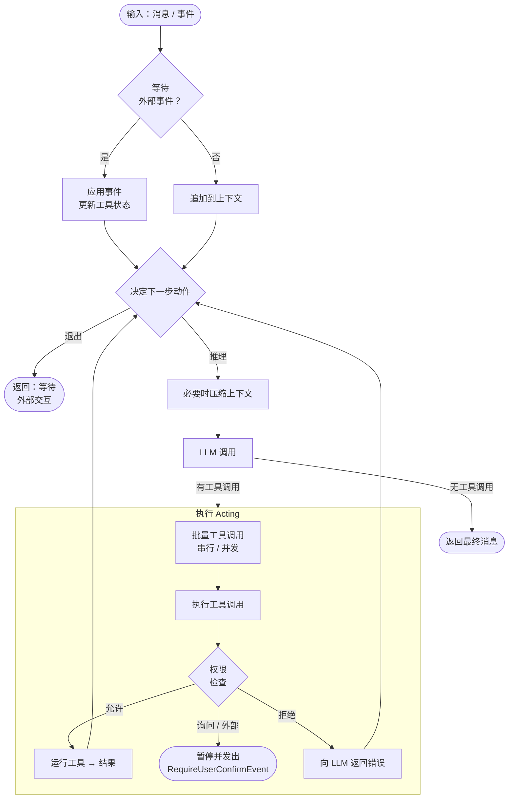

## 概述

`Agent`（接口位于 `io.agentscope.core.agent.Agent`，默认实现为 `ReActAgent`）是核心抽象——一个推理-执行（reasoning-acting）循环引擎，把模型、工具、权限系统、human-in-the-loop、上下文管理、中间件、状态管理和事件系统整合到统一接口中。

它的主要职责：

- 接收输入消息或事件；编排工具以完成任务。
- 管理上下文（对话历史保存在 `AgentState.getContext()` 上，可通过 `AgentStateStore` 自动持久化）。
- 在关键生命周期点提供中间件钩子，用于注入自定义逻辑。
- 自动管理工具的并发与顺序执行。

### 核心接口

`Agent` 接口由三个能力接口组合而成：`CallableAgent`、`StreamableAgent`、`ObservableAgent`。最常用的方法：

| 方法 | 说明 |
|--------|-------------|
| `call(List<Msg>)` / `call(List<Msg>, RuntimeContext)` | 运行推理-执行循环，返回 `Mono<Msg>` |
| `streamEvents(List<Msg>)` / `streamEvents(Msg)` | 同样的循环，但增量地发出 `AgentEvent` |
| `observe(Msg)` / `observe(List<Msg>)` | 向上下文追加消息但不触发推理（返回 `Mono<Void>`） |

`ReActAgent` 额外提供了结构化输出重载（`call(msgs, structuredOutputClass, runtimeContext)`），以及通过 `RuntimeContext` 为每次调用附加元数据的便捷方式。

### 主循环

每次 `call` 都会经过推理-执行循环。下图展示主控制流：



## 配置 Agent

使用 `ReActAgent.builder()...build()` 构建 Agent。`.model(...)` 既接受由 `ModelRegistry` 解析的字符串 id（最常见——自动读取环境变量），也接受显式的 `Model` 实例（需要显式控制超时 / 自定义端点等场景）。


<Tabs>


<Tab title="字符串模型 id（推荐）">

```java
import io.agentscope.core.ReActAgent;
import io.agentscope.core.tool.Toolkit;

ReActAgent agent =
        ReActAgent.builder()
                .name("my_agent")
                .sysPrompt("You are a helpful assistant.")
                // 由 ModelRegistry 解析；自动读取 DASHSCOPE_API_KEY。
                // 切换供应商可使用 "openai:gpt-5.5" / "anthropic:claude-sonnet-4-5"
                // / "deepseek:deepseek-v4-flash" / "gemini:gemini-2.0-flash" / "ollama:llama3"。
                .model("dashscope:qwen-plus")
                .toolkit(new Toolkit())
                .build();
```

</Tab>


<Tab title="显式 Model builder">

```java
import io.agentscope.core.ReActAgent;
import io.agentscope.extensions.model.dashscope.formatter.DashScopeChatFormatter;
import io.agentscope.extensions.model.dashscope.DashScopeChatModel;
import io.agentscope.core.tool.Toolkit;

ReActAgent agent =
        ReActAgent.builder()
                .name("my_agent")
                .sysPrompt("You are a helpful assistant.")
                .model(
                        DashScopeChatModel.builder()
                                .apiKey("YOUR_API_KEY")
                                .modelName("qwen-max")
                                .stream(true)
                                .formatter(new DashScopeChatFormatter())
                                .build())
                .toolkit(new Toolkit())
                .build();
```

</Tab>


<Tab title="搭配 Toolkit / MCP">

```java
import io.agentscope.core.ReActAgent;
import io.agentscope.core.tool.Toolkit;
import io.agentscope.core.tool.builtin.TodoTools;
import io.agentscope.core.tool.mcp.McpClientBuilder;
import io.agentscope.core.tool.mcp.McpClientWrapper;

Toolkit toolkit = new Toolkit();
toolkit.registerTool(new TodoTools());          // 通过反射注册 @Tool 方法
toolkit.registerTool(new MyCustomTools());      // 自定义工具类

McpClientWrapper amap = McpClientBuilder.streamableHttp()
        .name("amap")
        .url("https://mcp.amap.com/mcp?key=" + System.getenv("AMAP_API_KEY"))
        .build();
toolkit.registerMcpClient(amap).block();

ReActAgent agent =
        ReActAgent.builder()
                .name("my_agent")
                .sysPrompt("You are a helpful assistant.")
                .model("dashscope:qwen-max")
                .toolkit(toolkit)
                .build();
```

</Tab>


</Tabs>


<Tip>

`ModelRegistry` 字符串形式（`<provider>:<model>`）要求类路径上有对应的模型扩展模块。支持 `dashscope` / `openai` / `openai-official` / `deepseek` / `anthropic` / `gemini` / `ollama`，并从环境变量读取对应的 API key（`DASHSCOPE_API_KEY` / `OPENAI_API_KEY` / `DEEPSEEK_API_KEY` / `ANTHROPIC_API_KEY` / `GEMINI_API_KEY`）。对于需要工作区、会话持久化、记忆压缩、子 Agent 等能力的长时运行场景，请使用 [`HarnessAgent`](/v2/en/docs/harness/architecture)——它是对 `ReActAgent` 的轻量封装，builder 用法基本一致。

</Tip>

### Builder 字段

| 字段 | 类型 | 默认值 | 说明 |
|-------|------|---------|-------------|
| `name` | `String` | 必填 | Agent 标识，用于消息和日志 |
| `sysPrompt` | `String` | 必填 | 基础系统提示词 |
| `model` | `Model` | 必填 | 驱动推理的 LLM（继承自 `ChatModelBase`） |
| `toolkit` | `Toolkit` | `new Toolkit()` | 管理工具、MCP 客户端、技能和工具组 |
| `middlewares` | `List<? extends MiddlewareBase>` | `List.of()` | 应用于 agent / reasoning / acting / 模型调用 / 系统提示词等钩子 |
| `stateStore` | `AgentStateStore` | `null`（不持久化） | 设置后，Agent 在每次 `call` 时自动加载/保存 `AgentState`，以调用的 `RuntimeContext` 中的 `(userId, sessionId)` 为键 |
| `defaultSessionId` | `String` | Agent 的 `name` | 调用的 `RuntimeContext` 未携带 sessionId 时使用的回退值 |
| `permissionContext` | `PermissionContextState` | `DEFAULT` 模式 | 细粒度工具执行规则，见[权限系统](/v2/en/docs/building-blocks/permission-system) |
| `modelConfig` | `ModelConfig` | 默认 | 模型重试与备用模型 |
| `reactConfig` | `ReactConfig` | 默认 | 最大迭代次数与拒绝处理 |
| `maxIters` | `int` | `10` | ReAct 主循环的最大迭代次数（`reactConfig` 的替代项） |

## 多用户 / 多会话并发

`ReActAgent` 在**调用之间是无状态的**——单个实例可以同时服务多个用户和会话。每次 `call()` 使用其 `RuntimeContext` 携带的 `(userId, sessionId)` 定位正确的会话状态；不同会话完全隔离。

```java
import io.agentscope.core.ReActAgent;
import io.agentscope.core.agent.RuntimeContext;
import io.agentscope.core.message.UserMessage;
import io.agentscope.core.state.JsonFileAgentStateStore;
import java.nio.file.Paths;

// 应用启动时创建唯一 Agent 实例（单例）
ReActAgent agent = ReActAgent.builder()
        .name("assistant")
        .sysPrompt("You are a helpful assistant.")
        .model("dashscope:qwen-plus")
        .stateStore(new JsonFileAgentStateStore(
                Paths.get(System.getProperty("user.home"), ".agentscope/sessions")))
        .build();

// 在 HTTP 处理器中——不同请求传入不同 RuntimeContext，完全隔离
agent.call(List.of(new UserMessage("Hello")),
        RuntimeContext.builder().userId("alice").sessionId("session-1").build()).block();

agent.call(List.of(new UserMessage("Hi there")),
        RuntimeContext.builder().userId("bob").sessionId("session-2").build()).block();
```

每次 `call()` 开始时，Agent 自动加载给定 `(userId, sessionId)` 的 `AgentState`（对话上下文、权限规则等）。调用结束后，状态写回。不同会话完全隔离。


<Tip>

针对同一 `(userId, sessionId)` 的调用会被**串行化**——第二个请求等待第一个完成后才执行。针对不同会话的调用则并行运行。

</Tip>


完整的 Spring Boot 示例：`agentscope-examples/documentation/.../streaming/StreamingWebExample.java`。

## 控制单次执行

`ReActAgent` 和 `HarnessAgent` 提供 `prepareRun(messages, context)`（用于事件）和 `prepareCall(messages, context)`（用于最终回复）。两者都返回带唯一 `runId()` 的 `AgentRun<T>`。准备句柄并不会执行 Agent；对 `stream()` 订阅一次才会启动。

```java
AgentRun<AgentEvent> run = agent.prepareRun(List.of(new UserMessage("Hello")), context);
String runId = run.runId(); // 先在应用的运行管理器中注册该句柄。
run.stream().subscribe(this::onEvent, this::onError);

// 另一个请求可以按 runId 查到此句柄。
run.cancel();
```

- `cancel()` 立即取消响应式执行，包括在订阅之前、以及在等待会话门（session gate）时。订阅方会收到 `CancellationException`。取消排队的 B 不会中断正在运行的 A，也不会让 C 越过 A。
- `interrupt()` / `interrupt(message)` 请求一个已被接纳（admitted）的执行在协作检查点停止。ReActAgent 会返回被打断的恢复回复；随后句柄正常完成。在被接纳之前，打断只会取消那个排队的执行。
- `status()` 返回 `CREATED`、`QUEUED`、`RUNNING`、`COMPLETED`、`FAILED` 或 `CANCELLED`。`QUEUED` 包括进入核心生命周期之前的准备阶段。`termination()` 在不启动执行的情况下观察最终状态。下游订阅被 dispose 也会取消句柄。
- 一个句柄只允许一次订阅。新执行要创建新句柄；重复订阅会被拒绝。已终结的句柄无法再响应后续的 interrupt 调用。

运行管理器负责句柄的查找、授权和终结清理。Agent 本身不维护 RuntimeContext 注册表。取消不会回滚外部副作用，也不会强制终止忽略取消信号的阻塞型工具。强制取消同样不保证走协作式打断回复/状态保存的路径。

## 打断（Interrupt）

要从外部取消进行中的调用（用户取消、超时、优雅停机），使用 `interrupt`：

```java
import io.agentscope.core.agent.RuntimeContext;

// 定位目标会话
RuntimeContext target = RuntimeContext.builder()
        .userId("alice")
        .sessionId("session-001")
        .build();

// 打断该会话正在进行的调用
agent.interrupt(target);

// 为打断上下文附加一条消息
agent.interrupt(target, new UserMessage("User cancelled the operation"));
```

这个便捷 API 选中当前在 `(userId, sessionId)` 中运行的调用，不会选中排队的调用：对排队的调用请使用其执行句柄。打断空闲会话是空操作。打断信号本身属于执行过程，不会持久化到 AgentState 中。

**打断后的行为：**
- 当前的推理/工具执行在下一个检查点停止（推理开始时、acting 开始时、每个流式 chunk）
- Agent 返回一条带 `GenerateReason.INTERRUPTED` 标记的 Msg
- 会话状态（AgentState）自动保存——下次对同一会话调用 `call()` 时从打断点恢复

也可以直接使用原始的 `(userId, sessionId)` 字符串：

```java
agent.interrupt("alice", "session-001");
agent.interrupt("alice", "session-001", interruptMsg);
```

## 运行 Agent

`call` 和 `streamEvents` 接受相同的输入消息，驱动相同的推理-执行循环。区别在于结果的交付方式。

### call

`call` 在内部消费所有事件，并在 Agent 结束或暂停等待外部交互时返回最终的 `Msg`。

```java
import io.agentscope.core.agent.RuntimeContext;
import io.agentscope.core.message.Msg;
import io.agentscope.core.message.UserMessage;
import java.util.List;

UserMessage msg = new UserMessage("What files are in the current directory?");
Msg result = agent.call(List.of(msg), RuntimeContext.empty()).block();
System.out.println(result.getTextContent());
```

### streamEvents

`streamEvents` 逐个发出 `AgentEvent`，可以将文本、工具调用进度和生命周期事件实时推送到 UI。按 `event.getType()` 分发处理：

```java
import io.agentscope.core.event.AgentEventType;
import io.agentscope.core.event.TextBlockDeltaEvent;
import io.agentscope.core.event.ToolCallStartEvent;

agent.streamEvents(new UserMessage("Summarize the README."))
        .doOnNext(event -> {
            if (event.getType() == AgentEventType.TEXT_BLOCK_DELTA) {
                // 流式文本片段——追加到 UI 或标准输出
                System.out.print(((TextBlockDeltaEvent) event).getDelta());
            } else if (event.getType() == AgentEventType.TOOL_CALL_START) {
                // Agent 即将调用工具——展示调用信息
                System.out.println("\n[tool] " + ((ToolCallStartEvent) event).getToolCallName());
            }
            // 其他事件：思维块、工具结果、回复结束等。
        })
        .blockLast();
```

完整的事件类型和字段参考：[消息与事件](/v2/en/docs/building-blocks/message-and-event)。

### observe

使用 `observe` 向 Agent 上下文注入一条消息但不触发回复——在多 Agent 场景下，一个 Agent 观察另一个 Agent 的输出时非常有用。

```java
agent.observe(otherAgentMsg).block();
```

## RuntimeContext（每次调用的上下文）

`RuntimeContext`（`io.agentscope.core.agent.RuntimeContext`）是一个**每次调用的元数据袋**。每次调用传入独立实例；工具与中间件通过参数接收该上下文。Agent 不提供共享的"当前上下文"获取器，也不会把上下文注入共享的钩子字段。技能仓库操作和 `HarnessAgent.promoteSkill(name, reviewerId, ctx)` 同样显式传入上下文；无上下文参数的仓库操作使用默认命名空间。

它**不是**持久化状态——那由 `AgentState`（对话上下文、压缩摘要、权限规则、工具状态）负责。`RuntimeContext` 承载的是单次调用范围内的数据：租户 / userId / 请求 id、数据库连接、审计日志记录器、特性开关等。

### 内置字段与属性分层

`RuntimeContext` 暴露三种槽位：

| 槽位 | 写入方式 | 读取方式 |
|------|---------|----------|
| 会话字段 | `sessionId(String)` / `userId(String)` | `getSessionId()` / `getUserId()` |
| 字符串属性（自由键值） | `put(String key, Object value)` | `<T> T get(String key)` |
| 类型化属性（按 `Class<T>` 注入业务 POJO） | `put(Class<T> type, T value)` / `put(String key, Class<T> type, T value)` | `<T> T get(Class<T> type)` / `<T> T get(String key, Class<T> type)` |

类型化属性支撑工具注入——在 `@Tool` 方法上声明匹配类型的参数，框架会自动供给该值。见[工具——接收上下文](/v2/en/docs/building-blocks/tool#receiving-context)。字符串属性通常用于进程内协调（如中间件之间的信号传递）。两层相互隔离：类型化值不会出现在 `getExtra()` 中，反之亦然。

### 构造与传递

```java
import io.agentscope.core.agent.RuntimeContext;
import io.agentscope.core.message.Msg;
import io.agentscope.core.message.UserMessage;
import java.util.List;

RuntimeContext ctx =
        RuntimeContext.builder()
                .userId("alice")                                             // 可选；null = 匿名
                .sessionId("session-001")                                    // 选择状态槽位
                .put("request_id", "req-abc-123")                            // 字符串层
                .put(UserContext.class, new UserContext("alice", "en"))      // 类型化层（POJO）
                .build();

Msg result = agent.call(List.of(new UserMessage("Hi.")), ctx).block();
```

`ReActAgent` 为 `call`、`streamEvents` 以及旧版 `stream` API 提供了 `RuntimeContext` 重载。对于事件流，通过 `streamEvents(msgs, ctx)` 显式传入上下文。未传上下文时，框架用 `RuntimeContext.empty()`（会话字段为 null、属性图为空）替代，Agent 回退到构建时的 `defaultSessionId`。

### 谁会读取它

- **工具**（`@Tool` 方法和 `ToolBase.callAsync`）——见[工具——接收上下文](/v2/en/docs/building-blocks/tool#receiving-context)。
- **中间件**（每个 `MiddlewareBase` 钩子）——作为第二个参数 `ctx` 传入。见[中间件——读取 RuntimeContext](/v2/en/docs/building-blocks/middleware#reading-runtimecontext)。
- **同一次调用内的所有线程**——内部 map 是 `ConcurrentMap`，因此中间件和工具可以读写同一个实例进行协调。

### 与持久化的关系

- 自由格式 / 类型化的 `RuntimeContext` 属性从不进入 `AgentState`，也不会被 `AgentStateStore` 写回。
- `sessionId` / `userId` 字段**确实**驱动持久化：每次调用激活对应的 `(userId, sessionId)` 状态槽位，因此在 `RuntimeContext` 上传入不同身份会切换加载和保存的 `AgentState`。缺省时，Agent 回退到构建时的 `defaultSessionId`。

可运行示例：`agentscope-examples/documentation/.../context/RuntimeContextExample.java`、`tool/ToolExecutionContextExample.java`。


<Note>

旧版 `ToolExecutionContext`（`io.agentscope.core.tool`）已 `@Deprecated`。新代码应使用 `RuntimeContext`。旧类型通过 `RuntimeContext.asToolExecutionContext()` 自动桥接，现有代码可继续工作。

</Note>


## Human-in-the-loop

Agent 在两种情况下暂停并发出特殊事件：工具调用需要**用户确认**（权限系统返回 ASK），或工具被标记为**外部执行**（结果必须来自 Agent 之外）。两种情况都通过在下一次 `call` 中回传结果来恢复 Agent。

### 用户确认

当权限系统判定某个工具调用需要用户批准时，Agent 发出 `RequireUserConfirmEvent` 并暂停。

**1. 接收 `RequireUserConfirmEvent`**——使用 `streamEvents` 检测暂停。事件携带 `getReplyId()`（用于恢复）和 `getToolCalls()`——一个 `ToolUseBlock` 列表，每个暴露 `getId()` / `getName()` / `getInput()` / `getSuggestedRules()`。

```java
import io.agentscope.core.event.RequireUserConfirmEvent;

agent.streamEvents(msg)
        .doOnNext(event -> {
            if (event instanceof RequireUserConfirmEvent confirm) {
                confirm.getToolCalls().forEach(tc -> {
                    System.out.println("Tool: " + tc.getName() + ", input: " + tc.getInput());
                    System.out.println("Suggested rules: " + tc.getSuggestedRules());
                });
            }
        })
        .blockLast();
```

**2. 构造确认结果**——为每个待处理的调用构造一个 `ConfirmResult`。回传时可以修改工具入参，或接受建议规则让未来相同调用自动放行：

```java
import io.agentscope.core.event.ConfirmResult;
import java.util.ArrayList;
import java.util.List;

List<ConfirmResult> confirmResults = new ArrayList<>();
for (var tc : confirmEvent.getToolCalls()) {
    confirmResults.add(
            new ConfirmResult(
                    /* confirmed = */ true,                  // false 表示拒绝
                    /* toolCall  = */ tc,                    // 回传（可修改后回传）
                    /* rules     = */ tc.getSuggestedRules() // 接受规则 → 未来调用自动放行
                    ));
}
```

**3. 恢复 Agent**——通过元数据把 `confirmResults` 传给下一次 `call`：

```java
import io.agentscope.core.message.Msg;
import io.agentscope.core.message.UserMessage;

UserMessage resumeMsg =
        UserMessage.builder()
                .metadata(java.util.Map.of(
                        Msg.METADATA_CONFIRM_RESULTS, confirmResults))
                .build();

Msg result = agent.call(List.of(resumeMsg), RuntimeContext.empty()).block();
```

- **已确认**的工具调用立即执行；Agent 继续推理。
- **被拒绝**的工具调用会产生一个对 LLM 可见的错误结果，LLM 可能尝试其他方法。
- **被接受的规则**持久化到权限引擎中——未来匹配的调用将自动放行，不再询问。

### 外部工具执行

当 Agent 调用 `isExternalTool() == true` 的工具时，发出 `RequireExternalExecutionEvent` 并暂停。工具逻辑在 Agent 之外运行——通常由人工操作员或外部系统完成。

**1. 接收 `RequireExternalExecutionEvent`**——与用户确认形式相同：`getReplyId()` 加上待外部执行的 `getToolCalls()` 列表。

```java
import io.agentscope.core.event.RequireExternalExecutionEvent;

agent.streamEvents(msg)
        .doOnNext(event -> {
            if (event instanceof RequireExternalExecutionEvent ext) {
                ext.getToolCalls().forEach(tc ->
                        System.out.println("External execution: " + tc.getName() + "(" + tc.getInput() + ")"));
            }
        })
        .blockLast();
```

**2. 在外部执行并构造结果**——在 Agent 之外执行动作，把每个结果包装为 `ToolResultBlock`：

```java
import io.agentscope.core.message.TextBlock;
import io.agentscope.core.message.ToolResultBlock;
import io.agentscope.core.message.ToolResultState;
import java.util.ArrayList;
import java.util.List;

List<ToolResultBlock> executionResults = new ArrayList<>();
for (var tc : externalEvent.getToolCalls()) {
    String output = runExternalOperation(tc.getName(), tc.getInput());
    executionResults.add(
            ToolResultBlock.builder()
                    .id(tc.getId())
                    .name(tc.getName())
                    .output(List.of(TextBlock.builder().text(output).build()))
                    .state(ToolResultState.SUCCESS)
                    .build());
}
```

**3. 恢复 Agent**——把结果作为下一次 `call` 的输入消息回传。结果校验通过后注入 Agent 上下文，Agent 发出 `ExternalExecutionResultEvent`；其 `getReplyId()` 与之前的 `RequireExternalExecutionEvent#getReplyId()` 一致。推理随后从暂停处继续。


<Tip>

构建交互式 UI 时请使用 `streamEvents`——它能实时检测暂停并立即提示用户。程序化流程使用 `call`，事件由它自动处理。完整可运行示例：`agentscope-examples/documentation/.../hitl/PermissionHITLExample.java`。

</Tip>


## 配置状态持久化（AgentStateStore）

`AgentState` 保存恢复 Agent 所需的一切——对话上下文、压缩摘要、权限规则、工具状态和当前回复位置。[`AgentStateStore`](/v2/en/integration/session/index) 是它的存储抽象。

**在 builder 上设置 `stateStore(...)`，Agent 即自动持久化和恢复**：每次 `call` 写回 `AgentState`；下次用相同的 `(userId, sessionId)` 调用时加载。Agent 实例对会话是无状态的——槽位由每次调用的 `RuntimeContext` 选择（回退到 `defaultSessionId`）。

```java
import io.agentscope.core.agent.RuntimeContext;
import io.agentscope.core.state.JsonFileAgentStateStore;
import java.nio.file.Paths;

ReActAgent agent = ReActAgent.builder()
        .name("my_agent")
        .sysPrompt("You are a helpful assistant.")
        .model(model)
        .toolkit(new Toolkit())
        .stateStore(new JsonFileAgentStateStore(
                Paths.get(System.getProperty("user.home"), ".agentscope/sessions")))
        .build();

// 选择本次对话的槽位。userId 可选（null = 匿名）。
RuntimeContext rc = RuntimeContext.builder()
        .userId("user_123")
        .sessionId("session_789")
        .build();

// 若 (user_123, session_789) 已有数据则自动加载；调用完成时自动持久化。
agent.call(List.of(new UserMessage("Resume the previous task.")), rc).block();
```

内置与扩展实现：

| 实现 | 模块 | 适用场景 |
|----------------|--------|-------------|
| `InMemoryAgentStateStore` | `agentscope-core` | 单元测试 / 单进程演示 |
| `JsonFileAgentStateStore` | `agentscope-core` | 单机开发；每个 `(userId, sessionId)` 一个 JSON 目录 |
| `RedisAgentStateStore` | `agentscope-extensions-redis` | 多副本生产环境；跨进程、跨节点共享 |
| `MysqlAgentStateStore` | `agentscope-extensions-mysql` | 状态必须存入关系型存储时（审计 / 报表） |

大多数场景一个 `sessionId` 就够了。如需按用户分区，在 `RuntimeContext` 上再设置 `userId`；存储按 `(userId, sessionId)` 对寻址每个槽位。

使用 `agent.getAgentState(userId, sessionId)` 或 `agent.getAgentState(runtimeContext)` 查看特定会话的状态：

```java
AgentState state = agent.getAgentState("alice", "session-001");
state.getContext().size();                  // 当前消息数
String json = state.toJson();               // 序列化为 JSON
```

逐字段细节、跨节点续接，以及状态存储与压缩 / Plan Mode / 子 Agent 的交互，见[上下文与 AgentState](/v2/en/docs/building-blocks/context)和[压缩](/v2/en/docs/harness/compaction)。

## 结构化输出

结构化输出强制 Agent 按你指定的 JSON Schema 回复，而不是自由文本。只要代码需要程序化地消费 Agent 输出——表单填充、数据抽取、分类等——就应使用它。

### 基本用法

向 `call` 传入一个 Java 类（或 `JsonNode` schema）：

```java
import io.agentscope.core.message.Msg;
import io.agentscope.core.message.UserMessage;

// 定义输出结构
public record WeatherResponse(String location, String temperature, String condition) {}

Msg result = agent.call(List.of(new UserMessage("What's the weather in SF?")), WeatherResponse.class).block();

// 从结果中提取强类型数据
WeatherResponse weather = result.getStructuredData(WeatherResponse.class);
System.out.println(weather.location());      // "San Francisco"
System.out.println(weather.temperature());   // "18°C"
```

结构化输出与工具协同工作——Agent 可以先调用工具收集信息，再按指定 schema 输出最终结果。

### 工作原理

框架根据模型能力自动选择实现路径：

| 路径 | 条件 | 行为 |
|------|-----------|----------|
| **原生** | 模型支持带工具的 `response_format`（OpenAI、DashScope 等） | JSON Schema 直接通过 `response_format` 传给模型 API；模型保证输出合法 JSON，循环自然终止 |
| **回退** | 模型缺少原生结构化输出（Anthropic、Ollama 等） | 注入一个合成的 `generate_response` 工具和指令提示；模型通过调用该工具输出结构化结果 |

无论哪种路径，调用方代码完全相同——路径选择是透明的。

```
┌─── call(msgs, Schema.class) ───┐
│                                │
│   model.supportsNative...?     │
│      ├─ 是 → response_format   │  ← 零开销，模型原生
│      └─ 否 → generate_response │  ← 合成工具 + 指令
│                                │
└──── 返回带 schema 的 Msg ──────┘
```

### 读取结果

`call` 返回的 `Msg` 在元数据中携带解析后的结构化数据：

```java
// 方式 1：强类型提取
WeatherResponse data = result.getStructuredData(WeatherResponse.class);

// 方式 2：按 Map 读取
@SuppressWarnings("unchecked")
Map<String, Object> map = (Map<String, Object>) result.getMetadata().get("_structured_output");
```

### 使用 JsonNode schema

如果不想定义 Java 类，可以传入原始 JSON Schema：

```java
import com.fasterxml.jackson.databind.JsonNode;
import com.fasterxml.jackson.databind.ObjectMapper;

ObjectMapper om = new ObjectMapper();
JsonNode schema = om.readTree("""
    {
      "type": "object",
      "properties": {
        "sentiment": { "type": "string", "enum": ["positive", "negative", "neutral"] },
        "confidence": { "type": "number" }
      },
      "required": ["sentiment", "confidence"]
    }
    """);

Msg result = agent.call(List.of(new UserMessage("Analyze the sentiment of this review")), schema).block();
```

## 更多能力

以下特性通过 builder 配置，详见各自文档：

### 模型容错

```java
ReActAgent.builder()
        .model("dashscope:qwen-plus")
        .maxRetries(3)                              // 模型调用失败自动重试
        .fallbackModel("dashscope:qwen-max")        // 连续失败后切换到备用模型
        .failoverListener((primary, error) ->       // 观察切换：哪个模型失败、原因是什么
                metrics.recordFailover(primary.getModelName(), error))
        .build();
```

failover 监听器在切换点同步调用，携带原始错误——这是切换唯一的进程内信号，因为主模型的错误不会传到事件流或中间件。实现必须非阻塞且线程安全；抛出的异常会被记录并忽略，不影响切换本身。

### 技能（Skills）

技能是可热加载的 Markdown 提示词模块，由 LLM 按需激活：

```java
ReActAgent.builder()
        .skillRepository(new MysqlSkillRepository(dataSource))
        .build();
```

### 内置工具

| Builder 方法 | 说明 |
|---|---|
| `enableMetaTool(true)` | 注册 `list_tools` / `activate_group` 元工具——让 LLM 发现并切换工具组 |
| `enableTaskList()` | 注册任务列表工具——让 LLM 把复杂任务分解为步骤并跟踪进度 |

## 延伸阅读


<CardGroup cols={2}>


<Card title="权限系统" href="/v2/en/docs/building-blocks/permission-system">


控制 Agent 可以调用哪些工具，以及在什么条件下调用。

</Card>


<Card title="中间件" href="/v2/en/docs/building-blocks/middleware">


在 Agent、reasoning、acting 和模型调用钩子上拦截和修改 Agent 行为。

</Card>


</CardGroup>
