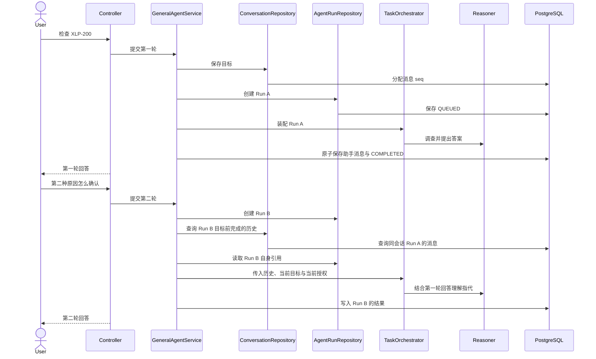
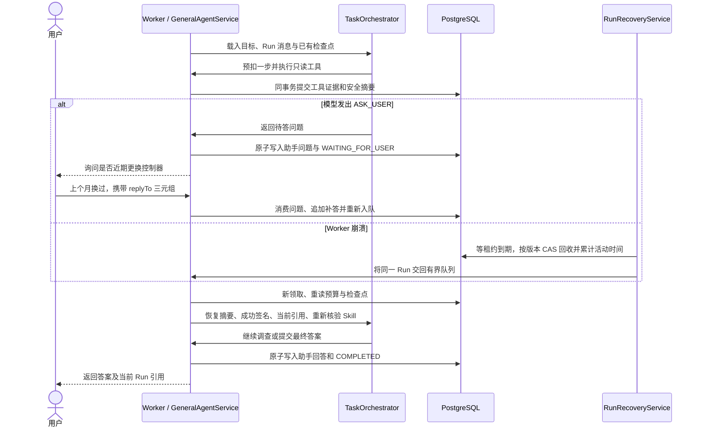

# DeviceTruth Agent Runtime 第二轮修复报告

## 1. 当前问题

R1 的工具白名单摘要、同引用 ID 原文扩展、有界窗口以及成功调用去重已在工作树中。其历史报告记载了离线、PostgreSQL 和一条 Qwen 路径的结果。R2 复核源码及离线用例，在线结论沿用 R1 的验收范围。

旧的 `runContextMessages` 只读本 Run 的目标、追问和补答。第二个 Run 看不到之前的回答，也就无法通过上下文定位“第二种原因”。原 V12/V13 支持租约、次数、状态和收尾时预算回写，但工具完成后的摘要、成功调用签名及未收尾步骤只保存在 Worker 内存。重建 Skill 时已有版本选择，最近读取的参考资料正文则随 Worker 丢失。原启动扫描还可能错过启动当时仍在租约有效期内的遗留 Run。

## 2. 修复方案与数据结构

- Conversation 按服务端 owner、project 和 conversation 查询历史。仅纳入最终助手消息序号早于新目标的 COMPLETED Run，其他并发 Run 即使后续完成也不会进入该目标的历史。先选最近 12 条，再分配最多 6,000 个 Unicode 码点，按 seq 升序装配，仅保留角色和正文。当前目标原文、运行内消息与历史分别传入推理器。
- 新 Run 从自身引用表取证。历史正文可帮助理解指代，引用与附件授权仍来自本 Run 的业务校验及显式 `contextRefs` 导入。
- Flyway V17 在 `dt_agent_run` 增加 `execution_checkpoint JSONB` 与 `active_accounted_at TIMESTAMPTZ`，在 `dt_run_skill` 增加可空 `active_reference_name`。旧行自然为空，仍可使用原预算、当前 Run 引用和已选 Skill。V1–V16 的迁移保持原样。回退代码时需考虑 Flyway 对已应用 V17 的校验，直接删除列会丢失新增恢复信息。
- 检查点 v1 含 `schemaVersion`、`runId`、已完成的 `step`、尝试过的工具名、成功调用 SHA-256 签名、最近的 R1 有界摘要、稳定反馈及拒绝计数。工具摘要最多 8 条，延用 R1 的单字段及累计长度限制。原始参数、模型提示、隐藏推理、原始工具响应和会话历史均不入检查点。引用从 `dt_evidence_reference` 读取，Skill 内容从磁盘重读并核验授权、版本和摘要。
- 模型调用前先在当前租约下预扣一步。工具的 PostgreSQL 引用或 Skill 写入与完成检查点同事务提交，保存时校验 owner/project、Worker、Run 版本、领取次数、有效租约及单调递增的已预扣步数。失败工具回滚其事务内写入，保留稳定错误反馈。关键持久化异常停止本执行段，在仍持有租约且数据库可写时落 `CHECKPOINT_PERSIST_FAILURE`；否则由租约回收处理。普通审计事件失败走日志，已提交的动作不会因此重做。
- 新 Worker 从累计步数及活动时间继续。有效检查点中的成功签名拦截再次提出的相同动作，失败调用仍可在预算内重试。崩溃后未结算时间保守计至租约到期，回收仍受尝试次数上限约束。租约过期后旧 Worker 的迟到工具结果回滚，迟到模型无法写助手消息或覆盖状态。
- 工具已执行而事务尚未提交时，外部读取可能已经发生，数据库事务内的效果会回滚。恢复只会在模型再次提出该动作时有界重试，只读外部调用可能出现第二次。普通检查点无法承诺 Exactly-Once。检查点成功后、独立审计提交前若退出，可能少一条对应审计，已存在的事件序号和内容保持原样。

## 3. 两条完整运行链路

### A. 连续两轮普通对话

### B. ASK_USER 与崩溃恢复

## 4. 修改文件

| 文件 | 方法及行为变化 |
| --- | --- |
| `ConversationRepository.java` | 新增 `recentConversationHistory`，按目标序号、归属及最终助手消息筛选历史。原 Run 消息查询保留。 |
| `GeneralReasoner.java` | `Context` 新增 `conversationHistory`，保留旧构造入口和现有 Run 内消息辅助方法。 |
| `StructuredAgentReasoner.java` | 明确历史文字、当前任务与引用权限的模型输入用途。响应协议不变。 |
| `TaskOrchestrator.java` | `runAgent` 从持久状态重建局部变量，协调步数预扣、执行事务和安全检查点。保留旧调用入口和 legacy 循环。 |
| `AgentExecutionCheckpoint.java` | 新增版本化值对象，限制摘要体积，校验步骤与签名形态。 |
| `GeneralAgentService.java` | `doRun` 装配历史与检查点。Worker 关键写入显式区分租约丢失和审计失败。收尾扣除已累计时长，避免重复计算。 |
| `AgentRunRepository.java` | 新增检查点读取、预扣及条件写入，补强续租和收尾检查，按已提交模型审计累计用量。 |
| `RunRecoveryService.java` | 将过期租约扫描提取为现有服务入口，启动后继续扫描初次启动时未过期的遗留 Run。 |
| `SkillInstallationRepository.java` | `pinReference` 记录最近读取的资料名，保留版本授权和每篇资料的摘要校验。 |
| `SkillRuntime.java` | 从 PG 读回资料名，在呈现给模型前重载并验证文件，版本被修改则按稳定错误码结束。 |
| `KnowledgeSearchService.java` | 将已授权扩展片段保留在当前 Run 的原有引用记录。 |
| `KnowledgeTools.java` | `excerptOutcome` 保存有界摘录，维持原引用 ID、来源与定位。 |
| `V17__agent_execution_checkpoint.sql` | 三列均为加法迁移，旧记录兼容。 |
| `RunRecoveryTest.java` | 观察推理器实际收到的历史、摘要、预算和引用，统计工具执行，断言数据库中的检查点、状态与游标。 |
| `GeneralAgentFlowTest.java` | 附件续接用例按已取得的结果选择下一份附件检索，验证两份附件及引用都保留。 |
| `SkillRuntimeIntegrationTest.java` | 验证 Skill 原文恢复与同版本资料被修改后提前拒绝。 |
| `AgentStreamTest.java` | 断线重连按游标补读新增答案，并验证补答没有重放已完成的检索。 |
| `CURRENT_PROJECT_STATUS.md` | 增加本轮修复和 R1/R2 报告索引。 |

## 5. 验收记录

环境为 Maven 3.9.9、JDK 21、真实 PostgreSQL 16.15 + pgvector 临时容器。测试按用例使用 scripted、确定性 embedding 或本地协议替身。首次使用历史报告的默认凭据连接现有实例遭拒，随后改用新容器，原实例认证配置未调整。首次集成启动暴露 V16 版本号冲突，改为 V17 后迁移通过。

执行 `mvn -q test`，使用临时真实 PG，51 个测试类共 381 项，380 通过、0 失败、0 错误、1 跳过。跳过项是 `SkillRegistryTest` 的符号链接用例，当前 Windows 执行环境无法创建符号链接。前端执行 `npm run test -- --run` 和 `npm run build`，36 项全部通过，类型检查与构建通过。产品前端的五类状态标签在 `App.vue` 中继续由原状态枚举映射。新增代码未改变事件公开允许列表。

普通打包目标遇到原 JAR 文件锁。使用仅替换 Maven 构建目录的临时 POM 执行 `mvn -q -f pom.r2-verification.xml -DskipTests package`，成功输出到 `target/r2-package`。将原 `scripts/verify_cli.py` 的 JAR 路径指向该产物后运行，帮助、A–D 场景持久报告、无效参数、两类密钥缺失及本机 HTTP 配置契约均通过。

| ID | 测试类与方法 | 结果及直接断言 |
| --- | --- | --- |
| R2-T01 | `RunRecoveryTest.nextRunReadsOnlyCompletedHistoryAndDoesNotImportOldReferences` | PASS。第二轮模型收到上一轮目标和“第二种可能”回答，未完成 Run 被排除。 |
| R2-T02 | 同上 | PASS。新会话历史为空。 |
| R2-T03 | 同上；`RunRecoveryTest.staleVersionAndCrossIdentityRepliesAreRejectedAfterRestart` | PASS。分别拒绝跨 owner 和跨 project 历史、检查点及补答。 |
| R2-T04 | `RunRecoveryTest.historyIsBoundedByMessageCountAndCodePoints` | PASS。最近 12 条、累计 6,000 码点。 |
| R2-T05 | `RunRecoveryTest.nextRunReadsOnlyCompletedHistoryAndDoesNotImportOldReferences` | PASS。当前目标只出现于本 Run 的消息序列，历史按序独立装配。 |
| R2-T06 | 同上；`RunRecoveryTest.fabricatedCitationAfterRestartIsStillRejected` | PASS。上轮引用不进入当前上下文，伪造引用无法产出答案。 |
| R2-T07 | `RunRecoveryTest.waitingRunSurvivesProcessRestartAndContinuesOnSameRun`；`SkillRuntimeIntegrationTest` | PASS。新 Worker 收到原始目标、追问、回复、引用、摘要、工具记录和累计预算，Skill 资料重新加载，失效授权或内容摘要变化会中止。 |
| R2-T08 | `RunRecoveryTest.concurrentRepliesAdvanceTheQuestionOnlyOnce`、`staleVersionAndCrossIdentityRepliesAreRejectedAfterRestart` | PASS。只有一个并发补答成功，旧版本拒绝。 |
| R2-T09 | `RunRecoveryTest.crashAfterToolCheckpointResumesWithoutDuplicatingReferencesOrMessages` | PASS。检查 PG 中的签名及摘要，与新 Worker 的上下文一致。 |
| R2-T10 | 同上 | PASS。相同检索再次提议时，真实工具处理器调用次数仍为 1。 |
| R2-T11 | `RunRecoveryTest.expiredWorkerRollsBackToolWritesBeforeCheckpointAndNewWorkerCanRetry` | PASS。提交前的引用对新 Worker 不可见；实际只读调用两次，只有新执行的检查点与一次成功工具审计提交。 |
| R2-T12 | 同上；`RunRecoveryTest.concurrentReconciliationReclaimsCrashedRunOnlyOnce` | PASS。失效领取不能覆盖新状态；并发回收只接手一次。 |
| R2-T13 | `RunRecoveryTest.expiredWorkerRollsBackToolWritesBeforeCheckpointAndNewWorkerCanRetry`、`crashedRunBeyondRecoveryLimitFailsExplicitlyInsteadOfStayingRunning`；`AgentLifecycleTest.stepBudgetExhaustionFailsRunWithStableCodeAndNoAnswer`、`resumedRunWithExhaustedActiveDurationBudgetFailsInsteadOfContinuing` | PASS。崩溃前预扣的步数、累计活动时间及领取次数保留，超限退出。 |
| R2-T14 | `RunRecoveryTest.waitingRunSurvivesProcessRestartAndContinuesOnSameRun` | PASS。重新对账后助手消息总数和唯一 RUN_ANSWER 不变。 |
| R2-T15 | `AgentStreamTest.reconnectWithLastEventIdBackfillsMissedEventsInOrderExactlyOnce`、`recoveryPreservesPreviouslyDeliveredCursorAndStampsStepsPerAttempt` | PASS。断线按 seq 补读，既有工具事件不会重复发布为新执行。 |
| R2-T16 | `AgentToolFeedbackTest` 的工具反馈、`documentExcerptEnrichesReferenceKeepingIdentity`、`identicalSuccessfulCallIsIntercepted`、`oversizedToolResultsAreBounded` 等 | PASS。18 项，覆盖白名单、扩展身份、失败与去重、长度限制。 |

跨 Java 进程恢复 PASS。使用隔离产物、真实 PG 和本机 OpenAI 兼容 HTTP 替身执行 `python outputs/r2-restart-probe.py`（执行后归档至 `target/r2-restart-probe.py`）。第一进程在工具检查点提交后、下一次模型请求阻塞时被强制终止。第二进程恢复摘要及已用两步，拦截重复检索并进入等待。第三进程读到原问题，补答后继续为同一个 Run 写入唯一答案。事件 1–10 连续，含一次成功工具、一次重复拦截、一次恢复和一次答案。验证日志位于 `outputs/r2-restart.log`。外部 LLM、真实设备现场、五种状态的浏览器端人工观察均为 NOT_RUN。

## 6. R1 兼容性和遗留验证

恢复复用 R1 白名单摘要和参数规范化。RAG 扩展重新读出同一条已授权引用的有界摘录。工具和审计事件协议维持既有枚举，重复提议可留下 `DUPLICATE_CALL` 审计，实际工具处理器不会执行第二次。旧数据库行没有工具检查点时，从已有授权记录继续，新工具才建立检查点。外部真实模型的跨轮表现与真实设备资料留作独立验收。
